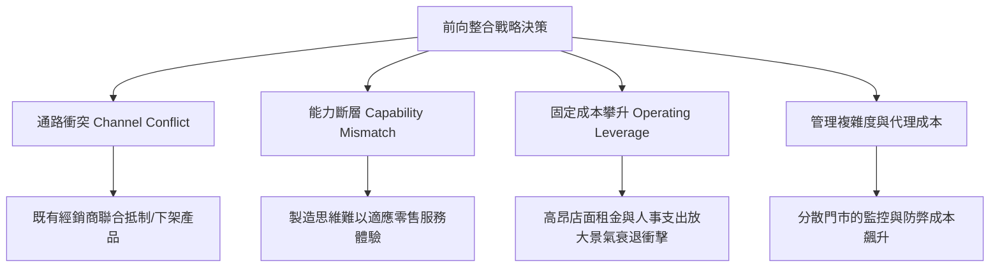

---
{"dg-publish":true,"permalink":"/98/forward-integration/","tags":["商業概念","垂直整合","價值鏈","企業邊界","通路策略","PMBA"],"dg-note-properties":{"aliases":["前向整合","Forward Integration","下游整合","通路整合","垂直前向整合"],"tags":["商業概念","垂直整合","價值鏈","企業邊界","通路策略","PMBA"]}}
---


# 前向整合 (Forward Integration & Downstream Channel Mastery)

> **【核心決策摘要】**
> **前向整合（Forward Integration）** 是指企業沿著[[98_商業概念庫/Firm_Value_Chain_企業價值鏈\|企業價值鏈]]向產品或服務的**下游終端消費者與通路端延伸組織邊界**的戰略行為。製造商或上游供應商透過自建或收購分銷體系、直營旗艦店（D2C Stores）、電商平台或售後服務網路，直接掌握終端市場接觸點。前向整合的核心經濟學動機在於**消除雙重邊際化（Double Marginalization）**、保障品牌溢價、獲取一手市場需求反饋數據；然而其潛在威脅包含引發劇烈**通路衝突（Channel Conflict）**、承擔高額門市固定成本與零售營運能力缺口。

---

## 1. 概念核心定義與戰略定位 (Executive Definition & Strategic Positioning)

### 1.1 核心定義
在產業組織經濟學與戰略管理中，前向整合嚴格定義為：**企業將價值創造活動的重心向下游（Downstream）位移，將原本由獨立分銷商（Wholesalers）、代理商（Agents）或零售商（Retailers）執行的銷售、履約、客戶服務與數據資產管理，內部化（Internalize）納入企業治理範疇之過程**。

```
                    ┌─────────────────────────────────────────────────────────┐
                    │               產業垂直價值鏈流動圖譜                    │
                    └────────────────────────────┬────────────────────────────┘
                                                 ▼
        ┌───────────────────┐        ┌───────────────────┐        ┌───────────────────┐
        │  上游：原物料/零組件  │ ──────▶ │   中游：核心製造商   │ ──────▶ │  下游：分銷/零售/客戶  │
        └───────────────────┘        └─────────┬─────────┘        └───────────────────┘
                                               │
                                               │ === 前向整合 (Forward Integration) ===>
                                               ▼
                                   ┌───────────────────────┐
                                   │ 自建 D2C 實體旗艦門市   │
                                   │ 自營官方電商與 App 閉環 │
                                   │ 自有物流履約與售後維修 │
                                   └───────────────────────┘
```

### 1.2 前向整合的兩大實踐途徑
1. **內部有機生長（Organic Development）**：企業自行投資設立零售展示中心、打造專屬直營電商或開發訂閱制服務平台（如 Apple 設立 Apple Store、Tesla 堅持直營門市）。
2. **外部非有機併購（M&A Forward Integration）**：透過收購既有下游連鎖通路或重要代理商直接取得市場控制權（如 Luxottica 收購 LensCrafters 與 Sunglass Hut）。

---

## 2. 經濟學基石：雙重邊際化消除模型 (Economic Foundation: Double Marginalization)

### 2.1 雙重邊際化現象（Spengler, 1950）
當上游製造商與下游零售商各自擁有局部市場壟斷力量（Market Power）且獨立追求自身利潤極大化時，上游廠商會在邊際成本上疊加利潤（Mark-up 1），下游廠商又在批發價基礎上再度疊加利潤（Mark-up 2）。這導致終端產品售價過高、總產量縮減，產生嚴重的市場無謂損失（Deadweight Loss），並使整個產業鏈的合併利潤低於整合企業。

### 2.2 數學模型推導與利潤比較
假設市場反需求函數為線性：
$$P(Q) = a - bQ$$

上游製造商生產邊際成本為常數 $c$，無固定成本。

#### 情況 A：未整合體系（Decentralized Supply Chain）
1. **下游零售商利潤極大化**：
   零售商面臨批發價 $w$，利潤函數為：
   $$\pi_R(Q) = (P(Q) - w)Q = (a - bQ - w)Q$$
   一階導數條件（FOC）求最佳訂購量：
   $$\frac{d\pi_R}{dQ} = a - 2bQ - w = 0 \implies Q(w) = \frac{a - w}{2b}$$

2. **上游製造商定價決策**：
   製造商預知零售商的反應函數 $Q(w)$，其利潤函數為：
   $$\pi_M(w) = (w - c)Q(w) = (w - c)\frac{a - w}{2b}$$
   一階導數條件（FOC）求最佳批發價：
   $$\frac{d\pi_M}{dw} = \frac{a - 2w + c}{2b} = 0 \implies w^* = \frac{a + c}{2}$$

3. **市場均衡解**：
   - 均衡產量：$$Q_{Decentralized}^* = \frac{a - c}{4b}$$
   - 終端售價：$$P_{Decentralized}^* = a - b\left(\frac{a-c}{4b}\right) = \frac{3a + c}{4}$$
   - 產業鏈總利潤：$$\Pi_{Total}^{Decentralized} = \pi_M^* + \pi_R^* = \frac{(a-c)^2}{8b} + \frac{(a-c)^2}{16b} = \frac{3(a-c)^2}{16b}$$

#### 情況 B：前向整合體系（Forward Integrated Firm）
製造商直接向消費者銷售，消除中間批發價 $w$，以邊際成本 $c$ 統一定價：
$$\max_Q \Pi_{Integrated}(Q) = (P(Q) - c)Q = (a - bQ - c)Q$$
一階導數條件求最佳銷量：
$$\frac{d\Pi}{dQ} = a - 2bQ - c = 0 \implies Q_{Integrated}^* = \frac{a - c}{2b}$$
終端售價與整合利潤：
$$P_{Integrated}^* = \frac{a + c}{2}$$
$$\Pi_{Integrated}^* = \frac{(a-c)^2}{4b}$$

```
┌─────────────────────────────────────────────────────────────────────────────┐
│                       雙重邊際化前後對照成果表                              │
├──────────────────────┬───────────────────────┬──────────────────────────────┤
│ 指標                 │ 未整合分散鏈          │ 前向整合一體化體系           │
├──────────────────────┼───────────────────────┼──────────────────────────────┤
│ 終端市場售價 ($P^*$) │ $\frac{3a+c}{4}$ (高)  │ $\frac{2a+2c}{4} = \frac{a+c}{2}$ (低 $\downarrow$) │
│ 終端市場銷量 ($Q^*$) │ $\frac{a-c}{4b}$ (少)  │ $\frac{a-c}{2b}$ (翻倍 $\uparrow 100\%$)     │
│ 產業總體利潤 ($\Pi$) │ $\frac{3(a-c)^2}{16b}$ │ $\frac{4(a-c)^2}{16b}$ (提升 $\uparrow 33.3\%$) │
│ 消費者剩餘 (CS)      │ 嚴重受損              │ 大幅擴大 (售價下降、銷量擴張)│
└──────────────────────┴───────────────────────┴──────────────────────────────┘
```

> **PMBA 決策洞見**：前向整合打破了各自為政的雙重加價困局，**使消費者享受更低價格、企業獲取更高利潤**，同時消弭了無謂損失，達成帕累托改進（Pareto Improvement）。

---

## 3. 戰略驅動力與管理綜效 (Strategic Drivers & Management Benefits)

### 3.1 掌控終端客戶體驗與品牌資產保護
在第三方經銷通路中，零售商往往將產品與競品陳列於同一貨架，並基於佣金高低進行推銷，削弱製造商的[[brand-equity_品牌權益|品牌溢價]]。前向整合使企業能夠建立 100% 契合品牌價值主張的體驗空間。

### 3.2 第一方數據閉環與敏捷反應 (Data Feedback Loop)
傳統經銷模式下，零售商壟斷 POS 銷售數據，製造商面臨嚴重的**長鞭效應（Bullwhip Effect）**。透過直營體系，企業可秒級掌握：
- 顧客偏好與試穿/試用流失率
- 價格彈性與促銷敏感度
- 庫存周轉與區域補貨即時信號

### 3.3 提升轉換成本與客戶終身價值
藉由自營服務、官方維修與會員訂閱體系，將單純的「硬體產品銷售」轉型為「持續性服務生態系」，顯著拉高客戶的[[switching-costs_轉換成本|轉換成本]]與[[clv-customer-lifetime-value_顧客終身價值|顧客終身價值（CLV）]]。

---

## 4. 前向整合的潛在陷阱與治理風險 (Risks, Pitfalls & Governance)



1. **破壞性通路衝突（Channel Cannibalization & Revolt）**：
   當製造商開設直營店或官方電商時，既有經銷商會感到被背叛，可能採取減量採購、轉移主推競品甚至聯合抵制下架的報復行動。
2. **基因錯配與零售運營能耐缺失**：
   製造業的核心競爭力在於供應鏈良率、生產規模與研發（B2B）；而零售業的核心能耐在於選址、店面動線設計、前線員工話術培訓與客訴處理（B2C），兩者組織文化迥異。
3. **營運槓桿（DOL）急遽放大**：
   直營門市伴隨長期租約、門市裝潢折舊與固定人事開銷，將拉高損益平衡點。當景氣下滑時，龐大的固定支出將對營業利益造成嚴重侵蝕。

---

## 5. 跨產業標竿案例深度剖析 (Benchmark Case Studies)

### 5.1 典範案例：Apple 直營零售帝國 (Apple Store)
- **背景挑戰**：2000 年代初期，蘋果電腦在 CompUSA、Best Buy 等傳統 3C 賣場中被置於昏暗角落，店員缺乏熱情與產品知識，品牌形象受損。
- **前向整合戰略**：賈伯斯（Steve Jobs）力排眾議，延攬零售專家打造 Apple Store。
- **關鍵成效**：
  - 創造全球零售業史上最高的**每平方英尺銷售額（坪效）**。
  - 打造「Genius Bar」天才吧，將技術支援轉化為信任建立與口碑傳播引擎。
  - 全球直營店成為新品發布狂歡、生態系體驗與高毛利硬體銷售的超級護城河。

### 5.2 顛覆案例：Tesla 汽車直銷革命
- **背景挑戰**：美國各州法律長期保護汽車特許經銷商（Franchised Dealers），經銷商主要利潤來自傳統燃油車的昂貴零件更換與售後維修，缺乏推廣純電動車（EV）的動力。
- **前向整合戰略**：特斯拉全面拒絕特許經銷制，堅持 100% 直營門市與官網訂車、透明統一價格。
- **關鍵成效**：消除了經銷商中間加價，確保軟體付費升級（FSD）利潤 100% 歸於特斯拉，並建立端到端的充電網路（Supercharger Network）服務閉環。

### 5.3 壟斷案例：Luxottica 眼鏡帝國的通路包夾
- **戰略佈局**：義大利眼鏡巨頭 Luxottica 在掌握 Ray-Ban、Oakley 等品牌製造權後，積極啟動前向整合，先後收購全球最大眼鏡連鎖店 LensCrafters、Sunglass Hut、Pearle Vision 及 Target Optical 通路。
- **綜效兌現**：完全控制眼鏡零售門市的貨架空間與終端售價，實現高達 70%~80% 的驚人毛利率，展現了前向整合消滅雙重邊際化並兼具市場力量的極致表現。

---

## 6. 高階決策檢核表：前向整合可行性評估 (Executive Decision Framework)

高階經營團隊在拍板前向整合前，必須嚴格自問以下五大核心問題：

| 評估維度 | 核心檢驗問題 | 綠燈信號 (適合前向整合) | 紅燈警訊 (宜維持現狀或外包) |
| :--- | :--- | :--- | :--- |
| **1. 雙重邊際效應** | 既有零售商是否擁有高度壟斷力並大幅加價？ | 通路加價率極高，壓抑終端市場需求潛力 | 零售通路充分競爭，通路利潤微薄 |
| **2. 通路專用性** | 產品是否需要高度專業解說、體驗與客製服務？ | 外部通路無法傳遞核心價值，顧客流失率高 | 產品標準化、大宗化（Commodity），隨處可買 |
| **3. 通路衝突反彈** | 既有經銷通路是否佔據公司過半營收且具備替代品？ | 品牌具備不可替代性（Must-have），經銷商不敢棄單 | 經銷商掌握命脈，若抵制將引發營收斷崖 |
| **4. 資本回報與能力** | 內部是否具備零售管理、數位行銷與庫存敏捷調度能耐？ | 團隊具備 B2C 基因，或透過併購取得現成專業團隊 | 純研發/工廠製造基因，無面對終端客戶經驗 |
| **5. 資訊價值溢價** | 即時取得終端使用數據是否對產品迭代至關重要？ | 數據能直接轉化為演算法或新產品研發優勢 | 傳統週期品，消費端數據對上游研發無顯著價值 |

---

## 7. 關聯概念與延伸閱讀 (Cross References)

- [[backward-integration_後向整合]]：企業向價值鏈上游的原物料與研發端延伸邊界。
- [[vertical-merger-acquisition_垂直併購]]：透過外部 M&A 手段達成上下游整合的合規與反壟斷考量。
- [[TCE_Transaction_Cost_Economics_交易成本理論]]：資產專屬性與市場交易成本如何決定自製、外購或自建通路。
- [[merger-acquisition-integration_併購後整合]]：前向收購零售通路後的文化與組織協同挑戰。
- [[Firm_Value_Chain_企業價值鏈]]：麥可·波特價值鏈中下游後勤、行銷與銷售活動的戰略配置。
- [[switching-costs_轉換成本]]：透過直營服務體系鎖定客戶價值的機制。
- [[home]]：PMBA 知識庫首頁與模組導航。