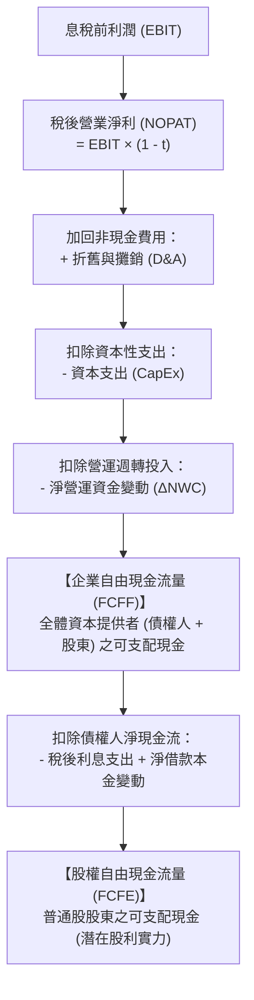

---
{"dg-publish":true,"permalink":"/98/free-cash-flow/","tags":["商業概念","財務管理","現金流量","企業評價","PMBA"],"dg-note-properties":{"aliases":["自由現金流量","Free Cash Flow","FCF","自由現金流"],"tags":["商業概念","財務管理","現金流量","企業評價","PMBA"]}}
---

# 自由現金流量 (Free Cash Flow, FCF)

## 一、 核心定義與商業本質

### 1. 核心定義
- **自由現金流量（Free Cash Flow, FCF）** 是指企業在日常營運產生的現金流入中，扣除維持現有營運生產力以及支援未來成長所需之「必要[[98_商業概念庫/capital-expenditure_資本支出\|資本支出]]（CapEx）」與「[[98_商業概念庫/net-working-capital_淨營運資金\|net-working-capital_淨營運資金]]追加（$\Delta\text{NWC}$）」後，**可以完全自由分配給資本提供者（全體股東與債權人）的剩餘現金**。
- 這筆現金在不影響企業正常運作與可持續成長的前提下，企業管理層可自由決定用於：發放現金股利、買回庫藏股、清償銀行借款本息、進行策略性併購（M&A），或作為戰略儲備金留在帳上。

### 2. 商業本質與底層邏輯
- **獲利不等於現金（盈利品質的試金石）**：
  - 依據[[98_商業概念庫/accrual-accounting_權責發生制\|權責發生制]]編製的[[98_商業概念庫/income-statement_損益表\|income-statement_損益表]]中，帳面淨利（Net Income）極易受到收入認列時點、折舊年限攤提與存貨計價等人為會計政策的調節；
  - 帳面獲利再高，若充斥著未收現的[[98_商業概念庫/receivable_應收帳款\|應收帳款]]或滯銷的[[98_商業概念庫/inventory_存貨\|存貨]]，企業仍會面臨資金鏈斷裂的[[98_商業概念庫/insolvency-with-profit_黑字倒閉\|insolvency-with-profit_黑字倒閉]]風險。**自由現金流量是檢驗企業真實造血能力的硬通貨**。
- **企業內在價值的唯一真實源泉**：
  - 在現代金融評價體系（如[[98_商業概念庫/dcf_現金流量折現法\|現金流量折現法 DCF]]）中，企業的實質內在價值絕非取決於短期每股盈餘（EPS）或本益比（P/E）倍數，而是等於其未來全生命週期所能創造的自由現金流量之折現值總和。

---

## 二、 核心計算公式與推導體系

在財務分析與企業評價實務中，自由現金流量依據評估視角分為兩大核心口徑：

---

### 1. 通用會計簡算法（經理人速算口徑）
適用於快速審視財報現金流量表現：
$$\text{FCF} = \text{營業活動現金流量 (CFO)} - \text{資本支出 (CapEx)}$$

- **[[98_商業概念庫/operating-cash-flow-statement_營業活動現金流量\|營業活動現金流 (CFO)]]**：本業實際創造的淨現金流入。
- **[[98_商業概念庫/capital-expenditure_資本支出\|資本支出 (CapEx)]]**：購買不動產、廠房及設備（PPE）與無形資產的現金流出（通常來自投資活動現金流量 CFI 中的購置資產項）。

---

### 2. 企業自由現金流量（FCFF, Free Cash Flow to Firm）
衡量企業**全體資本提供者（債權人＋普通股東）**可享有的自由現金總額，不受企業資本結構（舉債比例高低）的干擾：

$$\begin{aligned}
\text{FCFF} &= \text{EBIT} \times (1 - t) + \text{折舊與攤銷 (D\&A)} - \text{資本支出 (CapEx)} - \Delta\text{淨營運資金 (NWC)} \\
&= \text{NOPAT} + \text{D\&A} - \text{CapEx} - \Delta\text{NWC}
\end{aligned}$$

亦可從營業現金流（CFO）出發反推調整：
$$\text{FCFF} = \text{CFO} + \text{稅後利息費用} - \text{CapEx}$$

#### 關鍵推導變數解析：
| 變數符號 | 完整財務名稱 | 計算公式 / 定義 | 財務與決策意涵 |
| :--- | :--- | :--- | :--- |
| **NOPAT** | 稅後營業淨利 | $\text{EBIT} \times (1 - t)$ | 假設企業無任何負債時的純營業利潤（排除融資結構影響）。 |
| **D&A** | 折舊與攤銷 | 損益表中的非現金成本 | 雖屬營業費用但並未實際流出現金，且能創造[[98_商業概念庫/depreciation-tax-shield_折舊稅盾\|depreciation-tax-shield_折舊稅盾]]效益，故需全額加回。 |
| **CapEx** | 資本支出 | 期末固定資產 $-$ 期初固定資產 $+$ 當期折舊 | 企業維持現有產能與構築競爭護城河所必需投入的固定資本。 |
| **$\Delta\text{NWC}$** | [[98_商業概念庫/changes-in-net-working-capital_淨營運資金變動\|changes-in-net-working-capital_淨營運資金變動]] | 期末 NWC $-$ 期初 NWC | 產銷規模擴張時被應收帳款與存貨積壓的現金（若為正代表資金被咬住，為現金流扣項）。 |

---

### 3. 股權自由現金流量（FCFE, Free Cash Flow to Equity）
衡量在償還債權人本息並扣除所有營運與資本再投資需求後，**僅歸屬於普通股股東**的可自由支配現金（衡量企業潛在配息能力的終極指標）：

$$\text{FCFE} = \text{FCFF} - \text{利息支出} \times (1 - t) + \text{淨借款本金變動 (新增舉債 - 償還本金)}$$

亦可直接從損益表底部的稅後淨利（Net Income, NI）推導：
$$\text{FCFE} = \text{稅後淨利 (NI)} + \text{D\&A} - \text{CapEx} - \Delta\text{NWC} + \text{淨借款本金變動}$$

---

## 三、 金融評價與折現率匹配原則（黃金法則）

在運用[[98_商業概念庫/dcf_現金流量折現法\|現金流量折現法 (DCF)]]進行企業估值時，現金流量的口徑必須與折現率保持嚴格的**對稱匹配**：

| 評價視角 | 採用的現金流度量 | 對應的折現率 | 折現得出之價值結論 | 股權價值求算公式 |
| :--- | :---: | :---: | :--- | :--- |
| **企業整體價值法 (Entity / Firm Approach)** | **FCFF** | **[[98_商業概念庫/wacc_加權平均資本成本\|加權平均資本成本 (WACC)]]** | **企業整體價值 (Enterprise Value, EV)** | $\text{股權價值} = \text{EV} - \text{淨負債} - \text{少數股權}$ |
| **股權價值直接法 (Equity Approach)** | **FCFE** | **[[98_商業概念庫/capm_資本資產定價模型\|股權資本成本 ($K_e$)]]** | **股權價值 (Equity Value)** | 直接除以流通股數即得**每股合理內在價值** |

---

## 四、 產業意涵與經理人策略判讀

### 1. 「負自由現金流」的二元策略判讀：成長擴張 vs. 本業失血
經理人與投資人絕不可單憑 FCF 為正或為負就草率判定企業優劣，必須結合企業所處之生命週期綜合研判：
- **「健康的負 FCF」（主動性資本開支）**：
  - 處於高速擴張期的成長型新創或半導體龍頭（如台積電積極投入 2 奈米先進製程擴產、早期 Amazon 擴建 AWS 伺服器中心）。
  - 特徵：營業活動現金流（CFO）充沛且逐年成長，但管理層將現金大舉投入高回報率的成長型 CapEx。這類負 FCF 是構築未來長期護城河的必經之路。
- **「危險的負 FCF」（被動性營運失血）**：
  - 特徵：CFO 本身即為負值（本業產銷無法賺回現金），全靠外部借貸或增資維持日常運作。一旦資本市場流動性緊縮，極易爆發財務危機。

### 2. 警惕經理人短視「人為粉飾 FCF」的治理紅線
部分經理人為了達成當期 KPI 或推升短期股價，常利用以下財務手段虛增短期 FCF，實質上卻摧毀了企業的長期價值：
1. **惡意砍停維護型資本支出（CapEx Starvation）**：
   - 凍結老舊機台汰換、設備定檢或核心 IT 系統升級。當期 FCF 帳面瞬間大增，但隨之而來的是機台稼動率崩跌、良率滑落與安全事故，大幅透支企業未來的營運壽命。
2. **惡意壓榨供應鏈帳期（延遲應付帳款 AP）**：
   - 透過延長供應商付款天數壓低淨營運資金（讓 $\Delta\text{NWC}$ 轉負以增加現金流入）。這種做法雖能在期末擠出現金，但會嚴重摧毀供應鏈互信，導致優質供應商停止供料或要求加計融資利息。

### 3. 極致現金管理槓桿：「負營運資金」對 FCF 的倍增效應
- 卓越的供應鏈巨頭（如 Costco、Dell、統一超商）憑藉強大的通路與產品話語權，達成「先收客戶現款、大幅延遲付給供應商」，創造負的現金轉換週期（CCC < 0）。
- 在業務高速擴張時，其營運資金變動（$\Delta\text{NWC}$）不僅不是資金的消耗，反而成為企業源源不絕的無息免稅浮存金（Float），推升自由現金流遠超帳面獲利水準。

---

## 五、 關聯主題與模組筆記

### 核心必修與財務模組
* [[02_核心必修/01_財務管理/L03_基本財務報表與分析II_現金流量評價\|L03 核心必修：現金流量評價]]
* [[02_核心必修/01_財務管理/L04_資本支出預算(或投資)決策_合併與收購\|L04 核心必修：資本支出預算與併購決策]]
* [[02_核心必修/01_財務管理/L10_股利政策\|L10 核心必修：股利政策與自由現金流分配]]
* [[01_基礎先修/01_財務報表分析/Ch04_認識現金流量表\|財務報表分析：Ch04 認識現金流量表]]

### 商業概念庫關聯卡片
* [[98_商業概念庫/enterprise-free-cash-flow-liang_企業自由現金流量\|enterprise-free-cash-flow-liang_企業自由現金流量]]
* [[98_商業概念庫/equity-free-cash-flow_股權自由現金流量\|equity-free-cash-flow_股權自由現金流量]]
* [[98_商業概念庫/operating-cash-flow-statement_營業活動現金流量\|operating-cash-flow-statement_營業活動現金流量]]
* [[98_商業概念庫/capital-expenditure_資本支出\|capital-expenditure_資本支出]]
* [[98_商業概念庫/net-working-capital_淨營運資金\|net-working-capital_淨營運資金]]
* [[98_商業概念庫/changes-in-net-working-capital_淨營運資金變動\|changes-in-net-working-capital_淨營運資金變動]]
* [[98_商業概念庫/depreciation-tax-shield_折舊稅盾\|depreciation-tax-shield_折舊稅盾]]
* [[98_商業概念庫/dcf_現金流量折現法\|dcf_現金流量折現法]]
* [[98_商業概念庫/wacc_加權平均資本成本\|wacc_加權平均資本成本]]
* [[98_商業概念庫/capm_資本資產定價模型\|capm_資本資產定價模型]]
* [[98_商業概念庫/cycle_淨營業循環週期\|cycle_淨營業循環週期]]
* [[98_商業概念庫/insolvency-with-profit_黑字倒閉\|insolvency-with-profit_黑字倒閉]]
* [[98_商業概念庫/_待改寫草稿庫/time-value-2_貨幣時間價值\|time-value-2_貨幣時間價值]]
