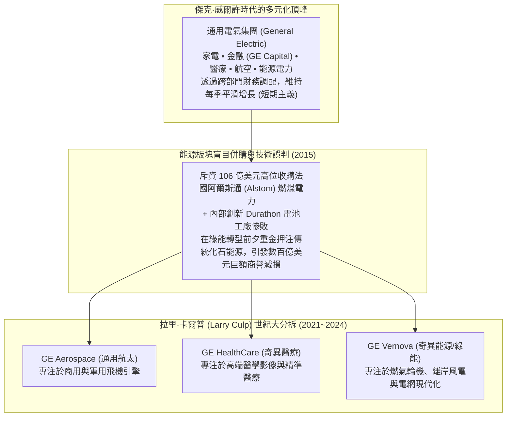

---
{"dg-publish":true,"permalink":"/98/ge-energy/","tags":["商業概念","能源轉型","企業重組","創新管理","PMBA"],"dg-note-properties":{"aliases":["奇異能源","GE Energy","GE Vernova","奇異電力","通用電氣能源"],"tags":["商業概念","能源轉型","企業重組","創新管理","PMBA"]}}
---


# 奇異能源 (GE Energy / GE Vernova)

> [!NOTE]
> **核心概念精粹**：奇異能源（GE Energy，現已分拆獨立為上市代碼 **GE Vernova**），是百年工業巨霸通用電氣（General Electric）歷史最悠久的核心支柱。它承載了自愛迪生創立以來的電氣化榮耀，全球超過 30% 的電力由其設備生產或輸送。然而，它也是企業多元化帝國衰落、內部創新盲動（如 Durathon 電池慘敗）與大企業病（Conglomerate Discount）的深刻反思標本。2024 年完成的**世紀大分拆**，標誌著傳統工業托拉斯走向「專注於全球能源轉型與電網現代化」之純業務實體（Pure-Play）的鳳凰涅槃。

---

## 一、 學理淵源：多元化帝國的盛極而衰與世紀大拆分

奇異在傑克·威爾許（Jack Welch）時代曾創下全球市值第一的巔峰，但進入 21 世紀後，龐大臃腫的多元化企業（Conglomerate）架構在資本市場遭遇嚴厲的「多元化折價」懲罰：



---

## 二、 奇異能源內部創新的慘痛教訓：Durathon 電池的閉門造車

在哈佛商學院與精實創業教學中，奇異能源耗資逾億美元的 **Durathon 電池專案**，被列為反面教材之首：

| 評估維度 | 奇異 Durathon 電池的傳統封閉研發失敗 | [[blue-river-technology_藍河科技|藍河科技]]等精實創業的最佳實踐 |
| :--- | :--- | :--- |
| **決策邏輯** | 內部科學家在實驗室攻克先進鈉金屬鹵化物電池技術，高管盲信「只要做出來，全世界都會買」。 | 「走出大樓（Get Out of the Building）」，在動工前深度訪談上百位目標客戶，反覆驗證真實痛點。 |
| **資本投入節奏** | 在尚未獲得真實付費訂單之前，直接斥資 **1.7 億美元** 在紐約興建巨型全自動化先進電池工廠。 | 以極低成本打造最小可行產品（MVP），以極小代價在真實田間進行假設檢定（RAT）。 |
| **市場需求真相** | 設想的電信基地台與電網儲能客戶，實際更偏好成熟低價的鉛酸電池或快速降價的鋰電池；訂單慘淡。 | 根據客戶即時反饋每週敏捷軸轉（Pivot），直到達到真實的產品市場適配（PMF）。 |
| **最終代價** | 工廠開工率長期不足 20%，奇異最終被迫**全盤關閉工廠、裁員數百人並提列數億美元全額資產減損**。 | 以 3.05 億美元被龍頭收購，技術全面商用普及，創造數百倍資本回報。 |

---

## 三、 經典企業實戰案例：阿爾斯通併購之痛 vs GE Vernova 獨立重生

```carousel

<!-- slide -->
### 1. 2015 年阿爾斯通（Alstom）收購慘劇
- **戰略錯判**：2015 年時任 CEO 傑夫·伊梅特（Jeff Immelt）斥資 106 億美元收購法國阿爾斯通電力業務，創下奇異歷史上最大規模工業併購；
- **時代逆流**：收購完成之際，全球能源格局劇變——風能與太陽能發電成本斷崖式暴跌，全球各國相繼宣布退煤政策，傳統燃煤發電機組訂單腰斬；
- **巨額放血**：奇異電力部門營收暴跌、現金流斷裂，被迫在 2018 年一次性提列高達 **220 億美元的商譽減損（Goodwill Impairment）**，重創集團百年根基，引發股價崩盤與連續更換 CEO。
<!-- slide -->
### 2. 拉里·卡爾普的「精益拆分」與 GE Vernova 獨立
- **外行破局**：2018 年丹納赫（Danaher）傳奇掌舵人拉里·卡爾普接任 GE 史上首位外來 CEO；
- **斷尾求生**：導入丹納赫精益管理系統（DBS），嚴格削減債務，並果斷宣布推行「世紀大分拆」；
- **2024 年獨立上市**：GE Vernova 正式在紐約證交所掛牌（代碼 GEV），手握 HA 級高效燃氣輪機與離岸風電核心技術，以健康的資產負債表直接對接全球資料中心 AI 算力暴增所引發的「海量電力渴求」，市值強勢回升。
```

---

## 四、 經理人重工業轉型與資本配置檢核表（Executive Decision Checklist）

在主導重型製造業轉型、綠能佈局或重大跨國併購時，高階管理團隊應依序審計：

- [ ] **技術趨勢與政策週期逆流檢驗（Energy Paradigm Shift）**：
  - 我們所進行的重資本併購（如化石能源資產），是否正處於全球監管法規與 ESG 淘汰的歷史拐點？我們是否高位接盤了即將變成「擱淺資產（Stranded Assets）」的過時產能？
- [ ] **精實新創 vs 巨型建廠紀律（The Durathon Trap Test）**：
  - 在投入數千萬美元興建大規模新技術產線之前，我們是否已經獲得了具備法律約束力的「商業預售合約」？我們是否用小規模代工試驗驗證了真實客戶需求？
- [ ] **多元化折價與專注解方（Pure-Play Focus Audit）**：
  - 本公司旗下的多元化業務，是否存在互相牽制、資源爭奪與管理層注意力分散的病態現象？推動業務分拆（Spin-off）能否讓各事業部以獨立治理結構釋放隱含價值？
- [ ] **電力基載與 AI 算力基礎設施適配（Grid Modernization Alignment）**：
  - 面對生成式 AI 與資料中心爆發帶來的電力缺口，我們的產品矩陣（燃氣發電、小型模組化核電 SMR、智慧電網調度）是否具備搶佔全球綠色基載電力的先發優勢？

---

## 五、 關聯概念與知識網絡

* 核心收購與創新案例：
  * [[blue-river-technology_藍河科技|藍河科技 (Blue River Technology)]]：精實創業對奇異 Durathon 閉門造車之經典對照
  * [[income-loss_停業部門損益|停業部門損益 (IFRS 5)]]：GE 世紀大分拆與業務剝離之會計報表重塑
  * [[goodwill_商譽|商譽 (Goodwill)]]：奇異阿爾斯通併購案引發 220 億美元巨額商譽減損之歷史慘劇
  * [[capital-budgeting_資本預算|資本預算 (Capital Budgeting)]]：重型電力裝備數十年週期之動態現金流折現
* 組織理論與戰略轉型：
  * [[great-company_好公司|好公司 (Great Company)]]：百年巨頭克服帝國建造官僚、斷尾求生之治理標本
  * [[short-term_短期主義|短期主義 (Short-Termism)]]：傑克·威爾許時代依靠金融財報平滑利潤所埋下之長期潰敗隱患
  * [[disruptive-innovation_破壞式創新|破壞式創新 (Disruptive Innovation)]]：再生能源發電成本暴跌對傳統發電裝備之結構性衝擊
  * [[system-2_開放系統|開放系統 (Open Systems)]]：奇異打破封閉官僚體制、引入外部精益負熵之浴火重生
