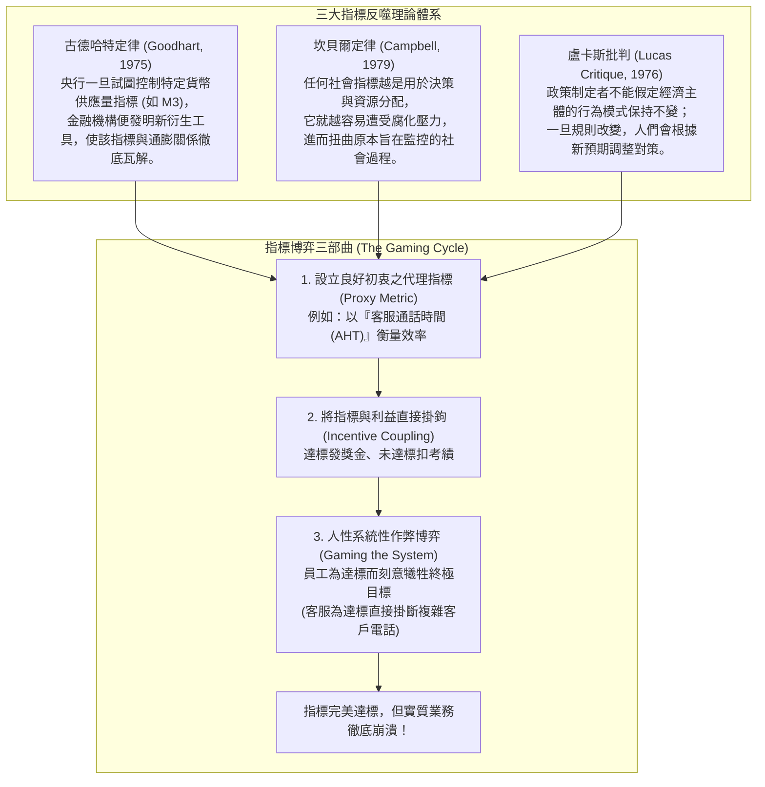

---
{"dg-publish":true,"permalink":"/98/goodharts-law/","tags":["商業概念","管理學","組織行為","決策科學","PMBA"],"dg-note-properties":{"aliases":["古德哈特定律","Goodhart's Law","坎貝爾定律","Campbell's Law","指標異化定律","績效考核反噬"],"tags":["商業概念","管理學","組織行為","決策科學","PMBA"]}}
---


# 古德哈特定律 (Goodhart's Law)

> [!NOTE]
> **核心概念精粹**：古德哈特定律（Goodhart's Law）是由英國經濟學家查爾斯·古德哈特（Charles Goodhart）於 1975 年提出的經典治理法則。瑪麗蓮·斯特拉森（Marilyn Strathern）將其精闢概括為：**「當一個指標變成目標時，它就不再是一個好指標（When a measure becomes a target, it ceases to be a good measure）」**。一旦某個統計量被選定為考核與獎懲的依據，人們便會開始鑽空子操縱該指標，徹底摧毀其原本所代表的實質價值。

---

## 一、 學理淵源：從貨幣政策到社會指標異化

古德哈特定律的發現源於總體經濟政策，但隨後在組織行為學、社會學與管理學中展現出驚人的普適性：



---

## 二、 商業管理中最常見的四大「指標博弈」災難矩陣

在企業推行[[key-performance-indicator-kpi_關鍵績效指標|KPI]]考核時，古德哈特定律幾乎無處不在：

| 考核維度 | 被設定為目標的代理指標 | 員工與組織的博弈操縱行為 | 最終導致的業務災難 |
| :--- | :--- | :--- | :--- |
| **軟體工程研發** | 工程師產出的**「代碼行數（LOC）」**或**「修復 Bug 數量」**。 | 刻意撰寫臃腫冗長的代碼；工程師私下故意製造簡單 Bug 再自行修復刷量。 | 代碼庫極度肥大難以維護，架構脆弱，技術債飆升。 |
| **客服與售後** | 平均通話處理時長（AHT，要求 3 分鐘內結束）。 | 遇到複雜、憤怒的客戶，客服在快到 3 分鐘時「故意掛斷電話」假裝信號中斷。 | 通話時長漂亮達標，但顧客滿意度（CSAT）與淨推薦值（NPS）崩盤。 |
| **業務與通路銷售** | 季度最後一週的**「出貨營收總額（Gross Sales）」**。 | 向下游經銷商提供不合理的高額折扣與退貨承諾，進行「通路塞貨（Channel Stuffing）」。 | 本季營收暴增，但次季面臨巨額退貨潮與應收帳款壞帳。 |
| **醫療與公共衛生** | 急診室病患候診等待時間（要求 4 小時內收治）。 | 醫院要求救護車將病患留在車內長達數小時，直到有病床才允許「正式打卡入院」。 | 醫院帳面等待時間歸零，但病患延誤治療導致死亡率上升。 |

---

## 三、 經典企業實戰案例：富國銀行世紀醜聞 vs 眼鏡蛇效應

```carousel

<!-- slide -->
### 1. 歷史寓言：英國殖民時期的「眼鏡蛇效應（Cobra Effect）」
- **政策初衷**：英國殖民政府為了解決德里市區劇毒眼鏡蛇氾濫問題，宣布「每上繳一條死眼鏡蛇，即可領取高額賞金」；
- **指標反噬**：當地居民發現抓野生蛇太危險，紛紛開始在自家庭院「大規模人工飼養眼鏡蛇」來領賞；
- **荒謬結局**：政府察覺後取消賞金，居民索性將毫無價值的數萬條眼鏡蛇全數釋放到野外，德里的毒蛇數量比政策推行前暴增數倍。
<!-- slide -->
### 2. 當代慘案：富國銀行（Wells Fargo）的「8 帳戶」瘋狂狂躁
- **高管目標**：前 CEO 約翰·斯坦普夫（John Stumpf）提出著名的交叉銷售口號「Going for Gr-Eight」，強制要求每位客戶必須開立 8 個富國銀行金融產品；
- **制度暴力**：分行行員每天面臨嚴酷的每小時考核監控，未達指標者直接被當眾羞辱或開除；
- **黑化博弈**：為保住飯碗，基層員工開始利用客戶個資，在客戶完全不知情的情況下私自偽造了超過 **350 萬個虛假虛擬帳戶與信用卡**；
- **後果**：醜聞在 2016 年曝光，富國銀行被聯準會重罰數十億美元、限制資產規模擴張，CEO 辭職並遭終身金融禁業，百年公信力蕩然無存。
```

---

## 四、 經理人古德哈特定律免疫檢核表（Executive Decision Checklist）

在設計績效考核體系與 OKR 時，高階管理團隊應進行下列「防博弈」機制體檢：

- [ ] **終極目標 vs 代理指標分離（Objective vs Proxy Audit）**：
  - 團隊是否把「代理指標（如點擊率、通話數）」直接等同於「終極商業目標（如顧客終身價值、真實獲利）」？員工是否能在不創造實質價值的情況下輕易洗刷該指標？
- [ ] **平衡配對指標對沖（Paired Metrics Counterbalance）**：
  - 是否為每一個「速度/產出指標」配對了一個「品質/防禦指標」？（例如：考核業務新增營收的同時，必須強制考核「90 天回款率」；考核工程發布速度的同時，必須考核「線上故障回滾率」）。
- [ ] **定性同行評價互補（Qualitative Peer Review Integration）**：
  - 考核體系是否避免了「100% 依賴冰冷數字」？是否引入了 360 度同儕匿名互評、主管質化面談與道德價值觀審查，以捕捉數字背後的行為質量？
- [ ] **指標動態輪替與去神聖化（Metric Rotation & De-Sacralization）**：
  - 組織是否每隔 1~2 年主動檢討並調整關鍵考核指標？防止員工在摸透既有指標的漏洞後，形成制度化的博弈利益集團。

---

## 五、 關聯概念與知識網絡

* 組織行為與績效管理：
  * [[key-performance-indicator-kpi_關鍵績效指標|關鍵績效指標 (KPI)]]：古德哈特定律作用的核心載體與局限性
  * [[short-term_短期主義|短期主義 (Short-Termism)]]：過度追求單一季度財務指標引發之組織近視
  * [[management-2_盈餘管理|盈餘管理 (Earnings Management)]]：為達成會計指標目標所進行的財報操縱
  * [[experience_經驗偏誤|經驗偏誤 (Experience Bias)]]：過度迷戀過去指標有效性之認知盲點
* 策略與系統思考：
  * [[Agency_Theory_Corporate_Governance_代理理論與公司治理|代理理論與公司治理 (Agency Theory)]]：委託人與代理人圍繞指標展開的資訊博弈
  * [[Tolerance_of_Ambiguity_不確定性容忍度與控制感|不確定性容忍度與控制感 (Tolerance of Ambiguity)]]：接受質化模糊、拒絕偽精確量化
  * [[great-company_好公司|好公司 (Great Company)]]：以核心價值觀驅動紀律文化而非純粹指標考核
  * [[viable-business_好事業|好事業 (Viable Business)]]：回歸客戶真實價值創造之本質飛輪
