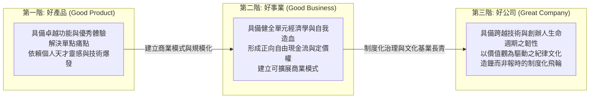
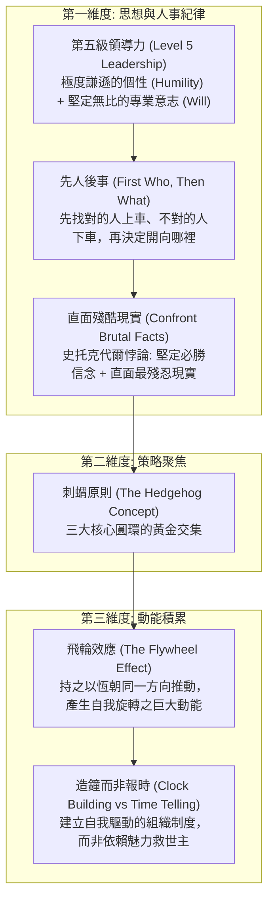

---
{"dg-publish":true,"permalink":"/98/great-company/","tags":["商業概念","策略管理","領導力","組織行為","PMBA"],"dg-note-properties":{"aliases":["好公司","偉大企業","Great Company","從優秀到卓越"],"tags":["商業概念","策略管理","領導力","組織行為","PMBA"]}}
---


# 好公司 (Great Company)

> [!NOTE]
> **核心概念精粹**：在當代管理學與企業治理體系中，「好公司（Great Company）」是指超越了單點爆款產品（Good Product）與短期賺錢事業（Good Business），具備持久跨週期適應力、卓越組織文化、永續經濟引擎，並能為所有利害關係人持續創造非凡價值的偉大組織實體。吉姆·柯林斯（Jim Collins）《從優秀到卓越》確立了其核心演進定律：以**第五級領導力**為根基，推動**刺蝟原則**與**飛輪效應**，最終實現「基業長青」。

---

## 一、 學理定位：產品、事業與公司的三級進化階梯

許多企業領導者常將「擁有熱銷產品」誤認為「擁有一家好公司」。在 NTU PMBA 治理視角下，企業的成熟度經歷了本質性的三階段躍遷：



### 產品、事業與好公司的核心矩陣對照

| 比較維度 | 好產品 (Good Product) | 好事業 (Good Business) | 好公司 (Great Company) |
| :--- | :--- | :--- | :--- |
| **存在核心** | 滿足特定消費者的功能或情緒需求。 | 實現健康的 ROIC、毛利率與正自由現金流。 | 踐行崇高核心價值觀，引領產業與社會進步。 |
| **競爭壁壘** | 技術規格、外觀專利、演算法參數。 | 網絡效應、轉換成本、規模經濟。 | 組織文化資本、造鐘制度、跨週期自我修復力。 |
| **生命週期** | 容易隨著技術 S 曲線躍遷而在數年內過時。 | 受到產業興衰與景氣循環的直接衝擊。 | 跨越數十年乃至百年，連續孕育多波第二曲線。 |
| **對人的依賴** | 極度依賴個別明星工程師或產品經理。 | 依賴具備商業敏銳度的核心高階團隊。 | 制度大於個人，任何人離職組織依然高速運轉。 |

---

## 二、 吉姆·柯林斯《從優秀到卓越》核心理論架構

吉姆·柯林斯（Jim Collins）帶領研究團隊，歷時五年嚴格篩選出能夠在長達十五年間擊敗大盤 3 倍以上的偉大企業，歸納出四大基石：



### 1. 刺蝟原則（The Hedgehog Concept）的三環交集
狐狸知道許多事情，但刺蝟只知道一件大事。偉大企業絕不盲目追逐熱門風口，而是將策略嚴格鎖定在三大圓環的交界處：
1. **你對什麼充滿狂熱？（Deep Passion）**：團隊發自內心深處認同的事業，而非僅僅為了賺錢。
2. **你在什麼方面能成為世界頂尖？（Best in the World）**：立足於真實核心能力，敢於承認自己在哪些領域永遠無法超越對手。
3. **什麼驅動你的經濟引擎？（Economic Engine）**：找到關鍵的「每單位 X 的利潤（Profit per X）」，精準衡量資源轉換效率。

### 2. 飛輪效應（The Flywheel Effect）
- 卓越的轉型絕非依靠一次性的大型發表會、神級併購或靈光乍現的奇蹟。
- 它就像推動一個重達數十噸的巨大飛輪：一開始必須用盡全力推動一圈，接著推動第二圈、第三圈……每一圈的努力都在為下一圈蓄積動能，直到飛輪本身的重力與角動量形成自我驅動的狂暴加速度。

---

## 三、 經典企業實戰案例：微軟（Microsoft）的文化重生與雙重飛輪

```carousel

<!-- slide -->
### 1. 史蒂夫·鮑爾默時期的官僚困境（優秀但停滯）
- 2000 年代微軟憑藉 Windows 與 Office 壟斷全球 PC，是一門暴利的「好事業」，但卻逐漸喪失了「好公司」的靈魂；
- 內部充斥著部門牆（Silos）與殘酷的「堆疊排名考核（Stack Ranking）」，員工為了自保互相傾軋，徹底錯失了智慧型手機、搜尋引擎與社群網絡等重大歷史機遇。
<!-- slide -->
### 2. 薩提亞·納德拉的第五級領導與成長心態重塑
- 2014 年納德拉接任 CEO，展現了典型的「第五級領導力」：溫和謙遜、強調同理心，但對策略轉型展現鋼鐵般的意志；
- 他廢除堆疊考核，將企業文化徹底轉向卡蘿·杜維克（Carol Dweck）的「成長心態（Growth Mindset）」——從「無所不知（Know-it-all）」轉向「無所不學（Learn-it-all）」；
- 確定了微軟的刺蝟原則：「賦能全球每個人與每個組織，成就不凡」，將 Windows 降級，全力推動 Azure 雲端與跨平台生態。
<!-- slide -->
### 3. AI 時代的第二曲線狂飆
- 正是因為組織文化的重塑與飛輪的重新咬合，微軟才能在 2019 年以極致前瞻的魄力重金投資 OpenAI，並將生成式 AI 迅速整合至全線產品，市值強勢突破 3 兆美元，完成了現代商業史上最壯麗的「從好事業到偉大公司」的涅槃重生。
```

---

## 四、 經理人「好公司」治理成熟度檢核表（Executive Decision Checklist）

董事會與執行團隊應定期對公司進行靈魂審計（Soul Audit）：

- [ ] **先人後事原則落實（People First Check）**：
  - 當面臨重大轉型與策略迷茫時，我們是否優先將不合適的人請下車、將卓越人才放到最重要的位置？我們是否敢於開除業績亮眼但踐踏企業文化價值觀的「有毒員工」？
- [ ] **史托克代爾現實直面（Confronting Brutal Facts）**：
  - 公司內部是否存在「報喜不報憂」的寒蟬效應？第一線員工是否敢於在主管面前揭露產品缺陷、客戶流失與競爭對手的致命威脅？
- [ ] **刺蝟原則三環聚焦（Hedgehog Discipline）**：
  - 我們當前投入巨額預算的新專案，是否同時符合「團隊狂熱」、「能做到全球頂尖」、「驅動每單位利潤指標」這三項條件？如果缺少一環，是否只是盲目跟風？
- [ ] **造鐘制度與接班梯隊（Clock-Building Over Time-Selling）**：
  - 如果現任創辦人或 CEO 明天因意外無法履職，公司的決策流程、文化運作與資本配置是否能毫無障礙地持續運作？
- [ ] **長期利害關係人承諾（Stakeholder Value Creation）**：
  - 公司在追求季度財務績效的同時，是否正在傷害長期客戶信任、員工身心健康或生態夥伴利益？我們的存在是否讓產業變得更健康？

---

## 五、 關聯概念與知識網絡

* 核心理論基礎：
  * [[Good_Product_Business_Company_好產品好事業好公司模型|好產品好事業好公司模型]]：從單點爆款到偉大企業的三級躍遷框架
  * [[viable-business_好事業|好事業 (Viable Business)]]：商業模式自我造血與正現金流基礎
  * [[sound-investment_好投資|好投資 (Sound Investment)]]：價值投資內在價值與經濟護城河
  * [[great-idea_好創意|好創意 (Great Idea)]]：好創意轉化為商業機會之起點
* 領導與策略工具：
  * [[conceptual-skills_概念技能|概念技能 (Conceptual Skills)]]：高層領導洞察全局與系統性思考架構
  * [[core-competence_核心能力|核心能力 (Core Competence)]]：刺蝟原則之頂尖能力構築
  * [[business-model-pivot_商業模式軸轉|商業模式軸轉 (Pivot)]]：直面殘酷現實下的戰略調整
  * [[growth-velocity_成長速度|成長速度 (Growth Velocity)]]：飛輪動能釋放與閃電擴張節奏
