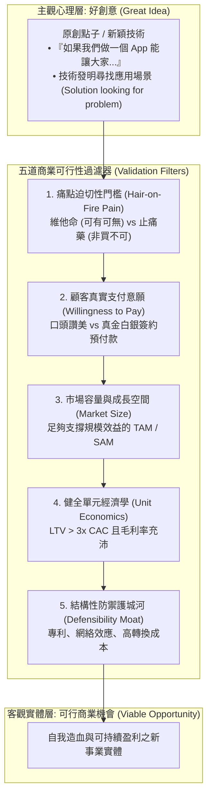

---
{"dg-publish":true,"permalink":"/98/great-idea/","tags":["商業概念","創業管理","產品設計","PMBA"],"dg-note-properties":{"aliases":["好創意","Great Idea","創意與商業機會評估","點子驗證"],"tags":["商業概念","創業管理","產品設計","PMBA"]}}
---


# 好創意 (Great Idea)

> [!NOTE]
> **核心概念精粹**：好創意（Great Idea）是指在心智中構想出具備高度新穎性（Novelty）、獨特性與潛在價值的新概念、技術發明或解決方案。然而，在商業管理與創投領域，「好創意」絕不等於「可行的商業機會（Viable Business Opportunity）」。全球超過 90% 的新創失敗並非源於點子不夠酷，而是因為陷入了「自嗨型創意」的盲區，未能跨越真實付費意願、單元經濟學與防禦壁壘的考驗。

---

## 一、 學理剖析：好創意向可行商業機會的演進漏斗

在技術創新與創業管理中，好創意僅是認知發散階段的產物。如何將一個主觀點子（Idea）打磨篩選為客觀的商業機會（Opportunity），需要經過嚴格的漏斗檢驗：



---

## 二、 創業者最常跌入的四大「好創意陷阱」

許多極具才華的研發人員與創業者，常因過度迷戀自己的點子而陷入認知偏誤：

| 創意陷阱 | 典型表象與思維盲區 | 殘酷市場現實對照 | 解套心法 |
| :--- | :--- | :--- | :--- |
| **1. 拿著鐵鎚找釘子<br>(Solution in Search of a Problem)** | 發明了酷炫的新演算法或新材料，四處尋找哪裡可以用得上。 | 顧客根本不在乎你的底層技術多優雅，顧客只在乎自己的痛苦能否被以最低代價解決。 | **愛上問題，而非愛上解法**；回歸目標客群的核心作業情境（JTBD）。 |
| **2. 維他命陷阱<br>(The Vitamin Trap)** | 產品確實有益處，顧客調研時每個人都說「這點子很棒、很有趣」。 | 當需要顧客掏錢購買或改變既有習慣時，顧客立刻猶豫推託，流失率極高。 | 鎖定如果不解決就會導致巨大虧損、法律風險或極端痛苦的**「止痛藥」**領域。 |
| **3. 偽陽性市場調查<br>(False Positive Validation)** | 問親朋好友「如果有這個產品，你們會用嗎？」獲得一致讚賞。 | 嘴巴說好不需要付出代價；沒有金錢交易的市場調研全部都是雜音（Noise）。 | **以「預售訂金（Pre-orders）」或「意向書（LOI）」**作為唯一驗證標準。 |
| **4. 巨頭秒殺脆弱性<br>(Feature, Not a Product)** | 點子非常精妙，但實質上只是一個單點功能（Feature），缺乏平台架構。 | 一旦獲得微幅市場關注，微軟、Google、蘋果直接在下一次系統更新中內建該功能。 | 快速將單點功能擴充為具備[[switching-costs_轉換成本|高轉換成本]]或數據閉環的完整產品。 |

---

## 三、 經典案例對比：好創意夭折 vs 好創意昇華

```carousel

<!-- slide -->
### 案例 A：Segway 賽格威——「酷炫好創意」的商業滑鐵盧
- **點子萌芽**：1999 年天才發明家狄恩·卡門（Dean Kamen）發明了動態自平衡雙輪載具 Segway，賈伯斯曾預言「這將比個人電腦更重要」，獲得巨額風險投資。
- **致命缺陷**：
  - 這是典型的「技術領先、商業殘廢」：售價高達 5,000 美元（消費者買不起）；
  - 重量高達 40 公斤（無法提上樓）；
  - 行駛法規不明（不能上人行道、上慢車道太危險）。這是一個工程學上的偉大點子，但在商業需求上完全是偽命題，最終淪為商場警衛巡邏玩具並被低價收購。
<!-- slide -->
### 案例 B：Canva——將「複雜好點子」昇華為百億商業機會
- **點子萌芽**：創辦人梅蘭妮·珀金斯（Melanie Perkins）在大學教授設計軟體時，發現 Photoshop 與 InDesign 操作極其繁瑣複雜，普通人花費數月依然無法排版一張海報。
- **商業昇華**：
  - 她沒有試圖做一個功能更強大的專業軟體，而是抓住「中小企業需要快速製作社群貼文、簡報，但請不起專職設計師」的真實痛點；
  - 打造基於瀏覽器的極簡拖曳介面，內建數萬種商用版型；
  - 採用 Freemium 免費增值模式，單元經濟學極致健康，一躍成為全球估值數百億美元的設計獨角獸。
```

---

## 四、 經理人好創意轉化機會檢核表（The Idea-to-Opportunity Filter）

在公司內部立項或個人決定投入全部資源創業前，必須由獨立委員會或創始核心進行殘酷五問：

- [ ] **支付意願檢驗（Skin-in-the-Game Test）**：
  - 是否有至少 10 位非親非故的潛在顧客，願意在產品尚未正式問世前簽署「付費意向書」或支付「不可退還的訂金」？
- [ ] **替代方案對比（Competitor & Inertia Benchmark）**：
  - 客戶目前是如何應對這個問題的？（用 Excel？用人工紙本？還是乾脆忍受它？）我們的方案是否比現有替代方案「好上十倍（10x Better）」或「便宜一半（50% Cheaper）」？如果只有微幅領先，顧客絕不會承擔轉換成本。
- [ ] **市場容量檢驗（TAM Realism）**：
  - 目標市場是否過於小眾？以合理價格乘以現實可獲取的目標顧客數（SOM），年營收上限能否支撐一家上市企業或獨立健康運營的公司？
- [ ] **單元經濟健康度（Unit Economics Sanity Check）**：
  - 在最保守的估計下，顧客終身價值（LTV）能否達到獲客成本（CAC）的 3 倍以上？獲客成本回收期是否在 12 個月之內？
- [ ] **防禦壁壘（Defensibility & Speed）**：
  - 如果市場證明這個點子大獲成功，強大的既有競爭者是否能在三個月內以十分之一的成本推出複製品？我們的專利、先動品牌與團隊執行力能否構築足夠的進入門檻？

---

## 五、 關聯概念與知識網絡

* 核心理論基礎：
  * [[opportunity_機會|機會 (Opportunity)]]：提蒙斯模型機會評估體系
  * [[opportunity-recognition_創業機會辨識|創業機會辨識 (Opportunity Recognition)]]：從心理感知到商業機會的認知轉換
  * [[AFBP框架|AFBP 框架 (AFBP Framework)]]：從底層產品規格向情感利益的價值階梯
  * [[great-company_好公司|好公司 (Great Company)]]：從單點好創意昇華至偉大組織
* 驗證與落地方法：
  * [[lean-startup_精實創業|精實創業 (Lean Startup)]]：假設檢定與 MVP 快速迭代驗證
  * [[MVP最小可行產品|最小可行產品 (MVP)]]：以最低成本檢驗好創意的實務工具
  * [[value-proposition_價值主張|價值主張 (Value Proposition)]]：針對痛點設計無可挑剔的解決方案
  * [[viable-business_好事業|好事業 (Viable Business)]]：自我造血與正自由現金流飛輪
