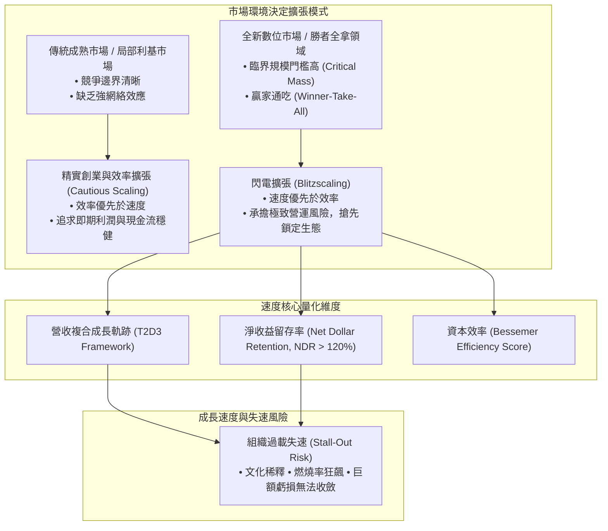

---
{"dg-publish":true,"permalink":"/98/growth-velocity/","tags":["商業概念","創業管理","策略管理","擴張戰略","PMBA"],"dg-note-properties":{"aliases":["成長速度","Growth Velocity","閃電擴張速度","擴張節奏"],"tags":["商業概念","創業管理","策略管理","擴張戰略","PMBA"]}}
---


# 成長速度 (Growth Velocity)

> [!NOTE]
> **核心概念精粹**：成長速度（Growth Velocity）是指企業在特定時間週期內，將商業模式進行用戶滲透、市場份額擴張與營收轉化的非線性加速度。雷德·霍夫曼（Reid Hoffman）在《閃電擴張（Blitzscaling）》中強調：在具備強網絡效應與勝者全拿特徵的現代經濟中，**「極致的成長速度往往優先於營運效率」**。然而，缺乏健康單元經濟學支撐的盲目狂飆，亦會誘發組織失速（Stall-Out）與資本斷裂的毀滅性風險。

---

## 一、 學理奠基：速度 vs 效率的策略權衡

在傳統管理學中，企業經營的最高美德是「效率（Efficiency）」——精簡成本、消除浪費、穩紮穩打、利潤最大化。然而，在新經濟與平台生態中，市場遵循嚴格的**收益遞增（Increasing Returns to Scale）**與**網絡效應（Network Effects）**規律。



### 閃電擴張的五大組織演進階段（Hoffman & Yeh, 2018）

| 階段名稱 | 組織人數規模 | 核心管理焦點 | 成長速度首要威脅 |
| :--- | :--- | :--- | :--- |
| **1. 家庭階段 (Family)** | 1 ~ 9 人 | 探索產品與市場適配度（PMF），創辦人親自下場。 | 資金耗盡、點子無人買單。 |
| **2. 部落階段 (Tribe)** | 10 ~ 99 人 | 驗證可複製的銷售模式，建立初步分工。 | 早期員工與專業經理人衝突。 |
| **3. 村莊階段 (Village)** | 100 ~ 999 人 | 閃電式擴張主力戰場，跨部門協同與中層幹部拔擢。 | 溝通失靈、流程官僚化吞噬速度。 |
| **4. 城市階段 (City)** | 1,000 ~ 9,999 人 | 建立正式考核與激勵體系，推動全球化擴張。 | 企業文化稀釋、內部政治內耗。 |
| **5. 國家階段 (Nation)** | 10,000+ 人 | 管理多元業務組合，平衡主業守成與邊緣創新。 | 反壟斷審查、失去創新動能（大企業病）。 |

---

## 二、 成長速度的量化評估體系

在資本市場與 VC 評估高成長科技企業時，建立了嚴格的「速度與效率」度量標準：

### 1. 頂級 SaaS 新創的 T2D3 成長軌跡
全球頂級創投（如 Battery Ventures）提出著名的 **T2D3 成長路徑**，作為新創能否成為百億美元巨頭的黃金標竿：
- 當年度經常性營收（ARR）達到 100~200 萬美元時啟動：
  - 第一年：**翻三倍（Triple）** $\to$ 達到約 300~600 萬美元；
  - 第二年：**再翻三倍（Triple）** $\to$ 達到約 900~1,800 萬美元；
  - 第三年：**翻兩倍（Double）** $\to$ 達到約 1,800~3,600 萬美元；
  - 第四年：**再翻兩倍（Double）** $\to$ 達到約 3,600~7,200 萬美元；
  - 第五年：**再翻兩倍（Double）** $\to$ 正式跨越 1 億美元 ARR 大關，達成 IPO 上市門檻。

### 2. 40 法則（Rule of 40）
衡量科技公司在擴張期「速度與獲利平衡」的經典公式：

$$\text{Growth Rate (YoY \%)} + \text{Free Cash Flow Margin (\%)} \ge 40\%$$

- 若一家新創營收年增長率高達 80%，即便利潤率為 $-30\%$（合計 $50\% \ge 40\%$），依然屬於極其健康的高速擴張；
- 反之，若營收增長僅 10%，利潤率為 $15\%$（合計 $25\% < 40\%$），則代表企業陷入擴張緩慢且利潤平庸的泥淖。

---

## 三、 實戰案例對照：速度制勝 vs 速度致死

```carousel

<!-- slide -->
### 案例 A：Uber 的閃電擴張（速度優先建立雙向網絡壁壘）
- **策略邏輯**：在叫車共享平台中，市場具有極其強烈的在地雙邊網絡效應（乘客越多 $\to$ 司機接單越快 $\to$ 乘客等待時間越短 $\to$ 吸納更多乘客）。
- **狂飆行動**：Uber 在 2011~2015 年間採取極端激進的擴張速度，不惜每季度燒掉數億美元補貼司機與乘客，在全世界數百個城市發動閃電戰；
- **結果**：在傳統計程車工會與法規反應過來之前，Uber 已經跨過臨界規模（Critical Mass），建立了不可逆的雙邊網絡壟斷，將數百家在地追隨者徹底絞殺。
<!-- slide -->
### 案例 B：WeWork 的速度狂躁症（忽視單元經濟的致命失速）
- **致命謬誤**：WeWork 創辦人亞當·諾伊曼將傳統的「長期二房東轉租業務」包裝為「高科技社群平台」，狂熱追求全球門市的極限成長速度；
- **擴張崩潰點**：
  - WeWork 忽視了其底層根本不具備軟體公司的零邊際成本與網絡效應；每增加一個據點，背後都是長達 10~15 年的巨額剛性租約；
  - 擴張速度越快，現金流黑洞越龐大（一年淨虧損高達數十億美元）。當 2019 年 IPO 招股書揭露真實財務結構後，估值在數週內自 470 億美元雪崩式蒸發，最終以破產重組慘烈收場。
```

---

## 四、 經理人成長速度節奏調控檢核表（Executive Decision Checklist）

在踩下油門全面加速擴張前，CEO 與高管團隊應完成下列體檢：

- [ ] **產品與市場適配度檢驗（PMF Gatekeeper）**：
  - 我們是否真正實現了 PMF？（40% 以上的用戶表示如果產品消失會非常沮喪；NDR > 110%）。如果在沒有 PMF 的情況下強行加速，只是「用高速將一輛底盤散架的車開下懸崖」。
- [ ] **單元經濟可收斂性（Unit Economics Convergence）**：
  - 目前的虧損究竟是源於「擴張期的前期固定研發與獲客投入」，還是「每多做一筆業務就在實質虧損」？成熟老用戶群的毛利率與留存率能否隨時間推移自發轉正？
- [ ] **現金跑道與融資耐力（Runway & Dilution Check）**：
  - 依照當前的[[Burn Rate|資金消耗速度]]，現有現金儲備能否支撐至少 18 個月？如果資本市場進入嚴冬，公司是否具備在一夜之間將模式切換為「零增長、正現金流」的自保能力？
- [ ] **組織承載極限評估（Dunbar Limit & Cultural Dilution）**：
  - 公司在過去 12 個月內人數是否膨脹超過一倍？新進員工是否理解核心價值觀？中層管理者的管理幅度是否已瀕臨崩潰？

---

## 五、 關聯概念與知識網絡

* 核心理論基礎：
  * [[network-effects_網絡效應|網絡效應 (Network Effects)]]：閃電擴張速度背後的底層經濟學依託
  * [[viable-business_好事業|好事業 (Viable Business)]]：速度必須立足於健康的單元經濟自我造血
  * [[great-company_好公司|好公司 (Great Company)]]：飛輪動能的持續積累與跨週期治理
  * [[timmons-model_提蒙斯創業模型|提蒙斯創業模型 (Timmons Model)]]：機會擴張與資源團隊的動態平衡
* 擴張治理與風險工具：
  * [[Burn Rate|資金消耗率 (Burn Rate)]]：極速擴張期的現金流消耗控制線
  * [[business-model-pivot_商業模式軸轉|商業模式軸轉 (Pivot)]]：擴張受阻時的敏捷轉向機制
  * [[economies-of-scale_規模經濟|規模經濟 (Economies of Scale)]]：速度轉化為成本壁壘的實現路徑
  * [[barriers-to-entry_進入障礙|進入障礙 (Barriers to Entry)]]：搶先佔位所釋放的結構性防禦資產
