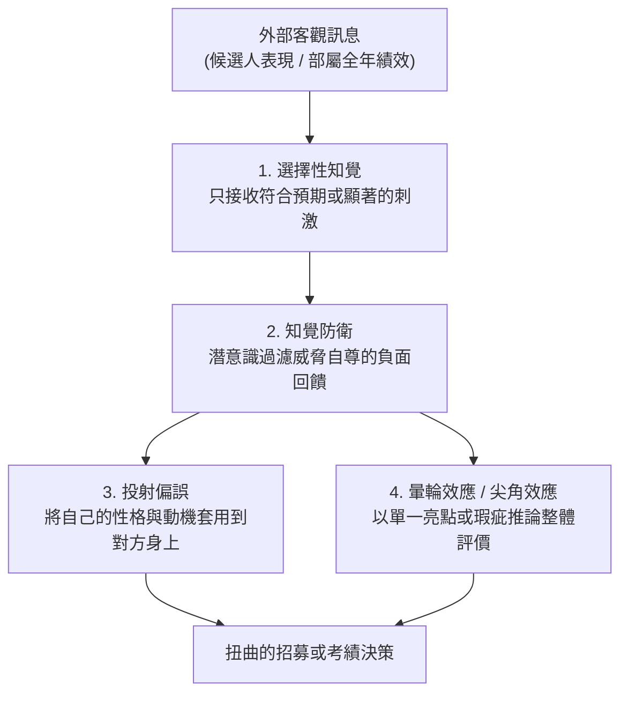

---
{"dg-publish":true,"permalink":"/98/halo-effect-and-projection/","tags":["商業概念","組織行為","社會知覺","認知偏誤","人才招募","績效考核","PMBA"],"dg-note-properties":{"aliases":["暈輪效應","光環效應","Halo Effect","投射偏誤","Projection","知覺防衛","Perceptual Defense","選擇性知覺"],"tags":["商業概念","組織行為","社會知覺","認知偏誤","人才招募","績效考核","PMBA"]}}
---

# 暈輪效應與投射偏誤 (Halo Effect, Projection & Social Perception Biases)

> [!NOTE] 核心概念精粹
> **社會知覺偏誤（Social Perception Biases）** 是人類大腦在快速解讀他人行為與評價績效時，因感官過濾與認知捷徑所產生的系統性扭曲。其中最常破壞企業招募、面試與年終考核公正性的四大機制為：**暈輪效應（Halo Effect）**、**投射（Projection）**、**知覺防衛（Perceptual Defense）** 與 **選擇性知覺（Selective Perception）**。

---

## 一、 四大職場知覺偏誤運作機制

| 偏誤名稱 | 心理定義 | 組織管理與評估現場的典型誤區 |
| :--- | :--- | :--- |
| **暈輪效應 (Halo Effect)** | 依據對方的單一正向特徵（如名校學歷、外貌氣質、第一題答得極佳），自動推論其在其他所有面向都表現卓越；反之若因單一瑕疵全面否定則稱**尖角效應（Horn Effect）** | • **閱卷效應**：批改申論題時若第一題寫得極好，後續題目往往不自覺給出高分 • **面試儀態偏誤**：候選人因過度緊張或坐姿過於隨性，導致面試官直接否定其專業能力 |
| **投射偏誤 (Projection)** | 將自己內在的特質、價值觀、情緒或假設動機，投射到他人身上（「以己度人」） | 主管認為「高薪獎金才是一切動力」，便假設追求工作與生活平衡的部屬缺乏企圖心 |
| **知覺防衛 (Perceptual Defense)** | 個體潛意識地阻擋或曲解令自己感到威脅、不悅或與自我形象衝突的訊息 | 主管長期「自我感覺良好」，對匿名滿意度調查中的負面警訊選擇性失明或合理化 |
| **近期偏誤 (Recency Bias)** | 在評估長期表現時，過度放大最近發生事件的記憶權重（屬[[98_商業概念庫/cognitive-bias_認知偏誤\|可得性捷思]]延伸） | **年終考績失真**：員工 1～10 月表現平庸，僅因 11 月救火成功便拿最高等第；或全年辛勞卻因年底一次失誤被否定 |

---

## 二、 刻板印象（Stereotyping）的雙面功能

**刻板印象（Stereotyping）** 本質上是依據群體標籤（國籍、學歷、世代）進行快速分類的認知捷徑：
- **正面認知功能**：協助決策者在資訊不足的陌生情境中快速建立心智模型（例如：跨國商務談判前，預先依據對德國客戶重視嚴謹準時、日本客戶重視禮儀細節的認知做準備）。
- **負面偏見陷阱**：當管理者將「群體平均印象」僵化套用於每一個體（例如迷信「純血頂大」、「特定學校背景」而忽略個別候選人的真實能力），即會導致嚴重的人才錯配與組織同質化盲點。

---

## 三、 經理人除偏實務檢核清單（Debiasing Checklist）

- [ ] **結構化面試與評分拆解**：面試前建立獨立的能力維度評分表，禁止僅憑「整體感覺」打分，防範暈輪效應與投射偏誤。
- [ ] **盲審與題目分開批閱**：評估專案提案或考卷時，遮蔽背景標籤並逐項獨立評分，避免單一亮點掩蓋實質破綻。
- [ ] **全年度績效日誌（Log-based Appraisal）**：建立雙週或月度 1-on-1 紀錄，強制在年終考績時回顧全年事實，消除近期偏誤。
- [ ] **建立魔鬼代言人回饋機制**：針對高階主管決策設立無記名或獨立第三方回饋管道，突破「自我感覺良好」的知覺防衛。

---

## 四、 關聯概念與模組導航

- **對應模組**：[[02_核心必修/03_組織行為/02_模組筆記/Module_2_個體動能_知覺歸因與激勵/M2-2_社會知覺偏誤與跨文化歸因理論\|M2-2_社會知覺偏誤與跨文化歸因理論]] · [[02_核心必修/03_組織行為/_組織行為 MOC\|_組織行為 MOC]]
- **理論關聯**：[[98_商業概念庫/cognitive-bias_認知偏誤\|cognitive-bias_認知偏誤]] · [[98_商業概念庫/fundamental-attribution-error_基本歸因謬誤\|fundamental-attribution-error_基本歸因謬誤]] · [[98_商業概念庫/perception-2_知覺\|perception-2_知覺]]
