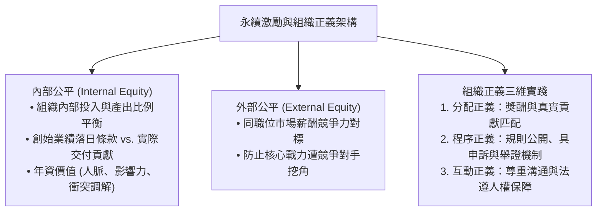

---
{"dg-publish":true,"permalink":"/98/incentive-distortion-and-organizational-justice/","tags":["商業概念","組織行為","績效激勵","薪酬設計","組織正義","公平理論","PMBA"],"dg-note-properties":{"aliases":["激勵扭曲","反激勵效應","Anti-incentive Effect","組織正義","Organizational Justice","內部公平與外部公平","DBF律師事務所個案"],"tags":["商業概念","組織行為","績效激勵","薪酬設計","組織正義","公平理論","PMBA"]}}
---

# 激勵扭曲與組織正義 (Incentive Distortion & Organizational Justice)

> [!NOTE] 核心概念精粹
> **激勵的本質是引導組織成員未來的行為。** 然而在實務薪酬與分潤設計中，管理者常陷入「過度公式化」的陷阱：只要未納入計分公式的關鍵貢獻（如團隊指導、公益服務、跨部門協調），就會立即產生**反激勵效應（Anti-incentive Effect）**——成員將精力全數集中於公式內的短期指標，導致組織長期競爭力萎縮。真正的永續激勵必須建立在**內部公平、外部公平與組織正義（Organizational Justice）**三大支柱之上。

---

## 一、 公式化激勵的三大管理陷阱（以 DBF 律師事務所為鏡）

在專業服務機構（如會計師、律師事務所或高階顧問業）設計合夥人分潤與 KPI 時，極易遭遇以下結構性兩難：

1. **「透明」不等於「公平」**：
   - 公開明確的數學公式能達成「程序透明」（每個人都能驗證獎金如何算出），但若公式忽略了難以量化的質性價值，成員仍會感到極度不公平。
2. **反激勵效應（Anti-incentive Effect）**：
   - **「你獎勵什麼，就得到什麼；你沒放進公式的，就沒有人會做。」**
   - **公車過站不停效應**：若只考核公車準點率而不考核載客數，司機為了準點就會過站不停；同理，若律師事務所只獎勵「可計帳工時（Billable Hours）」與「個人創始業績（Origination Credit）」，合夥人便會拒接無計帳價值的內部管理委員會與新人培育工作。
3. **「平均型激勵」vs.「抓大放小型激勵」**：
   - 將所有十幾項指標全部塞入複雜公式，容易獎勵「樣樣普通、缺乏尖峰突破」的平均型人才，且過度複雜的參數會稀釋員工的行動焦點；反之，「抓大放小」針對核心策略方向挑選少數關鍵指標（搭配保留池機制），更能精準驅動組織轉型。

---

## 二、 雙重公平基準與組織正義架構

根據[[98_商業概念庫/equity-theory_公平理論\|亞當斯公平理論]]與現代組織正義研究，薪酬與考核制度必須同時通過兩道外部與內部測試，並落實三維正義（參見 [[98_商業概念庫/justice-view_正義觀點\|justice-view_正義觀點]]）：

### 年資（Seniority）的真實組織價值再評估
在世代交替的組織中，年輕成員常主張「廢除年資、純論績效」，但組織行為學提醒管理者審慎評估年資背後的隱性功能：
- **負面風險**：若僅憑年資或 20 年前的創始客戶永久領取高額分紅，會形成「坐享其成」的搭便車文化，打擊中生代創收動能。
- **正面功能**：資深成員往往承載著跨部門影響力、外部高階人脈以及衝突調解的組織潤滑劑角色，適度保留合理比例的穩定性回饋，有助於維繫組織長期安定。

---

## 三、 經理人制度設計檢核清單

- [ ] **反激勵盲點掃描**：檢視現行 KPI 公式，是否無意中懲罰了「高效率完成任務者」（如以工時計價懲罰做更快的人）或消滅了團隊利他行為？
- [ ] **程序正義與事實舉證**：面對績效不佳人員的淘汰（PIP）或爭議處分時，是否具備完整客觀的事實證據與申訴程序，以符合現代勞動法規與組織正義要求？
- [ ] **創始功勞的動態調整**：針對早期開拓客戶或專案功臣，是否設有合理的分潤遞減或交接機制，平衡開拓者與維繫者的長期公平感？

---

## 四、 關聯概念與模組導航

- **對應模組**：[[02_核心必修/03_組織行為/02_模組筆記/Module_2_個體動能_知覺歸因與激勵/M2-3_績效激勵機制與組織正義個案_DBF律師事務所\|M2-3_績效激勵機制與組織正義個案_DBF律師事務所]] · [[02_核心必修/03_組織行為/_組織行為 MOC\|_組織行為 MOC]]
- **理論關聯**：[[98_商業概念庫/equity-theory_公平理論\|equity-theory_公平理論]] · [[98_商業概念庫/justice-view_正義觀點\|justice-view_正義觀點]] · [[98_商業概念庫/intrinsic-vs-extrinsic-motivation_內在激勵與外在激勵\|intrinsic-vs-extrinsic-motivation_內在激勵與外在激勵]]
