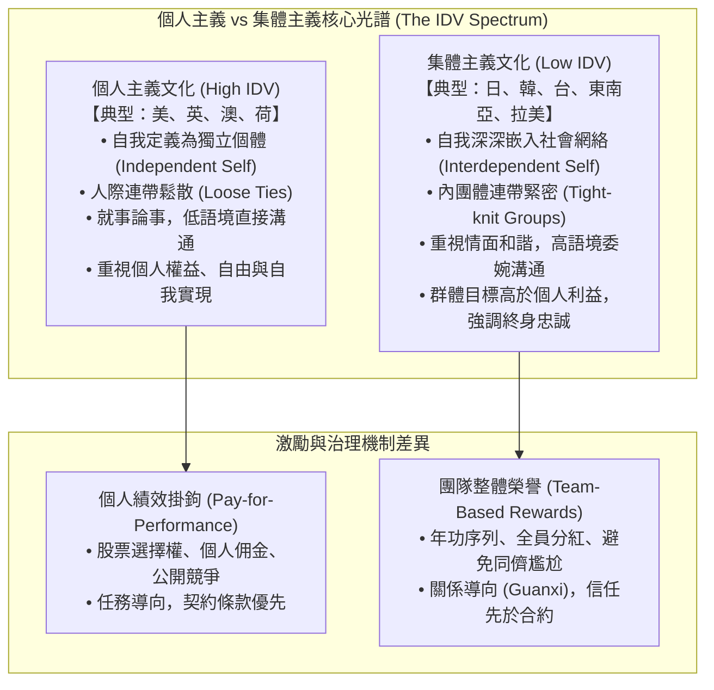

---
{"dg-publish":true,"permalink":"/98/individualism-vs-collectivism/","tags":["商業概念","跨文化管理","組織行為","領導力","PMBA"],"dg-note-properties":{"aliases":["個人主義與集體主義","Individualism vs Collectivism","霍夫史泰德個人主義維度","IDV文化維度"],"tags":["商業概念","跨文化管理","組織行為","領導力","PMBA"]}}
---


# 個人主義與集體主義 (Individualism vs Collectivism)

> [!NOTE]
> **核心概念精粹**：個人主義與集體主義（Individualism vs Collectivism, IDV），是荷蘭跨文化管理大師吉爾特·霍夫史泰德（Geert Hofstede）文化維度理論中最核心的社會結構指標。它衡量一個社會中**個體與所屬群體之間的相互依賴程度與連帶緊密度**。個人主義文化強調「我（I）」的自主權、個人成就與契約關係；集體主義文化強調「我們（We）」的歸屬感、群體和諧與內團體（In-group）忠誠。理解兩者的動態張力，是跨國併購文化整合、全球供應鏈協同與全球多元團隊（DEI）激勵的必修課題。

---

## 一、 學理淵源：霍夫史泰德文化維度理論

霍夫史泰德在 1970 年代對 IBM 全球 70 多個國家、逾 11 萬名員工進行大規模實證研究，確立了文化的基礎深層架構：



---

## 二、 個人主義與集體主義在組織行為中的深度對比矩陣

跨國企業在進行制度移植時，若忽視文化維度的差異，往往引發激烈的排異反應：

| 管理維度 | 個人主義文化（High IDV） | 集體主義文化（Low IDV） | 跨國管理衝突點與應對 |
| :--- | :--- | :--- | :--- |
| **自我認同與價值觀** | 「我是誰？我為自己負責。」追求獨特與差異化。 | 「我屬於誰？我是團隊一分子。」追求融入與集體認同。 | 在高個人主義國家強調全員穿制服可能引發反彈；在集體主義文化則視為團結象徵。 |
| **溝通與衝突模式** | **低語境溝通（Low-Context）**：說話直截了當，公開辯論被視為專業健康的表現。 | **高語境溝通（High-Context）**：言下之意、察言觀色；公開質疑會讓對方「丟臉面子（Loss of Face）」。 | 美國主管若在會議上公開嚴厲指責台灣/日本部屬，部屬可能直接離職，導致團隊信任徹底崩壞。 |
| **激勵與考核機制** | 突出個人貢獻，設立「月度最佳員工（Employee of the Month）」專屬獎金與個人提成。 | 強調團隊連帶責任，單獨表揚某位個人會引發同儕排擠與嫉妒心理。 | 在集體主義文化中，應將獎金發放給整個部門團隊，由內部共享榮譽。 |
| **雇用與離職契約** | 純粹的經濟利益契約，員工隨時可為了更高薪資跳槽，企業景氣下滑時冷血裁員。 | 廣義的道德與心理契約，企業照顧員工如家族成員，員工以高度忠誠與加班回報。 | 外商空降主管若輕率推行美式無差別裁員，在日韓往往引發工會激烈抗爭與社會抵制。 |

---

## 三、 經典企業實戰案例：戴姆勒—克萊斯勒世紀併購的文化車禍

```carousel

<!-- slide -->
### 1. 「天堂締結的良緣」與萬億合併
- **背景**：1998 年德國豪華車霸主戴姆勒—賓士（Daimler-Benz）斥資 360 億美元併購美國第三大車廠克萊斯勒（Chrysler），號稱全球汽車業歷史上最強跨國世紀聯姻；
- **戰略互補幻想**：管理層預期結合德國頂級工程工藝與美國大眾市場行銷通路，實現每年數十億美元綜效。
<!-- slide -->
### 2. 個人主義 vs 制度集體主義的致命文化撞車
- **德國戴姆勒文化**：嚴謹層級制、集體共決、嚴格遵循程序、出差搭乘經濟艙、高管薪酬相對克制；
- **美國克萊斯勒文化**：極端個人主義、自由奔放、推崇明星高管、出差乘坐私人飛機、高管享受數千萬美元奢華股票選擇權；
- **內部撕裂**：兩派管理層在每次會議中為了發言風格、薪酬差距與決策流程爆發激烈衝突；德國主管視美方為「自私自利的暴發戶」，美方視德方為「僵化死板的獨裁者」；
- **悲慘下場**：合併後市值縮水三分之二，9 年後戴姆勒以虧本 300 億美元的恥辱代價，將克萊斯勒拋售給私募基金，成為跨文化整合失敗的歷史第一標籤。
```

---

## 四、 經理人跨文化團隊領導檢核表（Executive Decision Checklist）

在全球化拓展、海外設廠或推動跨國專案時，高階管理團隊應進行下列文化體檢：

- [ ] **激勵制度在地化適配（Incentive Localization Audit）**：
  - 我們所設計的薪酬體系，是否生搬硬套母國模式？在集體主義分支機構中，是否有足夠的「團隊團體激勵」維護內部凝聚力？
- [ ] **高低語境溝通轉化（Context Sensitivity Check）**：
  - 跨國會議是否建立了「保護面子的建設性反饋管道」？我們是否為習慣委婉表達的集體主義同仁，提供了會後一對一私下溝通或匿名建議機制？
- [ ] **決策制定與共識建立節奏（Consensus vs Mandate Pace）**：
  - 領導層是否理解日本「根回（Nemawashi，事前私下廣泛協商溝通）」等集體主義決策傳統？如果為了追求美式速度而跳過共識階段，推動執行時是否會遭遇消極抵抗？
- [ ] **心理契約與雇主品牌（Psychological Contract Alignment）**：
  - 在招聘海外核心人才時，我們宣傳的價值主張是否切中當地員工的核心渴望？（個人主義看重個人升遷與技能跳板；集體主義看重長期穩定與歸屬感）。

---

## 五、 關聯概念與知識網絡

* 跨文化維度與全球領導力：
  * [[culture-dimension_霍夫斯泰德文化維度|霍夫斯泰德文化維度 (Hofstede Dimensions)]]：文化比較研究的大一統分析體系
  * [[uncertainty-avoidance_不確定性規避|不確定性規避 (Uncertainty Avoidance)]]：面對未知情境焦慮反應之文化維度
  * [[power-distance_權力距離|權力距離 (Power Distance)]]：組織內部不平等接受度之文化維度
  * [[culture_高低語境文化|高低語境文化 (High/Low Context Culture)]]：愛德華·霍爾之跨文化溝通密碼
* 組織與心理激勵：
  * [[corporate-culture_企業文化|企業文化 (Corporate Culture)]]：組織內部核心價值觀與群體規範之塑造
  * [[intrinsic-vs-extrinsic-motivation_內在激勵與外在激勵|內在激勵與外在激勵]]：個人自我實現與團隊歸屬感之激勵對策
  * [[person-job-fit_人職匹配|人職匹配 (Person-Job Fit)]]：文化特質與職位屬性之深度契合
  * [[interpersonal-skills_人際技能|人際技能 (Interpersonal Skills)]]：跨文化情境下同理溝通與衝突協調能力
