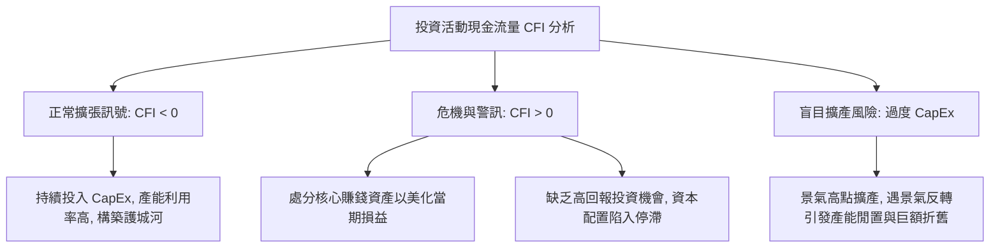

---
{"dg-publish":true,"permalink":"/98/investing-cash-flow-statement/","tags":["商業概念","現金流量表","資本支出","投資策略","資產配置","PMBA"],"dg-note-properties":{"aliases":["投資活動現金流量","Cash Flow from Investing Activities","CFI","ICF","投資現金流","資本支出現金流"],"tags":["商業概念","現金流量表","資本支出","投資策略","資產配置","PMBA"]}}
---


# 投資活動現金流量 (Cash Flow from Investing Activities & Capital Allocation)

> **【核心決策摘要】**
> **投資活動現金流量（Cash Flow from Investing Activities, CFI / ICF）** 是現金流量表中記錄企業為**獲取與處置長期營運資產（不動產、廠房及設備 PP&E、無形資產）、戰略性對外股權投資（合資公司、M&A 併購收購）以及非約當現金之金融工具所產生的真實現金淨收支**。CFI 是衡量企業**資本配置雄心與未來成長動能的晴雨表**。在絕大多數處於正常營運與擴張期的企業中，**CFI 應當呈現穩健的負值（$CFI < 0$）**，反映出企業持續進行[[98_商業概念庫/capital-expenditure_資本支出\|資本支出（CapEx）]]以築高技術壁壘；反之，若 CFI 轉為大幅正值，往往釋放出企業處分核心資產（Selling the Family Jewels）以求生存或粉飾帳面的危險信號。

---

## 1. 概念核心定義與主要組成項目 (Executive Definition & Components)

### 1.1 核心定義
投資活動現金流量是指：**企業在特定會計期間內，針對長期資產（Long-term Assets）及其他不包括在現金及約當現金範圍內的各類投資之取得與處分，所產生之現金流入與流出的代數和**。

```
                    ┌─────────────────────────────────────────────────────────┐
                    │               投資活動現金流量正負向組成                │
                    └────────────────────────────┬────────────────────────────┘
                                                 ▼
        ┌───────────────────────────────────────┬───────────────────────────────────────┐
        ▼ 現金流出 (Cash Outflows: -)           ▼ 現金流入 (Cash Inflows: +)           │
    • 購建不動產、廠房及設備支出 (CapEx)        • 處分不動產、廠房及設備之現金收入     │
    • 取得專利權、軟體授權等無形資產            • 處分專利或無形資產之現金收入         │
    • 取得子公司或業務單位股權之淨現金流出 (M&A)• 處分子公司或業務單位股權之淨現金流入 │
    • 購買長期股權投資或債券金融資產            • 收回長期貸款本金或處分金融資產收入   │
    • 對關聯企業發放長期貸款融資                • 收到被投資公司之現金股利 (依會計政策)│
```

---

## 2. 資本支出的二元拆解：維持性 vs. 擴張性 CapEx (Maintenance vs. Growth CapEx)

在專業財務分析與巴菲特（Warren Buffett）的**業主盈餘（Owner Earnings）** 理論中，CFI 內部最大的支出項目「資本支出（CapEx）」必須嚴格區分為兩類：

$$\text{Total CapEx} = \text{Maintenance CapEx} + \text{Growth CapEx}$$

```
                          ┌───────────────────────────────┐
                          │    資本支出 (CapEx) 二元結構  │
                          └───────────────┬───────────────┘
                                          ▼
                ┌─────────────────────────┴─────────────────────────┐
                ▼                                                   ▼
   【維持性資本支出 (Maintenance)】                    【擴張性資本支出 (Growth)】
    • 抵銷生產設備之實體磨損與技術老化                 • 新建晶圓廠、開拓新市場門市
    • 維持當前產能與競爭地位之必要代價                 • 旨在驅動未來營收與市佔率增長
    • 規模通常約等於當期「折舊與攤銷 (D&A)」           • 創造「成長機會現值 (PVGO)」
    • 屬於「防守型」支出，不可刪減                     • 屬於「進攻型」支出，具備選擇權彈性
```

> **高階估值洞見**：
> 計算企業真正可自由分配給股東的現金流時，若粗暴將全部 CapEx 扣除，將低估處於大舉擴張期企業的內在價值。真正的自由現金流應僅扣除維持性 CapEx：
> $$\text{True Owner Earnings} = \text{OCF} - \text{Maintenance CapEx}$$

---

## 3. 投資現金流信號解讀與戰略陷阱 (Signals & Strategic Traps)



1. **健康擴張期的負值信號（Negative CFI is Healthy）**：
   成長型與成熟型企業若 $CFI < 0$，且該流出全數由穩健的本業 $OCF$ 支應（即 $OCF > |CFI|$），代表企業內部資本良性循環，具有充沛的[[enterprise-free-cash-flow-liang_企業自由現金流量|企業自由現金流量（FCFF）]]。
2. **大額正值的「賣祖產」警訊（The Positive CFI Trap）**：
   若企業本業虧損（$OCF < 0$），而整體現金流轉正全靠 $CFI > 0$（處分廠房、土地、高毛利轉投資公司），這是極度危險的**失血性處分**。這種業外收益是一次性的，非但無法持續，更會導致企業未來喪失核心生產工具，淪入惡性循環。
3. **過度投資與週期頂部套牢（Over-investment Cycle）**：
   在景氣繁榮頂點，管理層容易過度樂觀，透過大舉借債進行巨額 CapEx。一旦建廠完成（耗時 2~3 年）適逢產業景氣崩跌，龐大的固定資產折舊將產生極高的營運槓桿（High DOL），重創利潤。

---

## 4. 跨產業 CFI 特徵深度對比 (Industry Benchmarks)

| 產業類型 | CFI 特徵與強度 | 主要投資標的 | 關鍵觀察指標 |
| :--- | :--- | :--- | :--- |
| **半導體代工 (如台積電 TSMC)** | **極度龐大負值**<br>CapEx 佔營收高達 30%~45% | 極紫外光（EUV）曝光機、無塵室、先進封裝廠 | ROIC 是否持續超越 WACC；產能利用率是否維持在 85% 以上 |
| **軟體與 SaaS (如 Adobe, Salesforce)** | **微小負值**<br>CapEx 佔營收 $< 5\%$ | 伺服器機房、辦公設備、技術專利、中小型 SaaS 收購 | 研發費用資本化比例；資本支出以併購軟體團隊為主 |
| **重資產航運/鋼鐵 (景氣循環業)** | **劇烈週期性波動**<br>造船期巨額流出，景氣低谷幾乎停擺 | 貨櫃輪、散裝船、高爐產線更新 | 船隻交付時間是否精準對接景氣復甦週期，避免在高點接船 |

---

## 5. 關聯概念與延伸閱讀 (Cross References)

- [[cash-flow-statement_現金流量表]]：現金流量表全貌與三大現金流八大矩陣。
- [[operating-cash-flow-statement_營業活動現金流量]]：支應投資活動所需資金的本業造血來源。
- [[capital-expenditure_資本支出]]：CapEx 的會計確認、估值模型與經濟意涵。
- [[enterprise-free-cash-flow-liang_企業自由現金流量]]：$FCFF = OCF - CapEx$ 之核心扣除邏輯。
- [[ROIC_投入資本報酬率 Return on Invested Capital]]：檢驗投資活動現金流出所創造的新增資本回報率。
- [[insolvency-with-profit_黑字倒閉]]：因投資活動過度擴張、吸乾營運資金引發的流動性危機。
- [[home]]：PMBA 知識庫首頁與模組導航。