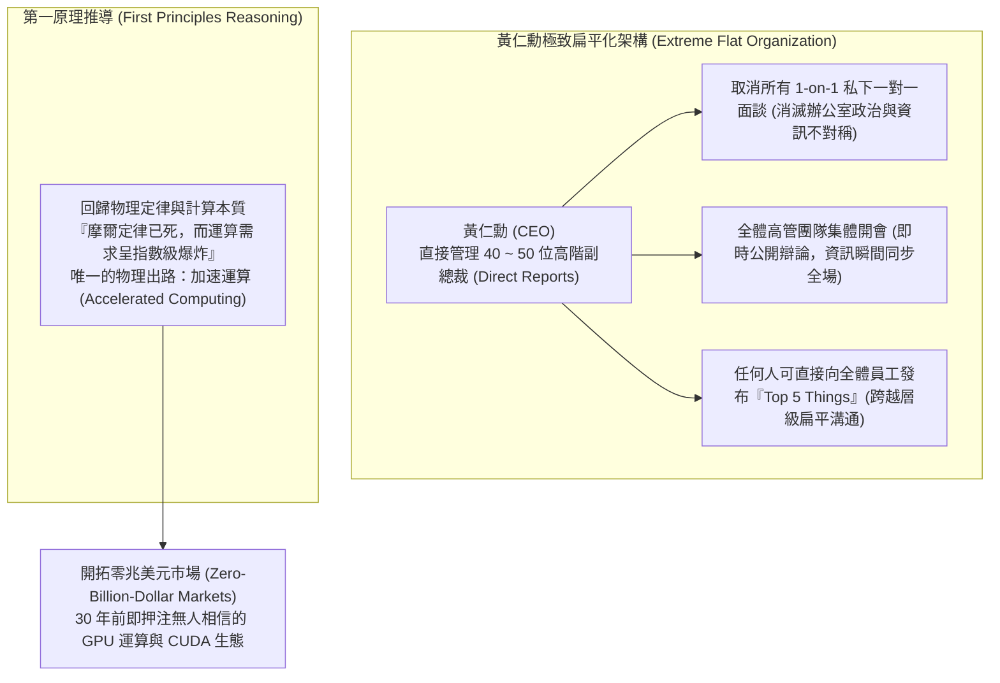

---
{"dg-publish":true,"permalink":"/98/jensen-huang/","tags":["商業概念","企業領袖","人工智慧","策略管理","PMBA"],"dg-note-properties":{"aliases":["黃仁勳","Jensen Huang","AI教父","輝達創辦人兼執行長"],"tags":["商業概念","企業領袖","人工智慧","策略管理","PMBA"]}}
---


# 黃仁勳 (Jensen Huang)

> [!NOTE]
> **核心概念精粹**：黃仁勳（Jensen Huang, 1963–），輝達（NVIDIA）共同創辦人暨執行長，是全球科技產業歷史上任期最長且成就最卓越的科技創始人之一。他以**「光速運作（Light Speed）」**、**「第一原理思考（First Principles Thinking）」**與**「極致扁平化管理」**著稱。黃仁勳以驚人的戰略定力，將輝達從一家瀕臨破產的 3D 繪圖晶片新創，轉型為市值突破三兆美元的全球 AI 運算基礎設施霸主。其獨創的「開拓零兆美元市場（Zero-Billion-Dollar Markets）」與「忍受痛苦與苦難（Pain and Suffering）」的領導哲學，成為全球管理學研究的新典範。

---

## 一、 學理定位：第一原理思考與獨創扁平組織架構

黃仁勳的管理實踐打破了商學院所有關於「傳統官僚層級」的教科書教條：



---

## 二、 黃仁勳領導哲學核心四大支柱

黃仁勳的領導風格展現出工程師的理性極致與創業家的熱血感召：

| 領導核心支柱 | 哲學內涵與實務運作 | 典型名言與管理實踐 |
| :--- | :--- | :--- |
| **1. 光速運作與即時調整<br>(Light Speed Execution)** | 拒絕繁瑣死板的五年規劃；企業應該像神經網絡一樣，根據市場反饋以光速進行動態即時重構。 | 「長程計畫往往是官僚藉口；我們每天都在根據第一原理即時重新規劃公司。」 |
| **2. 開拓零兆美元市場<br>(Zero-Billion-Dollar Markets)** | 絕不與對手在既有的成熟紅海中爭奪殘羹剩飯，而是提前十幾年佈局目前規模為零、但未來將重塑世界的巨大賽道。 | 2006 年全力投入 CUDA、2012 年押注 AlexNet 深度學習、2018 年押注光線追蹤與機器人 Omniverse。 |
| **3. 忍受痛苦與磨難<br>(Pain and Suffering)** | 偉大並非來自智商，而是來自經歷無數次瀕臨破產與磨難後所鍛造出的超強心理韌性。 | 「我祝你們每個人都能經歷大量的痛苦與苦難；因為唯有痛苦才能鍛造出偉大的品格。」 |
| **4. 毫無防禦的公開透明<br>(Radical Candor & Transparency)** | 在數十位高管面前公開直接指出錯誤，不給留虛偽的情面，但對事不對人；消滅一切資訊孤島。 | 「在公開場合討論錯誤，才能讓全公司所有人在同一瞬間學會同一堂昂貴的課。」 |

---

## 三、 經典企業實戰案例：CUDA 孤注一擲與贈送 OpenAI 第一台超級電腦

```carousel

<!-- slide -->
### 1. 2006 年 CUDA 豪賭：長達八年的華爾街質疑
- **孤注一擲**：2006 年黃仁勳決定在輝達每一顆 GPU 中強制內建 CUDA 專用硬體與軟體編譯器，這導致晶片面積激增、製造成本暴漲，而當時全世界幾乎沒有任何客戶需要用顯卡進行科學運算；
- **至暗時刻**：華爾街分析師痛斥 CUDA 浪費研發預算，輝達毛利率腰斬、股價崩跌 80%；
- **戰略回報**：黃仁勳咬牙堅持長達八年，每年投入數十億美元培育學術社群；直到 2012 年 AlexNet 深度學習突破，全球 AI 研究者驚喜發現：全天下只有輝達的 GPU 與 CUDA 能夠訓練神經網絡，瞬間開啟萬億美元 AI 時代。
<!-- slide -->
### 2. 2016 年親手向 OpenAI 交付全球首台 DGX-1
- **歷史性時刻**：2016 年黃仁勳帶著由輝達研發、價值數百萬美元的全球第一台 AI 超級電腦 [[DGX|DGX-1]]，親自驅車前往舊金山交付給當時名不見經傳的非營利研究機構 OpenAI；
- **手寫題詞**：黃仁勳在機身上親筆寫下：「To Elon and the OpenAI team! To the future of computing and humanity!」；
- **歷史回響**：正是這台 DGX 超級電腦，訓練出了幾年後震驚全球的 GPT 系列大模型，引爆了生成式 AI 革命，輝達市值狂飆十倍登頂全球之巔。
```

---

## 四、 經理人黃仁勳式領導力體檢表（Executive Decision Checklist）

在領導高科技創新或推動敏捷組織重組時，高階管理團隊應依序反思：

- [ ] **扁平化溝通與資訊透明度（Radical Transparency Audit）**：
  - 我們的管理架構是否存在層層彙報的「官僚傳話筒」？一線工程師的真實聲音與產品缺陷，是否需要跨越四五層主管才能傳達給 CEO？
- [ ] **零兆美元市場戰略前瞻（Zero-Billion-Dollar Horizon）**：
  - 我們當前投入的研發預算，有多少比例在跟隨同業做「同質化內卷」，有多少比例在提前佈局「目前市場規模為零、但三年後將引爆行業」的顛覆性賽道？
- [ ] **非受迫性痛苦承受力（Resilience in the Trough of Disillusionment）**：
  - 當我們推動的前瞻性專案連續兩年虧損、被資本市場與媒體猛烈質疑時，管理層是否具備堅守第一原理、不輕易腰斬專案的鋼鐵意志？
- [ ] **全端思考能力（Full-Stack Problem Solving）**：
  - 面對客戶痛點，我們是只提供一個孤立的單點零件（晶片），還是提供了「晶片 + 網路互聯 + 系統軟體 + 演算法庫」的全端完整解決方案？

---

## 五、 關聯概念與知識網絡

* 核心企業與運算架構：
  * [[nvidia_輝達|輝達 (NVIDIA)]]：黃仁勳引領之全球加速運算與 AI 霸主
  * [[DGX|DGX 超級電腦]]：黃仁勳親手打造並交付 OpenAI 之 AI 超級算力核心
  * [[Omniverse|Omniverse 數位孿生]]：黃仁勳佈局實體 AI 與機器人世界之虛實融合平台
  * [[tsmc_台積電|台積電 (TSMC)]]：黃仁勳與張忠謀三十年深厚戰略同盟
* 領導力與管理思維：
  * [[can-zhao-quan_參照權|參照權 (Referent Power)]]：黃仁勳熱情願景對全球數萬頂尖研發工程師之極限感召
  * [[conceptual-skills_概念技能|概念技能 (Conceptual Skills)]]：以第一原理洞穿未來三十年計算架構之戰略洞察
  * [[great-company_好公司|好公司 (Great Company)]]：以刺蝟原則與極致飛輪造就全球科技領袖
  * [[risk-taking_風險承擔|風險承擔 (Entrepreneurial Risk-Taking)]]：長達八年堅持 CUDA 研發之非對稱世紀豪賭
