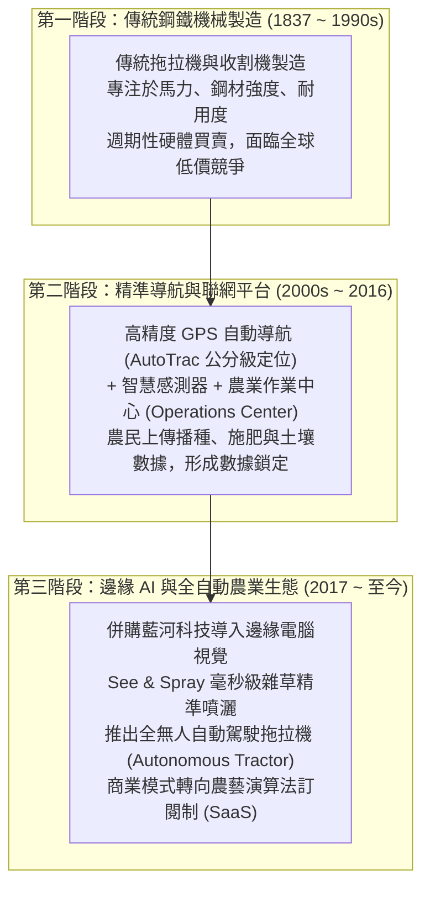

---
{"dg-publish":true,"permalink":"/98/john-deere/","tags":["商業概念","傳統轉型","智慧製造","物聯網","PMBA"],"dg-note-properties":{"aliases":["約翰迪爾","John Deere","迪爾公司","Deere & Company","智慧農業龍頭"],"tags":["商業概念","傳統轉型","智慧製造","物聯網","PMBA"]}}
---


# 約翰迪爾 (John Deere)

> [!NOTE]
> **核心概念精粹**：約翰迪爾（Deere & Company / John Deere），創立於 1837 年，是全球農業機械與重型工程裝備的百年霸主。它最卓越的商業成就，在於成功推動了**從「傳統鋼鐵農機製造商」向「高科技智慧農業（Precision Agri-Tech）與數據平台」的宏偉典範轉移**。約翰迪爾透過收購[[98_商業概念庫/blue-river-technology_藍河科技\|藍河科技]]導入邊緣電腦視覺與 AI，推出「See & Spray」精準噴灑技術，並依託 Operations Center 雲端平台建立聯網生態系，將硬體銷售轉化為高黏著度的農業 SaaS 經常性收入，成為全球傳統製造業數位轉型的教科書級標竿。

---

## 一、 學理定位：百年農機巨頭的「智慧工業（Smart Industrial）」轉型

約翰迪爾的轉型歷程深刻體現了麥可·波特關於「智慧聯網產品（Smart, Connected Products）」重塑競爭邊界的理論：



---

## 二、 約翰迪爾智慧農業商業模式轉型矩陣

| 轉型維度 | 傳統農機模式（Old Deere） | 智慧農業生態模式（Smart Deere） | 策略競爭優勢 |
| :--- | :--- | :--- | :--- |
| **核心產品定義** | 銷售鋼鐵重機械（拖拉機、收割機、播種機）。 | 提供「自動化機械 + 邊緣 AI + 雲端農藝數據平台」軟硬一體解決方案。 | 從一次性硬體利潤，跨越至高毛利率的軟體授權與訂閱經常性現金流。 |
| **客戶價值主張** | 「我們的機器馬力更大、更不容易故障。」 | 「**幫農民降低 80% 除草劑成本**，提高每英畝產量，節省 30% 燃料與工時。」 | 顧客由「成本支出」思維轉變為「投資報酬率（ROI）」採購決策。 |
| **數據資產閉環** | 售出後缺乏與使用者的數據互動。 | 全球數十萬台聯網農機每日回傳土壤濕度、種子密度與氣象數據，模型越用越聰明。 | 構築任何傳統競爭對手（如久保田、愛科）難以追趕的巨量專屬農業數據護城河。 |
| **經銷商關係** | 傳統維修零件銷售與保養更換。 | 經銷商升級為「智慧農藝顧問」，遠端監控故障預警，在零件損壞前主動維修。 | 極大化農忙時期的設備在線率，消除農民最恐懼的農忙停工風險。 |

---

## 三、 經典企業實戰案例：See & Spray 技術革命與生態融合

```carousel

<!-- slide -->
### 1. 併購藍河科技引爆「See & Spray」
- **產業痛點**：過去百年農民除草只能採用「地毯式無差別噴灑（Broadcast Spraying）」，大量除草劑浪費在光禿的土地上，不僅成本極高，更造成嚴重的土壤化學污染；
- **邊緣 AI 突破**：約翰迪爾於 2017 年以 3.05 億美元收購藍河科技，將其電腦視覺攝影機與機器學習演算法安裝於寬達 36 公尺的噴霧機桿上；
- **實測震撼**：拖拉機以時速 20 公里狂奔穿過農田時，AI 在毫秒內即時判斷每株植物是「玉米」還是「雜草」，並精準對雜草噴出微量藥劑，**實質減少高達 77%~85% 的除草劑消耗**。
<!-- slide -->
### 2. 全自動無人拖拉機（Autonomous 8R Tractor）
- **勞動力荒解方**：面對全球農業高齡化與嚴重缺工危機，約翰迪爾於 2022 年發表商業化全無人自動駕駛拖拉機；
- **手機一鍵放牧**：農民只需用智慧型手機將拖拉機運送至農田邊緣，滑動螢幕即可啟動；拖拉機透過 6 對雙目立體相機自主導航避障，24 小時晝夜無休翻土播種，將農業推入真正的無人駕駛時代。
```

---

## 四、 經理人傳統製造業數位轉型檢核表（Executive Decision Checklist）

在主導傳統重資產製造業推動物聯網與 AI 轉型時，高階管理團隊應依序審計：

- [ ] **客戶核心經濟學價值審計（Customer ROI Value Check）**：
  - 我們的智慧聯網功能，究竟是華而不實的行銷噱頭，還是能實質幫客戶「省下巨額耗材、提升產能良率」的剛需？（如約翰迪爾直接幫農民砍掉 80% 農藥支出）。
- [ ] **外部收購之組織整合保護（Acquisition Integration & Ring-Fencing）**：
  - 當收購高敏捷的 AI 新創團隊時（如約翰迪爾收購藍河科技），我們是否保護其研發獨立性，避免百年傳統官僚文化將新創菁英迅速窒息逼走？
- [ ] **硬體向服務化訂閱躍遷（Servitization & Recurring Revenue）**：
  - 我們是否建立了經常性收入（ARR）商業模式？硬體售出後，能否透過定期的演算法升級、高級數據分析向客戶持續收取訂閱費？
- [ ] **數據主權與客戶信任治理（Data Sovereignty & Trust）**：
  - 客戶在上傳營運生產數據時，是否對數據隱私抱有高度戒心？我們是否在合約中明確保障客戶對其數據的所有權，絕不擅自外洩或損害客戶利益？

---

## 五、 關聯概念與知識網絡

* 核心收購與技術夥伴：
  * [[blue-river-technology_藍河科技|藍河科技 (Blue River Technology)]]：約翰迪爾收購之精準農業電腦視覺先鋒
  * [[PMF_產品市場契合度 Product-Market Fit|產品市場契合度 (PMF)]]：智慧農業技術在農民田間驗證之核心標準
  * [[lean-startup_精實創業|精實創業 (Lean Startup)]]：藍河科技創辦人在農田敏捷訪談與 MVP 開發歷程
* 策略與商業模式：
  * [[great-company_好公司|好公司 (Great Company)]]：百年重工業巨頭持續自我革新、跨越週期之偉大典範
  * [[viable-business_好事業|好事業 (Viable Business)]]：從週期性硬體製造躍升為高黏著度數據訂閱生態
  * [[economies-of-scale_規模經濟|規模經濟 (Economies of Scale)]]：全球最大農機聯網節點數據積累之先發壁壘
  * [[core-competence_核心能力|核心能力 (Core Competence)]]：百年精密機械工藝與現代邊緣 AI 之深度融合
