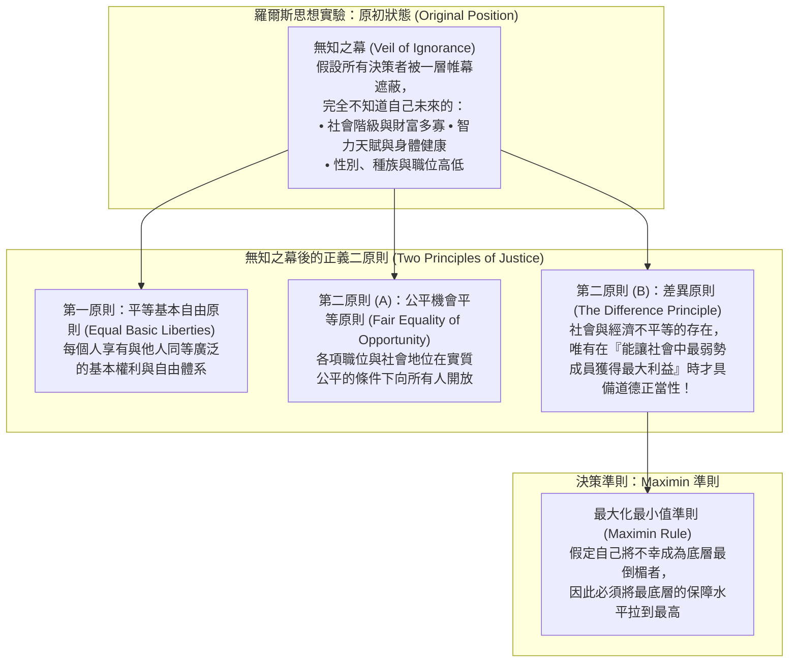
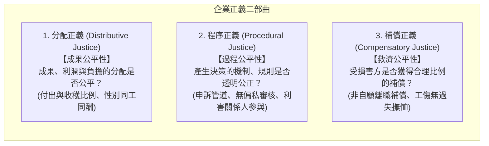

---
{"dg-publish":true,"permalink":"/98/justice-view/","tags":["商業概念","商業倫理","組織行為","哲學","PMBA"],"dg-note-properties":{"aliases":["正義觀點","正義倫理觀","Justice View of Ethics","羅爾斯正義論","Rawlsian Justice","公平正義觀"],"tags":["商業概念","商業倫理","組織行為","哲學","PMBA"]}}
---


# 正義觀點 (Justice View of Ethics)

> [!NOTE]
> **核心概念精粹**：正義觀點（Justice View of Ethics），以哲學家約翰·羅爾斯（John Rawls）《正義論》為集大成者。它主張道德決策的核心使命在於**追求公平（Fairness）、平等（Equality）與公正（Impartiality）**，要求規則制定者站在**「無知之幕（Veil of Ignorance）」**後思考，確保制度設計能保護社會中最弱勢的成員。在現代管理中，它延伸為**分配正義（Distributive）**、**程序正義（Procedural）**與**補償正義（Compensatory）**三大實踐支柱。

---

## 一、 學理淵源：羅爾斯的「無知之幕」與正義二原則

約翰·羅爾斯（John Rawls, 1921–2002）在 1971 年發表的傳世巨著《正義論》，被公認為 20 世紀政治哲學與倫理學的最高峰，其思想實驗徹底重塑了組織制度設計的邏輯：



---

## 二、 現代企業管理中正義觀點的三大維度架構

在企業薪酬激勵、組織考核、升遷裁員與爭議處理中，正義觀點具體展現為三大交互維度：



### 企業正義三維度實務深度解析

| 正義構面 | 核心問題與焦點 | 企業制度落地措施 | 組織行為後果對照 |
| :--- | :--- | :--- | :--- |
| **分配正義<br>(Distributive Justice)** | 資源、獎金、職位分配是否符合公平原則？（依貢獻、依需求或依平等分配）。 | 建立市場透明薪酬區間、績效獎金透明掛鉤、高管與基層薪資倍數合理化。 | 若缺失，引發嚴重的亞當斯公平理論（Equity Theory）失衡、員工消極怠工或集體跳槽。 |
| **程序正義<br>(Procedural Justice)** | 做出分配決策的遊戲規則是否客觀、一致、允許發聲？ | 考核指標事前公布、設立跨部門評審委員會、雙向面談回饋、申訴仲裁機制。 | **程序正義能顯著緩解不利結果的衝擊**！員工即便拿不到獎金，只要相信程序公平，依然信任組織。 |
| **補償正義<br>(Compensatory Justice)** | 當員工或顧客遭受非過失損害時，是否獲得按比例之充分賠償？ | 優於法定標準之裁員資遣費、職業災害全額醫療與復健撫恤、瑕疵召回賠付。 | 若缺失，引發嚴重的勞資訴訟、工會罷工抗爭與公關商譽全面毀滅。 |

---

## 三、 經典企業實戰案例：程序正義在組織變革中的奇蹟救贖

```carousel

<!-- slide -->
### 1. 金偉燦與莫伯尼（Kim & Mauborgne）程序正義工廠實驗
- **實地研究**：藍海策略提出者金偉燦曾針對兩家推動相同精益變革（全面導入自動化機器人）的跨國製造工廠進行對比；
- **A 工廠（缺乏程序正義）**：管理層閉門造車制定計畫，突然宣布自動化方案並下達命令。結果引發員工恐慌抗議、蓄意破壞新機台，最終工廠產能崩跌 30% 並爆發長期罷工；
- **B 工廠（極致程序正義）**：管理層在變革前六個月召集全體技術工人舉行座談，公開說明市場競爭危機（參與原則 Engagement）；詳細解釋為何需要引入自動化（說明原則 Explanation）；明確交代新考核標準與轉型再培訓路徑（預期清晰 Expectation Clarity）；
- **成果**：B 工廠員工主動協助調試機台，生產效率在三個月內提升 40%，成為全球標竿工廠。
<!-- slide -->
### 2. 差異原則在合夥制企業中的實踐：博斯艾倫（Booz Allen）利潤池
- **傳統問題**：高階合夥人往往壟斷最肥沃的大客戶，初級顧問被殘酷壓榨且缺乏分潤；
- **差異原則落實**：博斯艾倫建立「全公司單一利潤池（One-Firm Profit Pool）」：合夥人獎金不僅取決於個人簽單，更與「其所指導之初級顧問的留存率與晉升率」直接掛鉤；
- **制度成果**：確保了組織頂層的繁榮能直接外溢至最底層初級員工，打造出凝聚力極高、人才流失率遠低於同業的顧問天團。
```

---

## 四、 經理人正義觀點審計檢核表（Executive Decision Checklist）

在推動考核改革、資源重組或重大人事裁決時，決策層應進行下列正義體檢：

- [ ] **無知之幕思維推演（The Veil of Ignorance Test）**：
  - 「如果我們制定這套薪酬考核制度時，完全不知道自己會是這家公司的 CEO、中層經理還是最基層的約聘客服，我們還會願意接受這套制度嗎？」
- [ ] **程序正義三大基石檢驗（Procedural Triad Audit）**：
  - 員工在遭遇不公正考評或爭議處分時，是否有「向獨立於原主管之外的第三方進行申訴」的暢通管道？決策依據是否允許員工檢視？
- [ ] **差異原則對底層賦能（Difference Principle Audit）**：
  - 公司引入全新生成式 AI 工具或利潤成長時，這項成果是全數被高管與股東獨吞，還是實質提升了基層員工的技能溢價、工作環境與安全保障？
- [ ] **同工同酬與弱勢保護（Pay Equity & Anti-Bias Check）**：
  - 組織內部是否存在不可解釋的「性別薪資差距（Gender Pay Gap）」或「背景關係溢價」？我們是否定期進行薪酬審計以消除無意識偏見？

---

## 五、 關聯概念與知識網絡

* 核心商業倫理三大觀點：
  * [[utilitarian-view_功利主義觀點|功利主義觀點 (Utilitarian View of Ethics)]]：正義觀點對純粹效率極大化與不平等的制度約束
  * [[rights-view_權利觀點|權利觀點 (Rights View of Ethics)]]：正義觀點第一原則（平等自由）對個體人權的基石依託
  * [[ethical-responsibility_倫理責任|倫理責任 (Ethical Responsibility)]]：公平對待員工與利害關係人的道德自覺
  * [[enterprise-dao-de-gui-fan_企業道德規範|企業道德規範 (Code of Conduct)]]：反歧視、防範利益衝突之制度化章程
* 組織行為與人力資源：
  * [[person-job-fit_人職匹配|人職匹配 (Person-Job Fit)]]：招募與考評中程序正義之實質保障
  * [[intrinsic-vs-extrinsic-motivation_內在激勵與外在激勵|內在激勵與外在激勵]]：分配正義與程序正義對組織公民行為（OCB）之激發
  * [[theory-8_期望理論|期望理論 (Expectancy Theory)]]：努力、績效與獎酬關聯度（工具性 I）對正義感之心理依賴
  * [[great-company_好公司|好公司 (Great Company)]]：以正義文化凝聚內部卓越團隊之基業長青準則
