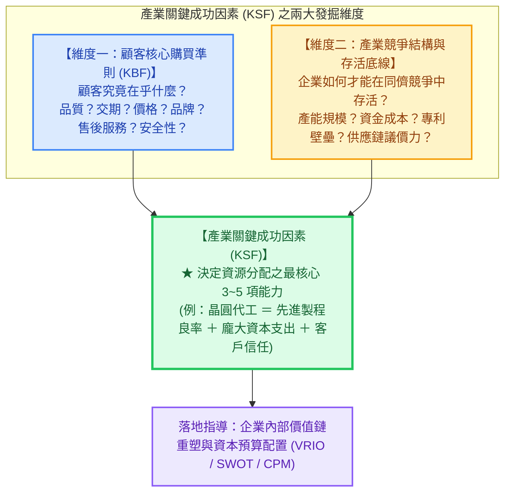

---
{"dg-publish":true,"permalink":"/98/key-success-factors-ksf/","tags":["商業概念","策略管理","產業分析","競爭策略","PMBA"],"dg-note-properties":{"aliases":["關鍵成功因素","KSF","Key Success Factors","關鍵成功因子","key-success-factors-ksf_關鍵成功因素"],"tags":["商業概念","策略管理","產業分析","競爭策略","PMBA"]}}
---


# 關鍵成功因素 (Key Success Factors, KSF)

> 💡 **導航與索引**：本篇為產業結構分析、競爭者解構與企業核心資源配置之基石概念。探討特定產業環境中決定企業能否生存、獲利與勝出的少數關鍵驅動要件。亦可參閱競爭對比架構 [[98_商業概念庫/competitive-matrix_競爭矩陣\|競爭矩陣 (Competitive Matrix / CPM)]]、產業競爭結構 [[98_商業概念庫/Porter's Five Forces Analysis_波特五力分析\|波特五力分析 (Porter's Five Forces)]]、宏觀趨勢掃描 [[98_商業概念庫/PESTEL分析\|PESTEL 分析 (PESTEL Framework)]]、價值鏈解構 [[98_商業概念庫/Firm_Value_Chain_企業價值鏈\|企業價值鏈 (Value Chain)]]，以及微觀企業策略 [[98_商業概念庫/SWOT分析\|SWOT 分析]]。

---

## 一、 核心定義與策略本質

### 1. 核心定義
- **關鍵成功因素（Key Success Factors，簡稱 KSF，又稱關鍵成功因子）** 係指在**特定產業環境、市場競爭結構與技術規範下，企業欲在市場中立足並取得持續獲利，所必須具備並做到卓越的少數幾個（通常為 3~5 項）最核心資源、技術能力、營運條件或競爭優勢**。
- **產業層級的客觀規則，而非個別企業的主觀願望**：
  - KSF 是由**外部「市場顧客需求特質」與「產業客觀競爭結構」所共同塑造的遊戲規則**。
  - 一個產業的 KSF 對全體同儕是一致的，但企業能透過相異的策略定位（如極致成本領先 vs. 差異化）在不同 KSF 維度上進行資源權重配置。



---

## 二、 跨產業 KSF 對標矩陣：台大 PMBA 經典個案實證

不同的產業結構決定了截然相異的 KSF 清單。經理人若錯把別人的 KSF 當作自己的戰略重心，將引發資源錯配的災難：

| 產業賽道 | 代表性企業標竿 | 核心 KSF 清單（前三大生存與勝出要件） | 策略意涵與營運特徵 |
| :--- | :--- | :--- | :--- |
| **半導體晶圓代工<br>(Foundry)** | **台積電 (TSMC)** | 1. **極致製程良率與技術領先**（研發先行）<br>2. **巨額資本支出規模 (CapEx)**（以千億為單位投入）<br>3. **純晶圓代工承諾與客戶信任**（不與客戶競爭） | 資本密集與技術密集交織，形成全球最高移動障礙與定價特權。 |
| **電子專業代工<br>(EMS)** | **鴻海 (Foxconn)** | 1. **全球供應鏈即時調度與垂直整合**<br>2. **超大型訂單之快速量產交付能耐 (NPI)**<br>3. **極致微利成本控管與採購議價力** | 以高週轉率補足低淨利率，透過極限營運效率建立規模壁壘。 |
| **便利商店零售<br>(Convenience Retail)** | **統一超 (7-11)** | 1. **黃金商圈店點佈局密集度（鄰近性）**<br>2. **智慧物流常溫/低溫一日多配效率**<br>3. **鮮食與自有品類創新（推升毛利）** | 通路密集度形成網絡外部性，營運資金採負現金轉換週期（負 CCC）。 |
| **生技新藥研發<br>(Biotech R&D)** | **各國新藥研發廠** | 1. **原創靶點專利佈局與智財壁壘**<br>2. **跨國臨床試驗（IND/NDA）法規推進能力**<br>3. **充足現金跑道與資本市場募資能力** | 高風險、長週期、極端二元回報（Binary Outcome），核心在於實質選擇權管理。 |

---

## 三、 KSF 隨產業生命週期（PLC）之動態演化

產業的 KSF 絕非靜止不變，隨著產業由導入期走向成熟與衰退期，決定勝負的關鍵因素會發生結構性轉變：

```text
【產業生命週期各階段 KSF 動態演化軌跡】

  階段：   【導入期 (Introduction)】   【成長期 (Growth)】       【成熟期 (Maturity)】      【衰退期 (Decline)】
  市場特徵：產品定義模糊、顧客少        需求爆發、群雄逐鹿        市場飽和、同質化競爭      需求萎縮、價格血洗
  ────────┼───────────────────────────┼─────────────────────────┼──────────────────────────┼─────────────────────
  核心    │ • 產品功能與技術突破       │ • 品牌認知度與通路鋪貨  │ • 極致成本控管與製程優化 │ • 殘留利基市場聚焦
  KSF     │ • 驗證 PMF (客戶痛點)     │ • 產能擴建與搶佔份額    │ • 顧客忠誠度與留存率     │ • 精實資產變現與清算
  重點    │ • 獲取種子輪融資          │ • 行銷獲客與快速規模化  │ • 供應鏈整合與營運效率   │ • 審慎控制資本支出
```

- **警示**：許多在導入期憑藉「技術領先」崛起的技術導向新創，進入成熟期後因缺乏「成本控制、通路管理與供應鏈協同能力」，往往迅速被具備製造規模與銷售通路的後進巨頭徹底碾壓。

---

## 四、 企業高階經理人實戰三大軍規

### 1. 貫徹「KSF 資源聚焦原則」：集中優勢兵力打殲滅戰
* 企業資源永遠有限，切忌在所有構面上全面開花。
* 經理人應定期對照**[[98_商業概念庫/competitive-matrix_競爭矩陣\|競爭態勢矩陣 (CPM)]]**，為每項 KSF 賦予權重，確保公司的核心資本支出（CapEx）與核心研發預算，**至少有 70% 以上集中配置於產業權重最高的前兩大 KSF 項目**。

### 2. 警惕「把自身的優勢誤當成產業的 KSF」
* 新創創辦人最常見的盲點，是把「自己引以為傲的獨特技術」當成客戶買單的理由。
* **反思金句**：**如果某項技術顧客根本不在乎、也不願意為此多付一毛錢，那它充其量只是自我感動的工程藝術品，絕非 KSF！**

### 3. 主動重塑 KSF：以破壞式創新「改寫產業遊戲規則」
* 偉大的顛覆者（Disruptors）從不滿足於在舊有 KSF 上與傳統巨頭苦戰：
  * **Netflix 顛覆 Blockbuster**：把錄影帶租賃的 KSF（實體店鋪數量、逾期罰款收入），改寫為串流時代的全新 KSF（演算法推薦精度、原創自製影集）；
  * **Apple iPhone 顛覆 Nokia**：把手機產業的 KSF（通話續航力、抗摔機械結構），改寫為智慧終端的全新 KSF（多點觸控螢幕、App Store 生態系）。

---

## 五、 關聯主題與模組網絡

- 🧭 **課程核心模組對接**：
  - [[04_主題選修/12_產業分析與投資策略/02_模組筆記/Module_1_產業框架與動態競爭/M1-1_產業分析本質與中層定位\|M1-1 產業分析本質與中層定位]]（產業結構分析與中層定位分析核心工具）
  - [[04_主題選修/12_產業分析與投資策略/02_模組筆記/Module_1_產業框架與動態競爭/M1-3_產業獲利結構差異與十大經典理論\|M1-3 產業獲利結構差異與十大經典理論]]（台積電 vs 鴻海跨產業 KSF 與獲利因子對標）
  - [[04_主題選修/10_創業與企業財務策略/02_模組筆記/Module_1_創新思維與商業模式/M1-8_企業內部資源理論與動態能耐矩陣\|M1-8 企業內部資源理論與動態能耐矩陣]]（內部 VRIO 資源能力與外部產業 KSF 之動態配適）
  - [[04_主題選修/10_創業與企業財務策略/02_模組筆記/Module_1_創新思維與商業模式/M1-5_創業構想發展與兩階段可行性評估\|M1-5 創業構想發展與兩階段可行性評估]]（兩階段可行性審查之產業成功要件）
- 🔗 **核心概念原子卡片雙向互聯**：
  - [[98_商業概念庫/competitive-matrix_競爭矩陣\|競爭矩陣 (Competitive Matrix / CPM)]]（KSF 加權評分模型之實戰應用工具）
  - [[98_商業概念庫/Porter's Five Forces Analysis_波特五力分析\|波特五力分析 (Porter's Five Forces)]]（外在競爭壓力決定產業存活底線 KSF）
  - [[98_商業概念庫/PESTEL分析\|PESTEL 分析 (PESTEL Framework)]]（宏觀大環境趨勢引導 KSF 之動態轉移）
  - [[98_商業概念庫/Firm_Value_Chain_企業價值鏈\|企業價值鏈 (Value Chain)]]（重塑價值鏈各環節以支撐核心 KSF）
  - [[98_商業概念庫/SWOT分析\|SWOT 分析]]（以內部優劣勢對焦外部產業 KSF 關鍵要件）
