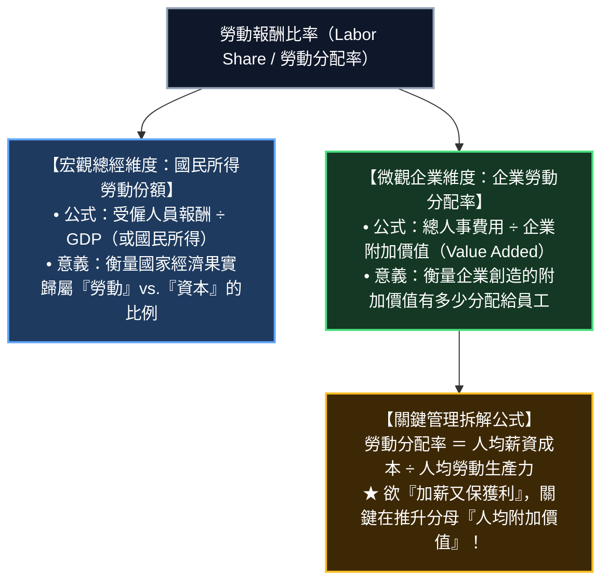
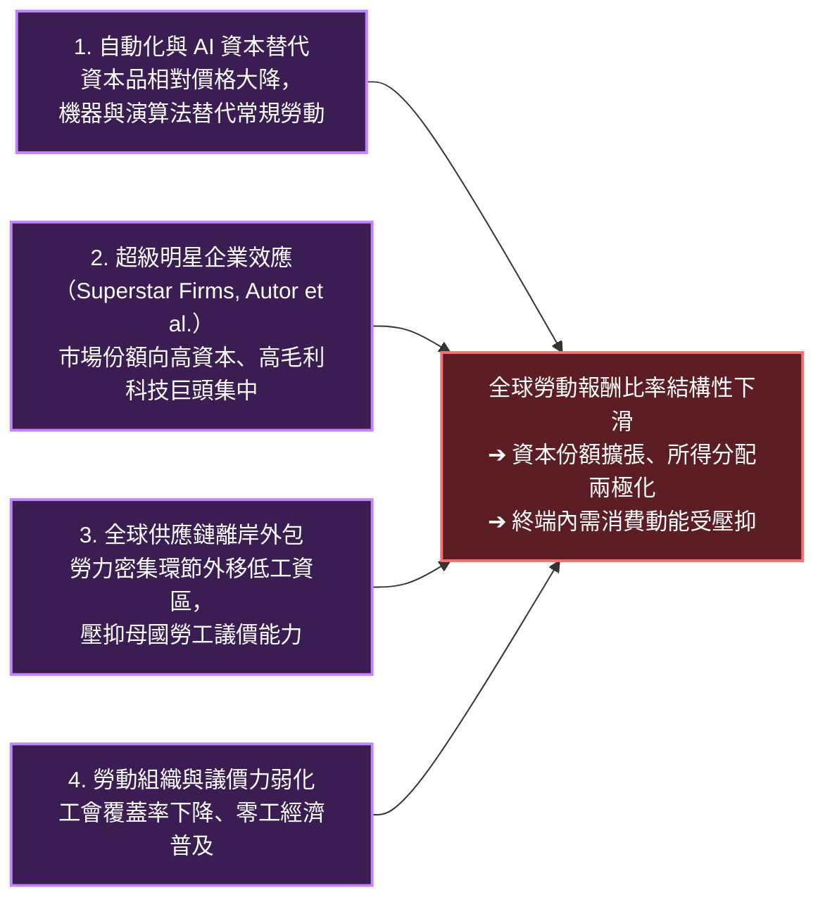
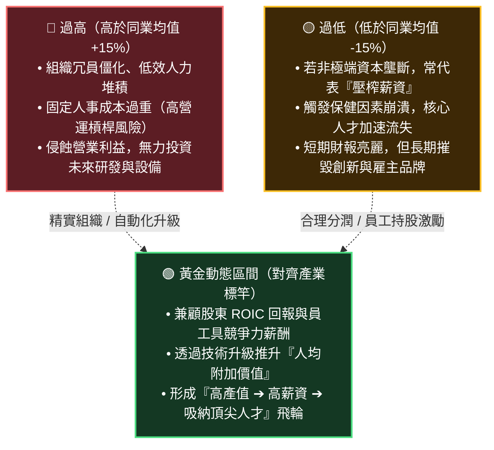

---
{"dg-publish":true,"permalink":"/98/labor-share-of-income/","tags":["商業概念","總體經濟","財務分析","管理會計","人力資源策略","生產力分析","PMBA"],"dg-note-properties":{"aliases":["勞動報酬比率","勞動分配率","勞動份額","受僱人員報酬占比","Labor Share","Labor Share of Income","Labor Distribution Ratio"],"tags":["商業概念","總體經濟","財務分析","管理會計","人力資源策略","生產力分析","PMBA"]}}
---


# 勞動報酬比率 (Labor Share of Income / 勞動分配率)

> **商管核心價值**：  
> 「勞動報酬比率過高，企業將被沉重的人事包袱壓垮而喪失再投資能力；勞動報酬比率過低，代表企業過度壓榨人力資本，最終必將面臨頂尖人才流失與組織創新枯竭。卓越的企業家不是靠『壓低薪資』來壓降勞動分配率，而是透過技術升級與商業模式創新，讓**人均附加價值（分母）的增速遠超人均薪資（分子）**，實現股東高回報與員工高待遇的雙贏。」  
> 
> 在 PMBA 商管決策體系中，**勞動報酬比率**同時橫跨 **「總體經濟（國民所得勞動份額）」** 與 **「微觀企業管理會計（企業勞動分配率）」** 兩大視角。在總經上，它反映經濟成長果實於「勞方（薪資）」與「資方（利潤）」間的結構性分配；在企業內部，它直接衡量「公司所創造的每一元附加價值中，有多少比例分配給了員工」，是檢驗人事成本效率、組織冗員風險與薪酬競爭力的核心財務指標。

---

## 一、 雙維度核心定義與數理公式



### 1.1 總體經濟維度（Macro: Labor Share of Income）
$$\text{總體勞動報酬比率} = \frac{\text{受僱人員報酬（薪資、獎金、雇主負擔勞健保與退休金）}}{\text{國內生產毛額（GDP）或 國民所得（NI）}} \times 100\%$$
- **與資本份額（Capital Share）之互補關係**：
  在國民所得會計中，總產出扣除間接稅淨額後，主要在**勞動報酬（Labor Share）**與**資本報酬（Capital Share：企業營業盈餘、折舊、利息與租金）**之間分配：
  $$\text{Labor Share} + \text{Capital Share} \approx 1$$

### 1.2 微觀企業維度（Micro: 企業勞動分配率 / Labor Distribution Ratio）
$$\text{企業勞動分配率} = \frac{\text{人事費用總額（Total Personnel Expenses）}}{\text{附加價值（Value Added）}} \times 100\%$$
- **附加價值（Value Added）的兩種實務算法**：
  1. **加算法（分配面）**：$\text{附加價值} = \text{營業利益} + \text{人事費用} + \text{折舊與攤提} + \text{租金} + \text{利息費用} + \text{稅捐}$
  2. **扣減法（生產面）**：$\text{附加價值} = \text{營業收入} - \text{外購原物料與外包加工費}$
- **經理人必懂的黃金拆解式（薪資 vs. 生產力）**：
  $$\text{勞動分配率} = \frac{\text{人事費用}}{\text{附加價值}} = \frac{\text{人事費用} / \text{員工人數}}{\text{附加價值} / \text{員工人數}} = \frac{\text{人均薪資成本}}{\text{人均勞動生產力（Labor Productivity）}}$$
  > **實戰解讀**：若公司今年幫全員加薪 8%（分子 $+8\%$），但同時透過 AI 工具與自動化讓「人均附加價值」提升 15%（分母 $+15\%$），企業的勞動分配率反而下降、淨利率反而上升！

---

## 二、 總體經濟趨勢：為何全球勞動報酬比率長期下滑？

經濟學家卡爾多（Nicholas Kaldor, 1961）曾歸納著名的「卡爾多典型事實」，認為各國勞動份額長期穩定於 $60\% \sim 65\%$。然而自 1980 年代起，包含美國、台灣、日本、韓國在內的先進經濟體皆出現**結構性長期下滑**（例如台灣受僱人員報酬占 GDP 比重由 1990 年代逾 50% 滑落至近年約 43%～44%）。



- **超級明星企業效應（Superstar Firms）實證**：
  MIT 經濟學家 David Autor 等人（2020）指出，像 NVIDIA、Apple、台積電等寡占龍頭憑藉規模經濟、專利與網絡效應吃下極高市占率，其營收與營業盈餘呈指數級暴增，但所需員工人數並未等比例膨脹，導致整體產業的「平均勞動報酬比率」被結構性拉低。

---

## 三、 企業微觀診斷：跨產業標竿區間與失衡風險

不同商業模式的資本密集度天差地別，評估勞動分配率**絕不可跨產業一刀切**，而必須與同業標竿（Peer Group）對比：

| 產業類型 | 合理勞動分配率參考區間 | 成本結構特徵與代表企業 | 財務管理核心焦點 |
| :--- | :---: | :--- | :--- |
| **高資本／高技術密集業**<br>（先進晶圓代工、石化、電信） | **25% ～ 40%** | 需保留龐大盈餘支付天價折舊與 CapEx 資本支出（如台積電、電信三雄） | 雖然比率低，但因人均產值極高，員工絕對年薪依然稱霸市場 |
| **一般製造與電子代工業**<br>（精密零組件、EMS 組裝） | **45% ～ 55%** | 物料成本高、毛利率受限，高度依賴自動化與產能利用率（如鴻海、傳統製造） | 嚴防產線自動化不足導致人事比率突破 60% 警戒線 |
| **知識密集與專業服務業**<br>（軟體 SaaS、管顧、金融租賃） | **55% ～ 70%** | 幾乎無重資產設備折舊，核心生產要素即為高階人才（如軟體業、中租-KY 業務團隊） | 透過標準化產品與 AI 賦能打破「純靠人頭堆營收」的線性瓶頸 |

---

### 3.1 勞動分配率「過高」vs.「過低」的雙向陷阱



---

## 四、 高階經理人實戰優化檢核清單

企業在面對缺工潮、基本工資調漲與 AI 轉型壓力時，應透過以下 5 項財務與人資連動檢核進行優化：

```markdown
### 📋 勞動報酬比率與生產力優化 5 步審計表

- [ ] 1. 【分子分母雙軸拆解】：
         過去三年公司勞動分配率上升，是因為「市場搶才被迫加薪（分子 ↑）」，還是「產品陷入價格戰導致人均附加價值萎縮（分母 ↓）」？
- [ ] 2. 【同業橫向對標（Peer Benchmarking）】：
         將本公司的勞動分配率與「人均附加價值」與產業前三大標竿企業對照，定位自身處於高薪高產值象限，還是低薪低產值泥淖？
- [ ] 3. 【彈性薪酬結構設計】：
         將部分「固定底薪」轉化為與附加價值或營業利益連動的「變動分紅／員工認股權（ESOP）」，在景氣下行時降低固定人事成本帶來的營運槓桿風險。
- [ ] 4. 【AI 與自動化槓桿投入】：
         盤點內部高重複性行政與營運流程，評估導入 AI 代理或自動化設備能否在 18 個月內顯著拉升「人均附加價值」。
- [ ] 5. 【避免惡性降本自殘】：
         切忌在未改善流程前盲目「凍結薪資或齊頭式裁員」，應先確保關鍵核心骨幹的薪酬處於市場前 25%（守住保健底線），優先淘汰低附加價值產品線。
```

---

## 五、 PMBA 模組講義與知識網絡鏈結

### 5.1 官方課程與模組雙向反向鏈結
- [[04_主題選修/12_產業分析與投資策略/02_模組筆記/Module_1_總論與架構/M1-3_產業獲利結構差異與十大經典理論\|M1-3 產業獲利結構差異與十大經典理論]]：
  - **跨產業成本與獲利驅動結構對照**：對比台積電（高資本寡占、低人事費用率但極高人均產值）、鴻海（極致費用管控）與中租-KY（高徵信業務人力費用率）的結構性差異。
- [[04_主題選修/10_創業與企業財務策略/02_模組筆記/Module_1_創新思維與商業模式/M1-9_商業模式畫布架構與價值主張設計\|M1-9 商業模式畫布架構與價值主張設計]]：
  - **成本結構與關鍵資源設計**：評估新創屬於「資本驅動」或「人力驅動」架構，避免早期過度擴編推升固定人事包袱。
- [[04_主題選修/12_產業分析與投資策略/02_模組筆記/Module_1_總論與架構/M1-6_產業分析模式與九大分析工具矩陣\|M1-6 產業分析模式與九大分析工具矩陣]]：
  - **平衡計分卡（BSC）之財務與學習成長平衡**：透過合理勞動分配率與人才投資，防止為了美化短期財務利潤而犧牲組織長期人力資本。

### 5.2 商業概念庫相關卡片
- [[98_商業概念庫/two-factor-theory_雙因素理論\|two-factor-theory_雙因素理論]]（薪酬作為保健因素之底線防禦，過低勞動分配率將引發人才崩盤）
- [[98_商業概念庫/efficient-frontier_效率前緣\|efficient-frontier_效率前緣]]（透過技術與商模創新同步實現「高員工報酬」與「高股東回報」的兩全突破）
- [[98_商業概念庫/DOL_營運槓桿\|DOL_營運槓桿]]（固定人事薪資費用對企業營業利益波動的槓桿放大效應）
- [[98_商業概念庫/ROIC_投入資本報酬率 Return on Invested Capital\|ROIC_投入資本報酬率]]（附加價值中「資本份額」轉化為股東超額資本回報之最終檢驗）
- [[98_商業概念庫/vpc-value-price-cost_價值價格成本分析\|vpc-value-price-cost_價值價格成本分析]]（唯有擴大總價值楔子 $V - C$，才能同步做大勞資雙方可分配的附加價值大餅）
