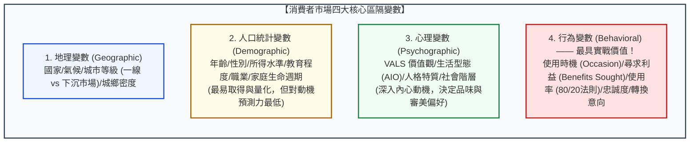

---
{"dg-publish":true,"permalink":"/98/market-segmentation/","tags":["商業概念","行銷管理","策略管理","STP","市場區隔","顧客洞察","PMBA"],"dg-note-properties":{"aliases":["市場區隔","市場細分","客群細分","顧客區隔","Market Segmentation","market-segmentation","市場區隔變數","市場分群"],"tags":["商業概念","行銷管理","策略管理","STP","市場區隔","顧客洞察","PMBA"],"類別":"商業概念庫"}}
---


# 市場區隔 (Market Segmentation / 市場細分)

> **核心名言**：  
> 「如果你試圖討好所有人，你最終誰也討好不了。市場區隔是一門策略藝術——它承認企業不可能以相同的滿意度服務所有人，因此必須將龐大異質的市場切分為具有相似需求的同質群體。」  
> —— 菲利普·科特勒（Philip Kotler, 現代行銷學之父, *Marketing Management*）  
>  
> 「市場區隔的本質是價格歧視與消費者剩餘的最大化攫取。當你對異質群體採用同一種產品與定價時，你不是把高支付意願顧客的錢留在了桌上，就是將價格敏感顧客拒之門外。」  
> —— 溫德爾·史密斯（Wendell R. Smith, 市場區隔理論創始人, 1956）

---

## 一、 核心定義與經濟學本質

### 1.1 經典理論起源與演進
- **理論起源（Wendell Smith, 1956）**：
  美國行銷學家溫德爾·史密斯（Wendell R. Smith）在《行銷期刊》（*Journal of Marketing*）發表劃時代論文《產品差異化與市場區隔作為替代性行銷策略》，首次正式提出**市場區隔（Market Segmentation）**概念。史密斯指出：傳統行銷視市場為一塊均質的整體；而現代行銷必須將一個**「異質的大市場（Heterogeneous Market）」**拆解為數個內部需求高度相似、外部特徵顯著差異的**「相對同質子市場（Homogeneous Sub-markets）」**。
- **STP 戰略流程的基石起點**：
  在科特勒的 STP 架構中，市場區隔是第一步（Step 1），也是決定後續「[[98_商業概念庫/target-market-selection_目標市場選擇\|目標市場選擇 (Targeting)]]」與「[[98_商業概念庫/positioning-strategy_定位策略\|市場定位 (Positioning)]]」成敗的最關鍵基礎：
  
$$\text{STP 策略鏈}：\underbrace{\text{市場區隔 (Segmentation)}}_{\text{依特徵切分市場}} \xrightarrow{\text{篩選}} \underbrace{\text{目標選擇 (Targeting)}}_{\text{鎖定資源投入}} \xrightarrow{\text{植入}} \underbrace{\text{定位策略 (Positioning)}}_{\text{佔領顧客心智}}$$

---

### 1.2 經濟學本質：價格歧視與消費者剩餘榨取
從微觀經濟學角度視之，市場區隔是企業實現**次級與三級價格歧視（Second & Third-degree Price Discrimination）**的實踐工具：

```
【單一定價 vs. 市場區隔定價的經濟效益對比】

  價格 (P)                               價格 (P)
     ▲                                      ▲
     │                                      │
  P_高├─ ─ ─ ─ ─ ─ ─ ─ ─ ─                  P_1 ├───────┐【區隔 1：高階商務客】
     │                   \                  │       │   (支付意願極高，榨取剩餘)
  P* ├───────────────┐   \                  P_2 ├───────┼───────┐【區隔 2：主流白領客】
     │  單一定價     │   \                  │       │       │
     │  遺留大量剩餘 │    \                 P_3 ├───────┼───────┼───────┐【區隔 3：價格敏感族】
     │  或排擠平價客 │     \                │       │       │       │
  0  └───────────────┴──────► 數量 (Q)      0  └───────┴───────┴───────┴──────► 數量 (Q)
           【未區隔市場】                                 【精準區隔市場】
```

1. **單一定價的死角**：若對全市場收取單一均價 $P^*$，對於上方高支付意願顧客（如商務艙旅客、極客買家），企業白白流失了巨額的「消費者剩餘」；而下方低支付意願顧客（如學生族群）則直接流失。
2. **區隔創造利潤極大化**：透過市場區隔設計不同規格、包裝、功能與定價階梯，企業得以在不同需求彈性的客群中同時實現利潤最大化與銷量擴張。

---

## 二、 四大核心區隔變數體系 (Segmentation Bases)

消費者市場的細分不能單憑直覺，科特勒建立了涵蓋由表及裡、從靜態到動態的**四大區隔維度**：



### 2.1 四大變數深度解析與指標

1. **地理變數（Geographic Variables）**：
   - 區域文化、氣候差異、城市能級（如一線精緻都市客群對比三四線下沉市場）。
   - *案例*：超商鮮食配方南北有別（南部口味偏甜、北部講求低卡少油）；羽絨衣品牌依氣溫等溫線動態調配各地庫存。
2. **人口統計變數（Demographic Variables）**：
   - 年齡（Z世代、銀髮族）、性別、可支配所得、婚姻與家庭結構（單身頂客族 DINK vs. 雙薪三代同堂）。
   - *特徵*：數據最容易透過政府普查與問卷取得，**但致命弱點是「無法直接解釋購買動機」**（同樣是 40 歲高所得男性，有人熱衷越野露營、有人沉迷古典音樂）。
3. **心理變數（Psychographic Variables）**：
   - **VALS 架構（Values and Lifestyles）**：將消費者區分為「創新者（Innovators）」、「思考者（Thinkers）」、「成就者（Achievers）」、「體驗者（Experiencers）」等。
   - 關注消費者的 AIO 構面：活動（Activities）、興趣（Interests）、意見（Opinions）。決定了顧客願意為哪些「情感與自我實現」支付溢價。
4. **行為變數（Behavioral Variables）—— 現代數據行銷的黃金維度**：
   - **追求利益（Benefits Sought）**：同一品類中，顧客最看重哪個核心價值？例如牙膏市場：防蛀健齒（實用派）、美白去漬（社交派）、抗敏感（保健派）。
   - **使用時機（Occasions）**：節慶送禮、運動後電解質補充（舒跑）、深夜加班能量補給（Red Bull）。
   - **使用者地位與頻率（Usage Rate & 80/20 法則）**：少數 20% 的重度使用者（Heavy Users）往往貢獻 80% 的品類銷量；企業應對忠誠顧客設計專屬留存機制。

---

### 2.2 B2B 工業市場專用區隔模型：波諾馬-夏皮洛嵌套模型 (Nested Approach)
企業市場（B2B）的買方是理性組織而非個人，哈佛商學院波諾馬（Bonoma）與夏皮洛（Shapiro）提出了由外而內的五層嵌套區隔法：

```text
【B2B 嵌套式市場區隔架構 (Bonoma & Shapiro)】

   ┌────────────────────────────────────────────────────────┐
   │ 1. 外部人口統計 (Demographics)：產業類別、公司規模、地理據點 │
   │  ┌──────────────────────────────────────────────────┐  │
   │  │ 2. 營運變數 (Operating Variables)：客戶技術水準、使用率   │  │
   │  │  ┌────────────────────────────────────────────┐  │  │
   │  │  │ 3. 採購途徑 (Purchasing Approaches)：集權/分權採購   │  │  │
   │  │  │  ┌──────────────────────────────────────┐  │  │  │
   │  │  │  │ 4. 情境因素 (Situational Factors)：急迫性、訂單規模│  │  │  │
   │  │  │  │  ┌────────────────────────────────┐  │  │  │  │
   │  │  │  │  │ 5. 個人特質：決策者風險容忍度、忠誠傾向│  │  │  │  │
   │  │  │  │  └────────────────────────────────┘  │  │  │  │
   │  │  │  └──────────────────────────────────────┘  │  │  │
   │  │  └────────────────────────────────────────────┘  │  │
   │  └──────────────────────────────────────────────────┘  │
   └────────────────────────────────────────────────────────┘
     最外層（最易辨識、通用） ──────────────► 最內層（最深入、具專屬競爭力）
```

---

## 三、 有效市場區隔的五大檢驗準則 (Kotler's MASDA Criteria)

並非隨意劃分出的群體都能成為合格的市場區隔。科特勒提出嚴謹的 **MASDA 檢驗準則**：

| 檢驗維度 | 英文準則 | 核心問題與失敗警訊 |
| :--- | :--- | :--- |
| **可衡量性** | **Measurable** | 該區隔的**人口規模、購買力與消費特徵**能否被精準量化測量？若界定模糊（如「有智慧的顧客」），無法進行市場規模預估。 |
| **足量性** | **Substantial** | 該區隔是否**足夠龐大且具備獲利潛力**，足以支撐獨立的產品開發與行銷投資？過度細分的「微型區隔」會導致固定成本無法攤提。 |
| **可接近性** | **Accessible** | 企業能否透過現有的**行銷溝通渠道與實體/數位物流通路**有效觸達並服務該群體？ |
| **可差異化** | **Differentiable** | 該區隔對於不同的行銷組合（4P）是否具備**本質上顯著不同的反應**？若單身與已婚女性對某保養品的反應完全相同，兩者就不應被切為不同區隔。 |
| **可執行性** | **Actionable** | 企業自身是否具備相應的**資源、技術與組織能耐**，足以制定切實可行的產品與促銷方案去打動該區隔？ |

---

## 四、 旗艦實證案例剖析 (Flagship Industrial Cases)

### 4.1 案例一：萊雅集團（L'Oréal）的立體多品牌區隔矩陣
全球化妝品霸主萊雅集團，透過極致的人口、所得與心理生活型態區隔，建立了覆蓋全價位帶的強悍品牌護城河：
- **頂級奢華區隔（高端所得、追求名流奢華）**：HR 赫蓮娜、Lancôme 蘭蔻（專櫃直營與頂級沙龍）；
- **專業醫療級區隔（問題肌膚、皮膚科信賴）**：理膚寶水（La Roche-Posay）、修麗可（SkinCeuticals）（醫美診所與藥局通路）；
- **潮流彩妝區隔（Z 世代年輕族、玩色大膽）**：Urban Decay、YSL 美妝；
- **大眾平價區隔（高性價比、學生與上班族日常）**：巴黎萊雅、Maybelline 媚比琳（屈臣氏、康是美與開架超市）。
- **策略綜效**：彼此客群壁壘分明，互不搶奪內部資源，實現了對全球美妝市場消費者剩餘的全面收割。

### 4.2 案例二：台灣機車市場的世代與使用情境細分
- **通勤實用派區隔（三陽 SYM / 光陽 KYMCO 國民車款）**：訴求油耗極低（每公升 60km）、耐操、置物箱大、維修零件便宜，精準切入日常菜籃族與外送員；
- **科技潮玩與環保派區隔（Gogoro）**：針對 20~35 歲都會年輕人，訴求無廢氣、智慧感應啟動、外型極簡時尚、換電站網絡體驗。

---

## 五、 高階經理人決策工具箱：區隔陷阱與行動清單 (Executive Playbook)

```
┌────────────────────────────────────────────────────────────────────────────┐
│              高階經理人「市場區隔與客群界定」決策檢核表                      │
├────────────────────────────────────────────────────────────────────────────┤
│ ☐ 1. 警惕「虛假區隔陷阱」(Spurious Segmentation)：                        │
│    • 避免單純按年齡切塊，務必深入探究不同群體的「底層利益追求 (Jobs to be Done)」│
├────────────────────────────────────────────────────────────────────────────┤
│ ☐ 2. 嚴格執行 MASDA 檢驗：                                                 │
│    • 該客群的 TAM/SAM 是否能被精確估算？（對接 [[TAM]] 與 [[SAM]]）       │
│    • 規模是否足以支撐專屬團隊與損益平衡？                                  │
├────────────────────────────────────────────────────────────────────────────┤
│ ☐ 3. 數據驅動的分群（RFM 與聚類分析）：                                    │
│    • 結合 CRM 系統的最近消費時間 (R)、消費頻率 (F) 與金額 (M) 進行動態標籤切分。│
├────────────────────────────────────────────────────────────────────────────┤
│ ☐ 4. 為下階段目標選擇做好鋪墊：                                            │
│    • 列出各區隔的營收潛力、毛利率與競爭強度，準備移交至 [[target-market-selection_目標市場選擇]]│
└────────────────────────────────────────────────────────────────────────────┘
```

---

## 六、 知識圖譜關聯與雙向鏈結 (Bidirectional Knowledge Links)

### 6.1 核心系列套裝導航（經典行銷 STP 三部曲）
- **[[market-segmentation_市場區隔]]** · 異質市場切分、四大變數體系與 MASDA 檢驗準則（本篇）
- **[[target-market-selection_目標市場選擇]]** · 目標市場評估、五大涵蓋模式與跨越鴻溝灘頭堡
- **[[positioning-strategy_定位策略]]** · 顧客心智佔領、POP/POD 差異化與知覺定位圖

### 6.2 策略與市場規模對接
- [[TAM]] · 總體潛在市場界定與市場區隔天花板測算
- [[SAM]] · 可服務市場與目標區隔篩選標準
- [[SOM]] · 可獲取市場與初期灘頭堡客群份額
- [[Dual_Positioning_Trap_雙重定位陷阱與品牌代工衝突]] · 品牌在不同區隔中的定位衝突防範
- [[clv-customer-lifetime-value_顧客終身價值]] · 針對高價值區隔優化獲客與留存回報

### 6.3 課程筆記與主控台
- [[L03_市場區隔與定位策略]] · 行銷管理課程模組三核心講義
- [[_創業與企業財務策略 MOC]] · 全課程創新與行銷架構
- [[home]] · 全球 PMBA 知識庫總導航主頁面
