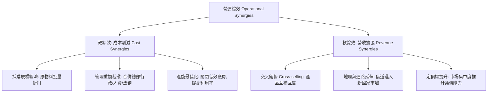

---
{"dg-publish":true,"permalink":"/98/merger-acquisition/","tags":["商業概念","企業併購","財務估值","策略管理","公司理財","PMBA"],"dg-note-properties":{"aliases":["併購綜效","M&A Synergies","併購協同效應","企業購併綜效","Synergy Value"],"tags":["商業概念","企業併購","財務估值","策略管理","公司理財","PMBA"]}}
---


# 併購綜效 (M&A Synergies & Value Creation Architecture)

> **【核心決策摘要】**
> **併購綜效（M&A Synergies）** 是指兩家企業合併後的整體商業價值與財務表現，**大於兩家公司獨立存在時的價值簡單加總**，即經典的「$1 + 1 > 2$」增量價值效應（$\Delta V = V_{AB} - (V_A + V_B)$）。綜效是買方管理層在收購交易中向股東證明支付[[98_商業概念庫/acquisition-premium_收購溢價\|收購溢價（Acquisition Premium）]]具備經濟合理性的唯一合法基石。在公司理財實踐中，綜效嚴格解構為兩大維度：**營運綜效（Operational Synergies）**（包含成本削減硬綜效與營收擴張軟綜效）與 **財務綜效（Financial Synergies）**（包含稅盾效應、舉債容量提升與資本成本 WACC 下降）。

---

## 1. 概念核心定義與價值增量公式 (Executive Definition & Valuation Framework)

### 1.1 核心定義與淨併購價值公式
併購交易的實質價值增量（Net Present Value of M&A）在金融估值中嚴格定義如下：

$$NPV_{M\&A} = \Delta V_{Total} - \text{Premium} - \text{Expenses}_{Transaction/Integration}$$

其中：
- **獨立企業價值加總**：$V_{Standalone} = V_A + V_B$
- **合併後實體價值**：$V_{AB} = V_A + V_B + \Delta V_{Total}$
- **總綜效現值（Gross Synergies）**：
  $$\Delta V_{Total} = \Delta V_{Operating} + \Delta V_{Financial}$$
- **收購溢價（Premium）**：買方支付給被併方股東超出其獨立市場價值的額外金額：
  $$\text{Premium} = \text{Purchase Price} - V_B$$

```
            ┌─────────────────────────────────────────────────────────┐
            │               併購總體價值創造與分配光譜                │
            └────────────────────────────┬────────────────────────────┘
                                         ▼
   ┌──────────────────────────────────────────────────────────────────────────┐
   │ 總綜效價值池 (Total Synergy Value: ΔV = ΔV_Operating + ΔV_Financial)    │
   └─────────────────────────────────────┬────────────────────────────────────┘
                                         │
                 ┌───────────────────────┴───────────────────────┐
                 ▼                                               ▼
   ┌───────────────────────────┐                   ┌───────────────────────────┐
   │ 被併方股東拿走的收購溢價   │                   │ 買方股東真正保留的淨價值   │
   │ (Acquisition Premium)     │                   │ (NPV for Acquirer)        │
   │ • 50%~70% 的預期綜效現值  │                   │ • 若溢價過高, 該值轉為負數│
   │ • 交易交割日即由被併方落袋│                   │ • 需經由 PMI 漫長執行兌現 │
   └───────────────────────────┘                   └───────────────────────────┘
```

> **高階決策鐵律**：只有當 **$\Delta V_{Total} > \text{Premium} + \text{Expenses}$** 時，這項併購案才為買方股東創造價值；反之，若支付溢價超過了綜效現值，買方即陷入了「**贏家的詛咒（Winner's Curse）**」。

---

## 2. 營運綜效 vs. 財務綜效 深度解構 (Deep Dive: Operating vs. Financial Synergies)

### 2.1 營運綜效（Operational Synergies）
營運綜效直接反映在**未計利息與稅項前營業利益（EBIT）** 的結構性改善：



1. **成本削減（Cost Synergies / 硬綜效）**：
   - **可預測性高（High Certainty）**：通常在交割後 12~24 個月內透過具體管理手段（裁員、關閉重疊辦公室、終止重複軟體授權）即可實現。
   - **估值折現率**：由於確定性較高，財務分析師通常以買方的加權平均資本成本（[[wacc_加權平均資本成本|WACC]]）進行折現。
2. **營收擴張（Revenue Synergies / 軟綜效）**：
   - **高度不確定性（Low Certainty）**：高度依賴市場客戶是否買單、銷售團隊是否具備交叉銷售能力。
   - **實務折價法則**：華爾街投資銀行在 M&A 估值模型中，通常會對承諾的營收軟綜效給予 **50%~70% 的保守折扣（Haircut）**。

### 2.2 財務綜效（Financial Synergies）
財務綜效不直接來自商品營運，而是源於資本結構、融資成本與稅務優化的財務工程增益：

1. **稅負優化效應（Tax Shields & NOLs）**：
   - **淨營業虧損扣抵（Net Operating Losses, NOLs）**：獲利豐厚的買方收購具有大額歷史累積虧損的目標公司，可用於抵減合併後的應稅所得，產生即時的現金節稅效益。
   - **折舊稅盾提升（Stepped-up Asset Basis）**：在資產收購架構下，目標資產按公允價值重新入帳，增加未來年度折舊攤銷額，進一步降低所得稅。
2. **舉債容量提升（Increased Debt Capacity & Coinsurance Effect）**：
   兩家現金流相關係數小於 1（$r < 1$）的公司合併後，整體現金流波動度顯著收斂（彼此分散風險），違約風險降低，使合併實體能承受更高的財務槓桿，享受更多利息稅盾（Interest Tax Shield）。
3. **加權平均資本成本下降（Lower WACC）**：
   企業規模擴大、資本市場信譽增強與信用評等調升，能直接壓低發行公司債與取得聯貸的利率點差（Credit Spread）。

---

## 3. 綜效評價的財務估值模型 (Valuation of Synergies)

綜效的價值等於合併後**預期新增自由現金流量的折現值**：

$$\Delta V = \sum_{t=1}^N \frac{\Delta \text{FCFF}_t}{(1 + \text{WACC}_{AB})^t} + \frac{\Delta \text{FCFF}_{N+1}}{(\text{WACC}_{AB} - g)(1 + \text{WACC}_{AB})^N} - \text{One-off Integration Costs}$$

其中各期增額企業自由現金流量（$\Delta\text{FCFF}_t$）拆解為：
$$\Delta \text{FCFF}_t = [\Delta \text{Revenue}_t - \Delta \text{Cost}_t](1 - T_c) + \Delta \text{Depr}_t \cdot T_c - \Delta \text{CapEx}_t - \Delta \text{NWC}_t$$

- $T_c$：邊際企業所得稅率。
- $\text{One-off Integration Costs}$：第一至二年為推動 PMI 必須支付的資遣費、系統建置費與違約金。

---

## 4. 關聯概念與延伸閱讀 (Cross References)

- [[enterprise-m-and-a_企業併購]]：企業併購全流程生命週期與戰略動機。
- [[acquisition-premium_收購溢價]]：收購溢價的計算基準與過度承諾綜效的陷阱。
- [[merger-acquisition-integration_併購後整合]]：綜效能否在實務上兌現的關鍵執行架構。
- [[horizontal-merger-acquisition_水平併購]]：同業併購規模經濟綜效的實現。
- [[vertical-merger-acquisition_垂直併購]]：價值鏈上下游協同綜效的實現。
- [[wacc_加權平均資本成本]]：併購綜效折現計算的核心基準折現率。
- [[home]]：PMBA 知識庫首頁與模組導航。