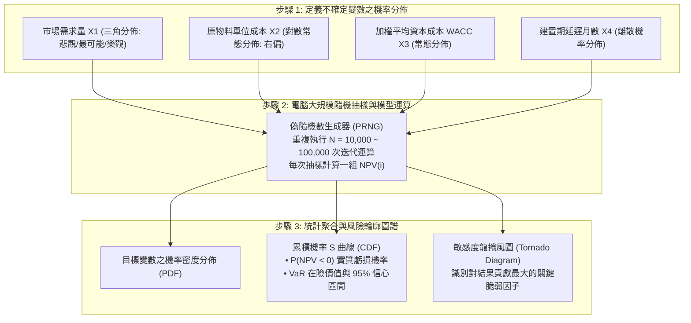

---
{"dg-publish":true,"permalink":"/98/monte-carlo-simulation/","tags":["商業概念","決策科學","財務管理","風險管理","PMBA"],"dg-note-properties":{"aliases":["蒙地卡羅模擬","Monte Carlo Simulation","隨機抽樣模擬","蒙地卡羅法"],"tags":["商業概念","決策科學","財務管理","風險管理","PMBA"]}}
---


# 蒙地卡羅模擬 (Monte Carlo Simulation)

> [!NOTE]
> **核心概念精粹**：蒙地卡羅模擬（Monte Carlo Simulation）是一種透過大量隨機抽樣（Random Sampling）與統計試驗，來計算複雜系統機率分佈與風險敏感度的運算模型。在面對充滿不確定性的重大資本支出、併購估值或新技術研發時，它徹底打破了傳統財務分析依賴「單一最佳估計值（Single-Point Estimate）」的虛妄假定，將靜態的[[98_商業概念庫/NPV_淨現值法 _Net Present Value\|淨現值（NPV）]]轉化為**動態的累積機率分佈曲線**，精準揭示專案面臨虧損與極端下檔的實質機率。

---

## 一、 學理淵源與演算法運作機制

蒙地卡羅方法誕生於 1940 年代二戰期間的美國曼哈頓計畫。數學家斯坦尼斯瓦夫·烏拉姆（Stanislaw Ulam）在休養期間玩紙牌遊戲時，思索能否透過隨機發牌並記錄勝率來計算獲勝機率；隨後他與約翰·馮·諾伊曼（John von Neumann）將此演算法正式命名為「蒙地卡羅（源自摩納哥著名賭城）」，並將其應用於原子彈中子擴散的計算。



---

## 二、 靜態單點預測 vs 蒙地卡羅動態模擬的本質鴻溝

在傳統企業投資決策中，專案團隊常呈報看似完美的 Excel 試算表，但其背後的脆弱性往往在真實市場中被無情戳破：

| 評估維度 | 傳統靜態預測（Static Single-Point / Base Case） | 蒙地卡羅隨機模擬（Monte Carlo Dynamic Simulation） |
| :--- | :--- | :--- |
| **輸入變數假設** | 每個關鍵變數僅填入單一數值（如預期年銷售 10 萬件、單價 50 元）。 | 每個關鍵變數均被賦予完整的機率分佈與合理波動區間。 |
| **變數關聯性** | 忽視變數之間的連鎖反應（如通膨推升成本時，需求量往往同步萎縮）。 | 可透過協方差矩陣（Covariance Matrix）設定變數間的關聯係數。 |
| **決策輸出結論** | 「本專案 NPV 為 1.2 億元，IRR 為 18%，建議全案通過。」 | 「本專案預期 NPV 為 1.2 億元，但有 **23.4% 的機率 NPV < 0**（實質虧損）。」 |
| **極端下檔感知** | 完全無法察覺尾部風險，對黑天鵝事件毫無抵抗力。 | 清晰繪製尾部極端情境（如 worst 5% 的平均虧損規模），提供下檔邊界。 |
| **心理認知偏差** | 引發團隊嚴重的「過度自信偏誤（Overconfidence Bias）」。 | 促使管理層正視不確定性，將焦點轉向下檔避險與彈性應變。 |

---

## 三、 經典企業實戰案例：跨國能源探勘與半導體建廠之資本預算

```carousel

<!-- slide -->
### 1. 離岸深海油田開採的資本預算抉擇
- **決策情境**：某跨國能源巨頭評估是否投入 30 億美元開發墨西哥灣深海油田，開採週期長達 20 年；
- **關鍵不確定變數**：國際原油期貨價格（高波動）、地底實際儲量（對數常態分佈）、水下鑽井事故停工天數、深海工程通膨率；
- **模擬結果**：
  - 靜態 Base Case 顯示 NPV 高達 4.5 億美元；
  - 但進行 50,000 次蒙地卡羅模擬後發現：由於原油價格與儲量的雙重波動，**該專案虧損破產的機率高達 31%**，且在最壞的 5% 情境中將產生超過 12 億美元的毀滅性虧損；
- **管理層行動**：董事會果斷暫緩全資自建，改為分拆 50% 股權引進戰略合作夥伴進行風險共擔，成功躲過隨後的國際油價雪崩。
<!-- slide -->
### 2. 半導體 2 奈米新廠產能爬坡模擬
- **決策情境**：晶圓代工廠評估百億美元先進製程新廠的回收期；
- **變數疊加**：EUV 機台交期延遲月數、良率爬坡（Yield Ramp）曲線斜率、消費電子景氣循環；
- **模擬成效**：透過龍捲風圖（Tornado Diagram）精準辨識出「良率提升速度」對 IRR 的影響力高達 65%，遠大於「設備採購折扣（僅佔 12%）」，從而將工程資源全數集中於良率攻關。
```

---

## 四、 經理人蒙地卡羅模擬審計檢核表（Executive Decision Checklist）

在審查由量化團隊呈報的蒙地卡羅模擬分析時，高階管理團隊應依序提出四問：

- [ ] **垃圾進垃圾出檢驗（GIGO Audit - Garbage In, Garbage Out）**：
  - 輸入端所設定的機率分佈形狀（如三角分佈、對數常態），究竟是有歷史經驗與實體工程依據，還是分析師為了交差隨意拍腦袋填寫的假想數字？
- [ ] **肥尾效應納入檢核（Fat-Tail Reality Check）**：
  - 核心變數是否盲目採用了「常態分佈（Normal Distribution）」？對於金融資產價格或供應鏈中斷等具備[[fat-tail-theory_肥尾理論|肥尾特徵]]的變數，是否選用了帕雷托或 Student-t 等厚尾分佈進行壓力測試？
- [ ] **變數相關性陷阱（Correlation Matrix Sanity）**：
  - 模型是否假定所有輸入變數彼此獨立？（例如原物料價格暴漲時，產品售價能否同步調漲？）如果沒有設定相關性矩陣，模擬結果將嚴重低估系統性連鎖衝擊。
- [ ] **最大可承受破產機率門檻（Ruin Probability Threshold）**：
  - 董事會是否預先設定了「專案虧損機率的紅線」？（例如：任何 $P(\text{NPV} < 0) > 15\%$ 的專案，無論預期報酬率多高，一律必須重新設計防禦結構）。

---

## 五、 關聯概念與知識網絡

* 核心統計與決策科學：
  * [[fat-tail-theory_肥尾理論|肥尾理論 (Fat-Tail Theory)]]：極端斯坦非線性衝擊對常規模擬的修正
  * [[normal-distribution_常態分配|常態分配 (Normal Distribution)]]：輸入端分佈設定之邊界與誤用防範
  * [[analysis_情境分析|情境分析 (Scenario Analysis)]]：質化情境規劃與量化蒙地卡羅的深度互補
  * [[contingency-planning_應變計畫|應變計畫 (Contingency Planning)]]：模擬揭示極端下檔時的應變機制
* 財務管理與資本配置：
  * [[capital-budgeting_資本預算|資本預算 (Capital Budgeting)]]：重大長期投資案之動態風險量化
  * [[NPV_淨現值法 _Net Present Value|淨現值法 (Net Present Value)]]：從靜態折現指標躍遷為動態機率分佈
  * [[wacc_加權平均資本成本|加權平均資本成本 (WACC)]]：隨機折現率對專案價值的敏感度影響
  * [[risk-control_風險控制|風險控制 (Risk Control)]]：透過量化敏感度分析鎖定核心防禦環節
