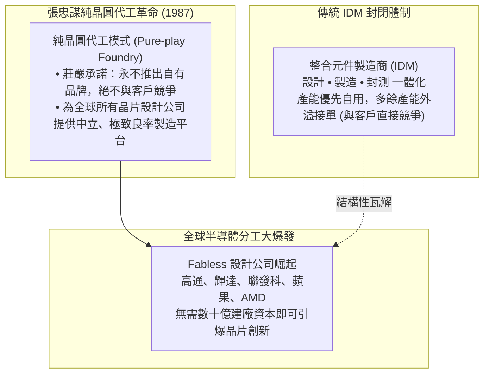

---
{"dg-publish":true,"permalink":"/98/morris-chang/","tags":["商業概念","企業領袖","半導體產業","策略管理","PMBA"],"dg-note-properties":{"aliases":["張忠謀","Morris Chang","半導體教父","台積電創辦人"],"tags":["商業概念","企業領袖","半導體產業","策略管理","PMBA"]}}
---


# 張忠謀 (Morris Chang)

> [!NOTE]
> **核心概念精粹**：張忠謀（Morris Chang, 1931–），被全球半導體產業尊稱為「晶圓代工之父」。他於 1987 年創立台灣積體電路製造公司（TSMC），以破壞性的**純晶圓代工（Pure-play Foundry）模式**打破了傳統垂直整合（IDM）的一統天下，催生了全球無晶圓廠（Fabless）IC 設計產業的繁榮。其治企哲學以**誠信正直（Integrity）**為絕對憲法，透過前瞻性的逆週期資本支出、夜鷹計畫研發攻堅與大同盟（Grand Alliance）生態系，將台積電打造成全球先進製程市佔超 90% 的「地緣政治兵家必爭之地」。

---

## 一、 學理淵源：破壞性模式創新與商業本質重塑

在張忠謀創立台積電之前，半導體產業被英特爾、德州儀器、摩托羅拉等 IDM（Integrated Device Manufacturer）巨頭所壟斷。晶片設計與晶圓製造緊密捆綁，建廠成本高昂，新創設計公司幾乎無法生存：



---

## 二、 張忠謀核心治理哲學：四大價值與戰略定力

張忠謀的管理思想融合了美式現代公司治理與東方誠信風骨，確立了四大治理核心（ICIC）：

| 治理核心價值 | 內在哲學內涵 | 策略性商業體現 |
| :--- | :--- | :--- |
| **誠信正直<br>(Integrity)** | **最高道德憲法**：不說謊、不誇大、對客戶嚴守機密，哪怕犧牲短期利潤也絕不違背承諾。 | 贏得蘋果、輝達、高通將核心商業機密設計圖託付給台積電的基石，構築競品無法用金錢買到的信用壁壘。 |
| **承諾<br>(Commitment)** | 一旦承諾客戶或合作夥伴，全力以赴達成交付標準；對員工與股東承擔長期回報義務。 | 在產能短缺時期，依據長遠合作而非價格高低分配產能，不發不義之財。 |
| **創新<br>(Innovation)** | 創新不僅限於技術與製程，更涵蓋商業模式、行銷組織與管理制度的全面創新。 | 提出「大同盟（Grand Alliance）」架構，將 EDA 工具、IP 矽智財與設備商緊密捆綁。 |
| **客戶信任<br>(Customer Trust)** | 客戶的成功才是台積電的成功；台積電是客戶的產能延伸，而非競爭威脅。 | 在 iPhone 晶片大戰中，寧可放棄自身產品線，也要傾全公司之力保證蘋果 A 系列晶片準時量產。 |

---

## 三、 經典企業實戰案例：金融海嘯逆勢加碼與夜鷹計畫

```carousel

<!-- slide -->
### 1. 2009 年金融海嘯回任：逆向暴增資本支出
- **危機背景**：2008 年底全球金融海嘯，台積電營收驟降，前任 CEO 啟動裁員與緊縮開支；
- **回任霸氣決策**：2009 年 78 歲高齡的張忠謀重掌執行長大印，力排眾議宣布召回所有被離職員工，並做出震驚華爾街的決策——**將 2010 年資本支出從原定的 27 億美元逆勢暴增至 59 億美元（增幅逾 100%）**；
- **戰略回報**：正是這筆逆週期投資，讓台積電在 28 奈米製程大獲全勝，獨吞全球智慧手機爆發紅利，徹底將聯電（UMC）甩在身後。
<!-- slide -->
### 2. 「夜鷹計畫」研發攻堅：奪下先進製程王座
- **挑戰情境**：在 10 奈米與 7 奈米研發階段，英特爾與三星來勢洶洶；
- **戰略部署**：張忠謀親自啟動「夜鷹計畫」——以優厚獎金與輪班福利組建千人精銳研發部隊，實施 **24 小時不間斷三班研發**；
- **成果**：將兩年半的研發週期壓縮至一年半，率先攻克 EUV 7 奈米與 5 奈米技術節點，一舉奪下蘋果 A 系列與 M 系列晶片全球 100% 獨家代工權，市值突破五千億美元。
```

---

## 四、 經理人張忠謀式戰略定力檢核表（Executive Decision Checklist）

在面對外部景氣蕭條、重大資本配置或商業模式抉擇時，CEO 應自省：

- [ ] **商業模式利益衝突檢驗（Zero Conflict of Interest）**：
  - 我們的商業模式是否與客戶存在潛在競爭？我們是否一邊向客戶收取服務費，一邊私下模仿客戶的產品（做自有品牌）？如果是，客戶的信任終將崩解。
- [ ] **逆週期資本配置勇氣（Counter-Cyclical Courage）**：
  - 在產業景氣低谷、所有競爭對手恐慌削減預算時，我們是否手握充沛現金與戰略定力，敢於逆勢重金投資核心研發，以便在景氣回暖時第一時間收割市場？
- [ ] **誠信正直一票否決制（Integrity as Non-Negotiable）**：
  - 當面對一筆能帶來數億元營收但需要「踩在法規灰色邊界或背叛合約承諾」的交易時，最高管理層是否具備毫不猶豫一票否決的道德骨氣？
- [ ] **生態系共榮聯盟（Grand Alliance Ecosystem）**：
  - 我們是否建立了與上下游夥伴利害一致的生態系？合作夥伴與我們合作時，能否獲得比與競爭對手合作更高的超額利差？

---

## 五、 關聯概念與知識網絡

* 核心企業與產業生態：
  * [[tsmc_台積電|台積電 (TSMC)]]：張忠謀創立之全球晶圓代工霸主商業模式全面解析
  * [[jensen-huang_黃仁勳|黃仁勳 (Jensen Huang)]]：台積電大同盟最核心的長期共生夥伴
  * [[nvidia_輝達|輝達 (NVIDIA)]]：依託台積電先進製造飛躍之 AI 晶片帝國
  * [[schumpeter_熊彼得|約瑟夫·熊彼得 (Joseph Schumpeter)]]：純晶圓代工對 IDM 體系之創造性破壞
* 領導力與治理心智：
  * [[can-zhao-quan_參照權|參照權 (Referent Power)]]：張忠謀誠信風骨對全球半導體菁英之崇高感召
  * [[great-company_好公司|好公司 (Great Company)]]：基於核心價值觀與刺蝟原則造就基業長青
  * [[sound-investment_好投資|好投資 (Sound Investment)]]：巴菲特大舉建倉台積電背後之深厚護城河
  * [[core-competence_核心能力|核心能力 (Core Competence)]]：台積電精密製造良率與跨週期研發資本壁壘
