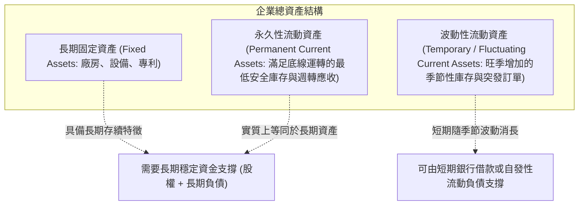

---
{"dg-publish":true,"permalink":"/98/net-working-capital/","tags":["商業概念","財務管理","流動性管理","企業評價","PMBA"],"dg-note-properties":{"aliases":["淨營運資金","Net Working Capital","NWC","營運資金","Working Capital","營業淨營運資金","Operating NWC"],"tags":["商業概念","財務管理","流動性管理","企業評價","PMBA"]}}
---


# 淨營運資金 (Net Working Capital, NWC)

> **【核心決策摘要】**
> **淨營運資金（Net Working Capital, NWC）** 是衡量企業短期流動性安全緩衝與日常營運資本沉澱的核心量化指標。在傳統財務會計中，其定義為「流動資產減流動負債」；但在現代公司理財與折現估值（DCF）中，經理人嚴格採用**非現金營業淨營運資金（Operating NWC / Non-Cash NWC）**，即扣除「多餘現金與短期投資」，並剔除「短期有息借款」。NWC 反映了企業為了支撐特定營業收入規模，必須在日常供應鏈流轉中「永久佔用」的真金白銀。當企業具備強大議價權而實現「負營運資金（Negative NWC）」時（如 Apple、Costco、Amazon），等於享有供應商提供的免息擴張資金；反之若 NWC 過高，則意味著大量現金被應收帳款與存貨無效凍結，拖累投入資本報酬率（ROIC）。

---

## 1. 概念核心定義與本質 (Executive Definition & Theoretical Essence)

### 1.1 核心定義與雙重分析視角

財務分析中必須清晰界定兩種不同口徑的營運資金：

```
【傳統會計視角 (Accounting NWC)】
NWC = 流動資產 (Current Assets) - 流動負債 (Current Liabilities)
用途：評估企業短期償債能力與破產清償緩衝。

【公司理財與估值視角 (Operating NWC / Non-Cash NWC)】
Operating NWC = (流動資產 - 現金與約當現金) - (流動負債 - 短期有息負債)
              = (應收帳款 + 存貨 + 預付款) - (應付帳款 + 應計未付費用 + 合約負債/預收款)
用途：衡量本業日常經營流轉真正吸收或釋放的營運資本。
```

### 1.2 本質解析：流動性安全 vs. 資本沉澱成本的權衡
高階經理人在配置營運資金時，面臨永恆的二元博弈：
1. **流動性緩衝價值（Liquidity Buffer）**：充沛的流動資產（高 NWC）能確保企業在遭遇客戶延遲付款、原料價格飆漲或生產中斷等外部衝擊時，不會因流動資金枯竭而陷入技術性破產（Technical Insolvency）。
2. **資金機會成本與回報率懲罰（Opportunity Cost）**：流動資產（存貨、應收帳款）的投資報酬率通常為零甚至負值（伴隨倉儲損耗、存貨跌價與呆帳損失）。若營運資金佔營收比例過高，將大幅膨脹企業的投入資本（Invested Capital），拉低企業整體的投入資本報酬率（[[ROIC_投入資本報酬率 Return on Invested Capital]]）與經濟附加價值（EVA）。

---

## 2. 數理模型與流動性健康度量化指標 (Mathematical Modeling & Liquidity Metrics)

### 2.1 短期償債能力經典比率

企業監控傳統會計 NWC 安全性時的三道防線：

$$\text{流動比率 (Current Ratio)} = \frac{\text{流動資產}}{\text{流動負債}} \quad (\text{健康標竿：} 1.5 \sim 2.0)$$

$$\text{速動比率 (Quick Ratio / Acid-test)} = \frac{\text{流動資產} - \text{存貨} - \text{預付款}}{\text{流動負債}} \quad (\text{健康標竿：} \ge 1.0)$$

$$\text{現金比率 (Cash Ratio)} = \frac{\text{現金及約當現金} + \text{短期有價證券}}{\text{流動負債}} \quad (\text{健康標竿：} 0.2 \sim 0.5)$$

### 2.2 營運資金密集度與營收規模聯動模型

衡量企業每產生 1 元營收，需要在營運資本中沉澱多少現金：

$$\text{NWC 密集度} = \frac{\text{Operating NWC}}{\text{Annual Sales}}$$

- **正營運資金企業（如傳統製造業，NWC 密集度約 20%~30%）**：營收每增長 1 億元，必須額外向營運資金注入 2,000 萬至 3,000 萬元現金（$\Delta\text{NWC} > 0$），形成「越增長越缺錢」的現金流壓力。
- **負營運資金企業（如 SaaS、電商，NWC 密集度為負值）**：營收每增長 1 億元，反而從供應鏈中抽取無息現金（$\Delta\text{NWC} < 0$），實現自我造血擴張。

---

## 3. 戰略框架與流動資產分類結構 (Strategic Framework & Asset Composition)

### 3.1 永久性流動資產 vs. 波動性流動資產

現代公司理財將流動資產進一步拆解為本質相異的兩個組成部分：



- **永久性流動資產（Permanent Current Assets）**：即使在產業淡季谷底，企業維持門市貨架不空、工廠不停工所不可或缺的「最低底線存貨與日常周轉金」。**其性質在財務本質上等同於固定資產**，若錯誤地以短期借款來融通，將埋下嚴重的期限錯配危機。
- **波動性流動資產（Temporary Current Assets）**：隨季節性銷售旺季（如雙十一、歐美黑五購物季）而暫時膨脹的存貨與應收帳款，在銷售完成收款後即可自動變現清償。

---

## 4. 產業標竿與實戰應用場景 (Industry Benchmarks & Applications)

| 商業模式與產業類別 | NWC 特徵 | 驅動機制 | 經理人管理重心 |
| :--- | :---: | :--- | :--- |
| **B2B 重型裝備製造** | **高額正值 (NWC/Sales: 25%~40%)** | 生產週期長達數月，驗收撥款延遲，庫存備品繁多 | 嚴格控制應收帳款信用額度，推行精益庫存防止跌價損失 |
| **訂閱制 SaaS 軟體** | **顯著負值 (NWC/Sales: -15%~-30%)** | 幾無實體存貨，客戶普遍採「年度預付制」形成巨額合約負債（Unearned Revenue） | 監控客戶流失率（Churn Rate）以確保預收款資金池穩定 |
| **連鎖量販與電商巨頭 (Costco, Amazon)** | **深度負值 (NWC/Sales: -5%~-15%)** | 存貨周轉極快（DIO 短），對供應商擁有強大議價權與超長付款期（DPO 長） | 維持與供應商的戰略共生關係，避免壓榨過度引發斷供斷鏈 |
| **連鎖餐飲與零售** | **微幅正值或中性** | 原料保鮮期極短、顧客現場現金/刷卡支付，應收帳款幾近為零 | 原料採購價格波動對沖，門市現金流每日自動歸集調撥 |

---

## 5. 經典企業個案深度剖析 (Deep Dive Case Studies)

### 5.1 成功典範：Dell 戴爾電腦的「負 NWC 革命」
- **商業模式創新**：1990 年代，戴爾打破傳統 PC 透過經銷商鋪貨的笨重體系，開創「直銷按單訂製（Build-to-Order, BTO）」模式。
- **極致的營運資金運作**：
  1. 客戶在戴爾官網下單時必須立即刷卡付款（應收帳款天數 DSO $\approx 0$ 天）。
  2. 戴爾透過即時系統向零件供應商叫料，零件入廠後數小時內完成組裝並發貨，將存貨周轉天數（DIO）壓縮至不可思議的 **4~6 天**（當時同業 Compaq、IBM 超過 60 天）。
  3. 戴爾享有供應商長達 **60 天** 的應付帳款期（DPO）。
- **財務神話**：戴爾的現金轉換週期達到了驚人的 **負 40 天**。這意味著戴爾每多賣一台電腦，就能無償使用客戶與供應商的現金 40 天。靠著這筆龐大的「免費內部銀行借款」，戴爾在幾乎不需要外部股權融資的情況下實現了數百億美元的爆炸性擴張。

### 5.2 失敗警示：尚德電力（Suntech Power）的營運資金失血破產
- **行業背景**：2010 年前後全球光伏（太陽能）產業產能劇烈過剩，歐洲各國政府大幅削減光伏補貼。
- **NWC 崩潰連鎖反應**：
  1. **存貨雪崩**：矽料價格從每公斤 400 美元斷崖式暴跌至 40 美元，尚德高價鎖定的長約原材料庫存發生數億美元巨額跌價損失。
  2. **應收帳款逾期**：海外下游客戶因補貼退坡大面積拖欠貨款，應收帳款周轉天數暴增至 150 天以上。
  3. **短期借款擠兌**：為了填補急遽惡化的 NWC 缺口，管理層過度依賴短期銀行借款週轉。當可轉換公司債與短債集中到期時，銀行拒絕展期，一代光伏龍頭因現金流斷裂慘遭破產重整。

---

## 6. 高階經理人決策實戰工具箱 (Executive Action Playbook)

### 6.1 營運資金健康度四象限診斷

```
                    高週轉效率 (CCC 極短 / 為負)
                            │
            【象限 II：隱蔽風險區】 │ 【象限 I：造血冠軍區】
            • 現象：CCC 優秀，但 NWC 為  │ • 現象：周轉極快，負營運資金
              正值（如規模受限）       │   或微小正值（如 Apple, Dell）
            • 策略：放大業務規模，     │ • 策略：全力擴張，將免息資金
              釋放供應鏈議價槓桿       │   轉化為戰略研發與市場壁壘
    ───────────────┼───────────────
            【象限 III：瀕死泥淖區】│ 【象限 IV：資本沉睡區】
            • 現象：周轉遲緩，高額正 NWC│ • 現象：周轉遲緩，帳上流動
              （庫存積壓、應收失控）   │   資產龐大但利用低效
            • 策略：緊急啟動庫存拋售， │ • 策略：優化內部 ERP 流程，
              嚴格催收並叫停寬鬆信用   │   壓縮非必要安全庫存水位
                            │
                    低週轉效率 (CCC 極長)
    高 NWC (資本大量佔用) ────────────── 低 NWC (資本佔用少/負佔用)
```

### 6.2 執行長淨營運資金實戰優化檢核表
- [ ] **檢核 1：是否以「非現金營業 NWC」作為事業部考核指標？**（防止事業部主管盲目以堆積庫存換取規模折舊降本）。
- [ ] **檢核 2：若公司處於負營運資金狀態，是否預留了「供應鏈擠兌」的應急流動性儲備？**（負 NWC 本質是商業信用負債，若營收驟降，應付帳款到期將轉化為現金流出）。
- [ ] **檢核 3：應收帳款與存貨的增長速度是否超越了營業收入的增長速度？**
- [ ] **檢核 4：跨部門協同機制是否建立？**（銷售部門不可為了衝業績任意答應客戶 180 天超長帳期，採購部門不可為了少量折扣大批囤積一年用量的原料）。

---

## 7. 關聯知識網絡與導航地圖 (Knowledge Network & Cross-References)

### 7.1 本主題核心三部曲
- **[[net-working-capital_淨營運資金]]** · 營業 NWC 與會計 NWC 辨析、短期償債三道防線與資本沉澱成本（本篇）
- **[[working-capital-management_營運資金管理]]** · 配合型、激進型與保守型三大資產融資政策博弈
- **[[changes-in-net-working-capital_淨營運資金變動]]** · 現金流量調節閥、CCC 現金循環週期聯動與「無獲利成長」陷阱

### 7.2 跨領域財務與策略鏈結
- [[CCC_現金循環週期 Cash Conversion Cycle]] · 應收、存貨與應付帳款周轉天數對 NWC 的微觀決定機制
- [[enterprise-free-cash-flow-liang_企業自由現金流量]] · $\Delta\text{NWC}$ 作為計算 FCFF 與企業價值的核心扣除項
- [[operating-cash-flow-statement_營業活動現金流量]] · 間接法調和中流動資產與流動負債變動對營運現金之衝擊
- [[ROIC_投入資本報酬率 Return on Invested Capital]] · 壓縮 NWC 降低投入資本分母、推升股東回報率
- [[working-capital_營運資金]] · 營運資金總覽概念對齊卡

### 7.3 課程筆記與導航主頁
- [[L09_資本結構理論與決策]] · 財務策略模組九：公司短期資產與負債管理
- [[_創業與企業財務策略 MOC]] · 企業財務策略與資本市場運作全景地圖
- [[home]] · 全球 PMBA 知識庫總導航主頁面