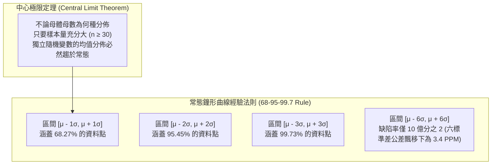

---
{"dg-publish":true,"permalink":"/98/normal-distribution/","tags":["商業概念","統計學","品質管理","風險管理","PMBA"],"dg-note-properties":{"aliases":["常態分配","Normal Distribution","高斯分配","Gaussian Distribution","鐘形曲線","Bell Curve"],"tags":["商業概念","統計學","品質管理","風險管理","PMBA"]}}
---


# 常態分配 (Normal Distribution)

> [!NOTE]
> **核心概念精粹**：常態分配（Normal Distribution / Gaussian Distribution），又稱高斯分配或鐘形曲線，是現代統計學、計量經濟學與工業工程中最核心的連續機率分佈。它以對稱的單峰鐘形為特徵，完全由**均值（$\mu$）**與**標準差（$\sigma$）**兩個參數決定。中心極限定理（Central Limit Theorem）賦予其堅實的數學基礎，使其成為六標準差品質管制與大規模製造公差的黃金工具；然而，在金融資產定價與系統性風險管理中，過度套用常態假設常因忽視「尖峰肥尾」而釀成災難性後果。

---

## 一、 數學原理與幾何特徵

常態分配的機率密度函數（Probability Density Function, PDF）呈現完美的左右對稱形態：

$$f(x) = \frac{1}{\sigma \sqrt{2\pi}} \exp\left( -\frac{(x - \mu)^2}{2\sigma^2} \right)$$

其中：
- $\mu$（均值）：決定了對稱軸的中心位置（亦即中位數與眾數所在）；
- $\sigma$（標準差）：決定了鐘形曲線的陡峭或扁平程度（分散程度）。



---

## 二、 常態分配在商業管理中的合法應用領域

在符合「獨立同分佈（i.i.d.）」且受大量微小無關隨機因素共同作用的物理與營運環境中，常態分配具有極高的指導價值：

| 應用領域 | 管理情境與運作機制 | 經典指標與工具 |
| :--- | :--- | :--- |
| **六標準差品質管制<br>(Six Sigma)** | 監控大規模製造製程變異，將公差規格界限推至 6 個標準差之外。 | 製程能力指標 $C_p, C_{pk}$，百萬分之 3.4 缺陷率（DPMO）。 |
| **安全庫存與補貨點<br>(Inventory Control)** | 當每日顧客需求量與前置時間（Lead Time）波動符合常態時，精準計算安全庫存。 | $SS = Z \times \sigma_L$（依照服務水準 95% 或 99% 設定 $Z$ 值）。 |
| **人力資源常態分佈評級<br>(Forced Ranking)** | 奇異（GE）前 CEO 傑克·威爾許採用的 20-70-10 活力曲線考核體系。 | 前 20% 頂尖拔擢、中間 70% 穩定培養、底層 10% 輔導或淘汰。 |
| **大規模測驗標準化<br>(Standardized Testing)** | 將數十萬名考生的原始分數轉化為標準九分（Stanine）或 T 分數。 | 消除難易度偏差，評定相對百分等級（Percentile）。 |

---

## 三、 常態分配的致命誤用：金融風險與肥尾危機

雖然常態分配在物理與工程世界大放異彩，但在涉及人類心理、預期反饋與網絡效應的**金融與經濟複雜系統**中，常態假設卻經常淪為引發系統性崩潰的「智力陷阱」：

```carousel

<!-- slide -->
### 1. 「尖峰肥尾」的殘酷現實
- **理論假設**：經典投資組合理論（Markowitz）與在險價值（Value at Risk, VaR）假設資產收益率遵循常態分佈；
- **統計真相**：金融市場收益率具有顯著的**超額峰度（Excess Kurtosis > 0）**——中心處更尖銳，而兩側尾部遠比常態分佈肥厚；
- **結果**：在常態模型下被認定為「500 年才發生一次」的 4 個標準差單日暴跌，在現實股市中幾乎每 3~5 年就會上演一次。
<!-- slide -->
### 2. 在險價值（VaR）的盲目安全感
- **盲區**：VaR 通常計算 99% 信心水準下的最大可能損失，但它完全無視「落在剩餘 1% 極端尾部中的損失到底有多大」（Tail Risk Blindness）；
- **實務慘劇**：金融機構高管誤以為自己已經控制了 99% 的風險，卻在 2008 年次貸危機中被那深不可測的 1% 肥尾衝擊直接吞噬倒閉。
```

---

## 四、 經理人常態統計工具適用性檢核表（Executive Decision Checklist）

在引進統計模型進行製程管理或策略風控時，管理層應依序檢驗下列前提：

- [ ] **獨立性檢驗（Independence Assumption Test）**：
  - 資料點之間是否存在強烈的關聯反饋或模仿羊群效應？（如金融恐慌拋售、社群裂變傳播）。若資料點並非彼此獨立（Independent），嚴禁套用常態分配。
- [ ] **物理邊界約束檢驗（Physical Boundary Check）**：
  - 被衡量的變數是否具有「無法超越的自然物理界限」？（例如人的身高不可為負數，且存在天花板）。缺乏物理邊界的純數位或財富變數，絕大多數屬於冪律肥尾而非高斯常態。
- [ ] **極端尾部情境壓力測試（Extreme Tail Stress Test）**：
  - 我們是否過度依賴 $3\sigma$（99.7%）作為安全邊界？如果系統遭遇 $6\sigma$ 或更高層級的外部衝擊，我們的備用流動性與業務持續計畫（BCP）能否承受？
- [ ] **績效強制分佈人性反思（Anti-Forced-Ranking Audit）**：
  - 組織內部是否盲目推行「常態分佈考核」？在高度協同的菁英研發團隊中，人才產出通常遵循帕雷托冪律（20% 的頂尖人才創造 80% 的代碼與專利），強行套用常態分佈將摧毀卓越協同文化。

---

## 五、 關聯概念與知識網絡

* 核心統計與機率理論：
  * [[fat-tail-theory_肥尾理論|肥尾理論 (Fat-Tail Theory)]]：極端斯坦對高斯常態世界觀的根本顛覆
  * [[monte-carlo-simulation_蒙地卡羅模擬|蒙地卡羅模擬 (Monte Carlo Simulation)]]：跨越單一常態分佈的多情境隨機抽樣
  * [[risk-management_金融風險管理|金融風險管理 (Financial Risk Management)]]：VaR 局限性與極端壓力測試架構
  * [[analysis_情境分析|情境分析 (Scenario Analysis)]]：質化情境規劃對量化常態統計之互補
* 管理與營運工具：
  * [[risk-control_風險控制|風險控制 (Risk Control)]]：從製程公差管理到黑天鵝防禦
  * [[key-performance-indicator-kpi_關鍵績效指標|關鍵績效指標 (KPI)]]：績效考核中常態分佈與冪律激勵之權衡
  * [[Tolerance_of_Ambiguity_不確定性容忍度與控制感|不確定性容忍度與控制感 (Tolerance of Ambiguity)]]：接受統計不可預測性之心智修煉
  * [[sound-investment_好投資|好投資 (Sound Investment)]]：拒絕脆弱量化模型、恪守安全邊際之投資原則
