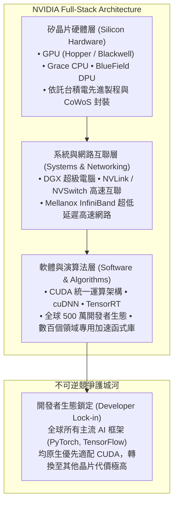

---
{"dg-publish":true,"permalink":"/98/nvidia/","tags":["商業概念","人工智慧","半導體產業","商業模式","PMBA"],"dg-note-properties":{"aliases":["輝達","NVIDIA","恩智浦 (易混淆除外)","英偉達","GPU巨頭"],"tags":["商業概念","人工智慧","半導體產業","商業模式","PMBA"]}}
---


# 輝達 (NVIDIA)

> [!NOTE]
> **核心概念精粹**：輝達公司（NVIDIA Corporation），成立於 1993 年，是全球繪圖處理器（GPU）的發明者，更是當代**加速運算（Accelerated Computing）與人工智慧運算基礎設施的絕對霸主**。輝達徹底打破了傳統以通用 CPU 為核心的運算範式，透過**「晶片硬體（GPU/DPU/CPU）」**、**「系統互聯（NVLink/InfiniBand）」**與**「底層軟體平台（CUDA/NVIDIA AI Enterprise）」**的三位一體全端架構（Full-Stack Architecture），構築起全球超過 500 萬開發者深度依賴的生態護城河，市值於生成式 AI 狂潮中強勢跨越三兆美元大關。

---

## 一、 學理定位：全端運算生態系的「三位一體」護城河

許多競爭對手試圖單純透過製造「運算晶片（ASIC）」挑戰輝達，但無一例外慘遭滑鐵盧。在管理學視角下，輝達絕非單純的晶片製造商，而是一家**全端運算平台公司（Full-Stack Computing Company）**：



---

## 二、 輝達商業模式的演進矩陣：從顯卡到資料中心

| 演進階段 | 時間跨度 | 核心產品與業務板塊 | 驅動成長之關鍵戰略舉措 |
| :--- | :--- | :--- | :--- |
| **第一階段：<br>PC 電競與圖形渲染** | 1993 ~ 2006 | RIVA 128、GeForce 256、可程式化著色器（Shaders）。 | 1999 年正式定義「GPU」概念，在 3D 電競市場擊潰 3dfx 等數十家對手，奠定圖形霸主地位。 |
| **第二階段：<br>通用運算與 CUDA 生態** | 2006 ~ 2016 | Tesla GPU、CUDA 平台、科學運算叢集。 | 孤注一擲向全球學術界免費推廣 CUDA，承受多年毛利率承壓，將 GPU 轉化為通用平行計算處理器。 |
| **第三階段：<br>深度學習與資料中心** | 2016 ~ 2022 | V100、A100、[[DGX|DGX 系統]]、收購 Mellanox。 | 斥資 69 億美元收購 Mellanox，補齊 InfiniBand 網路互聯短板，將運算單元從「單晶片」升級為「整座資料中心」。 |
| **第四階段：<br>生成式 AI 與實體世界** | 2023 ~ 至今 | H100、Blackwell B200、[[Omniverse|Omniverse]]、人形機器人。 | 成為全球生成式 AI 訓練與推論的黃金標準，跨足工業數位孿生與實體 AI（Physical AI）。 |

---

## 三、 經典企業實戰案例：收購 Mellanox 打造「資料中心級超級電腦」

```carousel

<!-- slide -->
### 1. 痛點洞察：單晶片極限與阿姆達爾定律（Amdahl's Law）
- **瓶頸浮現**：在訓練擁有千億級參數的大語言模型（如 GPT-3）時，單一 GPU 的算力再強也只是滄海一粟，必須將數萬顆 GPU 聯網協同作戰；
- **通訊牆危機**：傳統乙太網路（Ethernet）延遲過高且易丟包，晶片 70% 的時間都在「等待其他節點傳輸數據」，形成嚴重的通訊瓶頸。
<!-- slide -->
### 2. 2019 年擊退微軟與英特爾，斥資 69 億美元收購 Mellanox
- **戰略整併**：黃仁勳以極高溢價收購以色列高速通訊先鋒 Mellanox，將 InfiniBand 低延遲遠端記憶體直接存取（RDMA）技術與 GPU 深度融合；
- **運算範式躍遷**：此舉讓輝達成功將自己的產品定義從「主機板上的一塊插卡」，躍升為**「以數萬顆 GPU 互聯組成的整座倉儲級超級電腦」**；
- **商業收穫**：輝達資料中心營收在隨後三年內暴增十倍，徹底粉碎了競爭對手試圖單點超越的幻想。
```

---

## 四、 經理人輝達式平台護城河檢核表（Executive Decision Checklist）

在評估科技平台投資、生態系構建或面對平台霸權時，管理層應依序審計：

- [ ] **軟硬一體化生態粘性（Full-Stack Lock-in Test）**：
  - 我們的硬體產品是否擁有深厚且難以被替代的底層軟體平台？開發者與客戶是否已經在我們的工具鏈上沉澱了數萬小時的專屬代碼與習慣？
- [ ] **系統級創新思考（System-Level Architecture）**：
  - 我們是否還停留在「優化單一零組件」的思維？面對客戶的終極需求，我們能否將產品重新定義為「一整套隨插即用的整體系統解決方案」？
- [ ] **網絡效應正向反饋（Developer Network Effects）**：
  - 使用我們平台的開發者越多，是否會自發產生更多的開源工具庫與模型，進而吸引更多新手開發者別無選擇地加入？
- [ ] **供應鏈共生防禦（Critical Foundry Partnership）**：
  - 我們的極限創新，是否擁有全球最頂級製造夥伴（如台積電之於輝達）的無條件產能與先進封裝支持？雙方是否達成了「榮辱與共」的長期利益綁定？

---

## 五、 關聯概念與知識網絡

* 核心領袖與旗艦系統：
  * [[jensen-huang_黃仁勳|黃仁勳 (Jensen Huang)]]：輝達創辦人暨執行長，加速運算戰略奠基者
  * [[DGX|DGX 超級電腦]]：輝達旗艦級 AI 運算系統架構
  * [[Omniverse|Omniverse 數位孿生]]：輝達面向工業元宇宙與機器人模擬之平台
  * [[tsmc_台積電|台積電 (TSMC)]]：輝達 GPU 與先進封裝之獨家製造基石
* 策略與商業模式理論：
  * [[network-effects_網絡效應|網絡效應 (Network Effects)]]：CUDA 百萬開發者生態之雙向強化護城河
  * [[switching-costs_轉換成本|轉換成本 (Switching Costs)]]：客戶遷移 AI 模型代碼面臨之天價摩擦壁壘
  * [[platform-envelopment_平台包夾|平台包夾 (Platform Envelopment)]]：從圖形渲染向雲端 AI 運算之全面包夾
  * [[viable-business_好事業|好事業 (Viable Business)]]：極高毛利率（75%+）與充沛自由現金流之極致典範
