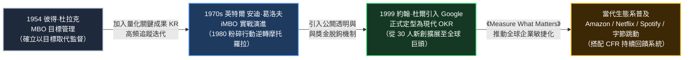
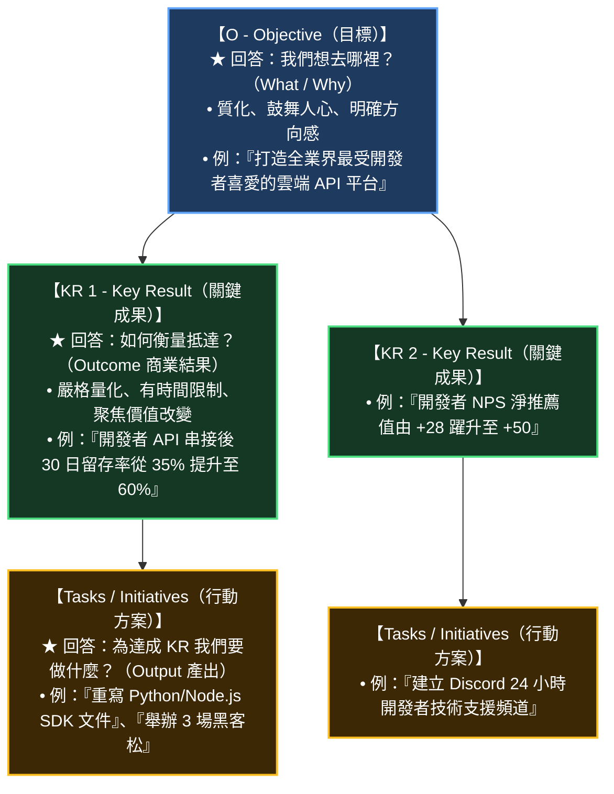
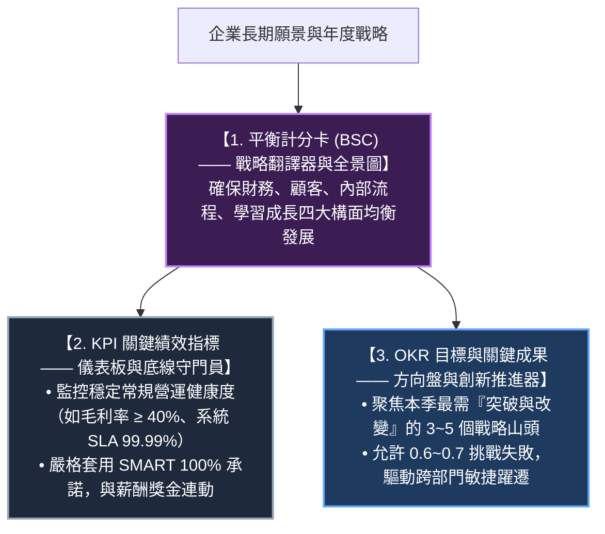

---
{"dg-publish":true,"permalink":"/98/okr-objectives-and-key-results/","tags":["商業概念","策略執行","績效管理","目標管理","敏捷管理","組織行為","SMART原則","平衡計分卡","PMBA"],"dg-note-properties":{"aliases":["OKR","OKR 目標與關鍵成果","目標與關鍵成果","Objectives and Key Results","OKRs","iMBO"],"tags":["商業概念","策略執行","績效管理","目標管理","敏捷管理","組織行為","SMART原則","平衡計分卡","PMBA"]}}
---


# OKR 目標與關鍵成果 (Objectives and Key Results)

> **商管核心價值**：  
> 「想法很容易，執行才是關鍵。在快速變動的商業戰場中，組織最致命的浪費不是員工不努力，而是全公司所有人朝著彼此衝突的方向拼命奔跑。」——約翰·杜爾（John Doerr）  
> 「OKR 並非用來考核員工是否領取獎金的計分板，而是聚焦資源、對齊方向、激發團隊挑戰極限的戰略導航系統。」——安迪·葛洛夫（Andy Grove）  
> 
> 在現代科技巨頭與敏捷轉型企業中，**OKR（Objectives and Key Results，目標與關鍵成果）** 是最核心的目標管理與戰略執行框架。它由 **Objective（質化、鼓舞人心的目標：「我們要去哪裡？」）** 與 **Key Results（量化、衡量成果的指標：「我們如何知道自己正走向那裡？」）** 組成，透過公開透明的「由上而下＋由下而上」雙向對齊機制，以及 **與薪酬考核脫鉤（Decoupling）** 的心理安全設計，驅動組織突破舒適圈、實現指數級創新。

---

## 一、 歷史淵源與演進脈絡



- **經典實證戰役——英特爾「粉碎行動（Operation Crush, 1980）」**：
  當時摩托羅拉推出效能優異的 68000 晶片，英特爾 8086 面臨市占流失危機。安迪·葛洛夫立即導入 iMBO/OKR，將全公司唯一最高 **Objective** 鎖定為「讓 8086 成為 16 位元微處理器產業標準」，並拆解出跨工程、行銷與業務的量化 **KR**（如「年底前贏得 2,000 個設計導入 Design Wins」）。最終英特爾在不到一年內逆轉搶下 85% 市占，證明 OKR 在極端高壓戰役中統一跨部門戰線的恐怖威力。

---

## 二、 核心架構解析：O vs. KR vs. Tasks（行動任務）

多數企業導入 OKR 失敗的頭號原因，在於混淆了「**目標（O）**」、「**關鍵成果（KR）**」與「**工作任務清單（Tasks/Outputs）**」三個層次：



### 2.1 三層概念嚴格邊界辨析
1. **Objective（目標）**：
   - **數量鐵律**：每個季度（或週期）個人與團隊最多設定 **3～5 個 O**。少即是多，超過 5 個代表戰略失焦。
   - **寫作標準**：動詞開頭、充滿畫面感與激勵性，避免塞入過多乾澀數字。
2. **Key Results（關鍵成果）**：
   - **核心法則（Outcome over Output）**：KR 絕不能寫成「完成某件事（Output）」，而必須寫成「做完這件事後，對客戶或商業產生的**量化影響結果（Outcome）**」。
   - **寫作公式**：結合 [[98_商業概念庫/smart-principle_SMART原則\|SMART 原則]]，包含基準值（Baseline）、目標值（Target）與截止期限（例：「將結帳頁跳出率從 42% 壓低至 25% 以下」）。
   - **數量鐵律**：每個 O 搭配 **2～5 個 KR**。
3. **Tasks / Initiatives（行動與專案任務）**：
   - 任務是「我做了什麼工作（如開發功能 A、拜訪 20 位客戶）」。**就算所有任務 100% 做完，若 KR 數字沒動，代表假設錯誤，必須立即調整行動方案！**

---

## 三、 OKR 的兩大分類與「脫鉤薪酬」心理機制

### 3.1 承諾型 OKR vs. 願景／挑戰型 OKR

| 比較維度 | 承諾型 OKR (Committed OKRs) | 願景／挑戰型 OKR (Aspirational / Moonshot OKRs) |
| :--- | :--- | :--- |
| **戰略定位** | 組織必須兌現的底線承諾（如合規、關鍵客戶交付、核心系統穩定度） | 探索未知賽道、追求 10 倍速（10x）突破與顛覆性創新 |
| **目標評分預期** | **必須達成 100%（1.0 分）** | **甜區為 60%～70%（0.6～0.7 分）** |
| **若達成 1.0 分代表？** | 執行優良，準時交付承諾 | **目標設得太保守（Sandbagging）**，未能激發團隊潛能！ |
| **資源調度邏輯** | 若進度落後，必須立即調動資源搶救以確保達標 | 容許試錯與部分失敗，重點在於從未達成的 30% 中獲得認知躍遷 |

---

### 3.2 黃金鐵律：為何 OKR 必須與績效獎金「脫鉤」？

在行為經濟學與組織心理學視角下，Google 與現代敏捷企業嚴禁將 OKR 分數直接換算為年終獎金或晉升考績：

- **連結 [[98_商業概念庫/framing-effect_框架效應\|框架效應]] 與 [[98_商業概念庫/two-factor-theory_雙因素理論\|雙因素理論]]**：
  1. **消弭藏拙效應（Eliminate Sandbagging）**：如果 OKR 分數低於 0.8 就要被扣獎金（觸發損失厭惡），聰明的員工會在季初把 KR 壓得極低，確保輕鬆拿到 1.0 分，組織將徹底喪失創新勇氣。
  2. **回歸內在動機（Intrinsic Motivation）**：當考核壓力被移除，團隊才敢設定「可能失敗但意義重大」的挑戰目標，並坦誠揭露進度風險（紅燈預警），讓主管能及時協助排除障礙，而非掩蓋問題。
- **那員工績效怎麼評？**  
  OKR 分數只是年終績效評估的**參考背景資訊（Context）之一**；管理者應綜合評估員工在目標上的貢獻難度、跨部門協作（Peer Feedback）、文化價值觀實踐與成長幅度，而非機械式套用 OKR 得分公式。

---

## 四、 跨架構對位：OKR vs. KPI vs. 平衡計分卡 (BSC)

高階經理人常見的最大困惑是：「導入 OKR 後，還要不要 KPI 和平衡計分卡（BSC）？」答案是**三者互補共存，各司其職**：



| 比較維度 | 平衡計分卡 (BSC) | KPI（關鍵績效指標） | OKR（目標與關鍵成果） |
| :--- | :--- | :--- | :--- |
| **核心隱喻** | 企業戰略的「**全景建築藍圖**」 | 飛機駕駛艙的「**油量與高度儀表板**」 | 戰略攻堅的「**GPS 導航與渦輪引擎**」 |
| **關注焦點** | 組織四大維度平衡與因果邏輯 | **維持既定標準（Maintain / BAU）** | **推動突破與改變（Change / Growth）** |
| **對齊方向** | 由上而下（Top-Down）層層展開 | 由上而下指派（Cascading） | **雙向網狀對齊（40% Top-Down ＋ 60% Bottom-Up）** |
| **透明度** | 通常僅限管理層與該部門內部 | 私人考核機密，與薪酬強綁定 | **全公司 100% 公開透明**（CEO 到實習生互相可見） |
| **週期節奏** | 年度檢視為主 | 年度／半年度考核 | **季度為核心節奏＋每週 Check-in 追蹤** |

---

## 五、 組織落地運作節奏與 CFR 文化閉環

OKR 絕非「季初寫一張表、季末打一次分」的紙上作業，其生命力源自與 **CFR 持續性績效管理**的深度咬合：

1. **季初對齊期（Alignment）**：
   - 先發布公司級年度／季度 OKR，各部門不急著往下拆解，而是召開跨部門對話會，由一線團隊**主動認領並提出由下而上（Bottom-Up）的貢獻草案**（佔比約 60%），並橫向確認需要其他部門協助的依賴項（Dependencies）。
2. **季中推進期（Weekly Check-in & CFR）**：
   - **每週 15 分鐘 Check-in**：用**信心指數（Confidence Level，1～10 分或紅黃綠燈）**評估每個 KR 的達成信心。分數下降不是問責，而是觸發團隊討論「需要誰來幫忙解鎖卡點」。
   - **C (Conversations 對話)**：主管與部屬的定期 1-on-1 教練對話。
   - **F (Feedback 回饋)**：雙向、即時、基於具體事實的同儕回饋。
   - **R (Recognition 認可)**：公開讚賞對他人 OKR 達成做出貢獻的幕後英雄。
3. **季末複盤期（Grading & Retro）**：
   - 依 0.0～1.0 客觀評分（0.0–0.3 紅燈失利、0.4–0.6 黃燈推進、0.7–1.0 綠燈達標）。
   - 召開復盤會（Retrospective）：剖析「為何達標／為何失利？下季該延續、調整或果斷放棄哪些 O？」

---

## 六、 實施五大致命陷阱與健康度審計檢核表

### ⚠️ 企業導入 OKR 最常踩的五大坑
1. **任務清單偽裝症**：把 KR 寫成「推出 App 2.0」、「發送 10 篇電子報」（Output），卻忘了寫這些行動要改變什麼商業結果（Outcome）。
2. **穿新鞋走老路（OKR 變形為加壓 KPI）**：把所有日常瑣事都塞進 OKR，且季末得分低於 0.8 就扣績效獎金，導致全員保守作假。
3. **健康制衡指標缺位**：只設「新增用戶數翻倍」的進攻型 KR，卻沒設定「CAC 獲客成本上限 / 留存率底線」作為 **健康護欄（Health / Guardrail Metrics）**，導致團隊為了衝指標不擇手段燒錢。
4. **季初設定、季末遺忘（Set it and Forget it）**：寫完放進資料夾長灰塵，日常例會依然只看舊表單，造成執行兩張皮。
5. **垂直層層壓迫（Rigid Cascading）**：CEO 的 KR 硬生生拆給副總、再拆給經理，抹殺一線員工的自主性與創造力（與 [[98_商業概念庫/two-factor-theory_雙因素理論\|雙因素理論]] 的自主激勵背道而馳）。

```markdown
### 📋 OKR 品質與組織健康度 6 步審計檢核表

- [ ] 1. 【少即是多聚焦】：本季設定的 Objective 是否嚴格控制在 3～5 個以內，真正反映當下最關鍵的戰略瓶頸？
- [ ] 2. 【結果導向測試】：檢視每一條 KR，是否都能通過「就算做完了，如果這個數字沒變也不算成功」的 Outcome 檢驗？
- [ ] 3. 【挑戰張力校準】：這份願景型 OKR 是否有約 30%～40% 的機率可能做不到（落在 0.6～0.7 甜區）？還是全都安逸在舒適圈？
- [ ] 4. 【獎金徹底脫鉤】：團隊成員是否明確知道挑戰型 OKR 未達 1.0 不會被懲罰扣薪，從而敢於設定大膽目標？
- [ ] 5. 【制衡護欄配對】：進攻型的成長 KR（如營收、註冊數）是否已搭配對應的品質／獲利／風險制衡指標？
- [ ] 6. 【高頻週檢視節奏】：團隊是否已將「更新 KR 進度與信心指數」納入每週例會前 15 分鐘的固定儀式？
```

---

## 七、 PMBA 模組講義與知識網絡鏈結

### 7.1 官方課程與模組雙向反向鏈結
- [[04_主題選修/12_產業分析與投資策略/02_模組筆記/Module_1_總論與架構/M1-6_產業分析模式與九大分析工具矩陣\|M1-6 產業分析模式與九大分析工具矩陣]]：
  - **平衡計分卡（BSC）與戰略執行落實**：在企業內部能耐與策略執行層（Step 3），BSC 繪製四大構面因果地圖後，可透過 **OKR** 作為季度戰略突擊與跨部門敏捷對齊工具。
- [[04_主題選修/10_創業與企業財務策略/02_模組筆記/Module_1_創新思維與商業模式/M1-9_商業模式畫布架構與價值主張設計\|M1-9 商業模式畫布架構與價值主張設計]]：
  - **新創驗證與指標管理**：新創團隊在商業模式探索期（PMF 驗證前），應使用挑戰型 OKR 加速假設驗證與快速迭代（Pivot），而非過早被剛性 KPI 綁死。
- [[04_主題選修/10_創業與企業財務策略/02_模組筆記/Module_1_創新思維與商業模式/M1-4_創意思考工具與設計思考方法\|M1-4 創意思考工具與設計思考方法]]：
  - **設計思考原型測試與兩全思維**：OKR 鼓勵的 0.6～0.7 挑戰區間與安全試錯文化，正是團隊實踐設計思考快速原型測試（Test）與突破 [[98_商業概念庫/efficient-frontier_效率前緣\|效率前緣]] 的組織制度保障。

### 7.2 商業概念庫相關卡片
- [[98_商業概念庫/smart-principle_SMART原則\|smart-principle_SMART原則]]（KR 量化撰寫之底層語法標準，與 OKR 形成「KPI 承諾 vs. OKR 挑戰」的雙軌搭配）
- [[98_商業概念庫/balanced-scorecard-bsc_平衡計分卡\|balanced-scorecard-bsc_平衡計分卡]]（企業戰略地圖與四大構面平衡架構）
- [[98_商業概念庫/two-factor-theory_雙因素理論\|two-factor-theory_雙因素理論]]（OKR 賦予自主權、挑戰性與成就感，從內在激勵員工而非靠外部獎金胡蘿蔔）
- [[98_商業概念庫/framing-effect_框架效應\|framing-effect_框架效應]]（將 OKR 與獎金脫鉤，是透過框架重構消除員工對失敗損失的厭惡心理）
- [[98_商業概念庫/efficient-frontier_效率前緣\|efficient-frontier_效率前緣]]（避免只追單一指標導致偏離企業長期價值-成本效率前緣）
