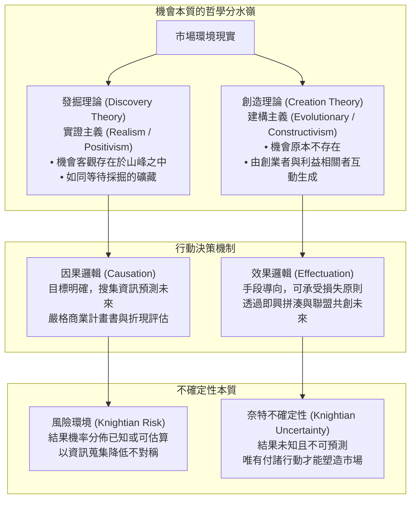
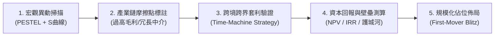

---
{"dg-publish":true,"permalink":"/98/opportunity-discovery/","tags":["商業概念","創業管理","策略管理","PMBA"],"dg-note-properties":{"aliases":["機會發掘","Opportunity Discovery","機會發現理論"],"tags":["商業概念","創業管理","策略管理","PMBA"]}}
---

# 機會發掘 (Opportunity Discovery)

> [!NOTE]
> **核心概念精粹**：機會發掘理論（Opportunity Discovery Theory）主張商業機會是客觀存在於經濟體系中的實體，源於外生衝擊所導致的市場非均衡與資訊不對稱。具備特殊經驗、警覺性或知識儲備的企業家，透過系統性掃描、因果邏輯（Causation）與理性分析，在市場中「發現」這些被隱蔽的價值窪地，並透過資源組合進行套利與商業化。

---

## 一、 學理脈絡：發掘理論 vs 創造理論之世紀辯論

在當代創業學研究中，莎倫·阿爾瓦雷斯與傑伊·巴尼（Sharon Alvarez & Jay Barney, 2007）在《Discovery and creation: Alternative theories of entrepreneurial action》中，將創業機會的本質嚴格劃分為兩大根本對立的哲學陣營：**機會發掘論（Discovery Theory）** 與 **機會創造論（Creation Theory）**。

### 機會發掘與創造之全維度深度對比

| 比較維度 | 機會發掘理論 (Discovery Theory) | 機會創造理論 (Creation Theory) |
| :--- | :--- | :--- |
| **哲學本體論** | **實證客觀論**：機會客觀存在於外部世界，獨立於創業者意志之外。 | **社會建構論**：機會內生於行動，若無創業者行動則無機會可言。 |
| **機會來源** | **外生衝擊（Exogenous Shocks）**：技術突變、法規變動、人口紅利轉換、宏觀經濟扭曲。 | **內生行動（Endogenous Action）**：創業者試錯、與顧客深度互動、社會實驗。 |
| **企業家本質** | **特質與警覺差異**：比他人更敏銳、掌握非對稱資訊、具備專業洞見。 | **學習與適應能力**：具備強大彈性、能凝聚共識、接受意外並自我迭代。 |
| **不確定性層級** | **可計算風險（Risk）**：未來可能狀態可被列舉，概率分佈可經由市場調查估算。 | **真性不確定性（Knightian Uncertainty）**：未來完全無法預測，根本不存在機率分佈。 |
| **決策思考模式** | **因果邏輯（Causation）**：以終為始，設定固定目標，優化資源配置路徑。 | **效果邏輯（Effectuation）**：手中掌握什麼資源？能承受多少損失？順勢而為。 |
| **競爭優勢基礎** | **速度與防禦性**：快速佔位、搶先申請專利、構築先動優勢與進入壁壘。 | **關係契約與適應力**：早期夥伴聯盟、顧客共同設計、黏著度與生態圈鎖定。 |

---

## 二、 機會發掘的四大外生驅動引擎（Exogenous Shocks）

在發掘理論架構下，市場的完美均衡常年被各類外部巨浪所打破，從而留下龐大的利差與價值窪地：

1. **技術突變衝擊（Technological Discontinuities）**：
   - 摩爾定律的推進、底層運算架構升級（如 GPU 取代 CPU 進行並行計算）、新能源電池能量密度突破。
   - 這些技術變革讓過往「經濟上不可行」的構想突然具備商業可行性。
2. **法規與政治制度重組（Regulatory & Political Shifts）**：
   - 金融鬆綁（開放純網銀、第三方支付）、能源雙碳政策、各國個資法（GDPR）與資安合規要求。
   - 制度法規的頒布在瞬間淘汰傳統模式，為能夠迅速合規的新創釋放出真空市場。
3. **人口結構與社會價值變遷（Demographic & Social Shifts）**：
   - 高齡少子化、單身家戶比例激增、遠距混合辦公常態化、健康永續意識抬頭。
   - 人口結構變化具有極高的「確定性（Predictable Wave）」，往往是發掘長期紅利的最穩定錨點。
4. **宏觀資源與供應鏈再平衡（Supply-Demand Disruption）**：
   - 地緣政治引發供應鏈移轉、國際貿易關稅調整、原物料供需短期中斷。

---

## 三、 實戰案例剖析：星巴克對義式濃縮咖啡文化的「跨域發掘」

### 1. 商業洞察與客觀機會之所在
- 1983 年，時任星巴克行銷主管的霍華·舒茲（Howard Schultz）前往義大利米蘭參加國際家庭用品展。
- 在米蘭街頭，舒茲被繁密林立的義式濃縮咖啡吧（Espresso Bar）深深震撼：義大利的咖啡館不僅販售高品質深焙咖啡，更是鄰里社交生活、文化交流的靈魂場域（第三空間）。
- 反觀當時的美國本土，星巴克僅僅是一家在西雅圖派克市場販售散裝咖啡豆、茶葉與香料的小型烘焙零售店，全美大眾飲用的是罐裝劣質濾滴咖啡。

### 2. 機會發掘與跨境套利
- 舒茲敏銳意識到：義式咖啡文化這座「金礦」在義大利已經高度成熟，但跨過大西洋後的美國市場，卻存在高達數億人口的「咖啡文化沙漠」。
- 這是一個標準的**外生機會發掘（Spatial & Cultural Arbitrage）**：市場需求與成熟解決方案客觀存在，只是因為地理與文化隔閡尚未被搬移至美國。
- 舒茲回國後堅決推動現煮義式咖啡零售模式，最終買下星巴克並將「第三空間」標準化複製至全美與全球，創造了全球連鎖咖啡帝國。

---

## 四、 經理人機會發掘執行框架（Analytical Discovery Framework）

對於成熟企業與創投基金，如何建立系統化「發掘」機制的決策檢查步驟：

- [ ] **時光機套利驗證（Time-Machine Arbitrage）**：該商業模式是否在更成熟的市場（如美、日、歐）已經獲得驗證？本國市場的基礎設施（如頻寬、金流、物流）是否已到達引爆點？
- [ ] **產業鏈租金解構（Industry Rent Extraction）**：既有產業鏈中哪一個環節佔據了不成比例的暴利，卻只提供低劣的顧客體驗？我們能否利用數位化手段移除該中間層？
- [ ] **技術成熟度與成本拐點（Cost-Parity Threshold）**：新技術成本是否已跨過普及臨界線（如太陽能發電成本低於燃煤發電）？
- [ ] **先發防禦速度（Speed to Lock-in）**：該機會一旦被我們公開發掘，同業是否能在 3~6 個月內完全抄襲？我們是否具備足夠的融資與執行速度在防禦期內鎖定關鍵客戶？

---

## 五、 關聯概念與知識網絡

* 核心理論基礎：
  * [[opportunity-recognition_創業機會辨識|創業機會辨識 (Opportunity Recognition)]]：機會感知、發掘與創造的完整生命歷程
  * [[opportunity_機會|機會 (Opportunity)]]：提蒙斯模型機會屬性評估
  * [[schumpeter_熊彼得|約瑟夫·熊彼得 (Joseph Schumpeter)]]：非均衡理論與創造性破壞
  * [[information-asymmetry_資訊不對稱|資訊不對稱 (Information Asymmetry)]]：市場摩擦與套利機會的經濟學根源
* 策略思維與實踐：
  * [[competitive-advantage_競爭優勢|競爭優勢 (Competitive Advantage)]]：機會發掘後的快速卡位與規模壁壘
  * [[timmons-model_提蒙斯創業模型|提蒙斯創業模型 (Timmons Model)]]：機會與資源的動態適配
  * [[ERRC_藍海策略四度空間架構 ERRC Grid|藍海策略 ERRC 架構 (Blue Ocean Strategy)]]：無人競爭市場空間的探索與重塑
  * [[disruptive-innovation_破壞式創新|破壞式創新 (Disruptive Innovation)]]：低端客群與未被滿足市場的結構發掘
