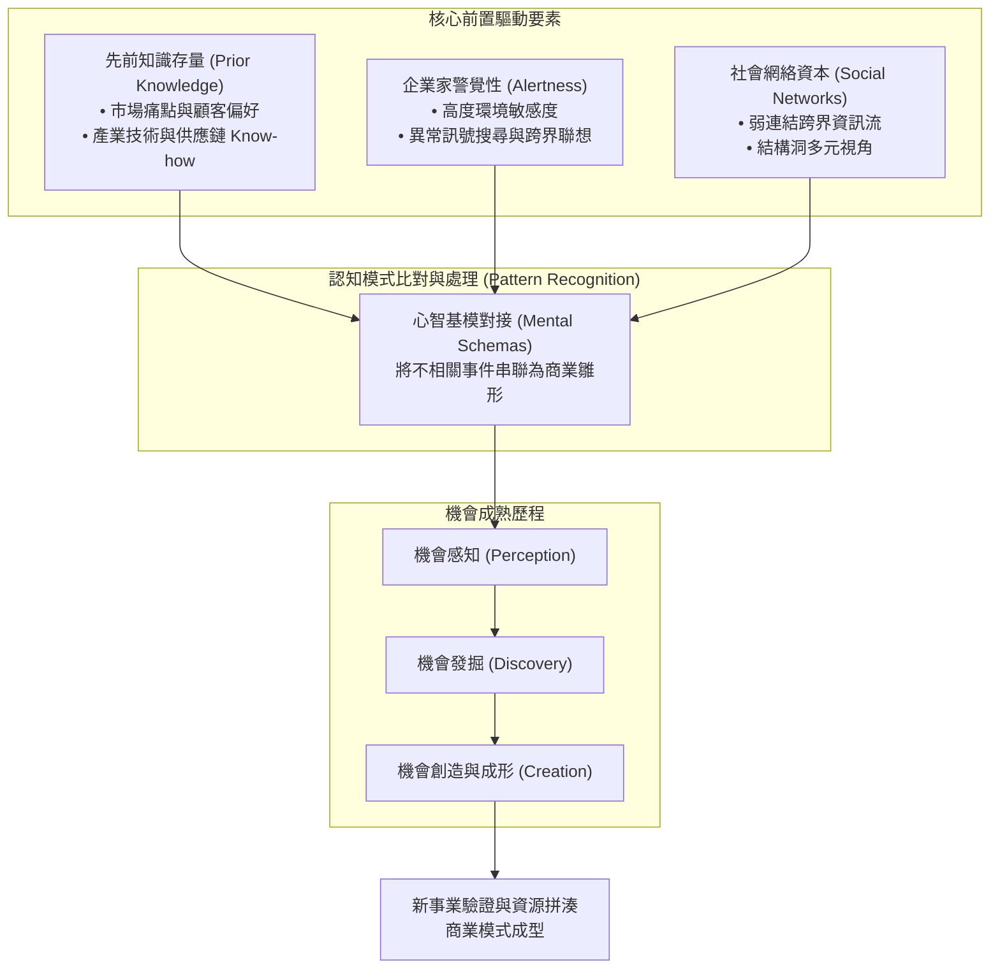

---
{"dg-publish":true,"permalink":"/98/opportunity-recognition/","tags":["商業概念","創業管理","策略管理","PMBA"],"dg-note-properties":{"aliases":["創業機會辨識","Opportunity Recognition","機會辨識歷程"],"tags":["商業概念","創業管理","策略管理","PMBA"]}}
---

# 創業機會辨識 (Opportunity Recognition)

> [!NOTE]
> **核心概念精粹**：創業機會辨識（Opportunity Recognition）是指潛在創業者在市場環境中，洞察未被滿足的顧客需求、未被有效配置的閒置資源或未被商業化的技術潛力，並將其轉化為具備商業可行性與經濟價值之新事業構想的認知與搜尋歷程。它不僅是創業歷程的起點，更是串聯個人認知特質與外部市場結構的核心樞紐。

---

## 一、 學理淵源與理論演進

創業機會辨識的研究歷程跨越了經濟學、認知心理學與策略管理學三大領域，經歷了從「外生套利」到「認知結構」的典範轉變：

1. **奧地利學派經濟學（Austrian Economics）**：
   - 伊斯雷爾·柯茲納（Israel Kirzner, 1973, 1997）提出**企業家警覺性（Entrepreneurial Alertness）**概念。他認為市場長期處於非均衡狀態，充斥著資訊不對稱與價格扭曲；具備敏銳警覺性的企業家無需主動投入高昂搜尋成本，便能「意外發現（Accidental Discovery）」市場中的價格差與未滿足需求，進而進行低買高賣的無風險或低風險套利。
2. **個人—機會雙構面架構（Individual-Opportunity Nexus）**：
   - 斯科特·謝恩與桑卡蘭·范卡塔拉曼（Shane & Venkataraman, 2000）在《The Promise of Entrepreneurship as a Field of Research》中指出，創業機會辨識不能單獨由「創業者個人特質」或「外部環境特徵」單向解釋，而必須研究**「特定機會與特定個體的交互作用」**。
   - 為什麼某些人能看見機會而其他人看不見？關鍵在於**先前知識（Prior Knowledge）**的存量差異與**認知處理能力（Cognitive Properties）**的運作機制。
3. **多維認知整合模型（Ardichvili, Cardozo & Ray, 2003）**：
   - 阿爾迪奇維利等人提出了整合性機會辨識與發展歷程模型，確立了三大前置核心變數：
     - **警覺性維度**：對未被滿足需求的敏感度與聯想能力。
     - **資訊不對稱維度**：特殊的生活與工作經驗帶來的專屬知識。
     - **社會網絡維度**：弱連結（Weak Ties）與結構洞（Structural Holes）帶來的非冗餘資訊流。

---

## 二、 核心構成構面與認知機理

創業機會辨識並非隨機的靈光乍現，而是高度結構化的認知運作過程：

### 1. 先前知識的走廊效應（The Corridor Principle）
- 羅恩斯塔特（Ronstadt, 1988）提出「走廊效應」：創業行動本身就像走進一條走廊，一旦創業者跨出第一步，許多原本在起點完全看不見的新門戶與分岔路（新機會）才會陸續顯現。
- 謝恩（Shane, 2000）進一步將先前知識細分為三大維度：
  - **對市場的先前知識**：深刻理解顧客未被言明的真正痛點與付費摩擦。
  - **對服務市場方式的先前知識**：通曉現存行銷通路、定價邏輯與供應鏈瓶頸。
  - **對客戶問題的先前知識**：來自創業者過去職場中的第一線實務痛點。

### 2. 模式比對（Pattern Recognition Framework）
- 巴倫（Robert Baron, 2006）從認知科學角度證實，具備豐富經驗的創業者會在大腦中形成「原型（Prototypes）」與「思考基模（Exemplars）」。
- 當外部世界出現技術變革、法規鬆綁或人口結構改變時，創業者能將看似毫無關聯的微弱事件串聯起來，比對出潛在的因果關係，迅速勾勒出新商業模式輪廓。

### 3. 機會辨識能力比較矩陣

| 比較構面 | 業餘追隨者（Amateur Follower） | 專業敏銳創業者（Alert Serial Entrepreneur） |
| :--- | :--- | :--- |
| **資訊來源** | 公開主流媒體、二手產業研究報告、熱門趨勢 | 深入產業底層的弱連結網絡、非公開的一線摩擦痛點 |
| **認知邏輯** | 孤立觀察單一技術或爆款產品，盲目跟風複製 | 模式比對（Pattern Recognition），串聯技術、成本與法規之結構變遷 |
| **思考焦點** | 「這個點子有多酷？（Solution-First）」 | 「這個問題有多痛？客戶是否願意付費？（Problem-First）」 |
| **防禦維度** | 缺乏壁壘，容易被同業低價跟進毀滅 | 結合專屬經驗、專利技術或資源拼湊能力，打造獨佔利基 |
| **價值評估** | 依賴樂觀預測，忽視市場容量與獲客成本 | 檢驗單位經濟學（CAC / LTV）、市場集中度與機會之窗長短 |

---

## 三、 經典企業實戰案例：從微弱痛點到百億機會

### 1. Airbnb：從會議住宿短缺辨識出共享經濟萬億藍海
- **背景與洞察**：2007 年，舊金山即將舉辦國際工業設計大會，市中心所有飯店全數客滿。創辦人布萊恩·切斯基（Brian Chesky）與喬·傑比亞（Joe Gebbia）正面臨繳不出公寓房租的窘境。
- **模式比對運作**：
  - 他們並非從龐大的飯店產業報告出發，而是從切身痛點中發現：大會參會者「需要床位與早餐」，而自己的客廳有「閒置空間與氣墊床（Airbed）」。
  - 他們將氣墊床、提供自製早餐與熱情在地導覽打包成每晚 80 美元的服務，三張氣墊床迅速售罄。
- **機會演進躍遷**：
  - 創辦人沒有將其停留在一次性兼職賺錢，而是辨識出背後深層的「供需結構性失衡」：全球各大都會區飯店供給僵化，而大量民宅存在閒置邊際產能。透過互信評價機制與線上金流，成功開創了顛覆傳統飯店巨頭的平台商業模式。

### 2. 聯發科（MediaTek）：從白牌手機混亂中辨識出「交鑰匙解決方案（Turnkey Solution）」
- **背景與洞察**：2000 年代初期，功能型手機市場由諾基亞、摩托羅拉等巨頭壟斷，製造手機需要龐大的基頻晶片、射頻軟體工程團隊，研發週期長達 12 至 18 個月，進入門檻極高。
- **先前知識變現**：
  - 蔡明介團隊憑藉在光碟機晶片領域積累的軟硬體高度整合技術，敏銳觀察到中國大陸及東南亞新興市場對低價多功能手機的爆發性渴求，但當地數千家製造商完全沒有底層研發能力。
- **商業模式重組**：
  - 聯發科打破傳統「只賣裸晶片」的行業慣例，將基頻晶片、作業系統、多媒體軟體乃至主機板設計全部整合為成熟的「Turnkey 方案」。客戶只要裝上外殼、螢幕與電池即可出貨，將手機研發週期從一年壓縮至數週，徹底引爆山寨機與新興品牌崛起浪潮。

---

## 四、 經理人機會辨識決策檢核表（Executive Decision Checklist）

在將一個「靈光一現的點子」正式列入公司研發預算或新事業投資計畫前，決策層必須進行五道嚴格檢驗：

- [ ] **痛點真實性檢驗（Hair-on-Fire Test）**：
  - 目標顧客是否正在積極尋求替代方案？該痛點是如果不解決就會造成重大經濟損失的「止痛藥（Painkiller）」，還是可有可無的「維他命（Vitamin）」？
- [ ] **資訊非對稱優勢（Unfair Information Advantage）**：
  - 團隊是否掌握市場大眾尚未察覺的獨門洞見（Unique Insight）？這項洞見是來自深厚的從業經驗，還是隨處可見的公開常識？
- [ ] **市場結構與技術轉折（Tectonic Shifts）**：
  - 該機會是否受到法規鬆綁、技術典範轉移（如 AI 普及、能源轉型）或消費者行為永久轉變的支撐？是否具備足夠寬闊的[[timmons-model_提蒙斯創業模型|機會之窗]]？
- [ ] **單位經濟防禦力（Unit Economics & Defensibility）**：
  - 是否能在早期實現健康的單元經濟學（LTV / CAC > 3）？一旦既有巨頭跟進模仿，公司是否擁有先動優勢、網絡效應或專利壁壘形成防禦阻絕？
- [ ] **個人—機會適配度（Founder-Opportunity Fit）**：
  - 本團隊的歷史能力矩陣是否最適合執行這個機會？我們是否具備將點子快速轉化為[[MVP最小可行產品|最小可行產品]]並敏捷迭代的動態執行力？

---

## 五、 關聯概念與知識網絡

* 核心理論基礎：
  * [[opportunity-discovery_機會發掘|機會發掘 (Opportunity Discovery)]]：客觀非均衡套利觀點與實證主義路徑
  * [[opportunity_機會|機會 (Opportunity)]]：提蒙斯模型機會屬性與多維度篩選準則
  * [[schumpeter_熊彼得|約瑟夫·熊彼得 (Joseph Schumpeter)]]：創造性破壞與創新五大型態
  * [[Venkataraman|范卡塔拉曼 (Sankaran Venkataraman)]]：個人—機會雙構面架構與創業學本質
* 創業行動與戰略落地：
  * [[timmons-model_提蒙斯創業模型|提蒙斯創業模型 (Timmons Model)]]：機會、團隊與資源的動態平衡
  * [[lean-startup_精實創業|精實創業 (Lean Startup)]]：假設檢定與快速構建—衡量—學習循環
  * [[resource-bricolage_資源拼湊|資源拼湊 (Resource Bricolage)]]：資源匱乏環境下的價值創造
  * [[disruptive-innovation_破壞式創新|破壞式創新 (Disruptive Innovation)]]：低端顛覆與新市場機會鎖定
