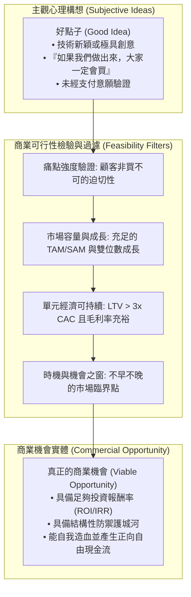

---
{"dg-publish":true,"permalink":"/98/opportunity/","tags":["商業概念","創業管理","策略管理","PMBA"],"dg-note-properties":{"aliases":["機會","創業機會","Entrepreneurial Opportunity"],"tags":["商業概念","創業管理","策略管理","PMBA"]}}
---


# 機會 (Opportunity)

> [!NOTE]
> **核心概念精粹**：在商業與管理學語境中，「機會（Opportunity）」絕非飄渺的空想或純粹的點子，而是一組在特定時空條件下，能夠將全新產品、服務或商業模式推向市場，並為顧客創造顯著價值、為企業創造可持續超額利潤（Economic Rents）的**客觀環境與資源組合狀態**。提蒙斯（Jeffry Timmons）創業學說將「機會」確立為創業三大要素之首，是牽引團隊與資源配置的唯一領先指標。

---

## 一、 學理定位：點子（Idea）與機會（Opportunity）的本質鴻溝

許多初創團隊與企業內部創新專案之所以迅速潰敗，其根源往往在於決策者混淆了「好點子（Good Idea）」與「真正機會（Viable Opportunity）」的本質區別。



### 點子 vs 機會的四維深度對照

| 比較構面 | 浮動點子 (Idea) | 商業機會 (Opportunity) |
| :--- | :--- | :--- |
| **本質屬性** | 主觀的心理構想、未經驗證的技術突破或功能假設。 | 經市場檢驗之客觀經濟狀態，具備顧客真實付費意願。 |
| **顧客價值** | 「聽起來很酷」的加分項（維他命），缺乏不可替代性。 | 解決高成本、低效率或重大痛苦的必備解方（止痛藥）。 |
| **經濟邏輯** | 忽視獲客成本、交付履約成本與單位經濟學。 | 具備健康的單位經濟學、充沛的自由現金流與可擴張性。 |
| **時空邊界** | 任何時候都可能產生，缺乏明確的時間窗口限制。 | 受到「機會之窗（Window of Opportunity）」嚴格限制，稍縱即逝。 |

---

## 二、 提蒙斯創業機會評估體系（Timmons Opportunity Framework）

傑弗里·提蒙斯（Jeffry A. Timmons）在其經典模型中指出，優秀的創業者不是從「我有多少錢（資源）」出發，而是**「以機會為導向（Opportunity-Driven）」**。提蒙斯提出了評估商業機會品質的五大核心維度：

### 1. 市場吸引力（Market Attractiveness）
- **市場規模與成長率**：整體潛在市場（TAM）需具備足夠規模（通常新創目標市場需具備 10 億美元以上潛力），且年複合成長率（CAGR）高於 20%。
- **顧客付費意願**：客戶生命週期價值（CLV）顯著高於獲客成本（CAC），客戶在 12 個月內能回收採購成本。

### 2. 經濟效益與財務指標（Economics & Financial Structure）
- **毛利率空間（Gross Margin）**：毛利率至少維持在 40% 以上（軟體產業需 70% 以上），方能承受擴張期的高額行銷與研發折舊。
- **自由現金流轉正速度**：首筆正向營運現金流能否在 18 至 24 個月內達成，資本密集度是否在可承受範圍內。

### 3. 競爭優勢與進入障礙（Competitive Advantage & Moat）
- **成本優勢與專有資產**：是否擁有專利技術、獨家供應鏈授權、關鍵渠道排他協議或顯著的規模經濟。
- **網絡效應（Network Effects）**：每增加一個新用戶，是否能自動提升整體產品對其他使用者的價值。

### 4. 團隊與策略適配（Management Team Fit）
- **創辦人—機會適配（Founder-Opportunity Fit）**：團隊過去的成功或失敗經驗是否能直接賦能此機會？團隊是否具備難以被挖角的領域專家（Domain Experts）？

### 5. 機會之窗（The Window of Opportunity）
- 機會之窗隨著市場結構變化而開啟，並隨著競爭者蜂擁而入或主流技術標準確立而快速關閉。在窗戶半開時進入風險最低、回報最高；太早進入面臨市場教育成本耗盡資金，太晚進入則面臨殺價紅海。

---

## 三、 商業案例對比：機會之窗的精準捕捉 vs 盲目搶進

```carousel

<!-- slide -->
### 案例 A：Netflix 捕捉串流機會之窗（精準時機）
- **背景**：1997 年 Netflix 成立時以郵寄 DVD 起家，但創辦人哈斯廷斯（Reed Hastings）深知實體租借只是過渡形態，真正的未來是「寬頻線上串流」。
- **時機抉擇**：Netflix 沒有在 2000 年網絡泡沫時強推串流（當時頻寬極慢且儲存昂貴），而是耐心等待了整整十年。直到 2007 年，全美家庭寬頻普及率跨過 50% 臨界點、AWS 雲端運算成熟且晶片解碼成本大跌，Netflix 瞬間打開串流大門，一舉吞噬全球影音市場。
<!-- slide -->
### 案例 B：Webvan 搶進生鮮電商之窗（太早開啟而慘烈關閉）
- **背景**：1999 年 Webvan 募集了近 10 億美元資金，試圖以自建巨型全自動化冷鏈倉庫與專屬配送車隊，顛覆全美生鮮超市產業。
- **失敗致命點**：機會之窗尚未真正開啟。當時智慧型手機尚未發明，消費者必須坐在笨重的桌上型電腦前下單；線上支付與地圖導航極其原始，履約每單配送虧損高達數十美元。在市場基礎設施不成熟的真空期過早大舉擴張，最終在短短 18 個月內破產倒閉。
```

---

## 四、 經理人機會篩選矩陣評分表（Opportunity Scoring Matrix）

在決定啟動新專案前，董事會或投資審查委員會可利用下列矩陣進行量化評分（每項 1~5 分，總分 25 分，低於 18 分應嚴格暫緩）：

| 評估維度 | 評估指標 | 權重 | 評分標竿 (5分條件) | 專案得分 |
| :--- | :--- | :---: | :--- | :---: |
| **痛點迫切性** | 顧客價值主張與痛點深度 | 25% | 客戶主動尋找替代方案，且現有方案成本極高或嚴重失能 | |
| **市場擴張性** | TAM 規模與年複合成長率 | 20% | TAM > 10億美元，且年成長率超過 20% | |
| **單位經濟學** | LTV / CAC 與毛利率 | 20% | LTV / CAC > 3 且毛利率高於 50%（或可快速轉正） | |
| **防禦護城河** | 網絡效應、專利或轉換成本 | 20% | 具備強網絡效應或高轉換壁壘，競品難以在一年內複製 | |
| **機會之窗** | 市場進入時機點適配度 | 15% | 基礎設施剛跨過臨界點，主流競爭者尚未建立絕對壟斷 | |

---

## 五、 關聯概念與知識網絡

* 核心理論基礎：
  * [[opportunity-recognition_創業機會辨識|創業機會辨識 (Opportunity Recognition)]]：從心理感知到商業機會的認知轉換
  * [[opportunity-discovery_機會發掘|機會發掘 (Opportunity Discovery)]]：客觀非均衡環境下的機會搜尋
  * [[timmons-model_提蒙斯創業模型|提蒙斯創業模型 (Timmons Model)]]：機會、資源與團隊之經典三維平衡架構
  * [[great-idea_好創意|好創意 (Great Idea)]]：點子與可行商業機會的本質分水嶺
* 策略與價值實踐：
  * [[value-proposition_價值主張|價值主張 (Value Proposition)]]：為目標客群創造不可替代價值的核心陳述
  * [[lean-startup_精實創業|精實創業 (Lean Startup)]]：以極低成本驗證機會假設的敏捷體系
  * [[viable-business_好事業|好事業 (Viable Business)]]：自我造血與正自由現金流飛輪
  * [[barriers-to-entry_進入障礙|進入障礙 (Barriers to Entry)]]：機會之窗開啟期的搶先佈局與防禦壁壘構築
