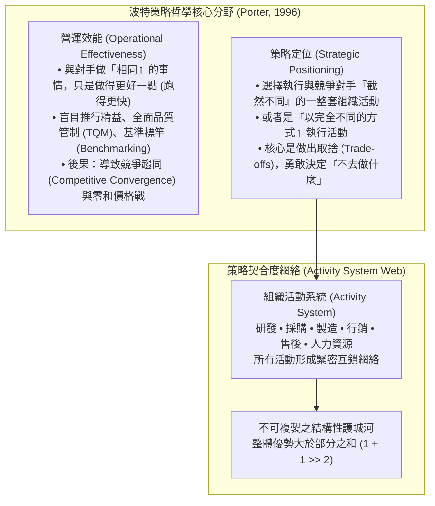
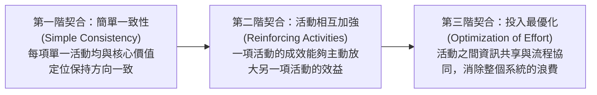

---
{"dg-publish":true,"permalink":"/98/organizational-activities/","tags":["商業概念","策略管理","組織設計","競爭策略","PMBA"],"dg-note-properties":{"aliases":["組織活動","策略性活動系統","Organizational Activities","活動系統圖","Activity System","波特活動系統"],"tags":["商業概念","策略管理","組織設計","競爭策略","PMBA"]}}
---


# 組織活動 (Organizational Activities)

> [!NOTE]
> **核心概念精粹**：組織活動（Organizational Activities / Activity System），是哈佛策略大師麥可·波特（Michael E. Porter）在《何謂策略？》（What is Strategy?）中確立的核心範式。波特斷言：**策略的本質在於選擇與競爭對手不同的組織活動，或以不同的方式執行活動**。企業的持久競爭優勢絕非源於單點孤立的卓越表現，而是源於各項離散組織活動之間緊密咬合、相互強化所形成的**「策略契合度（Strategic Fit）」網絡**。複製單一活動易如反掌，但要複製一整套高度互鎖的活動系統幾乎不可能。

---

## 一、 學理奠基：波特策略性活動系統理論

波特深刻批判了 1980 年代企業界將「營運效能（Operational Effectiveness, OE）」誤當成「策略」的迷思：



---

## 二、 策略契合度（Strategic Fit）的三種層次架構

波特將組織活動之間的協同契合度嚴格劃分為三大深化階梯：



### 策略契合度三層級實務解析

| 契合層級 | 運作機理與定義 | 西南航空（Southwest Airlines）實踐範例 | 對競爭對手模仿之威脅 |
| :--- | :--- | :--- | :--- |
| **第一階契合：<br>簡單一致性** | 組織內部的所有離散活動，均明確服務於同一個策略定位（如低成本或差異化）。 | 僅採購單一機型波音 737、不提供機上餐點、不指定座位、不轉運聯程行李。全部一致導向「降低運營成本」。 | 對手可輕易模仿單一環節（如取消餐點），尚無法形成壓倒性優勢。 |
| **第二階契合：<br>活動相互加強** | A 活動的執行，直接為 B 活動創造更低成本或更高價值，形成加乘綜效。 | 單一機型簡化了零件維修庫存，使得地勤人員能極速作業，直接推動「15 分鐘極限登機過站」，進而推升「飛機每日飛行時數（資產利用率極致）」。 | 對手必須同時複製兩項以上互相增益的活動，難度幾何級數增加。 |
| **第三階契合：<br>投入最優化** | 透過全系統的設計協同，使某些傳統昂貴的環節根本不需要存在。 | 由於只飛二線次級機場且過站極快，西南航空根本不需要像傳統樞紐航司（Delta、United）那樣建立高昂的行李自動分揀轉運中心。 | 對手若試圖全盤模仿，必須徹底推翻自身原有的航網樞紐架構，引發巨大的**自相殘殺（Straddling）代價**。 |

---

## 三、 經典企業實戰案例：IKEA 的無敵活動系統圖

```carousel

<!-- slide -->
### 1. 傳統家具業的臃腫活動
- **傳統模式**：市中心高租金展廳、大量銷售導購人員、整裝家具佔據龐大倉儲空間、高額的到府組裝與運送費用；
- **結果**：成本高昂、交期長達數週，消費者承擔高價。
<!-- slide -->
### 2. IKEA 的互鎖活動系統革命
- **獨特活動組合**：
  - **郊區低租金巨型門市**：提供充足免費停車位與家庭一日遊體驗；
  - **扁平式平板包裝（Flat-Pack）**：大幅降低倉儲與物流體積，方便顧客直接搬上自用車後車廂；
  - **消費者自主服務**：自行挑選、自行搬運、回家自行組裝（DIY），消滅了門市導購與昂貴組裝人工；
  - **模組化內部設計**：設計師直接根據生產製程與成本限制反向設計家具。
- **不可複製的防禦壁壘**：傳統家具巨頭即使看懂了 IKEA 的模式也無法模仿——若傳統家具店改賣平板包裝，其既有的高租金市中心門市與昂貴組裝工會將直接崩潰。
```

---

## 四、 經理人組織活動系統審計檢核表（Executive Decision Checklist）

在評估公司策略競爭力時，CEO 與策略長應依序檢驗下列問題：

- [ ] **獨立活動 vs 系統互鎖檢驗（System Over Isolated Actions）**：
  - 我們的核心優勢，究竟是建立在「某個明星員工、某項專利或低價」等單一孤立要素上，還是建立在「跨越研發、製造、行銷與文化的多重互鎖網絡」上？
- [ ] **取捨與棄置明確性（The Discipline of Trade-Offs）**：
  - 「我們為了貫徹現有的定位，明文決定『堅決不去做』哪些事情？」如果策略清單上只有「想做的事」而沒有「放棄的事」，就根本不存在真正的策略。
- [ ] **跨部門活動加乘效應（Reinforcing Cross-Functional Links）**：
  - 行銷部門推動的新方案，是否直接降低了研發或售後服務的負擔？還是行銷打得火熱，後端供應鏈與客服卻疲於奔命？
- [ ] **競品模仿自殘障礙（Competitor Straddling Penalty）**：
  - 如果市場第一大巨頭試圖完全抄襲我們的組織活動系統，它是否會因此損害其既有核心客群的利益與品牌形象？我們是否創造了「對手抄襲即自殘」的防禦陷阱？

---

## 五、 關聯概念與知識網絡

* 核心策略定位與競爭優勢：
  * [[strategic-fitness_策略適配性理論|策略適配性理論 (Strategic Fit)]]：組織活動系統理論之學理深化
  * [[competitive-advantage_競爭優勢|競爭優勢 (Competitive Advantage)]]：活動系統互鎖所釋放之持久超額利差
  * [[cost-leadership-strategy_成本領導策略|成本領導策略 (Cost Leadership Strategy)]]：西南航空與 IKEA 透過活動重構極致降本
  * [[core-competence_核心能力|核心能力 (Core Competence)]]：貫穿各項離散活動底層之專屬組織能力
* 組織設計與商業模式：
  * [[Good_Product_Business_Company_好產品好事業好公司模型|好產品好事業好公司模型]]：從單一活動卓越邁向偉大公司系統
  * [[viable-business_好事業|好事業 (Viable Business)]]：自我造血與活動協同構建之健康商業模式
  * [[business-model-pivot_商業模式軸轉|商業模式軸轉 (Pivot)]]：外生環境變遷時對整套活動系統之動態重組
  * [[differentiation-advantage_差異化優勢|差異化優勢 (Differentiation Advantage)]]：以獨特活動組合創造顧客不可替代之價值
