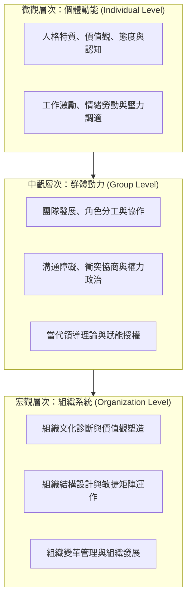

---
{"dg-publish":true,"permalink":"/98/organizational-behavior/","tags":["商業概念","組織行為","核心必修","管理學","PMBA"],"dg-note-properties":{"aliases":["組織行為","組織行為學","Organizational Behavior","OB"],"tags":["商業概念","組織行為","核心必修","管理學","PMBA"]}}
---

# 組織行為 (Organizational Behavior, OB)

## 一、 核心定義與學門本質
- **學科定義**：組織行為學是一門應用行為科學，系統性探討**個體（Individual）**、**群體（Group）**與**組織結構（Organizational Structure）**對組織內部行為的影響，以應用此類知識提升組織效能與員工福祉。
- **學科基石與多學科交集**：
  - **心理學（Psychology）**：解析個體知覺、學習、性格、工作動機、情緒與壓力。
  - **社會學與社會心理學（Sociology & Social Psychology）**：剖析團隊動力、人際溝通、權力政治、衝突與領導。
  - **人類學（Anthropology）**：透視組織文化、跨文化價值觀與環境適應。

## 二、 組織行為三大核心管理任務
1. **了解（Understand）**：以科學方法穿透表象，探究員工行為背後的深層心理動機與認知歷程。
2. **預測（Predict）**：結合性格特質、價值觀與情境線索，預先研判團隊未來的績效、流動率與協作態勢。
3. **影響與引導（Influence）**：運用激勵機制、溝通策略、文化重塑與賦能領導，驅動組織持續變革與成長。

## 三、 組織行為三大分析層次架構

## 四、 從經驗主義走向循證管理 (Evidence-Based Management, EBM)
- 現代經理人做決策時，拒絕單憑「過往直覺」或「流行管理神話」，必須嚴格整合：
  1. 最佳科學實證研究；
  2. 組織內部實質數據指標；
  3. 專業經理人沉澱之實踐智慧；
  4. 利害關係人之倫理道德關懷。

## 五、 關聯主題與導航對接
- 課程總覽：[[_組織行為 MOC|組織行為 MOC 全景地圖]]
- 核心模組：
  - **Module 1 個體行為與心理機制**
    - [[M1-1_組織行為導論與跨文化價值觀]]
    - [[M1-2_商業倫理決策與性格特質模型]]
- 核心理論工具：
  - [[Big_Five_Personality_Traits_大五人格特質模型]]
  - [[Hofstede_Cultural_Dimensions_霍夫斯泰德文化六維度]]
  - [[Schwartz_Value_Theory_施瓦茨價值觀十構面模型]]
  - [[Trait_Activation_Theory_特質激化理論]]
  - [[Personality_Plasticity_性格可塑性與高階職涯跨越]]