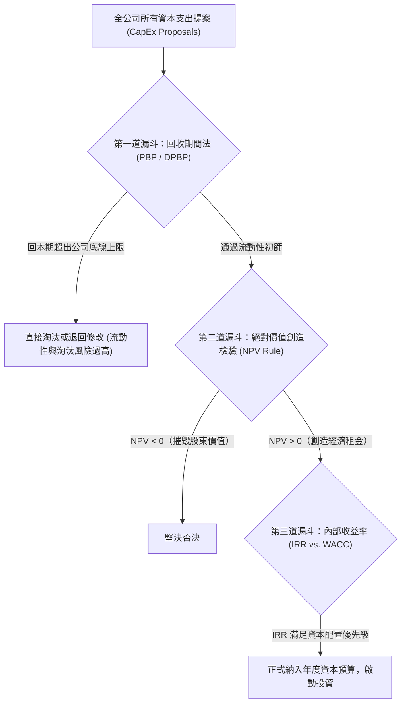

---
{"dg-publish":true,"permalink":"/98/payback-period/","tags":["商業概念","資本預算","財務管理","公司理財","PMBA"],"dg-note-properties":{"aliases":["回收期間法","Payback Period","回收期","投資回收期法","PBP"],"tags":["商業概念","資本預算","財務管理","公司理財","PMBA"]}}
---


# 回收期間法 (Payback Period Method, PBP)

> **【核心決策摘要】**
> **回收期間法（Payback Period Method，簡稱 PBP）** 是企業評估資本預算（Capital Budgeting）與大型固定資產投資時，歷史最悠久、實務界最普遍使用的直觀初篩工具。其衡量**投資專案所產生的累計現金淨流入，剛好全額覆蓋期初初始投資成本（Initial Outlay）所需的具體年數或月數**。儘管回收期間法具備計算簡便、直觀反映資金流動性風險與周轉速度的顯著優勢，但因其**完全忽視貨幣時間價值（Time Value of Money）**，且**武斷忽略回收期之後的一切現金流（Cut-off Bias）**，在現代財務金融理論中被定性為「次優決策準則」。然而，在面臨流動性緊縮、技術快速迭代或新創企業生存壓力時，高階經理人仍普遍將其作為「第一道防禦性流動性漏斗」。

---

## 1. 概念核心定義與本質 (Executive Definition & Theoretical Essence)

### 1.1 核心定義與數理表達
回收期被嚴格定義為：使專案累計淨現金流入剛好等於初期初始現金支出的時間長度 $T_{\text{pbp}}$：

$$\sum_{t=1}^{T_{\text{pbp}}} \text{CF}_t = I_0$$

其中 $I_0$ 為期初投資額，$\text{CF}_t$ 為第 $t$ 期產生的現金淨流入。

```
【情境 A：每期現金流入均等 (Annuity Cash Flows)】
PBP = 初始投資額 (I0) / 每年平均現金淨流入 (CF)

【情境 B：每期現金流入不均等 (Uneven Cash Flows)】
PBP = A + (B / C)
• A：累計現金流接近但尚未超過 I0 的最後完整年數
• B：第 A 年末尚未收回的剩餘成本 (I0 - 累計至第 A 年現金流)
• C：第 A+1 年該整年度的預期現金淨流入
```

### 1.2 本質解析：經理人偏好與四大理論死穴的衝突
儘管商學院教科書極力推薦淨現值法（NPV），全球 Fortune 500 大企業調查顯示，超過 75% 的財務長仍將回收期作為專案立項的必備輔助指標。這種實務偏好背後存在深刻的治理邏輯與理論缺陷的對撞：

```
                    ┌─────────────────────────────────────────┐
                    │      回收期間法 (PBP) 的二元評價圖譜    │
                    └────────────────────┬────────────────────┘
                                         ▼
         ┌───────────────────────────────┴───────────────────────────────┐
         ▼                                                               ▼
【實務經理人偏好的四大理由】                                    【學術財務理論批判的四大死穴】
 1. 直觀易懂：非財務背景高管與工程主管秒懂                     1. 忽視貨幣時間價值：將 5 年後的錢與今天的錢等同
 2. 流動性導向：回本越快，資金再次配置彈性越高                 2. 嚴重的截斷盲區 (Cut-off)：回本後的百億暴利視而不見
 3. 規避預測浮誇：遠期 10 年的現金流預測往往是虛妄             3. 門檻設定極度主觀：規定「3年內必須回本」毫無依據
 4. 防範技術淘汰：在高科技業，3年後產品可能已被顛覆             4. 無法極大化股東財富：不告訴你到底創造了多少淨價值
```

---

## 2. 數理模型與計算範例 (Mathematical Modeling & Calculation Examples)

### 2.1 典型專案評估對照演練

假設某高科技製造企業考慮投資兩條互斥的自動化產線專案（初始投資 $I_0 = \$1,000$ 萬元），預期現金流如下：

| 專案別 | 第 1 年 | 第 2 年 | 第 3 年 | 第 4 年 | 第 5 年 | 簡單回收期 (PBP) | 總累計現金流 | 專案實質價值評價 |
| :--- | :---: | :---: | :---: | :---: | :---: | :---: | :---: | :--- |
| **專案 A (快跑型)** | \$500 萬 | \$500 萬 | \$100 萬 | \$100 萬 | \$100 萬 | **2.0 年** | \$1,300 萬 | 回本極快，但後續造血能力貧弱 |
| **專案 B (慢熱長牛型)** | \$100 萬 | \$300 萬 | \$400 萬 | \$800 萬 | \$1,500 萬 | **3.25 年** | **\$3,100 萬** | 前期爬坡慢，第 4~5 年爆發巨額現金流 |

#### 經理人決策分歧：
- **若採回收期標準（設定門檻 $PBP_{\text{max}} = 3.0$ 年）**：管理層將**核准專案 A，否決專案 B**。
- **致命代價**：專案 B 在 5 年內創造了 \$3,100 萬元的現金流入（總盈餘為專案 A 的 2.4 倍），但僅因回本期超出 3 個月而遭到錯殺！這正是傳統回收期法最受詬病的「截斷偏誤（Cut-off Bias）」。

---

## 3. 戰略框架與流動性漏斗模型 (Strategic Framework & Decision Funnel)

在現代公司理財實踐中，成熟企業不再單獨以 PBP 作為立項終審標準，而是將其降維為**多階段資本配置的初級篩選漏斗（Phase-Gate Funnel）**：



### 3.1 適用回收期間法的三大特殊情境
1. **面臨嚴峻資金流動性約束的企業**：高槓桿企業或處於資本寒冬的新創公司，首要生存法則不是「極大化 10 年後的現值」，而是「確保 18 個月內有真金白銀回流以償還即期短債」（參見 [[net-working-capital_淨營運資金]] 與 [[working-capital-management_營運資金管理]]）。
2. **快速技術迭代與短生命週期產業**：消費電子產品（如智慧手機外觀模具）、快時尚產線，設備物理壽命雖有 8 年，但經濟壽命僅 18~24 個月。此時超過 2 年的遠期現金流純屬幻覺，強制要求 1.5 年內回本具備強大避險價值。
3. **高政治風險或主權信用脆弱之跨國投資**：在政策可能隨時轉向、存在外匯管制或國有化風險的發展中國家建廠，經理人首要考量是「幾年內能將本金完整撤回國內」。

---

## 4. 產業標竿與實戰應用場景 (Industry Benchmarks & Applications)

| 產業維度 | 典型回收期門檻 (PBP) | 背後戰略邏輯 | 核心監控指標 |
| :--- | :---: | :--- | :--- |
| **SaaS 與互聯網軟體** | **CAC Payback $< 12$ 個月** | 用戶獲取成本必須在一年內透過訂閱毛利收回，才能支撐現金再投資飛輪 | [[unit-economics-model_單位經濟模型]] 中的 CAC Payback Period |
| **汽車製造自動化 (Kaizen)** | **$12 \sim 24$ 個月** | 產線微型精益改造，投資額小但周轉要求極高，鼓勵基層快速試錯 | 單位工時節省折算現金、良率提升金額 |
| **商用太陽能屋頂 / 節能設備 (ESCO)** | **$3 \sim 5$ 年** | 依靠節省的電費支出覆蓋初期太陽能板安裝成本，現金流極度穩定且可預測 | 內部合約保證節能量（Performance Contracting） |
| **重化學工業與先進晶圓代工** | **不採用簡單 PBP**<br>(改採 NPV + 實質選擇權) | 晶圓廠（Fab）動輒數百億美元，前期建廠折舊沉重，依靠長達 7~10 年的製程演進獲利 | [[NPV_淨現值法 _Net Present Value]] 與 [[dcf_現金流量折現法]] |

---

## 5. 經典企業個案深度剖析 (Deep Dive Case Studies)

### 5.1 成功典範：Toyota（豐田）將 18 個月回收期授權予第一線產線主管
- **管理創新**：傳統企業所有資本支出無論金額大小皆須經財務委員會層層審批，耗時數月。
- **制度授權**：
  1. 豐田章男推行工廠現場賦能，凡是單項投資在 50 萬美元以內的自動化治具或防呆裝置改造，只要試算**簡單回收期在 18 個月以內**，廠長即可現場簽字撥款立項。
  2. 由於回本期極短，即使個別改善專案未達預期，其潛在損失完全受控；而成功專案則立即在全工廠推廣。
- **成效**：每年在現場產出數千項快速回本的微型精益專案，累積創造數十億美元的營運成本節約。

### 5.2 失敗警示：柯達（Kodak）因傳統回本門檻錯殺革命性研發
- **歷史教訓**：1990 年代初，柯達內部工程師多次提出數位相機與線上照片存儲平臺的立項申請。
- **財務決策死穴**：
  1. 傳統底片產線的邊際設備改造在 1~2 年內即可靠現成龐大銷量收回成本（極短 PBP）。
  2. 數位相機專案需要巨額初期軟硬體研發與傳感器量產投資，且預計初期市場規模極小，試算簡單回收期長達 6~8 年。
  3. 財務評審委員會嚴格執行「非核心業務投資回收期不得超過 3 年」的教條，連續否決數位專案預算。
- **經理人啟示**：簡單回收期法是天生的**「維持性創新偏袒者與破壞性創新殺手」**。高潛力革命性技術在前期必然呈現長回收期特徵，死守 PBP 終將導致企業被時代放逐。

---

## 6. 高階經理人決策實戰工具箱 (Executive Action Playbook)

### 6.1 資本預算決策工具優缺點綜合格局

```
                    ┌────────────────────────────────────────┐
                    │      資本預算三大指標決策互補圖譜      │
                    └───────────────────┬────────────────────┘
                                        ▼
    ┌───────────────────┬───────────────┴───────────────┬───────────────────┐
    ▼                   ▼                               ▼                   ▼
【回收期間法 (PBP)】    【折現回收期 (DPBP)】           【淨現值法 (NPV)】  【內部報酬率 (IRR)】
 • 核心優勢：流動性速度 • 核心優勢：兼顧時間價值       • 核心優勢：財富增量極大化 • 核心優勢：百分比回報率
 • 核心盲點：忽視時間價值 • 核心盲點：仍有截斷偏誤     • 核心盲點：直觀性差 • 核心盲點：再投資假設缺陷
 • 適用角色：初級排雷漏斗 • 適用角色：動態回本防線     • 適用角色：終極決策裁判 • 適用角色：管理溝通輔助
```

### 6.2 經理人使用回收期間法的避坑指南
- [ ] **防錯 1：切忌將 PBP 作為「唯一」決策準則**：必須與 NPV 搭配使用，嚴禁單獨以 PBP 決定百萬美元以上的大型戰略投資。
- [ ] **防錯 2：在現金流計算中必須使用「增額現金流」而非「會計淨利」**：（必須加回 D&A 等非現金折舊，扣除營運資金追加，參見 [[zeng-e-cash-flow_增額現金流量]]）。
- [ ] **防錯 3：對不同風險等級專案應設定階梯式門檻**：（例如：節能降本成熟專案門檻 2 年；新技術開拓專案應放寬至 5 年或改用實質選擇權）。

---

## 7. 關聯知識網絡與導航地圖 (Knowledge Network & Cross-References)

### 7.1 本主題核心三部曲
- **[[payback-period_回收期間法]]** · 初始投資流動性回本速度、四大理論缺陷與第一道初篩漏斗（本篇）
- **[[discounted-payback-period_折現回收期間法]]** · 引入資本成本折現、NPV 連動定理與動態回本邊界
- **[[zeng-e-cash-flow_增額現金流量]]** · 資本預算唯一度量標準、沉沒成本剔除、機會成本與自食效應

### 7.2 跨領域財務與策略鏈結
- [[capital-budgeting_資本預算]] · 公司理財長期資本支出決策主控導航架構
- [[capital-expenditure_資本支出]] · 資本支出（CapEx）本質、資本化 vs. 費用化
- [[NPV_淨現值法 _Net Present Value]] · 衡量股東財富增量極大化之至高決策準則
- [[unit-economics-model_單位經濟模型]] · 新創客戶獲取成本之 CAC Payback 聯動分析
- [[net-working-capital-2_淨營運資金回收]] · 專案終期營運資金逆向釋放回流機制

### 7.3 課程筆記與導航主頁
- [[M1-2_三大景氣循環與資本評價邏輯]] · 資本支出週期、DCF 評價與門檻收益率（Hurdle Rate）
- [[_創業與企業財務策略 MOC]] · 企業財務策略與資本市場運作全景地圖
- [[home]] · 全球 PMBA 知識庫總導航主頁面