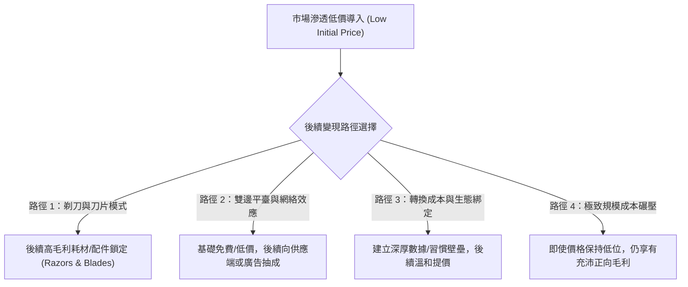

---
{"dg-publish":true,"permalink":"/98/penetration-pricing/","tags":["商業概念","行銷管理","策略管理","經濟學","PMBA"],"dg-note-properties":{"aliases":["市場滲透定價","Penetration Pricing","滲透定價策略","低價滲透"],"tags":["商業概念","行銷管理","策略管理","經濟學","PMBA"]}}
---


# 市場滲透定價 (Penetration Pricing Strategy)

> **【核心決策摘要】**
> **市場滲透定價（Penetration Pricing Strategy）** 是一種在產品或服務導入市場初期，設定顯著低於市場平均水平或接近邊際成本的極低價格，藉以迅速吸引價格敏感型客戶、擊穿競爭防線、搶佔壓倒性市佔率（Market Share）的進攻型定價策略。其底層商業邏輯在於：利用初期低價快速引爆**規模經濟（Economies of Scale）** 與 **學習曲線（Learning Curve）**，將單位成本壓降至同業無法生存的深度，並藉由網絡效應或轉換成本鎖定客戶，最終透過後續生態系、增值服務或提價實現長期盈利。

---

## 1. 概念核心定義與本質 (Executive Definition & Theoretical Essence)

### 1.1 核心定義
市場滲透定價在策略行銷與產業組織理論中被定義為：**企業在進入成熟或新興市場時，主動放棄短期毛利率，以具備破壞性的低價作為槓桿，快速拉動銷量跨越損益平衡點，築起基於產能規模與生態網絡之長期競爭壁壘的動態策略**。

```
              ┌────────────────────────────────────────────────────────┐
              │           市場滲透定價的「雙核正向反饋飛輪」           │
              └───────────────────────────┬────────────────────────────┘
                                          ▼
                       【破壞性低定價 (Low Price)】
                                  │      ▲
              銷量與市佔率爆發     │      │ 成本節約再反哺 (或提價變現)
              (Volume Spike)      ▼      │
                       【累計產能翻倍 (Scale Up)】
                                  │      ▲
              規模經濟與經驗學習   │      │ 形成競品無法逾越之成本屏障
              (Cost Advantage)    ▼      │
                    【單位成本大幅驟降 (Unit Cost Down)】
```

### 1.2 實施滲透定價的三大先決條件
1. **市場具備高度需求價格彈性（High Price Elasticity, $|\epsilon_d| > 1$）**：消費者對價格高度敏感，微小的降價即可激發大幅度的需求擴張與品牌替換。
2. **存在顯著的規模經濟或學習曲線效應**：隨產量擴大，每單位固定成本能被劇烈攤薄，或者存在顯著的製造經驗累積效應（累計產量每倍增，生產成本固定下降 $15\%\sim 25\%$）。
3. **具備充沛的資本跑道或先發優勢防禦力**：企業必須擁有足夠的融資儲備承擔初期低利潤甚至虧損，且競品無法在短期內發動對等的價格戰予以反擊（參見 [[economies-of-scale_規模經濟]] 與 [[barriers-to-entry_進入障礙]]）。

---

## 2. 數理模型與經驗曲線機制 (Mathematical Modeling & Experience Curve Dynamics)

### 2.1 波士頓諮詢（BCG）經驗曲線模型 (Experience Curve Model)

滲透定價能否最終轉化為經濟利潤，關鍵取決於單位製造成本隨「累計產量（Cumulative Output）」下降的速率：

$$C_t = C_1 \cdot X_t^{-b}$$

- $C_t$：第 $t$ 期生產第 $X_t$ 單位的單位直接成本。
- $C_1$：第一單位的生產成本。
- $X_t$：截至該時點的歷史累計總產量。
- $b$：經驗學習係數（$b > 0$），學習率（Learning Rate, $L$）定義為累計產量翻倍時的成本比例：$L = 2^{-b}$。

#### 經理人量化推論：
若某製造業的學習率為 $80\%$（即 $L=0.8$，$b \approx 0.322$）：
當累計產量從 10 萬件增長至 80 萬件（翻倍 3 次），其單位成本將降為：
$$C_{80\text{萬}} = C_{10\text{萬}} \times (0.8)^3 = 0.512 \times C_{10\text{萬}}$$
單位成本幾近腰斬！這意味著採取滲透定價的先驅者，能以競品「連原料成本都不夠」的終端售價持續獲利。

### 2.2 滲透定價的損益平衡與利潤擴展條件

企業在低定價 $P_{\text{low}}$ 下的營業利潤為：

$$\Pi = Q(P_{\text{low}}) \cdot \left[ P_{\text{low}} - \text{AVC}(Q) \right] - \text{TFC}$$

要使低價策略創造高於常規價格 $P_{\text{std}}$ 的利潤，銷量增幅 $\frac{\Delta Q}{Q}$ 必須滿足：

$$\frac{\Delta Q}{Q} > \frac{\frac{\Delta P}{P}}{\left( \frac{P - \text{AVC}}{P} \right) - \frac{\Delta P}{P}}$$

即當產品原有邊際貢獻率越低時，滲透定價所需的銷量拉動乘數就越極端。經理人切忌在邊際變動成本極高且缺乏規模攤提空間的行業盲目使用滲透定價。

---

## 3. 戰略框架與後續變現路徑 (Strategic Framework & Monetization Paths)

### 3.1 從低價滲透走向全面獲利的四大路徑 (The 4 Monetization Plays)

低價只是切入點，並非商業模式的終局。成功的滲透定價必須依託以下後續變現路徑之一：



1. **剃刀與刀片模式（Razors and Blades Model）**：硬體虧損或極低價出售以迅速鋪開裝機量（Installed Base），透過後續高頻、高毛利的專屬耗材持續獲利（如膠囊咖啡機、列印機墨匣、家用遊戲機）。
2. **增值服務與生態抽成（Platform Cross-subsidization）**：基礎功能免費或廉價，靠進階企業版、加值外掛模組、金融支付抽成或數位廣告變現。
3. **轉換成本沉澱後的定價權收復**：利用低價獲取大量用戶後，透過沉澱用戶歷史資產、社交圖譜或業務流程，築起極高 [[switching-costs_轉換成本]]，隨後分階段實施溫和提價。
4. **低成本結構的持久護城河**：如好市多（Costco）或亞馬遜（Amazon），將超低價作為永續經營哲學，依靠會員費或巨大的供應鏈採購議價權支撐微利運轉。

---

## 4. 產業標竿與實戰應用場景 (Industry Benchmarks & Applications)

| 商業賽道 | 典型代表 | 滲透定價手法 | 長期變現與防禦機制 |
| :--- | :--- | :--- | :--- |
| **雲端運算基礎設施 (IaaS)** | Amazon AWS | 歷史上連續主動降價超過 80 次，以極低利潤率壓迫同業 | 龐大伺服器群採購規模、全球骨幹網路架構、高毛利 PaaS/SaaS 增值服務鎖定 |
| **家用遊戲主機 (Gaming Console)** | 索尼 PS5、微軟 Xbox Series X | 主機硬體每台虧損 \$50~\$100 銷售以擴大普及率 | 抽取數位遊戲 30% 平台版稅分成、PlayStation Plus 訂閱服務費 |
| **平價零售與量販** | Costco 好市多、IKEA 宜家家居 | 毛利率嚴格限制在 14%~15% 以下，熱門單品（如熱狗烤雞）數十年不漲價 | 年費會員制（Membership Fee 貢獻逾 70% 營業利益）、超大批量直接採購 |
| **雙邊出行平臺 (Ride-hailing)** | Uber、Grab 早期 | 鉅額補貼乘客與司機，以低於計程車半價的車資擊穿市場 | 雙邊流動性網絡效應，等待競爭對手資金斷鏈後降低補貼率 |

---

## 5. 經典企業個案深度剖析 (Deep Dive Case Studies)

### 5.1 成功典範：Amazon AWS 的飛輪降價哲學
- **貝佐斯的逆向思考**：多數企業在獲得成本優勢後，傾向於維持原價以擴大每季利潤率；亞馬遜創辦人貝佐斯則堅持將所有因規模擴張省下的成本，**100% 主動以降低售價的形式返還給客戶**。
- **AWS 的毀滅性競爭優勢**：
  1. 雲端運算具備極其龐大的固定資本支出（Data Center 基礎設施）。
  2. AWS 憑藉先發優勢與滲透低價迅速累積全球過半開發者，龐大的運算需求迫使伺服器利用率居高不下。
  3. 利用規模經濟向晶片商（Intel/AMD/NVIDIA）進行深度的批量壓價，並自主研發 Graviton ARM 晶片進一步壓降算力成本。
  4. 競品（如微軟 Azure、Google Cloud）即便擁有雄厚母公司資金，亦極難在不承受百億美元虧損的情況下匹敵 AWS 的性價比。

### 5.2 失敗警示：中國共享單車的「流血無底洞」惡性價格戰
- **錯誤模式**：2016-2018 年間，ofo 與摩拜單車在全中國瘋狂投放數千萬輛單車，並開展「充 100 送 100」、「免費騎乘一個月」、「紅包車倒貼用戶」的極端滲透定價。
- **崩潰原因解構**：
  1. **缺乏轉換成本**：用戶手機內同時下載多款 App，誰免費就騎誰，品牌忠誠度為零。
  2. **維護與折舊成本並非固定成本**：單車風吹雨淋，人為破壞與調度維運成本高昂，投放越多，每日變動營運虧損越大（嚴重違背 [[unit-economics-model_單位經濟模型]] 原理）。
  3. **資本寒冬斷糧**：當創投資本不再無限輸血，企業嘗試將每半小時收費提升至 1.5~2 元時，活躍用戶雪崩，押金擠兌危機爆發，最終 ofo 宣告破產。
- **經理人啟示**：如果產品無法沉澱留存資產，低價滲透只是一場「花錢替產業培養消費者習慣」的自殺式慈善活動。

---

## 6. 高階經理人決策實戰工具箱 (Executive Action Playbook)

### 6.1 滲透定價 vs. 掠奪性定價（Predatory Pricing）之法律邊界
經理人使用激進滲透定價時，必須嚴格防範觸犯反壟斷法（Antitrust Law）：
- **合法滲透定價**：短期低於同業均價，但高於自身平均可變成本（AVC），旨在擴大規模與吸引試用。
- **違法掠奪性定價**：具備市場支配地位的壟斷巨頭，故意將價格長期壓低至「平均可變成本以下（Below Average Variable Cost）」，意圖將弱小競爭者徹底驅逐出市場，待形成寡占後再大幅提價實施壟斷剝削。

### 6.2 滲透定價落地執行四大檢驗指標
- [ ] **指標 1：規模擴展後，單位邊際成本是否確定存在至少 20% 以上的下降空間？**
- [ ] **指標 2：企業資產負債表能否承受至少 12~18 個月的淨利潤收縮期？**
- [ ] **指標 3：客戶使用產品後，是否會產生數據依賴、習慣或流程嵌入？（防止成為單純的過路客）**
- [ ] **指標 4：市場是否存在強大的專利持有者或不可逾越的法規壁壘，使得產能無法順利放大？**

---

## 7. 關聯知識網絡與導航地圖 (Knowledge Network & Cross-References)

### 7.1 本主題核心三部曲
- **[[pricing_撇脂定價法]]** · 跨期價格歧視、高端消費者剩餘榨取與科斯猜想防禦
- **[[penetration-pricing_市場滲透定價]]** · 低價搶佔網絡效應、規模經濟成本攤薄與後續變現閉環（本篇）
- **[[price-sensitivity_價格敏感度]]** · 需求價格彈性量化、價格敏感度九大心理驅動與 PSM 測試模型

### 7.2 跨領域策略與行銷鏈結
- [[economies-of-scale_規模經濟]] · 滲透定價背後的核心支撐柱：固定成本攤薄與採購議價權
- [[switching-costs_轉換成本]] · 阻止滲透用戶流向其他競品、確保提價成功的最強黏著劑
- [[barriers-to-entry_進入障礙]] · 結合規模經濟與低價策略構築不可跨越的產業壁壘
- [[unit-economics-model_單位經濟模型]] · 警惕變動成本侵蝕，防止陷入共享單車式「規模化毒藥」

### 7.3 課程筆記與導航主頁
- [[M1-5_創業構想發展與兩階段可行性評估]] · 創業產品定價與市場份額獲取策略
- [[_創業與企業財務策略 MOC]] · 企業營運現金流與資本防禦地圖
- [[home]] · 全球 PMBA 知識庫總導航主頁面