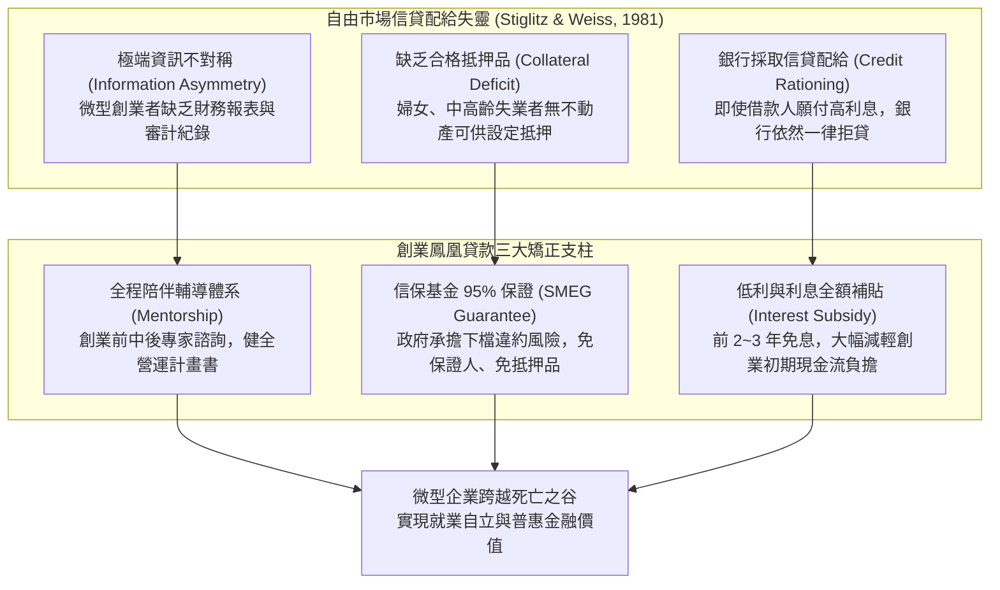

---
{"dg-publish":true,"permalink":"/98/phoenix-entrepreneur-loan/","tags":["商業概念","創業管理","創業金融","公共政策","PMBA"],"dg-note-properties":{"aliases":["創業鳳凰貸款","微型創業鳳凰貸款","Micro-Enterprises Phoenix Loan","政策性普惠創業金融"],"tags":["商業概念","創業管理","創業金融","公共政策","PMBA"]}}
---

# 創業鳳凰貸款 (Micro-Enterprises Phoenix Loan)

> [!NOTE]
> **核心概念精粹**：微型創業鳳凰貸款（Micro-Enterprises Phoenix Loan）是台灣勞動部為協助婦女、中高齡失業轉型者及離島居民發展微型企業，所推動的**標竿性政策性普惠金融與創業扶助制度**。其制度設計深度融合了**「信貸配給失靈矯正（Credit Rationing Correction）」**、**「國家信用保證風險共擔（Public Credit Guarantee）」**與**「全程陪伴式賦能輔導（Mentorship Program）」**三大支柱，是微型創業初期極具戰略價值的無股權稀釋（Non-dilutive）資本工具。

---

## 一、 學理淵源：信貸配給失靈與政策性金融介入

在自由市場金融體系中，商業銀行對微型企業與弱勢創業者的借貸普遍存在嚴重的市場失靈：

### 1. 史蒂格利茨—韋斯信貸配給模型（Stiglitz & Weiss, 1981）
- 傳統經濟學認為利率能自發出清借貸市場。但斯蒂格利茨與韋斯證明：銀行若單純拉高利率，會引發**逆向選擇（只有高風險賭徒願意借高利貸）**與**道德風險（借款人鋌而走險投入極端高風險專案）**。
- 因此，理性的商業銀行寧可設定嚴苛的抵押品門檻或直接「拒貸（Credit Rationing）」。微型創業者、女性及中高齡族群因而陷入制度性信貸荒漠。

### 2. 創業鳳凰貸款的核心制度參數架構

| 制度維度 | 政策規範與實務運作機制 | 創業者之策略意涵 |
| :--- | :--- | :--- |
| **扶持對象** | - 20~65 歲女性。 - 45~65 歲中高齡國民。 - 20~65 歲設籍離島居民。 - 設立登記未滿五年，且員工未滿 5 人之事業體。 | 精準鎖定傳統信貸弱勢族群，促進就業自立與社會包容。 |
| **貸款額度** | 最高新台幣 **200 萬元**（初次申請一般最高 100 萬，營運正常後可再次增貸至 200 萬）。 | 提供微型企業啟動期的初期固定資產與營運週轉金。 |
| **利率與利息補貼** | 按郵政儲金二年期定期儲蓄存款機動利率加年息 0.575% 機動計息。 **前 2 年（特定對象如受天災衝擊者前 3 年）由政府全額補貼利息**。 | 實質達成前 24 個月「零利息負擔」，保護早期脆弱現金流。 |
| **信用擔保條件** | **免保證人、免抵押品**；中小企業信用保證基金提供 **高達 95%** 信用保證。 | 徹底打破傳統銀行「無房產即無貸款」的硬壁壘。 |
| **還款期限** | 貸款期限最長 7 年，含寬限期最長 1 年（寬限期內僅付息不還本）。 | 與微型企業營運資本回收週期深度適配。 |

---

## 二、 陪伴式賦能體系：從單純輸血到造血培育

創業鳳凰貸款超越傳統銀行借貸的最關鍵創新，在於其建構的**「輔導 + 融資 + 網絡」三合一生態系**：

1. **創業前（Pre-Startup）——知能培訓與計畫輔導**：
   - 提供入門班、進階班與精實創業工作坊；
   - 指派資深顧問輔導撰寫具備商業可行性的營運計畫書（Business Plan），消除創辦人的認知盲區。
2. **創業中（In-Startup）——跨部會審查與快速通關**：
   - 由專家學者與銀行代表組成聯合審查委員會，以「計畫可行性與創業動機」取代傳統冷酷的財報徵信。
3. **創業後（Post-Startup）——專家一對一顧問與同儕社群**：
   - 經營顧問實地訪視，診斷財務金流、數位行銷與法規合規問題；
   - 建立「鳳凰家族」創業同儕社群，推動跨界異業結盟、市集展銷與共同採購。

---

## 三、 實戰個案剖析：傳統手作轉型連鎖甜點工坊

- **創辦人背景**：48 歲的林女士因原任職傳統製造業關廠而失業，憑藉烘焙熱情與客家在地食材，在家中廚房試做手工生乳捲與果醬，初期僅在社區市集零售，月營收不足 3 萬元。
- **痛點瓶頸**：
  - 隨著口碑發酵，訂單供不應求，急需租賃中央廚房並購置專業旋風烤箱與急速冷凍設備（需資金 120 萬元）；
  - 因無不動產抵押，且過去無任何公司銀行往來流水，遭三家商業銀行拒貸。
- **鳳凰貸款介入與賦能歷程**：
  - 參加勞動部微型創業進階班，在企管顧問指導下梳理單元經濟學，計算出每條生乳捲毛利率達 62%；
  - 成功申請到第一期 100 萬元鳳凰貸款，信保基金承擔 95% 信用保證，前兩年免息；
  - 顧問進一步輔導其導入 Line 官方帳號與冷凍宅配冷鏈合作，月營收突破 35 萬元，一年後申請增貸 100 萬元擴建二廠，成功脫離失業困境並聘用 4 位二度就業婦女。

---

## 四、 經理人政策性融資運用決策檢核表（Executive Decision Checklist）

創業者在考量申請創業鳳凰貸款等政策性金融工具時，應進行下列策略評估：

- [ ] **資本屬性與股權保全評估（Non-Dilutive Capital Evaluation）**：
  - 企業目前的資金需求是否適合政策性債權融資？（相比於過早出讓高達 20%~30% 股權給天使投資人，鳳凰貸款能 100% 保全創辦團隊的股權完整性）。
- [ ] **自我造血週期與還款壓力測算（Debt Serviceability Test）**：
  - 公司能否在前兩年利息全免的保護傘下，將月營運現金流成功轉正？寬限期結束後的本息均攤金額，是否佔每月淨營業現金流的 30% 以下？
- [ ] **補貼依賴陷阱防範（Anti-Subsidy Addiction Audit）**：
  - 商業模式的成立，是否過度依賴政府的免息補貼？一旦兩年期滿恢復正常付息，企業是否依然具備健康的毛利空間與生存能力？
- [ ] **顧問資源與社群網絡槓桿（Mentorship & Network Leverage）**：
  - 團隊是否充分利用政府委派的外部專家診斷資源？是否積極參與鳳凰同儕社群獲取低成本行銷曝光與供應鏈協同機會？

---

## 五、 關聯概念與知識網絡

* 核心理論基礎：
  * [[information-asymmetry_資訊不對稱|資訊不對稱 (Information Asymmetry)]]：信貸市場逆向選擇與信貸配給根源
  * [[evaluation-c-principles_信用評估五C原則|信用評估五C原則 (Five Cs of Credit)]]：商業銀行傳統徵信準則與政策性金融替代
  * [[viable-business_好事業|好事業 (Viable Business)]]：微型企業從生存向自我造血的躍遷
  * [[timmons-model_提蒙斯創業模型|提蒙斯創業模型 (Timmons Model)]]：資源匱乏階段的外部政策性槓桿
* 創業金融與治理工具：
  * [[equity-financing_股權融資|股權融資 (Equity Financing)]]：股權稀釋融資與無稀釋政策債券之比較
  * [[debt-financing_負債融資|負債融資 (Debt Financing)]]：債權融資槓桿效益與償債能力管理
  * [[Burn Rate|資金消耗率 (Burn Rate)]]：啟動期現金流監控與資金跑道維護
  * [[resource-bricolage_資源拼湊|資源拼湊 (Resource Bricolage)]]：極大化槓桿公共輔導資源的微型創業實踐
