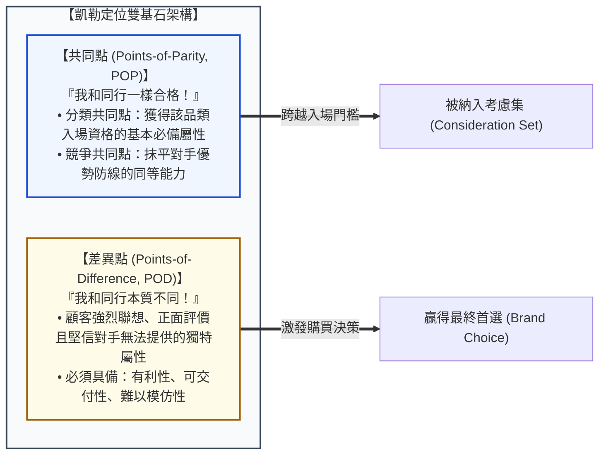

---
{"dg-publish":true,"permalink":"/98/positioning-strategy/","tags":["商業概念","行銷管理","策略管理","STP","定位策略","品牌策略","PMBA"],"dg-note-properties":{"aliases":["定位策略","市場定位","定位","心智定位","知覺定位","Positioning Strategy","Positioning","positioning-strategy","定位陳述句","品牌定位"],"tags":["商業概念","行銷管理","策略管理","STP","定位策略","品牌策略","PMBA"],"類別":"商業概念庫"}}
---


# 定位策略 (Positioning Strategy / 心智定位戰略)

> **核心名言**：  
> 「定位不是你對產品做了什麼，而是你在潛在顧客心智（Mind）中做了什麼。在資訊過載的超競爭時代，商業競爭的真正戰場不是在貨架上，而是在顧客的大腦中。」  
> —— 艾爾·賴茲 & 傑克·特勞特（Al Ries & Jack Trout, 定位理論創始人, *Positioning: The Battle for Your Mind*, 1981）  
>  
> 「建立強大品牌定位的關鍵，在於精確界定與競爭對手的『共同點（Points-of-Parity）』與『差異點（Points-of-Difference）』。你必須先證明自己具備入場資格，再展現無可替代的卓越理由。」  
> —— 凱文·萊恩·凱勒（Kevin Lane Keller, 品牌權益大師, *Strategic Brand Management*）

---

## 一、 核心定義與心智戰場本質

### 1.1 經典理論起源與演進
- **定位理論的誕生（Ries & Trout, 1981）**：
  美國知名行銷大師艾爾·賴茲（Al Ries）與傑克·特勞特（Jack Trout）在 1970 年代提出、1981 年正式出版《定位》（*Positioning*），掀起了全球商業界的定位革命。特勞特指出：現代社會已進入「傳播過載（Over-communicated Society）」時代，廣告與訊息泛濫成災。企業單純提升產品質量並無意義，**唯有在顧客心智中佔據一個清晰、獨特且不可動搖的「心智地產（Mental Real Estate）」，才能真正存活**。
- **STP 戰略閉環的終極收斂點**：
  定位是整個 STP 戰略的第三步（Step 3），也是將前期「[[98_商業概念庫/market-segmentation_市場區隔\|市場區隔]]」與「[[98_商業概念庫/target-market-selection_目標市場選擇\|目標市場選擇]]」成果轉化為終端溢價的靈魂中樞。

```
【顧客大腦的四大心智法則 (Laws of the Mind)】

  1. 心智容量極度有限 (Limited Mind) ──► 每個品類大腦最多只能記住 2~3 個品牌 (雙寡占階梯)
  2. 心智痛恨混亂 (Hates Confusion)   ──► 訊息必須極致聚焦為一個單詞 (如 Volvo = 安全)
  3. 心智缺乏安全感 (Insecure Mind)   ──► 追求品類第一或從眾潮流 (如「大家都在用」)
  4. 心智難以改變 (Resistant to Change)──► 試圖扭轉既有心智認知的行銷預算通常血本無歸
```

---

## 二、 定位兩大基石：共同點 (POP) vs. 差異點 (POD)

達特茅斯學院凱文·凱勒（Kevin Lane Keller）教授在品牌策略中指出，許多企業定位失敗，在於「只顧強調差異點，卻忘記了共同點」：



1. **共同點（Points-of-Parity, POP）—— 入場許可證**：
   - **分類共同點（Category POP）**：消費者認為該品類產品所「必須具備」的基本屬性。
     - *反例*：一家純網銀如果轉帳速度慢、App 經常閃退，即便提供再高的活存利率，也不會被視為一家合格的銀行。
   - **競爭共同點（Competitive POP）**：用來瓦解對手核心優勢的防守型措施。
     - *案例*：當市場認為麥當勞只有垃圾食物時，麥當勞推出健康燕麥沙拉與精品現磨 McCafé，目的不是要成為沙拉第一品牌，而是**消除消費者心中的「否決因子（Deal-breaker）」**，讓顧客不再有理由為了健康而轉去吃賽百味（Subway）。
2. **差異點（Points-of-Difference, POD）—— 決戰終點線**：
   - 差異點必須通過 **3D 檢驗法則**：
     1. **有利性（Desirable）**：對消費者而言必須是真正重要、能解決痛點的利益，而非工程師自嗨的技術參數；
     2. **可交付性（Deliverable）**：企業內部價值鏈是否具備穩定、高良率交付該承諾的真本事；
     3. **可防禦性（Differentiable）**：競爭對手是否能在短時間內透過資本或外購輕易複製。

---

## 三、 知覺定位圖 (Perceptual Mapping) 與策略白地辨識

**知覺定位圖（Perceptual Map）** 是經理人將消費者心智中的品牌認知進行二維空間視覺化的經典工具：

```text
【高階汽車市場之知覺定位圖 (Perceptual Map)】

                   性能 / 駕駛樂趣 (Performance & Sporty)
                                     ▲
                                     │     【Porsche】
                                     │      (極限跑車性能)
                                     │
                     【BMW】         │
                      (終極駕駛機器)   │
                                     │
  前衛 / 科技感 ─────────────────────┼───────────────────── 傳統 / 尊爵感
  (Innovative Tech)                  │                     (Prestige & Luxury)
                                     │         【Mercedes-Benz】
                     【Audi】        │          (尊貴地位與沉穩奢華)
                      (Quattro 科技) │
                                     │
                                     ▼
                   經濟實用 / 舒適性 (Practical & Comfort)
```

- **圖譜分析意涵**：
  1. **同儕聚集（Clustering）**：若多個品牌重疊在同一座標區間，代表該區域陷入高度同質化血戰；
  2. **策略白地（Strategic White Space）**：地圖上空無一人的區域，往往代表潛在未被滿足的市場缺口（如特斯拉早期在「前衛科技感 $\times$ 超級性能」的空白區強勢切入）；
  3. **防範「中間陷阱（Stuck in the Middle）」**：既不夠奢華、又不夠便宜，缺乏鮮明特徵的品牌最容易被邊緣化。

---

## 四、 經典定位陳述句模板 (Geoffrey Moore's Positioning Statement)

企業在落實內部研發、行銷廣告與業務溝通時，必須將定位提煉為一句高度嚴謹的**「定位陳述句（Positioning Statement）」**：

```text
【傑弗瑞·摩爾定位陳述句標準黃金模板】

  致【目標客群 Target Customer】，
  他們正面臨【特定痛點或情境問題 Statement of Need/Opportunity】，
  我們的【產品/品牌名稱 Product Name】
  是一個【品類範疇定義 Product Category】，
  它能夠提供【核心關鍵利益與價值主張 Key Benefit/Compelling Reason to Buy】。
  不同於【主要競爭對手或替代品 Primary Competitive Alternative】，
  我們的產品【具備核心差異化優勢與支撐證據 Point of Difference / Reason to Believe】。
```

---

## 五、 七大經典定位戰術維度 (Seven Positioning Approaches)

在商業實務中，頂尖企業通常依循以下七大維度之一發起心智搶位：

| 定位維度 | 策略本質與核心機制 | 經典代表品牌 |
| :--- | :--- | :--- |
| **1. 核心屬性/特點定位** | 牢牢綁定一項物理功能或專屬特性 | **Volvo**（汽車安全性）、**Dyson**（無袋氣旋吸塵） |
| **2. 核心效益/解決方案定位** | 承諾帶來最強烈的情感或生理效益 | **海倫仙度絲**（去屑）、**FedEx**（絕對在次日早晨送達） |
| **3. 價格-品質定位** | 極高奢華地位溢價 vs 極致天天平價 | **Rolex**（成就與身份象徵） vs **Costco / IKEA**（極致性價比） |
| **4. 使用時機/應用場景定位** | 與特定生活或工作時段深度聯結 | **Red Bull**（極限運動與熬夜抗疲勞）、**KitKat**（考試與休息時光） |
| **5. 使用者身份定位** | 讓產品成為特定族群的身份辨識徽章 | **Nike**（致敬所有人體內的運動員）、**Lululemon**（熱愛瑜伽的健康中產女性） |
| **6. 對立/反向定位 (Repositioning)** | 將自己定義為品類霸主的「鮮明對立面」 | **7-Up**（七喜「非可樂 Uncola」）、**Avis**（「我們是老二，所以我們更努力」） |
| **7. 品類先鋒/原創者定位** | 確立自己是該品類的正宗起源 | **可口可樂**（"The Real Thing" 真正的可口可樂） |

---

## 六、 旗艦實證案例剖析 (Flagship Industrial Cases)

### 6.1 案例一：星巴克（Starbucks）——「第三空間」體驗定位
星巴克之所以能將一杯成本不到 10 元台幣的黑咖啡賣出上百元溢價，關鍵在於其徹底跳脫了「咖啡豆烘焙商」的平庸定位：
- **重新定義品類**：星巴克賣的不是咖啡因液體，而是**家與辦公室之間的「第三空間（The Third Place）」**；
- **支撐證據（Reason to Believe）**：柔和溫暖的爵士樂、舒適的沙發椅、現磨咖啡豆的香氣、店員在紙杯上親切寫下顧客名字；
- **心智佔領**：當消費者需要非正式商務會談、閱讀放鬆或社交碰面時，大腦第一個跳出的關鍵字就是「星巴克」。

### 6.2 案例二：艾維斯租車（Avis）—— 商業史上最傳奇的老二反向定位
1960 年代，美國租車市場長期被赫茲租車（Hertz）絕對統治，排名第二的 Avis 每年虧損累累：
- **致命逆轉**：Avis 打破「報喜不報憂」常規，在廣告中公然承認：*「Avis is only No.2 in car rentals. So why go with us? We try harder.（艾維斯在租車業只是第二名，那為什麼要選我們？因為我們更努力！）」*
- **邏輯閉環**：因為我們是第二，所以我們的煙灰缸洗得更乾淨、油箱加得更滿、排隊時間更短！
- **市場結果**：精準擊中了消費者同情弱者、厭惡老大傲慢的心理，Avis 在一年內轉虧為盈，市佔率翻倍爆發。

---

## 七、 高階經理人決策工具箱：定位體檢與再定位指南 (Executive Playbook)

```
┌────────────────────────────────────────────────────────────────────────────┐
│              高階經理人「定位策略體檢與心智防衛」檢核清單                    │
├────────────────────────────────────────────────────────────────────────────┤
│ ☐ 1. 檢驗品牌是否掉入「雙重定位陷阱」(Dual Positioning Trap)：            │
│    • 既想做平價代工又想賣高價自有品牌？必然導致兩頭落空。（參閱專題筆記）  │
├────────────────────────────────────────────────────────────────────────────┤
│ ☐ 2. 審查 POP 與 POD 的平衡度：                                            │
│    • 我們的產品是否在「共同點 POP」上有嚴重缺角導致客戶一票否決？           │
│    • 我們的「差異點 POD」是否對顧客具備實質意義，且對手 1 年內無法模仿？   │
├────────────────────────────────────────────────────────────────────────────┤
│ ☐ 3. 一句話講清定位（三秒電梯簡報）：                                      │
│    • 公司所有主管與業務人員，能否用一句話精確描述公司的核心定位陳述句？    │
├────────────────────────────────────────────────────────────────────────────┤
│ ☐ 4. 何時啟動「品牌再定位 (Repositioning)」？                              │
│    • 當主流客群老齡化、或新技術（如 AI）讓原有優勢徹底商品化時，果斷重塑心智標籤。│
└────────────────────────────────────────────────────────────────────────────┘
```

---

## 八、 知識圖譜關聯與雙向鏈結 (Bidirectional Knowledge Links)

### 8.1 核心系列套裝導航（經典行銷 STP 三部曲）
- **[[market-segmentation_市場區隔]]** · 異質市場切分、四大變數體系與 MASDA 檢驗準則
- **[[target-market-selection_目標市場選擇]]** · 目標市場評估、五大涵蓋模式與跨越鴻溝灘頭堡
- **[[positioning-strategy_定位策略]]** · 顧客心智佔領、POP/POD 差異化與知覺定位圖（本篇）

### 8.2 策略與品牌資產對接
- [[Dual_Positioning_Trap_雙重定位陷阱與品牌代工衝突]] · 代工與自有品牌衝突之經典定位陷阱
- [[brand-equity_品牌權益]] · 定位如何轉化為無形資產與品牌心智溢價
- [[competitive-matrix_競爭矩陣]] · 知覺定位圖在競爭矩陣四象限中之戰略映射
- [[value-chokepoint_價值咽喉]] · 品牌在顧客心智端所鑄造的不可替代咽喉
- [[TAM]] ｜ [[SAM]] ｜ [[SOM]] · 定位對應之市場規模漏斗對接

### 8.3 課程筆記與主控台
- [[L03_市場區隔與定位策略]] · 行銷管理課程模組三核心講義
- [[L04_品牌管理與品牌權益]] · 品牌資產與定位延伸模組
- [[_創業與企業財務策略 MOC]] · 全課程創新與行銷架構
- [[home]] · 全球 PMBA 知識庫總導航主頁面
