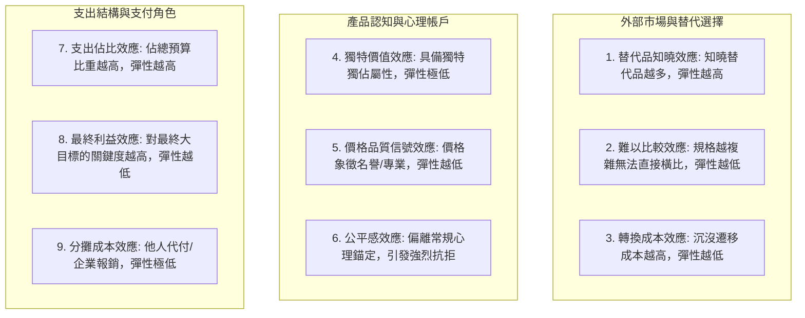

---
{"dg-publish":true,"permalink":"/98/price-sensitivity/","tags":["商業概念","行銷管理","經濟學","財務策略","PMBA"],"dg-note-properties":{"aliases":["價格敏感度","Price Sensitivity","需求價格彈性","價格彈性","Price Elasticity of Demand"],"tags":["商業概念","行銷管理","經濟學","財務策略","PMBA"]}}
---


# 價格敏感度與需求價格彈性 (Price Sensitivity & Elasticity)

> **【核心決策摘要】**
> **價格敏感度（Price Sensitivity）** 衡量消費者在面對產品或服務價格變動時，其購買意願、採購頻率與需求量產生的反應強度。在微觀經濟學與定量行銷學中，其標準量化指標為**需求價格彈性（Price Elasticity of Demand, $E_d$）**。深入洞察價格敏感度是企業制定任何科學定價決策（無論是撇脂定價、滲透定價、動態定價或價值基礎定價）的先決條件。它不僅直接決定了價格調整對總營收與邊際利潤的淨衝擊方向，更是評估企業是否具備抗通膨**溢價能力（Pricing Power）** 與市場區隔邊界的終極試金石。

---

## 1. 概念核心定義與本質 (Executive Definition & Theoretical Essence)

### 1.1 核心定義與數理表達
需求價格彈性衡量**價格變動的百分比所引發的需求量變動百分比**：

$$E_d = \frac{\% \Delta Q}{\% \Delta P} = \lim_{\Delta P \to 0} \frac{\frac{\Delta Q}{Q}}{\frac{\Delta P}{P}} = \frac{\partial Q}{\partial P} \cdot \frac{P}{Q}$$

由於需求曲線通常向下傾斜，需求量與價格呈反向變動，實務分析中通常取絕對值 $|E_d|$ 進行決策評估。

### 1.2 彈性區間與營收利潤聯動矩陣

總營收函數為 $TR = P \times Q$。對價格 $P$ 求一階導數，可得著名的阿莫羅索-羅賓遜定理（Amoroso-Robinson Relation）：

$$\frac{d(TR)}{dP} = Q + P \frac{dQ}{dP} = Q \left( 1 - |E_d| \right)$$

邊際收益（Marginal Revenue, $MR$）與彈性的對應關係為：

$$MR = P \left( 1 - \frac{1}{|E_d|} \right)$$

| 需求彈性區間 | 經濟學特徵 | 價格調升 ($P \uparrow$) | 價格調降 ($P \downarrow$) | 戰略建議與適用模型 |
| :---: | :--- | :--- | :--- | :--- |
| **$|E_d| > 1$** | **富有彈性 (Elastic)**<br>需求反應極為劇烈 | 總營收顯著減少 ($TR \downarrow$) | **總營收增加 ($TR \uparrow$)** | 採取 [[98_商業概念庫/penetration-pricing_市場滲透定價\|penetration-pricing_市場滲透定價]]；透過降價換取銷量爆發，發揮規模效應。 |
| **$|E_d| < 1$** | **缺乏彈性 (Inelastic)**<br>需求反應相對遲鈍 | **總營收增加 ($TR \uparrow$)** | 總營收減少 ($TR \downarrow$) | 具備強大 [[98_商業概念庫/pricing-power_溢價能力\|pricing-power_溢價能力]]；採取 [[98_商業概念庫/pricing_撇脂定價法\|pricing_撇脂定價法]] 或逐步提價釋放毛利。 |
| **$|E_d| = 1$** | **單一彈性 (Unitary Elastic)** | 總營收不變 ($TR$ 達極值) | 總營收不變 ($TR$ 達極值) | 營收最優點（若邊際成本 $MC > 0$，利潤最優點必然處於 $|E_d| > 1$ 的富彈性區間）。 |

---

## 2. 驅動價格敏感度的九大心理與市場機制 (Thomas Nagle's 9 Price Drivers)

定價策略大師湯瑪斯·奈格（Thomas Nagle）在其經典著作中總結了決定顧客價格敏感度的九大關鍵心理與情境因素：



1. **替代品知曉效應（Perceived Substitutes Effect）**：顧客對替代品的知曉度越高、搜尋成本越低，對價格越敏感（如比價網站普及導致電商標準品彈性上升）。
2. **獨特價值效應（Unique Value Effect）**：當產品擁有競品不具備的獨佔特性或專利時，顧客價格敏感度大幅降低（如 Apple 封閉 iOS 體驗）。
3. **轉換成本效應（Switching Cost Effect）**：更換供應商伴隨高額時間、合約違約金或重新學習成本時，客戶對提價極不敏感（參見 [[switching-costs_轉換成本]]）。
4. **難以比較效應（Difficult Comparison Effect）**：服務或產品架構高度客製、計費複雜時，顧客難以進行蘋果對蘋果（Apple-to-Apple）的直接比價（如電信資費複雜合約、顧問專案報價）。
5. **價格品質信號效應（Price-Quality Effect）**：對於高端精品、高難度外科手術或頂級律師事務所，過低的價格反而會引發消費者對品質瑕疵的懷疑，高定價自帶信任溢價。
6. **支出佔比效應（Expenditure Effect）**：該項支出佔消費者可支配所得或企業總採購預算的比例越低，價格敏感度越低（如買房裝潢時數萬元的五金配件容易隨手簽字通過）。
7. **最終利益效應（End-Benefit Effect）**：若該零組件是決定最終成果成敗的「價值咽喉」，客戶願意支付不成比例的超額溢價（如半導體製程中的極紫外光光阻劑）。
8. **分攤成本效應（Shared-Cost Effect）**：由第三方（如雇主報銷、保險公司給付）承擔部分或全部費用時，購買者對價格幾乎完全脫敏（如商務艙機票、高級健檢）。
9. **公平感效應（Fairness Effect）**：定價若被認為是趁人之危（如暴風雪中的天價除雪鏟、疫情期間天價口罩），將引發道德公憤與劇烈反彈。

---

## 3. 定量測量方法論與實戰模型 (Quantitative Measurement Methodologies)

### 3.1 范西斯滕多普價格敏感度測試法 (Van Westendorp Price Sensitivity Meter, PSM)

PSM 是市調與新產品定價中最廣泛使用的四問法，透過繪製四條累計百分比曲線尋找最適價格區間：

```
百分比 (%)
  100 ▲
      │       太便宜 (Too Cheap) ╲                 ╱ 太貴 (Too Expensive)
      │                           ╲               ╱
      │  划算 (Cheap)              ╲ 點A     點B ╱             昂貴 (Expensive)
      │      ╲                       ╲       ╱                ╱
      │       ╲                       ╲     ╱                ╱
   50 ┼────────╲───────────────────────╲───╱────────────────╱───────
      │         ╲                       ╲ ╱                ╱
      │          ╲                     點C ╲ 點D          ╱
      │           ╲                         ╲            ╱
    0 └────────────┴─────────────────────────┴──────────┴──────────────► 價格 ($)
                 最低定價邊界               最優價格點    最高定價邊界
                 (Point of Marginal         (Optimal      (Point of Marginal
                  Cheapness, PMC)            Price Point)  Expensiveness, PME)
```

- **四個核心問句**：
  1. 什麼價格會讓您覺得該產品「**太便宜**」，從而懷疑其品質而不買？（Too Cheap）
  2. 什麼價格會讓您覺得該產品「**很划算**」，是物超所值的超值選擇？（Cheap / Bargain）
  3. 什麼價格會讓您覺得該產品「**有點貴**」，但仍會考慮購買？（Expensive）
  4. 什麼價格會讓您覺得「**太貴了**」，無論如何都不可能購買？（Too Expensive）
- **關鍵交點指標**：
  - **最優價格點（Optimal Price Point, OPP）**：「太便宜」曲線與「太貴」曲線之交點，此處抗拒購買的阻力最小。
  - **價格無差別點（Indifference Price Point, IPP）**：「很划算」與「有點貴」曲線之交點，市場對價格的高低認知達到均勻平衡。
  - **可接受價格範圍（Range of Acceptable Prices）**：界定於邊際便宜點（PMC）與邊際昂貴點（PME）之間。

### 3.2 聯合分析 (Conjoint Analysis) 與真實 A/B 測試
- **聯合分析（Conjoint Analysis）**：將產品拆解為多個屬性（如：品牌、電池壽命、售價、保固期），讓受試者在多個虛擬產品配置組合中進行權衡挑選，以迴歸計算出價格屬性的「部分效用值（Part-worth Utility）」。
- **線上真實 A/B 測試動態定價**：在電商平臺隨機分流客群進行微小價格差異測試，真實記錄轉換率，直接擬合需求曲線。

---

## 4. 產業標竿與實戰應用場景 (Industry Benchmarks & Applications)

| 商業場景 | 典型需求價格彈性 ($|E_d|$) | 核心主導效應 | 經理人定價戰術 |
| :--- | :---: | :--- | :--- |
| **頂級奢侈品 / 超跑** | **$< 0.3$ (極度缺乏彈性)** | 價格品質信號、獨特價值、炫耀性消費 | 每年固定提價 5%~10%，以漲價塑造稀缺性 |
| **B2B 企業核心 ERP 系統** | **$< 0.5$ (顯著缺乏彈性)** | 極高 [[switching-costs_轉換成本]]、分攤成本效應 | 基礎模組穩健定價，按年遞增 5%~8% 維護費 |
| **航空商務艙機票** | **$< 0.6$ (缺乏彈性)** | 分攤成本效應（企業出差公費報銷） | 起飛前 7 天大幅提價，獲取商務客緊急出差溢價 |
| **連鎖平價航空經濟艙** | **$> 2.0$ (高度富有彈性)** | 替代品知曉、難度低且透明的比價網站 | 動態競價（Dynamic Pricing）、拆解輔助服務（行李/選位）收費 |
| **快消日用品 (洗頭精、衛生紙)** | **$1.5 \sim 2.5$ (富有彈性)** | 支出頻率高、品牌替代品極多 | 採用第二件半價、滿額折抵、大型促銷節活動 |

---

## 5. 經典企業個案深度剖析 (Deep Dive Case Studies)

### 5.1 成功典範：Adobe 轉向雲端訂閱制降低心理敏感度
- **變革痛點**：過去 Adobe 盒裝版套件（Creative Suite）售價高達 \$1,800 至 \$2,599，高昂的單次資本支出觸發了強烈的「支出佔比效應」，大批自由設計師與小型工作室望而卻步或轉向盜版。
- **重塑彈性的定價革命**：
  1. 2012 年全面停售盒裝版，改推 Creative Cloud 每月 \$49.99 訂閱制。
  2. 將數千美元的巨額痛感拆解為日常「一杯咖啡」的低額心理帳戶支出，大幅弱化了消費者的價格敏感度。
  3. 伴隨字體庫、雲端存儲與 AI 工具（Firefly）持續迭代，大幅築高生態切換成本。
- **成效**：營收從波浪狀的偶發升級轉變為可預測的高毛利 ARR，用戶基數擴張數倍，股價在轉型後 10 年內暴漲逾 10 倍。

### 5.2 失敗警示：J.C. Penney「取消假促銷」引發的公平感災難
- **盲目革新**：2011 年前蘋果零售主管 Ron Johnson 接掌平價百貨 J.C. Penney，推行「完全公平定價（Fair and Square Pricing）」，取消所有打折券、特價標籤與滿額贈，直接將商品標定為透明的一口公道底價。
- **背離顧客心理敏感度機制的崩潰**：
  1. **摧毀心理帳戶成就感**：大眾百貨顧客最享受的是「原價 \$100，使用優惠券後只要 \$40」的「獵奇省錢快感（Transaction Utility）」。
  2. 一旦標籤上只寫著 \$40，顧客感受不到任何價值剩餘，反而誤認為是廉價劣質品（觸發了價格品質負面信號）。
- **悲慘下場**：全年銷售額暴跌 25%，淨虧損近 10 億美元，一年後執行長慘遭董事會解職，公司不得不全面重啟舊版折扣機制。

---

## 6. 高階經理人決策實戰工具箱 (Executive Action Playbook)

### 6.1 弱化顧客價格敏感度的六大策略槓桿
1. **重新包裝與產品解耦（Unbundling / Re-bundling）**：打破原有規格參照系，將關鍵專長與標準功能重新組合，使顧客無法直接與市場競品進行每元單價的比對。
2. **改變度量單位（Metric Modification）**：從「依硬體規格計費」轉為「依商業價值/成果計費」（例如：不賣設備，改賣每小時算力或每噸處理量）。
3. **建立多維會員體系與忠誠鎖定**：將價格折扣封裝進專屬特權體系中，增加消費者的身分認同感與長期黏著度。
4. **提升轉換成本（Elevating Switching Costs）**：引導顧客導入專有數據格式、API 系統對接或深度操作培訓，讓換掉你的代價遠大於接受小幅提價。
5. **增強非貨幣感知價值**：改善交付速度、售後尊榮響應與品牌文化認同，擴大 [[customer-value_顧客讓渡價值]] 的整體分子。
6. **精準差異化定價（Price Discrimination）**：依照不同客戶群體的敏感度差異，推行學生版、專業版與企業版的階梯版本定價。

---

## 7. 關聯知識網絡與導航地圖 (Knowledge Network & Cross-References)

### 7.1 本主題核心三部曲
- **[[pricing_撇脂定價法]]** · 鎖定價格低敏感發燒友、跨期價格歧視與研發成本快速回收
- **[[penetration-pricing_市場滲透定價]]** · 啟動價格高敏感客群、以低價換取規模經濟與網絡效應
- **[[price-sensitivity_價格敏感度]]** · 需求價格彈性量化分析、奈格九大心理驅動與 PSM 測試模型（本篇）

### 7.2 跨領域財務與策略鏈結
- [[pricing-power_溢價能力]] · 缺乏價格敏感度所賦予企業的最高經營護城河
- [[switching-costs_轉換成本]] · 人為壓低顧客價格敏感度的最核心戰略工具
- [[vpc-value-price-cost_價值價格成本分析]] · 客戶願付價格（WTP）與消費者剩餘之微觀經濟學映射
- [[unit-economics-model_單位經濟模型]] · 定價與彈性對每單元邊際貢獻毛利的決定性影響

### 7.3 課程筆記與導航主頁
- [[M1-5_創業構想發展與兩階段可行性評估]] · 創業行銷可行性與顧客價值主張評估
- [[_創業與企業財務策略 MOC]] · 企業營運策略與利潤極大化決策地圖
- [[home]] · 全球 PMBA 知識庫總導航主頁面