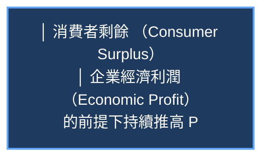

---
{"dg-publish":true,"permalink":"/98/pricing-power/","tags":["商業概念","投資策略","策略管理","財務分析","PMBA"],"dg-note-properties":{"aliases":["溢價能力","Pricing Power","定價權","提價能力"],"tags":["商業概念","投資策略","策略管理","財務分析","PMBA"]}}
---

# 溢價能力 (Pricing Power / 定價權)

> **【核心定義與概念導航】**
> **溢價能力（Pricing Power，又稱定價權）** 指企業在面對通膨上升或主動調高產品售價時，不會流失實質市場份額或顧客數量的核心競爭能力。傳奇投資家華倫·巴菲特（Warren Buffett）曾指出：「**評估一項企業的最重要單一決定因素，就是其定價權。如果你在調高價格前必須先向天祈禱，那這絕對不是一門好生意。**」溢價能力是衡量企業護城河深度、抗通膨韌性與資本回報率（ROIC）的最高試金石。

---

## 1. 核心驅動機制與微觀價值架構

企業之所以具備定價權，本質上源於其在微觀價值鏈中為顧客創造了難以被替代的超額剩餘：

**顧客願付價格 (Willingness to Pay, WTP)**

1. **極低的需求價格彈性**：目標客群的價格敏感度極低（$|E_d| \ll 1$），提價能直接帶來營業利潤的線性增長（參見 [[98_商業概念庫/price-sensitivity_價格敏感度\|price-sensitivity_價格敏感度]]）。
2. **通膨完全轉嫁機制**：在原物料、能源與薪資上漲時，具備定價權的企業能將成本壓力 100% 轉嫁給終端客戶，甚至藉機擴大產品毛利率。
3. **護城河的終極體現**：定價權並非憑空產生，而是建立在強大的 [[98_商業概念庫/switching-costs_轉換成本\|switching-costs_轉換成本]]、專利技術或無形品牌資產（[[98_商業概念庫/brand-equity_品牌權益\|brand-equity_品牌權益]]）之上。

---

## 2. 定價權的典型代表與產業分佈
- **高端奢侈品與頂級品牌**：如愛馬仕（Hermès）、勞力士（Rolex），每年固定提價 5%~10%，市場需求不降反增，價格成為稀缺與社會階層象徵。
- **關鍵咽喉零組件與專利霸權**：如艾司摩爾（ASML）極紫外光微影機（EUV），單台定價突破 2~3 億美元且持續攀升，全球晶圓代工巨頭爭相排隊採購（參見 [[98_商業概念庫/value-chokepoint_價值咽喉\|value-chokepoint_價值咽喉]]）。
- **深嵌工作流程的企業級軟體**：如微軟 Office 365、彭博終端機（Bloomberg Terminal），使用者離不開且轉換成本極高，調價對客戶流失幾乎毫無影響。

---

## 3. 核心概念關聯地圖
- **核心主篇**：[[98_商業概念庫/price-sensitivity_價格敏感度\|price-sensitivity_價格敏感度]] · 決定定價權強弱的需求價格彈性與心理機制
- **策略定價**：[[98_商業概念庫/pricing_撇脂定價法\|pricing_撇脂定價法]] · 依託強大定價權實施之高端市場跨期掠奪策略
- **競爭防禦**：[[98_商業概念庫/penetration-pricing_市場滲透定價\|penetration-pricing_市場滲透定價]] · 缺乏定價權時所採取的規模化進攻策略
- **價值量尺**：[[98_商業概念庫/Added_Value_附加價值與定價權\|Added_Value_附加價值與定價權]] · 附加價值理論對企業定價空間之詮釋
- **分析工具**：[[98_商業概念庫/vpc-value-price-cost_價值價格成本分析\|vpc-value-price-cost_價值價格成本分析]] · 價值、價格與成本三度空間拆解
- **導航總覽**：[[home\|home]] · 全球 PMBA 知識庫總導航主頁面