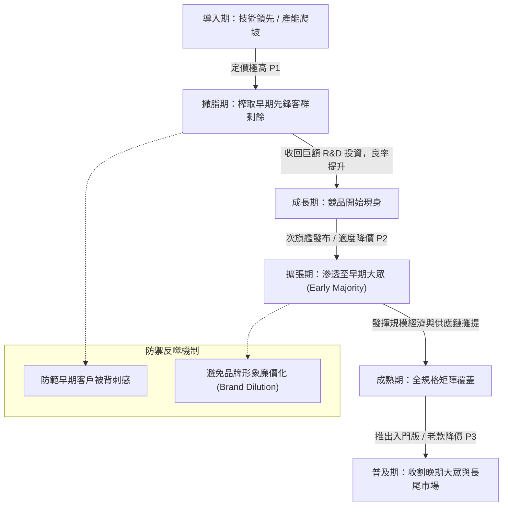

---
{"dg-publish":true,"permalink":"/98/pricing/","tags":["商業概念","行銷管理","策略管理","經濟學","PMBA"],"dg-note-properties":{"aliases":["撇脂定價法","Price Skimming","撇脂策略","高價法","跨期價格歧視"],"tags":["商業概念","行銷管理","策略管理","經濟學","PMBA"]}}
---


# 撇脂定價法 (Price Skimming Strategy)

> **【核心決策摘要】**
> **撇脂定價法（Price Skimming Strategy）** 是一種在創新產品或升級服務導入市場初期，設定極高溢價以「撇取（Skim）」市場頂層對價格最不敏感、最渴求創新特性之高端消費者剩餘（Consumer Surplus）的動態定價策略。隨著早期採用者市場飽和、產能爬坡擴張以及競品陸續出現，企業再採取階梯式降價以滲透大眾市場。撇脂定價本質上是**跨期價格歧視（Intertemporal Price Discrimination）** 的策略落地，其成敗取決於產品是否具備不可替代的技術與品牌壁壘，以及能否有效破解消費者推遲購買的「科斯猜想（Coase Conjecture）」。

---

## 1. 概念核心定義與本質 (Executive Definition & Theoretical Essence)

### 1.1 核心定義
撇脂定價法源自微觀經濟學中的定價理論，定義為：**在產品生命週期（PLC）的導入期（Introduction Stage），將價格錨定於目標客群願付價格（Willingness to Pay, WTP）的高位上限，優先鎖定高毛利客群以迅速收回前期巨額研發（R&D）與市場開拓成本，隨後動態下調價格區間以擴展市場份額**。

```
價格 (Price)
  ▲
  │   ┌────────────────────────────────────────┐
P1├───┤ 階段一：早期創新採用者 (極高溢價撇脂)  │  <-- 榨取頂層消費者剩餘
  │   └───────────────────┬────────────────────┘
P2├───────────────────────┼────────────────────┐
  │                       │ 階段二：實用主義早期大眾 (次旗艦降價覆蓋)
P3├───────────────────────┴────────────────────┼───────────────────────┐
  │                                            │ 階段三：成熟大眾市場 (平價普及)
  └────────────────────────────────────────────┴───────────────────────► 時間 (Time)
```

### 1.2 適用撇脂策略的四大邊界條件 (The 4 Boundary Conditions)
並非所有新產品皆能採取撇脂定價，企業必須嚴格檢驗以下四項前置條件：
1. **顯著的差異化與壁壘（High Barriers to Entry）**：產品必須擁有專利保護、專屬技術或強大品牌光環，競品在短期內（如 6~18 個月）無法推出同等替代品（參見 [[barriers-to-entry_進入障礙]]）。
2. **存在低彈性高端客群（Inelastic Segment）**：市場中存在足夠規模的創新者（Innovators）與早期採用者（Early Adopters），此類客戶對價格極不敏感（需求價格彈性 $|\epsilon_d| < 1$），重視身分地位認同或新功能帶來的領先優勢。
3. **初期產能受限（Capacity Constraints）**：新生產線在良率爬坡期產量有限，若貿然低價將導致供不應求、排隊抱怨；高價能自發達成「價格配給（Price Rationing）」，匹配有限產能。
4. **高品質心智錨定（Price-Quality Signaling）**：價格具有強烈信號傳導效應。初始高定價能建立奢華、尖端科技的高端品牌定位（[[brand-equity_品牌權益]]），避免陷入廉價質差的公眾刻板印象。

---

## 2. 數理模型與跨期優化機制 (Mathematical Modeling & Dynamic Optimization)

### 2.1 跨期價格歧視模型 (Intertemporal Price Discrimination Model)

假設市場由兩個異質消費群體組成：高願付價格群體（規模 $N_1$，願付價格 $V_H$）與低願付價格群體（規模 $N_2$，願付價格 $V_L$），其中 $V_H > V_L > C$（$C$ 為邊際生產成本）。

企業在期初 $t=1$ 定價 $P_1$，在期末 $t=2$ 定價 $P_2$。若高願付價格消費者為近視型（Myopic）：
- **第一期利潤**：$\Pi_1 = (P_1 - C) \cdot N_1 = (V_H - C) \cdot N_1$（定價 $P_1 = V_H$）
- **第二期利潤**：$\Pi_2 = \delta (P_2 - C) \cdot N_2 = \delta (V_L - C) \cdot N_2$（定價 $P_2 = V_L$，$\delta$ 為跨期折現因子）
- **總跨期利潤**：
  $$\Pi_{\text{Skim}} = (V_H - C) \cdot N_1 + \delta (V_L - C) \cdot N_2$$

若對比單一價格策略：若採取統一低價 $P = V_L$，利潤僅為 $(V_L - C)(N_1 + N_2)$，明顯損失了高階客群的超額消費者剩餘 $(V_H - V_L) \cdot N_1$。

### 2.2 科斯猜想與策略性延遲購買 (Coase Conjecture & Strategic Delay)

諾貝爾經濟學獎得主羅納德·科斯（Ronald Coase）指出：**耐用品壟斷者在跨期銷售時，若消費者具有完全理性預期，預見廠商隨後必然會降價，理性顧客將推遲購買以等待低價，導致跨期價格歧視崩潰，壟斷者最終只能以邊際成本定價**。

#### 破解科斯猜想的經理人策略槓桿：
1. **世代功能迭代（Generational Upgrades）**：降價的同時推出下一代全新旗艦，使舊款自然降價而不傷害新款的溢價權力。
2. **租賃取代買斷（Leasing vs. Selling）**：透過訂閱制或租賃合約消除二手市場拋售對一手價格的衝擊。
3. **保價承諾（Price Protection Guarantees）**：向早期買家承諾在特定時間內若降價將全額補償差價，消除消費者的觀望心理。

---

## 3. 戰略框架與動態演進歷程 (Strategic Framework & Evolution)

### 3.1 撇脂定價的全生命週期演進歷程



### 3.2 撇脂定價與經驗曲線之協同效應
撇脂定價並非孤立的銷售手段，而是與企業生產運作深度咬合的資本槓桿：
- **初期高毛利覆蓋資本支出**：在產品導入期，銷量低導致單位固定成本分攤極高，高毛利能確保企業在損益平衡點之前不致產生資金斷流。
- **沿著經驗曲線（Experience Curve）主動出擊**：隨著累計產量擴增，單位成本按學習率下降，企業主動實施階梯降價，不僅能擴大市場份額，更能精準壓制剛剛進入市場、尚未形成規模效應的跟隨者。

---

## 4. 產業標竿與實戰應用場景 (Industry Benchmarks & Applications)

| 產業賽道 | 撇脂機制設計 | 典型產品範例 | 成功核心支撐 |
| :--- | :--- | :--- | :--- |
| **消費電子 (Consumer Tech)** | 旗艦款首發定價 \$1,000+，次年伴隨新品上市降價 \$100~\$200，維持 3~4 年生命週期梯隊 | Apple iPhone 系列、Sony PlayStation 主機 | 封閉生態系、極高 [[switching-costs_轉換成本]]、卓越工業設計與品牌神聖感 |
| **高階半導體與算力** | 頂級製程旗艦晶片首發享受 80%+ 毛利率，後續隨製程成熟降價並推出降頻版本 | NVIDIA H100 / RTX 頂級 GPU、Intel Core i9 | CUDA 軟硬體生態壟斷、極端計算性能代差 |
| **專利原研藥 (Pharma)** | 在專利保護期（Patent Window）內設定數萬至數十萬美元天價，專利到期前夕授權學名藥降價 | 抗癌標靶藥物、罕見病基因治療針劑 | 法律專利壟斷壁壘、人命關天之極低價格彈性 ($|\epsilon_d| \approx 0$) |
| **高端奢侈品與汽車** | 限量首發超跑或高級訂製珠寶，以高價篩選超高淨值客戶，隨後推出常規量產入門款 | 保時捷 911 GT3 RS 至 Macan、愛馬仕限量柏金包 | 社交貨幣屬性、Veblen 炫耀性消費效應 |

---

## 5. 經典企業個案深度剖析 (Deep Dive Case Studies)

### 5.1 成功典範：Apple iPhone 的教科書級撇脂體系
- **跨期梯隊設計**：
  1. 每年秋季發布全新 iPhone Pro / Pro Max 頂級機型，定價高達 \$1,199~\$1,599，精準收割第一批高收入發燒友與商務人士。
  2. 同步將前一年的舊款 Pro 停產（防止自相殘殺 Cannibalization），但將前一代標準版降價 \$100 置於中高階區間。
  3. 將兩年前的老款降價 \$200 置於中階區間，並保留 iPhone SE 鎖定入門預算群體。
- **成效**：蘋果憑藉全球智慧型手機不足 20% 的出貨量份額，長期掠奪全球智慧型手機產業 **85% 以上的總營業利潤**，將撇脂策略發揮到極致。

### 5.2 失敗警示：Apple 2007 初代 iPhone 的「驟降背刺」危機
- **決策失誤**：2007 年 6 月，初代 iPhone 以 \$599 高價震撼上市，大量忠實果粉排隊數日搶購。然而，僅僅過了兩個月（9 月），賈伯斯為了刺激銷量，無預警宣佈直降 \$200（降至 \$399）。
- **引爆信任危機**：
  1. 首批排隊的死忠支持者感受到被嚴重背叛，社群輿論強烈反彈，痛斥蘋果「懲罰忠誠客戶」。
  2. 品牌形象與二手殘值遭受重創，消費者紛紛擔憂未來是否該推遲購買蘋果產品。
- **危機公關挽回**：賈伯斯親自發表公開道歉信，坦承決策過於魯莽，並承諾給每位以 \$599 購買的客戶發放 \$100 的 Apple Store 抵用券。
- **經理人啟示**：撇脂降價必須具備**合理的節奏感與時間間隔（通常需相隔 6~12 個月）**，或以產品規格區隔作為掩護，切忌在短期內斷崖式跳水。

---

## 6. 高階經理人決策實戰工具箱 (Executive Action Playbook)

### 6.1 撇脂定價策略可行性檢核表 (Feasibility Checklist)
- [ ] **檢核 1：產品是否具有 12 個月以上的技術或專利領先期？**（若競品 3 個月內即可推出仿製品，撇脂只會為對手創造低價切入的完美靶心）。
- [ ] **檢核 2：目標客群的價格彈性是否經得起檢驗？**（是否存在願為「首批體驗」支付 50%~100% 溢價的發燒客群）。
- [ ] **檢核 3：高定價是否會引發監管反托拉斯（Antitrust）或暴利道德指責？**（尤其是民生與公衛領域）。
- [ ] **檢核 4：是否有明確的降價路線圖與「防背刺」隔離機制？**（如推出不同儲存容量、限定配色或次級型號進行市場分割）。

---

## 7. 關聯知識網絡與導航地圖 (Knowledge Network & Cross-References)

### 7.1 本主題核心三部曲
- **[[pricing_撇脂定價法]]** · 跨期價格歧視、高端消費者剩餘榨取與科斯猜想防禦（本篇）
- **[[penetration-pricing_市場滲透定價]]** · 低價搶佔網絡效應、規模經濟成本攤薄與後續變現閉環
- **[[price-sensitivity_價格敏感度]]** · 需求價格彈性量化、價格敏感度九大心理驅動與 PSM 測試模型

### 7.2 跨領域策略與行銷鏈結
- [[pricing-power_溢價能力]] · 巴菲特護城河檢驗標準與通膨超額轉嫁能力
- [[barriers-to-entry_進入障礙]] · 維持撇脂超額利潤不被競品迅速侵蝕的核心防禦工事
- [[switching-costs_轉換成本]] · 鎖定高端客群、抑制其流向低價競品之轉換壁壘
- [[vpc-value-price-cost_價值價格成本分析]] · 價值、價格與成本之消費者剩餘分配框架

### 7.3 課程筆記與導航主頁
- [[M1-5_創業構想發展與兩階段可行性評估]] · 創新產品市場切入定位與定價決策分析
- [[_創業與企業財務策略 MOC]] · 企業財務策略與獲利模型全景地圖
- [[home]] · 全球 PMBA 知識庫總導航主頁面