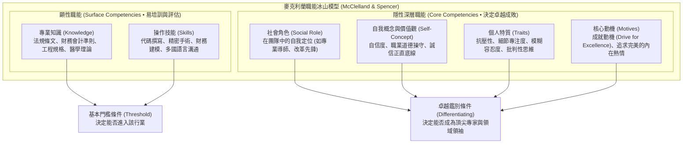

---
{"dg-publish":true,"permalink":"/98/professional-competence/","tags":["商業概念","人力資源","組織行為","領導力","PMBA"],"dg-note-properties":{"aliases":["專業能力","專業職能","Professional Competence","核心勝任力","專家能力模型"],"tags":["商業概念","人力資源","組織行為","領導力","PMBA"]}}
---


# 專業能力 (Professional Competence)

> [!NOTE]
> **核心概念精粹**：專業能力（Professional Competence / 核心職能），是指個體在特定專業領域中，能夠持續展現高水準工作成果、有效解決複雜非結構化問題，並恪守專業倫理操守的**整合性勝任力架構**。大衛·麥克利蘭（David McClelland）的「職能冰山模型（Competency Iceberg Model）」揭示：卓越的專業能力絕不僅限於浮在水面上的顯性知識與工具技術，更深植於水面下難以被模仿的自我概念、特質、內在動機與專業判斷力。

---

## 一、 學理淵源：麥克利蘭職能冰山模型

1973 年哈佛大學心理學家大衛·麥克利蘭發表《Testing for Competence Rather Than for "Intelligence"》，徹底粉碎了以「智力測驗與學校成績」預測職場績效的傳統迷思，開創了現代人力資源職能管理體系：



---

## 二、 現代專業人才的兩大型態演進：T 型 vs $\pi$ 型專家

隨著跨學科整合與產業顛覆加速，單一垂直技能的「I 型專家」面臨嚴重的技術折舊威脅，催生了人才架構的升級：

| 人才架構類別 | 結構剖析 | 核心競爭優勢 | 典型崗位與代表 |
| :--- | :--- | :--- | :--- |
| **I 型專家<br>(Deep Specialist)** | 單一領域垂直深入，缺乏跨領域理解力。 | 在特定封閉環境下效率極高，但面對技術轉折極易被 AI 替代。 | 傳統單一程式語言程序員、純記帳會計師。 |
| **T 型人才<br>(T-Shaped Professional)** | **垂直軸（深）**：在某一核心專業具備世界級深度；<br>**水平軸（廣）**：具備跨界通識、商業敏銳度與同理心。 | 能夠作為「跨界翻譯官」，將底層深度技術轉化為商業解決方案。 | 具備商務敏銳度的高級產品經理、生技專利律師。 |
| **$\pi$ 型 / 梳狀人才<br>(Pi-Shaped / Comb-Shaped)** | **雙垂直軸（雙核心）**：同時精通兩門互補專業（如「AI 演算法 + 臨床醫學」或「軟體工程 + 法律合規」）。 | 極端稀缺，具備橫跨兩大知識體系的結構洞（Structural Hole）套利優勢。 | 企業資安長（CISO）、Fintech 架構師、生醫創投合夥人。 |

---

## 三、 專家型領導（Expert Leadership）的研究實證

在過去數十年中，管理學界曾盛行「外行財務官僚可以管理一切專業組織」的通用管理假定。然而，阿曼達·古德爾（Amanda Goodall）教授的大規模實證研究徹底顛覆了這一迷思：

```carousel

<!-- slide -->
### 1. 醫院管理實證：醫師院長 vs 純 MBA 院長
- **研究發現**：古德爾對全美前 100 大醫院進行長達數年的實證研究發現：由**頂尖臨床醫生出身的院長**領導的醫院，其整體醫療品質評分、病患存活率與財務獲利率，顯著高出由「純職業經理人或 MBA 財務官」領導的醫院 25% 以上；
- **機制解構**：專家型領導者深刻理解前線醫護的真正痛苦、懂得如何激勵同儕追求卓越，且在同儕中享有無可替代的[[expert-power_專家權|專家權]]。
<!-- slide -->
### 2. 科技巨頭研發實踐：工程師文化引領
- 在半導體與 AI 產業中，張忠謀（MIT 機械工程博士）、黃仁勳（史丹佛電機碩士）均為親臨架構前線的頂級技術專家；
- 這種深厚的專業能力讓他們在技術十字路口（如 EUV 押注、CUDA 研發）展現出任何純財務官員絕不敢採取的鋼鐵定力。
```

---

## 四、 經理人專業能力與梯隊審計檢核表（Executive Decision Checklist）

高階管理團隊在選拔核心將領或規劃個人發展藍圖時，應檢核下列維度：

- [ ] **冰山底層動機探詢（Deep Iceberg Inquiry）**：
  - 在招募核心高管時，我們是否只被履歷表上光鮮的「水面名校學歷與技術清單（K & S）」所迷惑？我們是否透過行為事例面談（BEI），深刻檢驗了其水面下的「成就動機、誠信底線與抗壓特質」？
- [ ] **知識折舊與終身學習率（Knowledge Half-Life Audit）**：
  - 核心團隊的專業能力是否已產生嚴重的技術折舊？公司是否建立了制度化預算與時間機制，支持資深工程師與經理人掌握前沿生成式 AI 與綠色雙碳法規？
- [ ] **專家型領導與外行干預防範（Expert Leadership Safeguards）**：
  - 在高度仰賴研發創新的關鍵專案中，主導決策權究竟掌握在「深諳底層技術規律的專業領袖」手中，還是被完全不懂技術的純會計財務官所生硬捆綁？
- [ ] **專業倫理獨立性防線（Professional Ethics Independence）**：
  - 組織內部的法務長、財務長、首席資安官等專業人員，是否具備對業務違規直接說「不」的制度獨立性？是否受到董事會審計委員會的直接保護？

---

## 五、 關聯概念與知識網絡

* 核心管理技能與權力基礎：
  * [[technical-skills_技術技能|技術技能 (Technical Skills)]]：第一線具體專業操作能力的經典架構
  * [[expert-power_專家權|專家權 (Expert Power)]]：深厚專業能力所賦予之影響力基石
  * [[conceptual-skills_概念技能|概念技能 (Conceptual Skills)]]：高階領導將垂直專業整合為全局戰略之才能
  * [[emotional-intelligence_情緒智商|情緒智商 (Emotional Intelligence)]]：專業硬技能與情緒軟實力之雙輪協同
* 組織能力與人力資本：
  * [[core-competence_核心能力|核心能力 (Core Competence)]]：個人專業能力匯聚轉化為組織整體難以模仿之競爭護城河
  * [[person-job-fit_人職匹配|人職匹配 (Person-Job Fit)]]：基於職能冰山模型之精準人崗適配
  * [[can-zhao-quan_參照權|參照權 (Referent Power)]]：專業卓越與崇高道德共同催生之領袖魅力
  * [[great-company_好公司|好公司 (Great Company)]]：以頂級專業勝任力造就基業長青之典範企業
