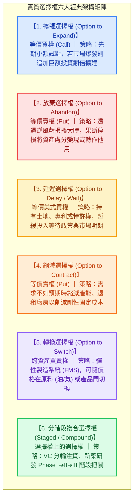

---
{"dg-publish":true,"permalink":"/98/real-options/","tags":["商業概念","財務管理","資本預算","策略管理","公司理財","實質選擇權","估值模型","決策分析","PMBA"],"dg-note-properties":{"aliases":["實質選擇權","Real Options","real-options","實質選擇權理論","策略性NPV","Strategic NPV","擴張選擇權","放棄選擇權","延遲選擇權","實質選擇權估值模型","Real Options 估值模型","Real Options Valuation Model","經營彈性價值","Real_Options_實質選擇權估值模型"],"tags":["商業概念","財務管理","資本預算","策略管理","公司理財","實質選擇權","估值模型","決策分析","PMBA"]}}
---


# 實質選擇權 (Real Options)

> 💡 **導航與索引**：本篇為現代資本預算（Capital Budgeting）與高階動態策略決策之最核心前沿概念。探討企業如何在高度不確定性與市場波動中，透過管理彈性將策略選擇權貨幣化。亦可參閱靜態價值折現基準 [[98_商業概念庫/dcf_現金流量折現法\|現金流量折現法 (DCF)]]、折現率估算工具 [[98_商業概念庫/wacc_加權平均資本成本\|加權平均資本成本 (WACC)]]、成長機會現值模型 [[98_商業概念庫/pvgo_成長機會現值\|成長機會現值 (PVGO)]]、精實新創驗證方法 [[04_主題選修/10_創業與企業財務策略/02_模組筆記/Module_1_創新思維與商業模式/M1-3_數位新經濟與精實創業方法論\|數位新經濟與精實創業]]、資本結構權衡模型 [[98_商業概念庫/theory-7_權衡理論\|權衡理論 (Trade-off Theory)]]，以及企業內在價值評估 [[98_商業概念庫/company-value_公司內在價值\|公司內在價值 (Company Value)]]。

---

## 一、 核心定義與「動態管理彈性」之價值躍遷

### 1. 核心定義與理論淵源
- **實質選擇權 (Real Options)** 最早由麻省理工學院教授史都華·麥爾斯（Stewart Myers, 1977）提出。它是指將**金融選擇權（Financial Options）的定價思維與數理工具，應用於評估企業「非金融實體資產投資與策略決策」中的管理彈性（Managerial Flexibility）**。
- **實質選擇權的本質**：
  企業在面對未來的重大不確定性時，擁有在未來特定時點，**「有權利、但無義務」採取特定策略行動（如追加投資擴張、暫緩等待觀察、縮小規模或終止清算）的能力**。
- **策略性 NPV 方程（Strategic NPV Equation）**：
  傳統靜態資本預算模型（如 DCF / 靜態 NPV）假設經理人「今天拍板投資後，就只能被動等待命運揭曉」。然而在真實商戰中，主動的經理人會隨著市場資訊的明朗化動態調整決策：

  $$\text{策略性 NPV (Strategic NPV)} = \text{傳統靜態 NPV (Static DCF)} + \text{實質選擇權價值 (Real Option Value)}$$
  $$\text{專案真實總價值 (Expanded NPV)} = \text{傳統靜態淨現值 (Static NPV)} + \text{實質選擇權溢價 (Option Premium)}$$

  - **當靜態 $\text{NPV} < 0$ 時**：若專案內含巨大的戰略擴張期權，企業依然應該大膽啟動（這解釋了為何許多早期科技研發與新創專案在傳統財務審查中被錯殺）。
  - **當靜態 $\text{NPV} > 0$ 時**：若立即投資會永久扼殺「等待更多資訊的延遲期權」，則等待的價值可能高於立即投資，企業應選擇暫緩執行。

### 2. 靜態 DCF 與實質選擇權之對抗視角

```text
【傳統靜態 DCF vs. 實質選擇權之思維範式轉移】

  傳統靜態 DCF 視角 (被動管理假設)：
  ┌──────────────┐         ┌──────────────────────────────────────────────────┐
  │ 今天拍板投資 ├────────►│ 經理人被動鎖定，無論未來繁榮或衰退，只能聽天由命 │
  └──────────────┘         └──────────────────────────────────────────────────┘
                            • 波動性 (σ) 被視為純粹的風險 ➔ 提高 WACC 折現率 ➔ 壓低 NPV

  實質選擇權視角 (主動動態管理)：
  ┌──────────────┐         ┌──────────────────────────────────────────────────┐
  │ 初期先期試點 ├────┬───►│ 若市場超預期繁榮 ➔ 行使【擴張選擇權】(放大上檔利潤)│
  └──────────────┘    │    └──────────────────────────────────────────────────┘
                      │    ┌──────────────────────────────────────────────────┐
                      └───►│ 若市場遭遇黑天鵝 ➔ 行使【放棄選擇權】(切斷下檔虧損)│
                           └──────────────────────────────────────────────────┘
                            • 波動性 (σ) 創造了不對稱收益 ➔ 波動越大，選擇權價值越高！
```

| 比較維度 | 傳統靜態 DCF / NPV 模型 | 實質選擇權模型 (Real Options Approach) |
| :--- | :--- | :--- |
| **管理假設** | **被動管理者（Passive Manager）**：假定專案一旦啟動便不可逆轉、路徑僵化 | **主動管理者（Active Manager）**：具備在執行過程中隨新資訊調整策略的決策彈性 |
| **對「不確定性（$\sigma$）」的解讀** | **不確定性是負債**：波動越大 $\to$ 要求報酬率（$WACC$）越高 $\to$ 專案價值越低 | **不確定性是資產**：下檔風險已被合約或策略鎖定，波動越大，上檔獲利空間越巨大 |
| **決策邏輯** | 全有或全無（Now-or-Never）：今天立即做 vs. 永遠不做 | 學習與階段化（Stage-Gate）：今天小做取得門票，觀察後再決定擴大或撤退 |
| **評價結果偏誤** | **系統性低估具備高度不確定性之突破性創新、研發與戰略投資** | 精準量化「管理彈性、戰略試點、專利儲備與退場保護」之貨幣溢價 |

---

## 二、 實質選擇權六大經典型態與商業實踐



### 1. 擴張選擇權 (Option to Expand) —— 等價金融買權（Call Option）
- **機制**：支付初期投資購買一張「未來可隨時追加資本」的門票。若市場需求強勁，經理人支付履約價（擴產資本支出 $I_2$），擴增產能以擷取龐大超額利潤。
- **實戰案例**：
  * **台積電（TSMC）海外晶圓廠佈局**：在美日設廠時，先購置足以容納二期、三期廠房的龐大土地，一期先建小產能試水溫。若地緣政治與客戶下單強勁，立即啟動第二期擴建。
  * **星宇航空（STARLUX）解封擴張實證**：2022 年底全球疫情解封、報復性旅運需求爆發時，立即行使擴張選擇權重啟新機交付，並全力開闢北美與東南亞長程航線，攫取高票價紅利。

### 2. 放棄選擇權 (Option to Abandon) —— 等價金融賣權（Put Option）
- **機制**：當專案營運遭受毀滅性衝擊或產業技術被淘汰時，經理人有權中途終止專案，將專案資產轉售、轉租或拆解變現（殘值作為履約價 $X$），為專案提供了「價值底線（Floor Value）」。
- **實戰案例**：
  * **航空公司引進新客機**：與波音或空中巴士簽署融資租賃協議時，保留「可在第 5 年退租並由出租方回收」的保護條款，鎖定下檔折舊與二手市場殘值風險。
  * **早期創投（VC）下檔停損與退場基石**：**「如果沒有退出的機制，對於新創而言就沒有投資的價值！」** 放棄／退出選擇權（賣權）為投資人鎖定了下檔最大虧損（如優先清算權 Liquidation Preference 與贖回權 Redemption Right），是高風險股權投資不可或缺的定價基石。

### 3. 延遲選擇權 (Option to Delay / Option to Wait) —— 等價美式買權
- **機制**：擁有無可替代之關鍵資源（如土地產權、採礦權、專利技術）。即便現在立即動工的靜態 $\text{NPV} > 0$，但若「等待一年以消除政策或利率不確定性」能創造更高的期望現值，則**等待的價值（Value of Waiting）大於立即行動**。
- **實戰案例**：
  * **不動產建商精華區土地開發**：手握市中心精華素地，若央行正處於升息循環且政府推動打炒房政策，建商選擇「暫緩推案養地」，等待降息循環與政策鬆綁後再大舉推案。
  * **星宇航空（STARLUX）疫情封鎖逆風應變**：開航初期即遭逢 COVID-19 全球航線封鎖。傳統航空公司依固定承諾大量接收客機將面臨巨額維護折舊與現金斷裂；星宇因無貨運機隊支撐，果斷執行「延遲選擇權」，將後續數十架客機交付時程往後遞延兩年，保全核心現金跑道渡過至暗時刻。

### 4. 縮減選擇權 (Option to Contract) —— 等價金融賣權
- **機制**：在市場需求轉疲但尚未達到全盤放棄的臨界點時，經理人有權將現有生產規模縮減（例如停開一條生產線、縮減 30% 產能），將多餘廠房轉租，換取即時營運資金並減少固定開支。

### 5. 轉換選擇權 (Option to Switch) —— 多重靈活性選擇權
- **機制**：企業設計之生產系統具備在**「投入要素（Inputs）」**或**「產出產品（Outputs）」**之間動態切換的能力。
- **實戰案例**：
  * **雙燃料發電廠**：發電機組可自由切換天然氣與燃油，隨全球原油與天然氣期貨現貨價差，哪邊便宜就切換到哪邊；
  * **代工廠彈性製造系統（FMS）**：同一條自動化產線可在智慧型手機、車用車機與穿戴式手錶間彈性切換生產排程。

### 6. 分階段複合選擇權 (Staged Investment / Compound Option)
- **機制**：投資是一連串循序漸進的階段（Phase 1 $\to$ Phase 2 $\to$ Phase 3）。**前一階段的成功，是獲得下一階段期權的必要條件**（即「選擇權上的選擇權 Option on an Option」）。
- **實戰案例**：
  * **新藥研發（Biotech R&D）**：臨床前試驗 $\to$ 一期臨床（安全性） $\to$ 二期臨床（有效性） $\to$ 三期臨床（大規模人體試驗） $\to$ FDA 藥證核准。每一階段投入少量資金驗證，不通過則立即止血。

---

## 三、 金融選擇權 vs. 實質選擇權五大對應參數映射

將 Black-Scholes-Merton (BSM) 或二項式定價模型應用於實體資產投資時，核心變數之映射對應如下：

| 金融選擇權變數 (Financial Options) | 實質選擇權對應參數 (Real Options) | 實務企業投資意涵 | 影響方向 (Call 擴張) |
| :--- | :--- | :--- | :---: |
| **標的資產現價 ($S$)** | **專案未來營業現金流現值 ($\text{PV}$)** | 該投資案在未來全生命週期預期帶來之現金流入總現值 | 正向 ($+$) |
| **履約價格 ($K$ 或 $X$)** | **後續行使期權所需之資本支出 ($I$)** | 擴建廠房、採購設備或商業化量產所需支付的追加投資款 | 負向 ($-$) |
| **到期時間 ($T$)** | **策略彈性保持之有效決策窗口** | 專利權有效年限、土地租約、特許營業執照或排他性協議期限 | 正向 ($+$) |
| **資產報酬波動度 ($\sigma$)** | **專案標的現金流之不確定性/波動率** | 產業景氣循環波動、終端市場價格與需求的不確定程度 | **強烈正向 ($+$)★** |
| **無風險利率 ($r_f$)** | **貨幣無風險時間價值 ($r_f$)** | 央行發行之政府公債無風險折現基準 | 正向 ($+$) |
| **持有成本/股利發放 ($q$)** | **因等待而喪失的現金流（漏損率）** | 延遲投資期間，被競爭對手搶佔市場份額之營收損失代價 | 負向 ($-$) |

> 📌 **最關鍵的思維顛覆——「波動度 $\sigma$ 的兩面性」**：
> 在傳統財務分析中，高波動度 $\sigma$ 會放大風險，導致權益成本與 WACC 飆升，嚴重殺傷靜態 NPV。但在實質選擇權中，**由於下檔損失已被合約鎖定（最差就是不履約），高波動度只會單向推升「上檔暴賺的理論可能性」，因此波動度越高，實質選擇權價值越高！**

---

## 四、 數理定價模型與實戰情境試算

實質選擇權常用的數理定價工具為**二項式樹狀模型（Binomial Lattice Model）**與 **Black-Scholes 模型**。以下透過經典資本預算案例展示「靜態 DCF 如何錯殺優質專案」：

### 實戰案例試算：AI 伺服器先進封裝試點專案
某台灣電子巨頭考慮切入高階 AI 伺服器晶片封裝領域：
- **階段一（先期試點）**：今天需投入資本支出 **$I_1 = 1.0$ 億元**。若按傳統靜態預測，一期營運未來現金流折現後僅值 **$0.85$ 億元**。
  $$\text{靜態 NPV} = 0.85 - 1.0 = \mathbf{-0.15 \text{ 億元 (-1,500 萬元)} \quad \implies \text{傳統 DCF 必然否決！}}$$
- **階段二（內含擴張選擇權）**：
  若執行了一期，企業便擁有一張「在第 2 年末（$T=2$），視市場需求決定是否投入 **$I_2 = 3.0$ 億元** 擴建 5 倍大廠房」的擴張買權。
  - 目前評估該擴建廠房在第 2 年末之預期現值 $S = 3.2$ 億元；
  - 由於 AI 需求極具爆發力，專案現金流年化波動度 $\sigma = 40\%$；
  - 無風險利率 $r_f = 3\%$。

#### 運用 Black-Scholes-Merton 公式計算擴張選擇權價值：
$$d_1 = \frac{\ln(S / I_2) + (r_f + \sigma^2 / 2)T}{\sigma \sqrt{T}} = \frac{\ln(3.2 / 3.0) + (0.03 + 0.16 / 2) \times 2}{0.40 \times \sqrt{2}} = \frac{0.0645 + 0.22}{0.5657} \approx 0.503$$
$$d_2 = d_1 - \sigma \sqrt{T} = 0.503 - 0.5657 \approx -0.063$$
查標準常態分佈表：$N(d_1) = N(0.503) \approx 0.6925$，$N(d_2) = N(-0.063) \approx 0.4749$。

$$\text{擴張選擇權價值 (ROV)} = S \cdot N(d_1) - I_2 e^{-r_f T} \cdot N(d_2)$$
$$\text{ROV} = 3.2 \times 0.6925 - 3.0 \times e^{-0.06} \times 0.4749 \approx 2.216 - 3.0 \times 0.9418 \times 0.4749 \approx 2.216 - 1.342 = \mathbf{0.874 \text{ 億元 (8,740 萬元)}}$$

#### 決策逆轉：策略性 NPV 結算
$$\text{策略性 NPV} = \text{靜態 NPV} + \text{實質選擇權價值}$$
$$\text{策略性 NPV} = -0.15 \text{ 億} + 0.874 \text{ 億} = \mathbf{+0.724 \text{ 億元 (+7,240 萬元)} \quad \implies \text{決策逆轉：應全速拍板立項！}}$$

> 📌 **精髓總結**：
> 一期投入的 1,500 萬淨虧損，在戰略上絕非浪費，而是花費 1,500 萬元「購買」了一張價值高達 8,740 萬元的巨型擴張門票！

---

## 五、 企業高階經理人與創始團隊（CEO / CFO / 策略長）實戰四大軍規

### 1. 學會擁抱波動，將「不確定性」轉化為「非對稱策略資產」
* 平庸經理人本能地恐懼不確定性與市場波動（因為高 $\sigma$ 在 DCF 框架下會拉高 WACC，摧毀專案價值）；
* 卓越經理人深諳實質選擇權思維：只要在合約中將下檔虧損鎖定（透過分段注資、轉售條款），**波動度越劇烈的產業，其孕育出的實質選擇權溢價越巨大**。

### 2. 主動在專案契約中進行「選擇權工程（Option Engineering）」
* 經理人不應被動等待選擇權出現，而應在起草投資合約與架構時，**主動設計並植入實質選擇權條款**：
  * **設備採購**：爭取「附帶以約定優惠價在未來兩年內加購同型號設備」之擴張權；
  * **廠房租賃**：簽訂「租賃期滿優先承購權」或「提前解約僅沒收一個月押金」之低成本退場權；
  * **戰略併購**：採取「先認購 20% 股權，並綁定未來兩年內可按約定估值收購剩餘 80% 控制權」的階梯收購權。

### 3. 破除「沉沒成本謬誤」，建立制度化行使「放棄選擇權」的停損文化
* 傳統企業最大的資源黑洞，在於經理人因「已經投入了 5 億元」或「面子問題」而難以割捨虧損專案，持續追加預算陷入失血深淵。
* **行使放棄選擇權不是「承認失敗」，而是理性保全企業資產剩餘價值的最優決策**。建立制度化的「階段審查閘口（Stage-Gate Process）」，一旦關鍵指標未達標即強制終止變現。

### 4. 精實創業（Lean Startup）與實質選擇權的終極融合
* 矽谷創投與精實創業所推崇的**「最小可行性產品（MVP）」、「快速迭代（Iteration）」與「小額軸轉（Pivot）」**，在財務學本質上正是實質選擇權的最佳實踐：
  * **MVP 本質**：以最低代價購買一張驗證客戶痛點的實質選擇權；
  * **Pivot 本質**：果斷放棄原路線（行使放棄權），將既有技術與團隊平移至新應用（行使轉換選擇權）。

---

## 六、 關聯主題與模組網絡

- 🧭 **課程核心模組對接**：
  - [[02_核心必修/01_財務管理/L07_資本支出預算決策\|L07 資本支出預算決策]]（靜態 NPV 盲點、策略性 NPV 方程、實質選擇權三大經典型態）
  - [[04_主題選修/10_創業與企業財務策略/02_模組筆記/Module_1_創新思維與商業模式/M1-3_數位新經濟與精實創業方法論\|M1-3 數位新經濟與精實創業方法論]]（精實 MVP、Pivot 軸轉之選擇權本質）
  - [[04_主題選修/10_創業與企業財務策略/02_模組筆記/Module_1_創新思維與商業模式/M1-2_白板決策鏈與財務價值三角\|M1-2 白板決策鏈與財務價值三角]]（資本傳導鏈、成長機會價值、價值投資三層模型 AV/EPV/GV）
  - [[04_主題選修/10_創業與企業財務策略/02_模組筆記/Module_2_產品創新與精實驗證/M2-5_創業投資與私募股權運作機制\|M2-5 創業投資與私募股權運作機制]]（早期創投分輪注資與退場機制之實質選擇權本質）
  - [[02_核心必修/04_策略管理/02_模組筆記/Module_5_公司成長與變革轉型/M5-1_新創事業成長發展與變革管理\|M5-1 新創事業成長發展與變革管理]]（動態應變與經營彈性價值）
  - [[04_主題選修/12_產業分析與投資策略/02_模組筆記/Module_1_產業框架與動態競爭/M1-2_三大景氣循環與資本評價邏輯\|M1-2 三大景氣循環與資本評價邏輯]]（景氣循環底部之等待與延遲選擇權）
- 🔗 **核心概念原子卡片雙向互聯**：
  - [[98_商業概念庫/dcf_現金流量折現法\|現金流量折現法 (DCF)]]（靜態折現基準 vs. 實質選擇權動態彈性）
  - [[98_商業概念庫/wacc_加權平均資本成本\|加權平均資本成本 (WACC)]]（資本預算折現率指標）
  - [[98_商業概念庫/pvgo_成長機會現值\|成長機會現值 (PVGO)]]（企業股價中內含未來成長選擇權之拆解）
  - [[98_商業概念庫/unit-economics-model_單位經濟模型\|單位經濟模型 (Unit Economics)]]（微觀驗證是否值得行使擴張選擇權）
  - [[98_商業概念庫/cap-table_股權結構表 Cap Table\|股權結構表 (Cap Table)]]（創投分階段注資複合選擇權之股權稀釋底冊）
  - [[98_商業概念庫/theory-7_權衡理論\|權衡理論 (Trade-off Theory)]]（財務困窘下資產替代賭博之選擇權逆向問題）
  - [[98_商業概念庫/company-value_公司內在價值\|公司內在價值 (Company Value)]]（資產現值 ＋ 實質選擇權溢價之綜合體現）
  - [[98_商業概念庫/Term_Sheet_創投投資意向書核心條款\|Term_Sheet_創投投資意向書核心條款]]（優先清算權、贖回權等下檔保護之賣權工程）
  - [[98_商業概念庫/dtl-matrix_總槓桿度與新創雙槓桿矩陣\|DTL_總槓桿度與新創雙槓桿矩陣]]（雙槓桿下的經營彈性與波動放大）
  - [[98_商業概念庫/capital-pool_資金池與備用週轉金模型\|Capital_Pool_資金池與備用週轉金模型]]（持有流動性儲備以購買等待選擇權）
  - [[98_商業概念庫/CVC_企業創投 Corporate Venture Capital\|CVC_企業創投 Corporate Venture Capital]]（策略性注資獲取外部技術創新選擇權）
  - [[98_商業概念庫/Davis_Double_Play_戴維斯雙擊與雙殺\|Davis_Double_Play_戴維斯雙擊與雙殺]]（盈餘增長與乘數擴張之選擇權重估效應）
