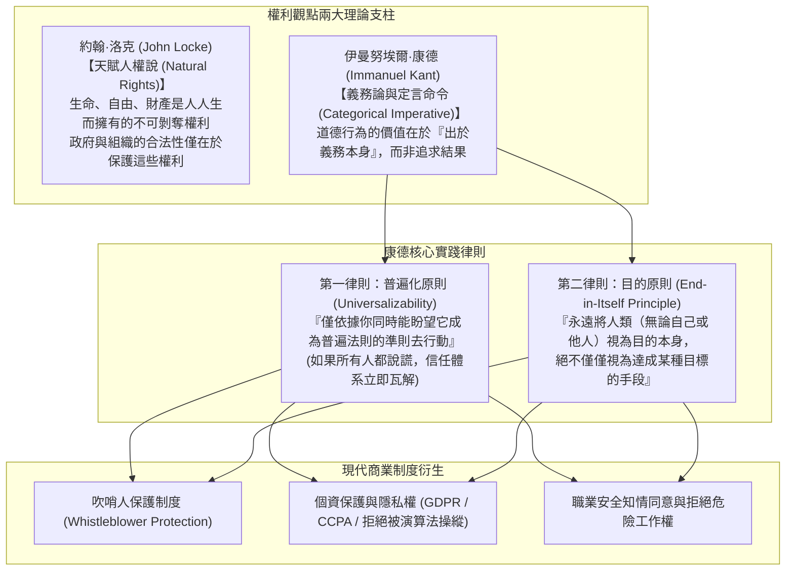

---
{"dg-publish":true,"permalink":"/98/rights-view/","tags":["商業概念","商業倫理","哲學","公司治理","PMBA"],"dg-note-properties":{"aliases":["權利觀點","權利倫理觀","Rights View of Ethics","義務論倫理觀","Deontology","康德主義倫理學"],"tags":["商業概念","商業倫理","哲學","公司治理","PMBA"]}}
---


# 權利觀點 (Rights View of Ethics)

> [!NOTE]
> **核心概念精粹**：權利觀點（Rights View of Ethics），在哲學上屬於**義務論（Deontology / 康德主義倫理學）**。它主張道德決策的核心責任在於**尊重、捍衛並維護個體所擁有的基本人權與道德權利**（如生命權、人身安全權、隱私權、言論自由、良心自由與知情同意權）。權利觀點堅信「人是目的，絕不僅僅是手段（Humanity as an End）」，權利具備不可讓渡的優先性（Rights as Trumps），任何多數人的整體利益都無權踐踏個體的基本權利。

---

## 一、 學理淵源：從洛克天賦人權到康德的定言命令

權利觀點構築了現代憲政法治、人權公約與企業合規審計的哲學大廈：



---

## 二、 現代企業管理中保護的五大基本道德權利

在組織內部與外部利害關係人互動中，權利觀點具體體現為五大不可侵犯的權利防線：

| 道德權利類別 | 權利內涵與本質要求 | 企業管理中的制度落實 | 典型侵權違規行為 |
| :--- | :--- | :--- | :--- |
| **1. 生命與安全權<br>(Right to Life & Safety)** | 員工與消費者享有不受有毒物質、危險工況或缺陷產品危害人身的權利。 | ISO 45001 職業安全衛生體系、最嚴苛產品安全測試。 | [[utilitarian-view_功利主義觀點|福特 Pinto]] 忽視油箱缺陷、強迫員工在無防護環境接觸劇毒溶劑。 |
| **2. 隱私與個人資料權<br>(Right to Privacy)** | 個體對自身私人生活、位置資訊與敏感數據擁有自主控制權。 | 歐盟 GDPR「被遺忘權」、資料最小化收集原則、透明隱私政策。 | 科技巨頭未經授權倒賣用戶個資、暗中竊聽通話進行廣告投放。 |
| **3. 知情同意權<br>(Informed Consent)** | 在被要求承擔風險前，擁有獲取完整、真實、未被隱瞞資訊的權利。 | 生技新藥臨床試驗嚴格知情同意書、金融商品風險揭露說明書。 | 銀行理專隱瞞衍生品高風險誘騙高齡長者購買、未揭露藥物致癌副作用。 |
| **4. 良心自由與拒絕權<br>(Freedom of Conscience)** | 員工有權拒絕執行違背基本道德良知或法律法規之指令。 | 確立員工向法務/審計部門匿名求助通道、反職場報復制度。 | 強迫會計師偽造虛假憑證、要求工程師在汽車尾氣測試中植入作弊軟體。 |
| **5. 言論自由與舉報權<br>(Free Speech & Whistleblowing)** | 揭露組織內部違法舞弊、危害公眾安全事實的權利受國家與企業保護。 | 獨立董事直接負責的舉報熱線、舉報人身分保密與高額法律兜底。 | 開除並惡意抹黑揭發醫療事故的吹哨醫師、對舉報者發動司法追殺。 |

---

## 三、 經典企業實戰案例：強生泰諾危機的「人權至上」救贖

```carousel

<!-- slide -->
### 1. 致命中毒事件爆發（1982 年）
- **危機降臨**：1982 年秋天，芝加哥地區發生 7 人服用被投毒氰化物的強生「泰諾（Tylenol）」膠囊後猝死事件；
- **傳統功利考量**：投毒僅發生在芝加哥少數藥局，全美其他地區受污染機率低於百萬分之一；若全面召回，強生將承受高達 1 億美元（在當時是天文數字）的直接損失，且品牌可能永久被毀。
<!-- slide -->
### 2. 踐行康德義務論：人命權利超越利潤
- **詹姆斯·伯克（James Burke）的抉擇**：強生董事長毫不猶豫回歸公司著名的「信條（Our Credo）」——第一責任永遠是病患、醫生與護士，第二是員工，第三是社會，股東利益排在最後；
- **閃電行動**：
  - 立即向全美大眾發出警報，暫停泰諾所有電視廣告；
  - 在全美範圍內**無差別主動召回全部 3,100 萬瓶泰諾藥品**並就地銷毀；
  - 研發防篡改的三重密封安全包裝（Triple-Seal Tamper-Evident Packaging），並將技術無償開放給全美製藥業。
- **神話級結果**：強生的誠實與對生命權利的敬畏贏得全美公眾瘋狂讚譽，泰諾在數月內奪回 90% 的原有市佔率，成為全球商業倫理危機處理的最高聖經。
```

---

## 四、 經理人權利觀點合規檢核表（Executive Decision Checklist）

在推動數位轉型、全球供應鏈採購或內部組織治理時，高階管理團隊應依序檢驗下列問題：

- [ ] **普遍化命令測試（Universalizability Test）**：
  - 如果我們今天採取的商業行徑（如在合約中使用晦澀條款誤導客戶、或暗中收集用戶位置），被我們的所有競爭對手奉為行業公開通用常態，市場信任體系是否會徹底瓦解？
- [ ] **人是目的檢驗（Humanity-as-an-End Audit）**：
  - 我們是否把外送員、派遣工或研發工程師，單純視為達成公司利潤指標與股價拉抬的「工具耗材（Mere Means）」？我們是否保障了他們的休息權、身心健康與人性尊嚴？
- [ ] **吹哨人保護防火牆（Whistleblower Safe Harbor）**：
  - 當公司內部基層員工發現重大資安漏洞、排污作假或財務違規時，他能否在不必承擔被直屬主管報復或開除的恐懼下，直接向稽核委員會匿名舉報？
- [ ] **數位人權與演算法倫理（Algorithmic Human Rights）**：
  - 我們的 AI 推薦模型或信用評分演算法，是否侵犯了用戶的知情權？是否存在未經說明的歧視性定價（大數據殺熟）？用戶是否享有退出（Opt-out）演算法審判的自主權利？

---

## 五、 關聯概念與知識網絡

* 核心商業倫理三大觀點：
  * [[utilitarian-view_功利主義觀點|功利主義觀點 (Utilitarian View of Ethics)]]：權利觀點對效益主義多數人暴政的絕對約束
  * [[justice-view_正義觀點|正義觀點 (Justice View of Ethics)]]：權利保障與羅爾斯平等自由原則的深度交融
  * [[ethical-responsibility_倫理責任|倫理責任 (Ethical Responsibility)]]：尊重基本人權是企業倫理責任的核心內核
  * [[enterprise-dao-de-gui-fan_企業道德規範|企業道德規範 (Code of Conduct)]]：將權利原則具體化為職場反性騷擾、反歧視政策
* 治理與組織行為：
  * [[Agency_Theory_Corporate_Governance_代理理論與公司治理|代理理論與公司治理 (Agency Theory)]]：管理層對股東以外廣大利害關係人權利之受託責任
  * [[great-company_好公司|好公司 (Great Company)]]：以堅不可摧之核心價值觀捍衛顧客信任與員工尊嚴
  * [[corporate-culture_企業文化|企業文化 (Corporate Culture)]]：尊重人權與心理安全感之組織土壤
  * [[Tolerance_of_Ambiguity_不確定性容忍度與控制感|不確定性容忍度與控制感 (Tolerance of Ambiguity)]]：堅守原則而不因短期壓力妥協之道德勇氣
