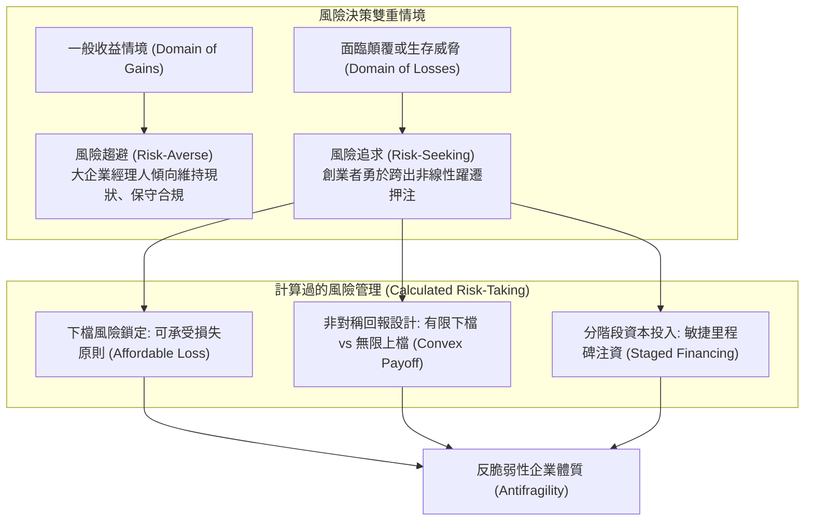

---
{"dg-publish":true,"permalink":"/98/risk-taking/","tags":["商業概念","創業管理","決策科學","PMBA"],"dg-note-properties":{"aliases":["風險承擔","Entrepreneurial Risk-Taking","創業風險偏好"],"tags":["商業概念","創業管理","決策科學","PMBA"]}}
---


# 風險承擔 (Entrepreneurial Risk-Taking)

> [!NOTE]
> **核心概念精粹**：創業風險承擔（Entrepreneurial Risk-Taking）並非盲目狂熱的賭徒行為（Gambling），而是企業家在面對高度不確定性（Knightian Uncertainty）時，主動跨出舒適圈、承擔潛在財務損失、聲譽代價與職業生涯風險，並透過系統性分析將未知轉化為「可計算與可承受之風險（Calculated Risk）」的戰略決策特質。它是企業家精神（Entrepreneurial Orientation, EO）的三大核心支柱之一。

---

## 一、 學理奠基：從奈特不確定性到企業家導向理論

對風險的理解與管理構成了當代管理學與經濟學的基石：

1. **奈特風險與奈特不確定性（Frank Knight, 1921）**：
   - 芝加哥學派宗師法蘭克·奈特在《Risk, Uncertainty and Profit》中做出經典區分：
     - **可計算風險（Risk）**：未來事件的可能結果及其發生機率分佈是已知的（如輪盤賭或人壽保險精算），此類風險可透過保險或投資組合分散。
     - **真性不確定性（Knightian Uncertainty）**：未來狀態完全不可預測，其機率分佈根本不存在（如引領全新的商業革命）。
   - **利潤的本質**：奈特指出，唯有在不可計算的「真性不確定性」中勇於做出判斷並承擔後果的人，才配享有超額利潤（Entrepreneurial Profit）。
2. **企業家導向三維模型（Miller, 1983; Covin & Slevin, 1989）**：
   - 丹尼·米勒（Danny Miller）確立了衡量組織企業家精神的經典 EO 架構：
     - **創新性（Innovativeness）**：追求新穎構想與實驗。
     - **前瞻先動性（Proactiveness）**：搶先競爭者行動。
     - **風險承擔性（Risk-Taking）**：願意承擔重大資源押注與未知結果。
3. **前景理論與損失規避的逆轉（Prospect Theory, Kahneman & Tversky, 1979）**：
   - 在正常情境下，人類大腦普遍具有「損失規避（Loss Aversion）」傾向（損失 100 美元的痛苦約為獲得 100 美元快樂的 2 至 2.5 倍）。
   - 然而在面臨「生存威脅（Threat to Survival）」或「絕境（Domain of Losses）」時，決策者會逆轉為強烈的**風險追求（Risk-Seeking）**。這解釋了為什麼許多連環創業者在陷入瓶頸時，會採取看似瘋狂的「背水一戰」戰略。



---

## 二、 賭徒謬誤 vs 計算過的風險（Calculated Risk）

卓越的企業家絕非毫無邊界的魯莽賭徒。兩者在認知架構與決策邏輯上存在天壤之別：

| 比較構面 | 賭徒心態（Gambler's Fallacy） | 計算過的風險承擔（Calculated Risk-Taking） |
| :--- | :--- | :--- |
| **資訊基礎** | 依賴直覺、僥倖心理與盲目樂觀，忽視基礎概率。 | 透過深度調研、情境分析與壓力測試，極大化掌握關鍵變數。 |
| **下檔保護** | 將全部資產押注在單次事件，無止損點，下檔風險無限。 | **鎖定最大可承受損失（Affordable Loss）**，一旦失敗不致於致命毀滅。 |
| **回報結構** | 對稱或負期望值（賭場抽水），長期勝率趨近於零。 | **凸性回報結構（Convexity）**：下檔損失固定且有限，上檔爆發潛力無窮。 |
| **應變彈性** | 一意孤行，將策略視為不可撼動的教條，拒絕接受反饋。 | 透過小規模 MVP 進行動態試錯，具備隨時[[business-model-pivot_商業模式軸轉|商業模式軸轉 (Pivot)]]的敏捷韌性。 |
| **心理基模** | 渴望短期暴富與即時滿足。 | 秉持長期主義，將失敗視為消除不確定性的「必要研發成本」。 |

---

## 三、 經典企業實戰案例：馬斯克與 SpaceX 的生死一役

```carousel

<!-- slide -->
### 1. 絕境中的極限承擔（2008 年的至暗時刻）
- **背景**：2008 年底，全球金融海嘯爆發。SpaceX 的「獵鷹一號（Falcon 1）」運載火箭連續三次發射失敗，資金全數耗盡；與此同時，特斯拉（Tesla）面臨 Roadster 研發超支與現金流斷裂，瀕臨破產清算。
- **風險承擔決策**：
  - 馬斯克個人賬戶僅剩最後 3,500 萬至 4,000 萬美元現金。若將資金均分，兩家公司將在數月內雙雙倒閉；若全力拯救一家，則另一家必死無疑。
<!-- slide -->
### 2. 計算過的下檔防護與孤注一擲
- 馬斯克做出了現代商業史上最具傳奇色彩的風險決策：他動用全部個人信用與人脈借款，將僅存的資金全數投入獵鷹一號的第四次發射，同時抵押所有股權換取特斯拉過橋貸款。
- 關鍵在於，馬斯克計算了發射成功的**非對稱收益**：一旦第四次成功，SpaceX 將直接證明其民間火箭發射能力，具備爭取 NASA 價值 16 億美元商業補給服務（CRS）合約的資格。
- 2008 年 9 月 28 日，獵鷹一號第四次發射完美入軌，成功拿下 NASA 巨額合約，兩家公司同日絕處逢生。
```

---

## 四、 經理人風險承擔評估架構：可承受損失原則（Affordable Loss Principle）

在推動高風險創新專案時，高階管理團隊應採用薩拉斯瓦蒂（Saras Sarasvathy）提出的「效果邏輯」風險決策檢核表：

- [ ] **致命下檔隔離（Ruination Check）**：
  - 如果該專案以最糟糕的方式徹底潰敗（投資歸零且引發訴訟），母公司或創始團隊是否會面臨破產清算？若答案是「會」，該專案必須立即分拆隔離，嚴禁賭上組織命運。
- [ ] **最大可承受損失預算（Affordable Loss Cap）**：
  - 我們是否是以「我們最多願意賠掉多少錢與時間」來設定預算，而非盲目基於「樂觀預測的未來折現利潤（NPV）」？
- [ ] **非對稱凸性檢驗（Asymmetry & Convexity Test）**：
  - 專案的潛在收益是否具備非線性爆發力（如贏得新時代的平台入場券）？而潛在下檔是否已被合約條款、股權隔離或保險工具封頂？
- [ ] **里程碑分段注資機制（Staged Milestones）**：
  - 是否建立門徑管理機制（Stage-Gate）？團隊是否必須在達成特定用戶驗證里程碑後，才能解鎖下一批資本，以避免沉沒成本謬誤？
- [ ] **失敗容忍與快速驗屍文化（Psychological Safety & Post-Mortem）**：
  - 組織內部是否懲罰經過深思熟慮的「智能失敗（Intelligent Failure）」？團隊能否在失敗後迅速萃取組織知識並二次出發？

---

## 五、 關聯概念與知識網絡

* 核心理論基礎：
  * [[opportunity-recognition_創業機會辨識|創業機會辨識 (Opportunity Recognition)]]：風險承擔與機會辨識的雙向強化
  * [[opportunity-discovery_機會發掘|機會發掘 (Opportunity Discovery)]]：客觀風險計算與非均衡市場佈局
  * [[Prospect_Theory_Executive_Risk_展望理論與高管風險決策|展望理論與高管風險決策 (Prospect Theory)]]：損失領域下的極限風險追求心理學
  * [[Nothing to Lose|無物可失 (Nothing to Lose)]]：背水一戰與不對稱決策心態
* 策略與執行工具：
  * [[entrepreneurial-risk_創業風險|創業風險 (Entrepreneurial Risk)]]：技術、市場與財務風險三維分類
  * [[Burn Rate|資金消耗率 (Burn Rate)]]：現金流消耗速度與風險控制防線
  * [[lean-startup_精實創業|精實創業 (Lean Startup)]]：以極低成本降低未知不確定性的實務方法
  * [[Tolerance_of_Ambiguity_不確定性容忍度與控制感|不確定性容忍度與控制感 (Tolerance of Ambiguity)]]：模糊情境下的心理承擔韌性
  * [[risk-control_風險控制|風險控制 (Risk Control)]]：結構性風險對沖與治理防線
