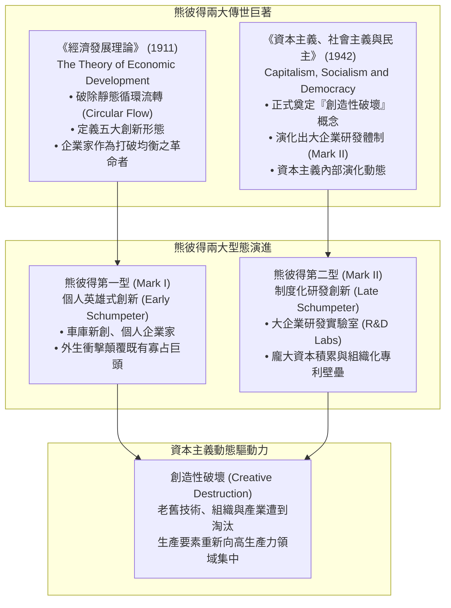

---
{"dg-publish":true,"permalink":"/98/schumpeter/","tags":["商業概念","經濟學","創新管理","PMBA"],"dg-note-properties":{"aliases":["熊彼得","約瑟夫·熊彼得","Joseph Schumpeter","熊彼得創新理論"],"tags":["商業概念","經濟學","創新管理","PMBA"]}}
---


# 熊彼得 (Joseph Schumpeter)

> [!NOTE]
> **核心概念精粹**：約瑟夫·阿洛伊斯·熊彼得（Joseph Alois Schumpeter, 1883–1950）是現代創新經濟學與演化經濟學的鼻祖。他打破了古典經濟學將市場視為靜態瓦爾拉斯一般均衡的教條，提出**「創造性破壞（Creative Destruction）」**是資本主義經濟運行的實質本質。熊彼得將「企業家（Entrepreneur）」定義為打破既有循環流轉、推動生產要素非線性「新組合」的革命性力量。

---

## 一、 學理淵源與理論體系

熊彼得的經濟學思想橫跨其兩部代表性傳世巨著，構築了當代創新管理的理論總綱：



### 1. 打破靜態均衡的「循環流轉（Circular Flow）」
- 在古典與新古典經濟學框架中，經濟體系最終會趨向利潤歸零的靜態瓦爾拉斯均衡（Walrasian Equilibrium）——所有的生產要素按照邊際成本定價，沒有超額利潤，企業家只是例行公事的被動管理者。
- 熊彼得斷言：這種靜態均衡根本無法解釋人類財富的飛躍增長。經濟體系之所以能實現「發展（Development）」，完全依賴於**企業家引入「新組合（New Combinations）」**，徹底粉碎舊有的經濟軌道。

### 2. 創新的五種型態（Five Types of Innovation）
熊彼得在 1911 年嚴格界定了五大創新面向，成為後世所有商業模式與策略創新分類的源頭：

| 創新維度 | 熊彼得原始定義 | 當代商業實踐對照 | 經典案例 |
| :--- | :--- | :--- | :--- |
| **1. 新產品** | 引進消費者不熟悉的新產品或新特性的商品 | 開創全新產品品類，滿足潛在需求 | 蘋果 iPhone 重新定義智慧型手機 |
| **2. 新方法** | 採用未在該產業部門驗證過的新生產或加工工藝 | 自動化、模組化、大幅降低邊際成本 | 福特汽車 T 型車移動裝配流水線、台積電 EUV 先進製程 |
| **3. 新市場** | 進入該國特定製造部門之前未曾進入的市場 | 跨國全球化擴張、下沉市場開拓 | 星巴克進入中國茶飲市場、拼多多開拓三四線電商市場 |
| **4. 新原料來源** | 獲取原料或半成品的新供給來源 | 供應鏈結構重組、替代材料突破 | 特斯拉採用磷酸鐵鋰（LFP）與一體化壓鑄鋁合金 |
| **5. 新組織型態** | 建立或打破某種壟斷地位的產業新組織結構 | 平台經濟、去中心化生態系、產業標準重構 | Uber 與 Airbnb 瓦解計程車與飯店執照壟斷 |

---

## 二、 熊彼得第一型（Mark I）vs 第二型（Mark II）典範轉移

熊彼得晚年深刻觀察到，資本主義的創新主體正在從早期的「個人冒險家」向現代的「組織化研發」轉變：

| 比較構面 | 熊彼得第一型 (Mark I, 1911) | 熊彼得第二型 (Mark II, 1942) |
| :--- | :--- | :--- |
| **創新主體** | 個人企業家、獨立發明家、邊緣顛覆者。 | 跨國巨頭、大企業內部中央研究院、研發工程軍團。 |
| **市場結構** | 進入門檻低、競爭分散的新興產業。 | 寡占壟斷、資本密集、高度成熟的科技重工業。 |
| **研發資源** | 自籌資金、天使投資、依靠[[resource-bricolage_資源拼湊|資源拼湊]]與個人直覺。 | 龐大盈餘再投資、政府科研補貼、系統性智財權戰略。 |
| **知識積累** | 零散、難以傳承的默會知識（Tacit Knowledge）。 | 結構化、可編碼的專利庫、實驗數據與標準作業程序。 |
| **典型代表** | 愛迪生初期、賈伯斯在車庫創立蘋果、馬斯克創立 SpaceX。 | 貝爾實驗室（Bell Labs）、微軟研究院、台積電千人研發團隊。 |

---

## 三、 實戰個案剖析：創造性破壞在半導體與運算產業的輪迴

```carousel

<!-- slide -->
### 1. 台積電的 Mark I 式組織創新（純晶圓代工模式）
- 1987 年張忠謀創立台積電時，全球半導體全由英特爾、德州儀器等整合元件製造商（IDM）主導。
- 張忠謀實施了熊彼得第五類創新——「開創新組織型態」：承諾永不製造自有品牌產品，只專注於純晶圓製造（Pure-play Foundry）。
- 這一創造性破壞直接摧毀了半導體產業「只有大巨頭才能設計晶片」的鐵律，孕育了高通、輝達、聯發科等數千家無晶圓廠（Fabless）設計公司的繁榮。
<!-- slide -->
### 2. 輝達（NVIDIA）向 Mark II 典範的演進與 AI 革命
- 1993 年黃仁勳在丹尼餐廳（Denny's）構想 3D 繪圖晶片時是標準的 Mark I 顛覆者。
- 但自 2006 年推出 CUDA 統一運算架構以來，輝達轉化為極致的 Mark II 組織化創新巨獸：每年投入數十億美元研發，構築「軟體生態 + 專屬架構 + 網路互聯（NVLink）+ 超級運算叢集」的全端護城河。
- 輝達對傳統 CPU 通用運算架構發動了毀滅性的「創造性破壞」，引爆生成式 AI 時代的運算範式轉移。
```

---

## 四、 經理人熊彼得式創新體檢清單（Executive Innovation Checklist）

面對永不停歇的創造性破壞浪潮，高階領導層必須定期對照以下維度自省：

- [ ] **反靜態流轉檢驗（Anti-Circular Flow Audit）**：
  - 本公司今年的利潤來源中，有多大比例來自「常規重複的既有業務」？有多大比例來自近三年推向市場的「新組合」？
- [ ] **內部破壞意願（Willingness to Cannibalize）**：
  - 當新技術出現時，我們是否敢於推出可能「吞噬既有高毛利產品」的新解決方案？還是因為保護既得利益而拖延，最終被外部入侵者毀滅？
- [ ] **五維創新覆蓋率（Five Dimensions Assessment）**：
  - 公司的創新專案是否過度集中在「產品微幅改良（New Good）」，而完全忽略了製程成本重塑、新原料替換或商業模式組織重組的潛力？
- [ ] **Mark I 與 Mark II 雙軌孵化機制（Ambidextrous Architecture）**：
  - 組織是否建立了[[dual-transformation-dual-transformation_雙軌轉型 Dual Transformation|雙軌轉型結構]]？既有成熟業務保持 Mark II 的規模研發效率，同時設立獨立戰鬥單位模擬 Mark I 的車庫創新靈活性。
- [ ] **技術折舊感知（Obsolescence Radar）**：
  - 團隊是否密切監測可能使我們核心競爭力「一夜歸零」的弱訊號？我們的資本配置是否具備足夠的[[entrepreneurial-capability_創業能力|創業能力]]迅速轉向？

---

## 五、 關聯概念與知識網絡

* 核心理論基礎：
  * [[creative-destruction_創造性破壞|創造性破壞 (Creative Destruction)]]：資本主義動態突變與淘汰機制
  * [[opportunity-recognition_創業機會辨識|創業機會辨識 (Opportunity Recognition)]]：非均衡市場中的價值發現歷程
  * [[Venkataraman|范卡塔拉曼 (Sankaran Venkataraman)]]：個人—機會雙構面與創業核心命題
  * [[disruptive-innovation_破壞式創新|破壞式創新 (Disruptive Innovation)]]：克里斯汀生對熊彼得破壞理論的當代發展
* 策略與組織落地：
  * [[Good_Product_Business_Company_好產品好事業好公司模型|好產品好事業好公司模型]]：從單點創新到偉大企業的躍遷
  * [[resource-based-view-rbv_資源基礎理論|資源基礎理論 (RBV)]]：組織專有異質資產與可持續優勢
  * [[competitive-advantage_競爭優勢|競爭優勢 (Competitive Advantage)]]：搶先引入新組合所形成的超額利差期
  * [[core-competence_核心能力|核心能力 (Core Competence)]]：組織專屬技術與難以模仿之競爭壁壘
