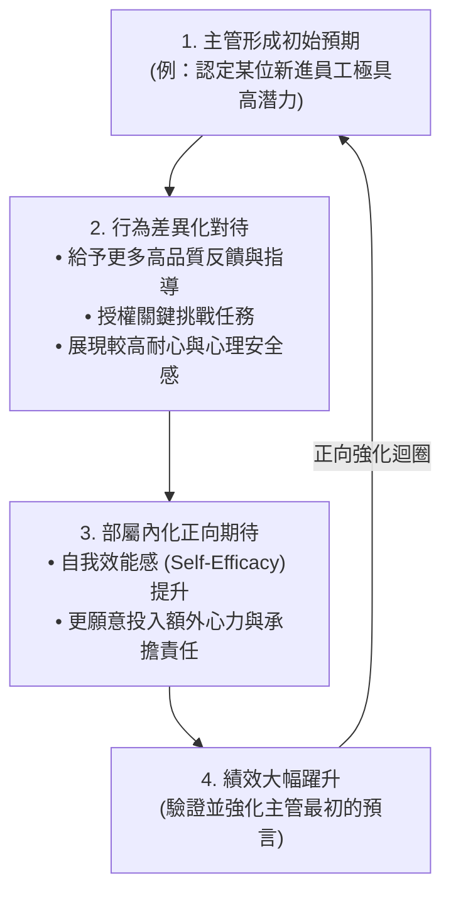

---
{"dg-publish":true,"permalink":"/98/self-fulfilling-prophecy/","tags":["商業概念","組織行為","領導力","期望管理","績效激勵","PMBA"],"dg-note-properties":{"aliases":["自我實現預言","比馬龍效應","畢馬龍效應","Self-Fulfilling Prophecy","Pygmalion Effect","戈侖效應","Golem Effect"],"tags":["商業概念","組織行為","領導力","期望管理","績效激勵","PMBA"]}}
---

# 自我實現預言與比馬龍效應 (Self-Fulfilling Prophecy & Pygmalion Effect)

> [!NOTE] 核心概念精粹
> **自我實現預言（Self-Fulfilling Prophecy）** 是指管理者或教師對個體所抱持的「初始預期」（無論最初是否符合客觀事實），會透過潛意識的互動行為改變對方的自我認知與努力程度，最終使該預期成為真實結果的心理動力學。正向期待引導出卓越表現稱為**比馬龍效應（Pygmalion Effect）**；負向期待導致績效惡化則稱為**戈侖效應（Golem Effect）**。

---

## 一、 比馬龍效應四階段循環模型

### 經典實證淵源（Rosenthal & Jacobson, 1968）
心理學家羅森塔爾在學校進行了一項經典實驗：學期初隨機抽取部分學生名單，向老師暗示「這些學生經過測驗屬於即將大放異彩的潛力資優生」。學期末追蹤發現，這批被隨機選出的學生在智力與學業成績上的進步幅度，顯著高於對照組——原因不在於學生天賦差異，而在於老師在整個學期中不自覺給予了他們更多的關注、鼓勵與正向反饋。

---

## 二、 組織管理中的兩面刃：比馬龍 vs. 戈侖

| 效應類型 | 主管心理預期 | 無意識管理行為特徵 | 組織行為後果 |
| :--- | :--- | :--- | :--- |
| **比馬龍效應 (Pygmalion Effect)** | 高期待、信任其成長潛力 | 提供清晰架構、容錯空間、密集教練指導與公開肯定 | 員工展現高投入與[[98_商業概念庫/job-satisfaction_工作滿意度\|組織公民行為]]，突破能力天花板 |
| **戈侖效應 (Golem Effect)** | 低期待、貼上「扶不起／不適任」標籤 | 微觀管理、只派發瑣碎雜務、缺乏指導、動輒公開指責 | 員工陷入習得性無助、出現[[98_商業概念庫/Quiet_Quitting_安靜離職與組織公民行為\|安靜離職]]，績效如主管預期般持續墊底 |

---

## 三、 經理人運用正向期待的行動檢核表

- [ ] **標籤清零原則**：接手新團隊或跨部門成員時，避免過度依賴前任主管的負面評價或[[98_商業概念庫/halo-effect-and-projection_暈輪效應與投射偏誤\|刻板印象]]，防止戈侖效應提前啟動。
- [ ] **高標準與高支持並重**：單純口頭施壓不是比馬龍效應；真正的正向預期必須搭配「具挑戰性的任務（Stretch Goals）」與「實質的資源指導」。
- [ ] **定期檢視關注分配**：盤點自己在 1-on-1 會議中是否將 80% 的指導時間只給了少數「明星員工」，無意中冷落了同樣具備成長空間的中堅成員。

---

## 四、 關聯概念與模組導航

- **對應模組**：[[02_核心必修/03_組織行為/02_模組筆記/Module_2_個體動能_知覺歸因與激勵/M2-2_社會知覺偏誤與跨文化歸因理論\|M2-2_社會知覺偏誤與跨文化歸因理論]] · [[02_核心必修/03_組織行為/_組織行為 MOC\|_組織行為 MOC]]
- **理論關聯**：[[98_商業概念庫/halo-effect-and-projection_暈輪效應與投射偏誤\|halo-effect-and-projection_暈輪效應與投射偏誤]] · [[98_商業概念庫/intrinsic-vs-extrinsic-motivation_內在激勵與外在激勵\|intrinsic-vs-extrinsic-motivation_內在激勵與外在激勵]] · [[98_商業概念庫/Trait_Activation_Theory_特質激化理論\|Trait_Activation_Theory_特質激化理論]]
