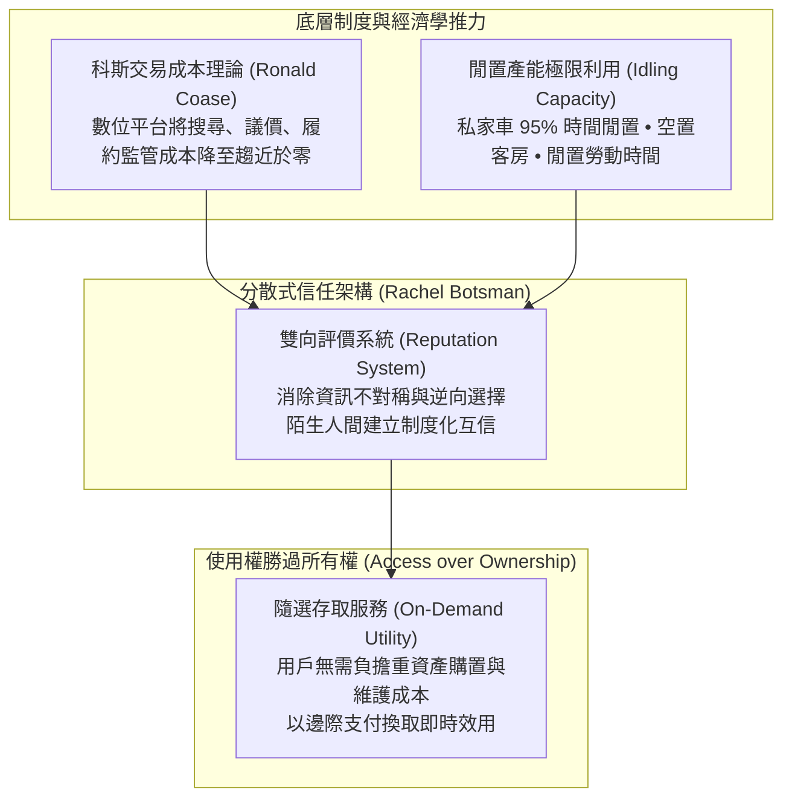

---
{"dg-publish":true,"permalink":"/98/sharing-economy/","tags":["商業概念","平台經濟","商業模式","數位轉型","PMBA"],"dg-note-properties":{"aliases":["共享經濟","Sharing Economy","協同消費","Collaborative Consumption","零工經濟"],"tags":["商業概念","平台經濟","商業模式","數位轉型","PMBA"]}}
---


# 共享經濟 (Sharing Economy)

> [!NOTE]
> **核心概念精粹**：共享經濟（Sharing Economy / Collaborative Consumption）是指藉由數位雙邊平台（Two-Sided Platforms），將個人或組織所擁有的**閒置資產（Idling Capacity）**與技能，以暫時性租賃、共用或授權方式媒合給需求端，實現**「使用權超越所有權（Access over Ownership）」**的經濟協同模式。其底層依託於極致壓縮的交易成本與去中心化信任評價體系，徹底重構了交通、旅宿與人力資源的傳統產銷邊界。

---

## 一、 學理淵源與經濟學機制

共享經濟的爆發奠基於兩大經典經濟學與社會學理論：



### 1. 科斯定理與交易成本消融（Transaction Cost Reduction）
- 諾貝爾經濟學獎得主羅納德·科斯（Ronald Coase）在《企業的本質》中指出：企業之所以存在，是因為市場交易存在高昂的「搜尋、談判、履約」成本。
- 智慧型手機、GPS 定位與行動支付的普及，使得個人之間（P2P）直接交易的摩擦力急遽下降。共享平台以極低成本在毫秒級完成「供需雙方動態撮合」，打破了傳統重資產企業的邊界壁壘。

### 2. 博茨曼的分散式信任模型（Distributed Trust）
- 雷切爾·博茨曼（Rachel Botsman）在《What's Mine Is Yours》中指出：共享經濟的貨幣不是金錢，而是**「信譽（Reputation）」**。
- 透過司機與乘客、房東與房客的雙向打分機制，平台建立了去中心化的信任基礎，使素昧平生的陌生人敢於坐進對方的私家車或住進對方的臥室。

---

## 二、 共享經濟的四大模式分類矩陣

共享經濟從最初純粹的非營利閒置共享，演進出多元的商業變現架構：

| 模式類別 | 核心資產屬性 | 商業運作機制 | 典型代表 |
| :--- | :--- | :--- | :--- |
| **空間與旅宿共享<br>(Space Sharing)** | 閒置不動產、空置公寓、共享辦公桌。 | 房東提供閒置居所，平台收取雙向服務佣金（Take Rate: 10%~15%）。 | Airbnb、WeWork（前期共享模式）。 |
| **交通出行共享<br>(Mobility Sharing)** | 私家車輛閒置運力、城市短途微交通。 | 動態定價（Surge Pricing）演算法調控供需，即時調度零工司機。 | Uber、Lyft、GoShare、YouBike。 |
| **專業勞動與技能共享<br>(Skill & Freelance)** | 個人知識、設計能力、工程代碼、跑腿勞力。 | 任務發包制，將傳統全職工作拆解為碎片化計件任務（Gig Economy）。 | Upwork、Fiverr、TaskRabbit。 |
| **實體物品與循環共享<br>(Goods Sharing)** | 昂貴工具、攝影器材、派對禮服、玩具。 | 以租代買，延長物品生命週期，減少資源浪費。 | Rent the Runway、Fat Llama。 |

---

## 三、 經典企業實戰案例：Airbnb 的信任機制與監管博弈

```carousel

<!-- slide -->
### 1. 閒置資產啟動與雙邊網絡效應
- **起點**：2008 年創辦人利用客廳的三張充氣床墊（Airbed）解決舊金山飯店客滿痛點；
- **飛輪擴張**：屋主無需任何固定投資，只要將閒置空房拍照上傳即可獲得額外被動收入；房源越多元，吸引全球旅客越多，形成狂暴的雙邊網絡效應。
<!-- slide -->
### 2. 共享經濟的陰暗面與專業化異化
- **演進異化**：隨著平台規模擴大，大量「職業二房東」與投資客湧入，將一般住宅大量轉為全職短租，推高全球都會區（如紐約、巴塞隆納）的長期租金，引發當地居民強烈抗議；
- **監管重拳**：各國政府開始祭出嚴厲法規（如紐約 Local Law 18 實質封殺未合住短租）。Airbnb 被迫從早期的「草根野蠻生長」，轉向全面合規化、推出高端專利認證與在地體驗服務。
```

---

## 四、 經理人共享商業模式檢核表（Executive Decision Checklist）

企業在設計或投資共享經濟平台時，必須嚴肅檢核下列關鍵門檻：

- [ ] **邊際閒置價值真實性（True Idle Capacity Check）**：
  - 目標資產是否真的存在高比例的「非意願閒置時間」？如果供給端必須特別貸款購買新資產來參與（例如全職借貸買車開 Uber），模式將退化為重資產偽共享，失去輕資產優勢。
- [ ] **動態信任與安全防線（Trust & Safety Architecture）**：
  - 平台是否建立完善的身份實名認證、背景調查與高額商業責任保險？當發生重大治安或財物毀損事件時，平台能否迅速介入並建立賠付兜底？
- [ ] **監管政策與外部性風險（Regulatory & Externality Exposure）**：
  - 該業務是否正在侵蝕既有受監管產業（計程車牌照、飯店營業執照、勞工最低工資法）？我們是否具備與地方政府溝通協商、繳納觀光稅或提供彈性福利的治理儲備？
- [ ] **平台抽成極限平衡（Take Rate Ceiling）**：
  - 平台的抽成比率（Take Rate）是否過高？如果抽成超過 25%~30%，是否會逼迫優質供給端與需求端進行私下線下交易（Platform Disintermediation）？

---

## 五、 關聯概念與知識網絡

* 宏觀經濟與新生活形態：
  * [[stay-at-home-economy_宅經濟|宅經濟 (Stay-at-Home Economy)]]：隨選配送與居家生活之共享外送基礎
  * [[single-economy_單身經濟|單身經濟 (Single Economy)]]：一人租屋與輕資產隨選共享偏好
  * [[K型經濟|K型經濟 (K-Shaped Economy)]]：零工經濟平台上的勞動力供給分化
* 平台戰略與治理工具：
  * [[information-asymmetry_資訊不對稱|資訊不對稱 (Information Asymmetry)]]：雙向信譽評價對檸檬市場的消除
  * [[platform-envelopment_平台包夾|平台包夾 (Platform Envelopment)]]：共享交通與外送平台之生態包夾
  * [[network-effects_網絡效應|網絡效應 (Network Effects)]]：雙邊共享平台之核心壁壘
  * [[viable-business_好事業|好事業 (Viable Business)]]：從燒錢補貼轉向可持續單元經濟的轉型
