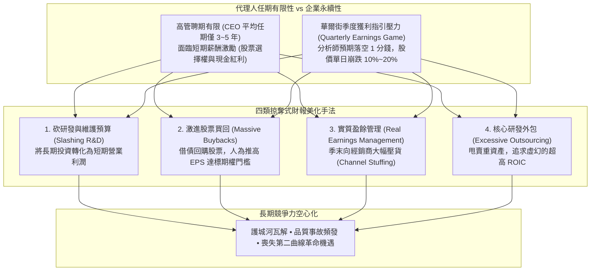

---
{"dg-publish":true,"permalink":"/98/short-term/","tags":["商業概念","公司治理","財務管理","策略管理","PMBA"],"dg-note-properties":{"aliases":["短期主義","Short-Termism","季度資本主義","Quarterly Capitalism","企業近視症","Corporate Myopia"],"tags":["商業概念","公司治理","財務管理","策略管理","PMBA"]}}
---


# 短期主義 (Short-Termism)

> [!NOTE]
> **核心概念精粹**：短期主義（Short-Termism），在現代公司治理中常被稱為「季度資本主義（Quarterly Capitalism）」，是指企業高階管理層或機構投資人過度屈從於資本市場的短期業績壓力（如季度獲利指引、分析師 EPS 預期），**不惜犧牲研發創新（R&D）、員工培育、客戶信任與長期資本開支等核心資產，以換取短期財務報表帳面美化與個人股票期權套現的戰略近視行為**。它是侵蝕企業持久護城河與引發系統性產業衰退的深層制度性毒瘤。

---

## 一、 學理淵源：委託—代理困境與季度資本主義

短期主義的氾濫，深植於現代企業所有權與經營權分離後的**代理理論（Agency Theory）**與資本市場博弈機制：



---

## 二、 短期主義 vs 長期主義治理模式的深度對決

| 治理維度 | 季度資本主義短期主義（Quarterly Short-Termism） | 利益相關者長期主義（Long-Termism / Day 1） |
| :--- | :--- | :--- |
| **最高決策準繩** | 下一季度的每股盈餘（EPS）與分析師共識預期。 | 未來 10 年自由現金流的折現總和與客戶核心福祉。 |
| **研發支出視角** | 視為侵蝕當期利潤的「費用」，景氣微幅下滑即首當其衝被砍。 | 視為構築未來護城河的「生命線」，景氣低谷期反而逆向加碼。 |
| **資本配置優先序** | 股票買回（Buybacks）與發放高股息，極大化短期股價。 | 將留存收益再投資於前沿產能、人才儲備與生態系培育。 |
| **顧客關係本質** | 榨取式變現，透過隱蔽加價或降低售後品質榨取當期利潤。 | 構建長期信任，寧可短期犧牲利潤也要極致提升客戶終身價值（LTV）。 |
| **高管薪酬考核** | 與 1~3 年的短期股價或會計利潤直接掛鉤。 | 綁定長達 5~10 年的限制性股票成熟期（Vesting）與回撥機制（Clawback）。 |

---

## 三、 經典企業實戰案例：波音的靈魂墜落 vs 亞馬遜的二十年長征

```carousel

<!-- slide -->
### 1. 波音（Boeing）的靈魂墜落：從工程師聖殿到財務至上
- **文化質變**：1997 年波音收購麥道（McDonnell Douglas）後，華爾街財務官僚接管領導層，公開宣稱「不再以技術為第一位，股價才是上帝」；
- **短期主義操作**：在 2013~2019 年間，波音耗資超過 430 億美元進行[[share-repurchase_股票買回|股票買回]]以美化 EPS，向管理層發放數億美元獎金；同時瘋狂裁撤資深安全審計工程師，將關鍵航電軟體低價外包；
- **災難代價**：為省下全新機身研發預算，倉促改裝 50 年老機型推出 737 MAX，最終引發兩次慘烈空難導致 346 人喪生，公司陷入停飛、訴訟與數百億美元虧損，全球商譽徹底破產。
<!-- slide -->
### 2. 亞馬遜（Amazon）的長程勝利：貝佐斯的「永遠第一天」
- **長程承諾**：貝佐斯在 1997 年第一封致股東信中立下鐵律：「一切圍繞長期（It's All About the Long Term）」；
- **對抗華爾街**：亞馬遜在長達 20 年的時間裡幾乎「毫無會計淨利潤」，甚至多次主動拒絕向華爾街提供季度盈利指引；
- **資本深耕**：將每一分賺來的毛利全數再投資於當時看似瘋狂的「自建全球倉儲物流網」與「AWS 雲端運算基建」；
- **偉大回報**：正是這種對抗短期主義的鋼鐵定力，讓亞馬遜鑄就了全球無人能撼動的雲端與電商帝國，為長期股東創造了數千倍的非凡回報。
```

---

## 四、 經理人短期主義解毒檢核表（Executive Decision Checklist）

董事會與治理委員會應對公司內部激勵機制進行深度排毒：

- [ ] **資本配置動機審計（Capital Allocation Motive Check）**：
  - 本公司近期推動的「大規模股票回購」或「特別股息分紅」，究竟是因為內部確實缺乏高回報的研發投資標的，還是為了幫助高管達成當季的期權激勵指標？
- [ ] **研發資本支出防護線（R&D Protection Redline）**：
  - 核心關鍵技術的 R&D 預算是否被設立了制度化的「最低防護門檻」？當季度財報面臨壓力時，是否有明文規定嚴禁以砍削核心研發來填補利潤缺口？
- [ ] **高管激勵鎖定期延展（Long-Term Vesting & Clawback）**：
  - 高階管理層的股權激勵成熟期是否延長至 5 年以上，甚至離職後仍需鎖定數年？是否設立了追索機制（Clawback Provision）——若未來發現前期利潤來自造假或隱匿風險，公司有權追回全數獎金？
- [ ] **廢除季度盈利指引評估（Quarterly Guidance Elimination）**：
  - 公司是否具備足夠的治理底氣，效法巴菲特、聯合利華（Unilever）廢除精確的季度 EPS 指引，轉而向資本市場溝通長期戰略路徑與多元利益相關者價值指標？

---

## 五、 關聯概念與知識網絡

* 公司治理與財務動態：
  * [[Agency_Theory_Corporate_Governance_代理理論與公司治理|代理理論與公司治理 (Agency Theory)]]：管理層短期自利與股東長期利益之結構性矛盾
  * [[earnings-per-share_每股盈餘|每股盈餘 (EPS)]]：短期主義操縱與財務報表粉飾的核心靶標
  * [[share-repurchase_股票買回|股票買回 (Share Repurchase)]]：人為美化短期股價之資本配置雙刃劍
  * [[management-2_盈餘管理|盈餘管理 (Earnings Management)]]：季度利潤調節與實質活動操縱
* 策略與價值哲學：
  * [[great-company_好公司|好公司 (Great Company)]]：基業長青之飛輪效應與造鐘制度
  * [[viable-business_好事業|好事業 (Viable Business)]]：立足於真實造血而非財報遊戲的實質商業本體
  * [[sound-investment_好投資|好投資 (Sound Investment)]]：格雷厄姆與巴菲特跨越景氣波動之長期內在價值觀
  * [[goodharts-law_古德哈特定律|古德哈特定律 (Goodhart's Law)]]：單一財務指標考核導致管理目標異化之根本法則
