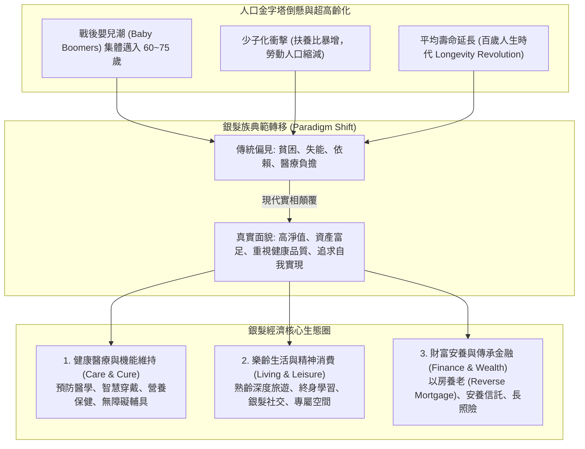

---
{"dg-publish":true,"permalink":"/98/silver-economy/","tags":["商業概念","人口學","策略管理","市場趨勢","PMBA"],"dg-note-properties":{"aliases":["銀髮經濟","Silver Economy","樂齡經濟","長壽經濟","Longevity Economy"],"tags":["商業概念","人口學","策略管理","市場趨勢","PMBA"]}}
---


# 銀髮經濟 (Silver Economy)

> [!NOTE]
> **核心概念精粹**：銀髮經濟（Silver Economy / Longevity Economy）是指圍繞 50 歲以上熟齡與高齡人口的多樣化需求，所展開的所有經濟活動與商業生態總和。隨著全球少子高齡化加速，台灣與東亞各國全面邁入「超高齡社會（Super-Aged Society）」，銀髮族不再是傳統偏見中的「貧病被動負擔」，而是掌握全社會 60% 以上淨資產、擁有充裕自由時間且渴望高品質尊嚴生活的「高淨值黃金消費群體」。

---

## 一、 學理定位與人口結構大變局

在總體環境分析（PESTEL Framework）中，人口結構（Demographics）是確定性最高、影響最深遠的巨浪。



### 超高齡社會的量化門檻（WHO 標準）
- **高齡化社會（Aging Society）**：65 歲以上人口佔總人口比率超過 $7\%$。
- **高齡社會（Aged Society）**：65 歲以上人口佔總人口比率超過 $14\%$。
- **超高齡社會（Super-Aged Society）**：65 歲以上人口佔總人口比率超過 $20\%$（台灣已於 2025~2026 年跨越此臨界點，正式邁入五人中即有一位老人的時代）。

---

## 二、 銀髮消費市場的三大族群細分與需求層次

銀髮市場絕非鐵板一塊，不同年齡層與健康狀態的熟齡族群展現出截然不同的價值主張：

| 族群類別 | 年齡與生理特徵 | 核心痛點與心理基模 | 核心商業商機 |
| :--- | :--- | :--- | :--- |
| **1. 活力熟齡族<br>(Active Agers)** | 50 ~ 65 歲。<br>身體健康、即將退休或半退休，具備高消費力。 | 「我還年輕，我要活出第二人生！」抗拒被稱為「老人」，追求身心凍齡。 | 運動健身俱樂部、高檔熟齡旅宿、抗衰老醫美、退休再就業賦能。 |
| **2. 亞健康樂齡族<br>(Pre-Frailty Agers)** | 65 ~ 75 歲。<br>慢性病初現（三高、關節退化），行動力輕度受限。 | 擔心成為子女負擔，渴望自立生活，極度重視健康管理與安全。 | 慢病管理 SaaS、居家無障礙改裝、低鈉高蛋白機能食品、智能防跌感測。 |
| **3. 照護高齡族<br>(Dependent Agers)** | 75 歲以上。<br>失能、失智或需他人長期照料。 | 尊嚴照護、疼痛緩解、家庭照護者身心減負。 | 專業日間照護機構、遠距在宅醫療、成人失禁護理用品、臨終關懷。 |

---

## 三、 經典企業實戰案例：去標籤化與通用設計的勝出

```carousel

<!-- slide -->
### 1. 日本島野（Shimano）與「去標籤化」高階熟齡自行車
- **痛點洞察**：日本 60 歲以上長者擁有充裕休閒時間，但傳統自行車坐墊過高、變速複雜，容易引發跌倒危險；然而，如果推出標榜「老人專用車」，長者因自尊心完全拒絕購買。
- **策略創新**：島野推出名為「Coasting」的極簡自行車架構——採用自動電子變速、低跨點設計、腳剎煞車，外型極度時尚現代。
- **成效**：絕口不提「老人」二字，卻精準解決了高齡者平衡與換檔痛點，成為大受歡迎的高端生活風尚產品。
<!-- slide -->
### 2. 雀巢（Nestlé）的「銀髮營養醫學」轉型
- **策略轉型**：面臨全球少子化導致的嬰兒奶粉市場萎縮，雀巢果斷將研發重點轉向「健康科學（Nestlé Health Science）」。
- **產品矩陣**：推出專為熟齡長者量身打造的機能營養品（如「立攝適 Boost」高蛋白高鈣配方、預防肌少症（Sarcopenia）的專利胜肽飲品）；
- **商業收穫**：銀髮醫學營養品毛利率遠高於一般食品，成功將人口老化的危機轉化為驅動集團獲利增長的最強發動機。
```

---

## 四、 經理人銀髮經濟策略檢核表（Executive Decision Checklist）

企業在進軍或佈局銀髮市場時，應由跨職能團隊檢核下列關鍵維度：

- [ ] **去標籤化尊嚴檢驗（Dignity & Anti-Stigma Check）**：
  - 我們的產品命名、包裝設計與行銷廣告，是否充斥著「病態、衰老、失能」等負面暗示？我們是否賦予客戶「活得優雅、活得精彩」的正面自我形象？
- [ ] **通用設計三要素（Universal Design Audit）**：
  - 產品與服務是否具備「字體大、介面直覺、防錯容錯高」的通用特性？即便是手指關節不靈活或視力退化的長者，能否在無人指導下獨立完成操作？
- [ ] **雙重顧客購買決策鏈（The Dual-Customer Dynamic）**：
  - 我們是否清晰辨別了「使用者（長者）」與「買單者（成年子女）」？行銷溝通是否同時滿足了子女的「孝順與安全安心感」以及長者的「舒適與尊嚴感」？
- [ ] **長期照護與安養金流對接（Financial Sustainability）**：
  - 我們的商業模式是否具備穩定的經常性金流（如月租訂閱制或結合保險信託）？是否能有效降低客戶面對長壽風險時的心理負擔？

---

## 五、 關聯概念與知識網絡

* 宏觀人口與社會趨勢：
  * [[K型經濟|K型經濟 (K-Shaped Economy)]]：高淨值銀髮資產階層與弱勢長者的階層分化
  * [[single-economy_單身經濟|單身經濟 (Single Economy)]]：獨居長者激增與高齡單身社會陪伴需求
  * [[stay-at-home-economy_宅經濟|宅經濟 (Stay-at-Home Economy)]]：在宅醫療、遠距照護與智慧長者居家空間
* 商業與策略落地：
  * [[means-end-chain_手段目標鏈|手段目標鏈 (Means-End Chain)]]：從無障礙屬性到尊嚴與自立的終極價值
  * [[AFBP框架|AFBP 框架 (AFBP Framework)]]：銀髮產品的利益與品牌個性共鳴
  * [[Functional_vs_Emotional_Value_功能價值與情緒價值|功能價值與情緒價值]]：安全防跌功能與不受年齡拘束的情緒賦能
  * [[viable-business_好事業|好事業 (Viable Business)]]：因應少子化長照需求的穩健造血模式
