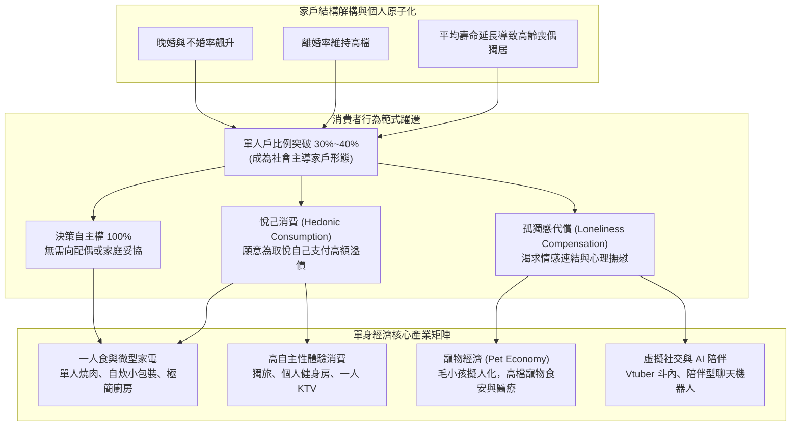

---
{"dg-publish":true,"permalink":"/98/single-economy/","tags":["商業概念","人口學","行銷策略","消費者行為","PMBA"],"dg-note-properties":{"aliases":["單身經濟","Single Economy","獨居經濟","孤獨經濟","Solo Economy"],"tags":["商業概念","人口學","行銷策略","消費者行為","PMBA"]}}
---


# 單身經濟 (Single Economy)

> [!NOTE]
> **核心概念精粹**：單身經濟（Single Economy / Solo Economy）是指由未婚、晚婚、離婚或喪偶所形成的單身與獨居人口（Single-Person Households），其專屬消費行為與生活型態所驅動的龐大商業生態。家庭結構的「微型化」與「個人原子化」，使消費決策重心從「以家庭為單位之妥協消費」轉向**「以自我為中心之悅己消費（Hedonic & Self-Care Consumption）」**，催生了一人食、小容量家電、微型旅宿以及寵物與情感代償經濟的爆發。

---

## 一、 學理淵源：從社會原子化到「一人戶」大浪潮

在社會學家埃里克·克里南伯格（Eric Klinenberg）的經典著作《單身社會（Going Solo）》中指出：單身人口的急遽擴張絕非一時的流行現象，而是現代社會在經濟富足、女性自主意識覺醒、都市化以及通訊技術發達後的**必然結構性轉變**。



---

## 二、 單身消費者的核心行為特徵矩陣

單身消費群體雖然在單次採購規模上小於多口家庭，但其展現出的邊際消費傾向（MPC）與定價容忍度卻顯著更高：

| 消費維度 | 傳統家庭消費模式 | 單身原子化消費模式 | 企業商業模式應對 |
| :--- | :--- | :--- | :--- |
| **決策邏輯** | 集體協商、追求性價比、平攤成本、避免浪費。 | **極致自我中心**：只要我喜歡，貴一點無所謂。 | 打造強烈個人風格與美學溢價，減少家庭促銷捆綁。 |
| **容量與規格** | 大容量量販包裝（Costco 巨型家庭號）。 | **小包裝、單人份、即開即食、零浪費**。 | 推出 100g 迷你真空包裝、單人份即食調理包。 |
| **空間體驗** | 四人至八人圓桌、強調熱鬧聚會。 | **隱私保護、單人隔間、無社交壓力**。 | 設計單人吧台座位、個人包廂、無人自助結帳。 |
| **情感寄託** | 撫育子女、家族親戚往來。 | **寵物當兒女養（毛孩經濟）、虛擬偶像情感投射**。 | 寵物友善空間、毛孩健康壽險、精緻周邊商品。 |
| **時間敏感度** | 週末集中家庭採買、長線旅遊規劃。 | **碎片化即時滿足、說走就走的微度假**。 | 隨選隨送（外送服務）、24 小時無人健身房。 |

---

## 三、 經典企業實戰案例：一人商業模式的極致典範

```carousel

<!-- slide -->
### 1. 日本一蘭拉麵：消滅社交壓力的「味集中座位」
- **洞察**：許多女性與單身消費者想吃拉麵，卻害怕獨自走進充滿大聲吆喝的傳統拉麵店，擔心被他人注視評頭論足。
- **創新設計**：一蘭拉麵首創「味集中座位（Flavor Concentration Booth）」——每個座位皆有獨立木質隔板隔開，面前設有竹簾；顧客透過點餐用紙勾選湯頭濃度、麵條硬度，店員遞上拉麵後立即放下竹簾。
- **結果**：徹底消除了「一人用餐」的社交焦慮與尷尬感，讓顧客全神貫注享受食物，成為全球單身餐飲模式的教科書級標竿。
<!-- slide -->
### 2. 寵物經濟的擬人化爆發（以瑪氏 Mars 寵物為例）
- **背景**：全球單身人口與不婚不育族群激增，傳統育兒開銷大量轉移至寵物身上（「把毛孩當家人疼」）。
- **策略延伸**：全球食品巨頭瑪氏（Mars）大舉收購動物醫院連鎖（如 VCA），將寵物食品從傳統廉價乾飼料，升級為有機鮮食包、無穀處方糧，並推出寵物腫瘤醫療與專屬物理治療。
- **獲利成效**：寵物照護部門的營收與獲利率已超越人類糖果巧克力業務，成為集團抗景氣循環的最強現金牛。
```

---

## 四、 經理人單身經濟策略檢核表（Executive Decision Checklist）

企業在重新審視產品線與行銷通路時，應由決策層檢核下列轉型維度：

- [ ] **一人友善體驗審計（Solo-Friendliness Audit）**：
  - 走進我們的實體門市或登入數位平台時，一位單身顧客是否會感受到「被歧視」或「強烈尷尬」？（例如：強制低消雙人套餐、無單人預約選項）。
- [ ] **規格微型化與防浪費設計（Downsizing Engineering）**：
  - 我們的產品是否仍停留在「一家四口才吃得完/用得完」的陳舊規格？我們是否能透過微型化包裝，換取更高的每公克或每單位毛利？
- [ ] **情感代償與陪伴價值（Emotional Compensation Value）**：
  - 產品除了冷冰冰的物理功能外，是否提供了溫暖、陪伴、無壓力或自我犒賞的情感價值？能否讓下班後疲憊孤獨的單身顧客感受到被理解？
- [ ] **小空間居家家電適配（Small-Footprint Fit）**：
  - 針對套房與小坪數住宅，我們的硬體產品是否具備「體積小巧、多功能合一、高顏值美學」的特質？是否容易收納與清潔？

---

## 五、 關聯概念與知識網絡

* 宏觀人口與社會結構：
  * [[silver-economy_銀髮經濟|銀髮經濟 (Silver Economy)]]：高齡單身社會與長壽孤獨商機
  * [[stay-at-home-economy_宅經濟|宅經濟 (Stay-at-Home Economy)]]：單身獨居驅動的隨選外送與居家娛樂
  * [[K型經濟|K型經濟 (K-Shaped Economy)]]：單身族群的消費兩極化與悅己支出
* 行銷定位與消費者行為：
  * [[Functional_vs_Emotional_Value_功能價值與情緒價值|功能價值與情緒價值]]：單身經濟的情感陪伴溢價
  * [[core-benefit_核心利益|核心利益 (Core Benefit)]]：一人食無拘無束的核心價值追求
  * [[AFBP框架|AFBP 框架 (AFBP Framework)]]：品牌個性（P 維度）與單身自由靈魂的共鳴
  * [[viable-business_好事業|好事業 (Viable Business)]]：高頻次、高留存的單身經濟造血機制
