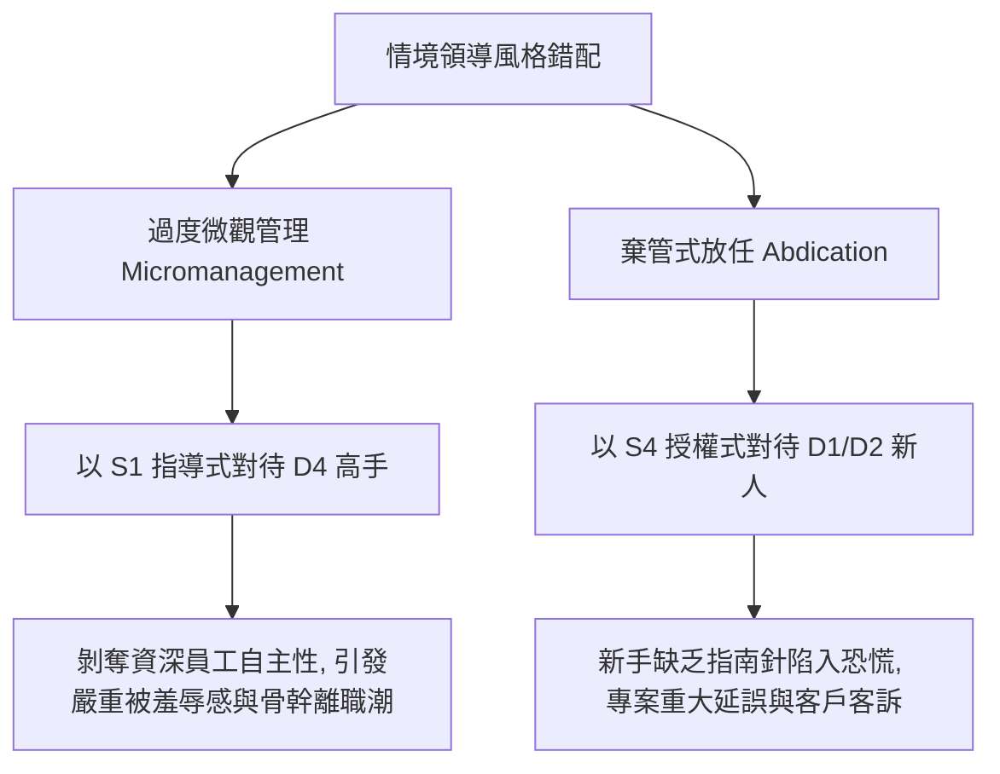

---
{"dg-publish":true,"permalink":"/98/situational-leadership-theory/","tags":["商業概念","領導力","組織行為學","員工發展","人才管理","PMBA"],"dg-note-properties":{"aliases":["情境領導理論","Situational Leadership Theory","SLT","赫西-布蘭查德情境領導","Hersey-Blanchard Model","SLII"],"tags":["商業概念","領導力","組織行為學","員工發展","人才管理","PMBA"]}}
---


# 情境領導理論 (Situational Leadership Theory & Adaptive Influence Architecture)

> **【核心決策摘要】**
> **情境領導理論（Situational Leadership Theory, SLT / SLII）** 是由保羅·赫西（Paul Hersey）與肯·布蘭查德（Ken Blanchard）於 1969 年提出的組織行為學經典理論。其核心哲學在於：**「世界上不存在單一最佳的領導風格（No single best leadership style）」**，卓越領導力取決於領導者行為與**追隨者/部屬的「準備度 / 發展階段（Follower Readiness / Developmental Level, D1~D4）」** 之間的動態適配。領導者必須依據部屬的「**工作能力（Competence）**」與「**工作意願（Commitment）**」，在**指導/任務行為（Task Behavior）** 與 **支持/關係行為（Relationship Behavior）** 兩大維度之間靈活切換於四大風格：**S1 指導式（Directing）**、**S2 教練式（Coaching）**、**S3 支持式（Supporting）** 與 **S4 授權式（Delegating）**。

---

## 1. 概念核心定義與二維行為坐標 (Executive Definition & Coordinates)

### 1.1 核心定義
情境領導模型定義為：**領導者依據特定任務情境下員工的成熟度，動態調適自身對任務結構之規定程度（指導行為）與人際心理撫慰程度（支持行為）之權變影響力歷程**。

```
  關係行為 / 支持行為 (Relationship / Supportive Behavior)
  高 ▲ ────────────────────────────────────────────────────────┐
     │ 【S3 支持式領導 (Supporting)】│ 【S2 教練式領導 (Coaching)】   │
     │ • 低任務、高關係             │ • 高任務、高關係               │
     │ • 共同決策, 傾聽激勵         │ • 說明決策, 雙向溝通, 鼓勵反思 │
     │ • 適用: 【D3 謹慎貢獻者】    │ • 適用: 【D2 幻滅學習者】      │
     ├──────────────────────────────┼────────────────────────────────┤
     │ 【S4 授權式領導 (Delegating)】│ 【S1 指導式領導 (Directing)】  │
     │ • 低任務、低關係             │ • 高任務、低關係               │
     │ • 成果導向, 充分放權         │ • 明確指示, 單向溝通, 緊密監督 │
     │ • 適用: 【D4 獨立高峰者】    │ • 適用: 【D1 熱情初學者】      │
  低 └──────────────────────────────┴────────────────────────────────▶
     低                                                           高
           任務行為 / 指導行為 (Task / Directive Behavior)
```

---

## 2. 追隨者發展階段四級演進模型 (Follower Readiness Levels: D1 ~ D4)

員工在面對一項「具體特定任務」時（準備度是針對任務而言，而非評價個人整體的智力），其發展階段經歷四個典型演進週期：

```
                    ┌─────────────────────────────────────────────────────────┐
                    │               部屬發展階段四維演進圖譜                  │
                    └────────────────────────────┬────────────────────────────┘
                                                 ▼
   【D1 熱情初學者】 ──────▶ 【D2 幻滅學習者】 ──────▶ 【D3 謹慎貢獻者】 ──────▶ 【D4 獨立高峰者】
    (Low Comp, High Comm)     (Low Comp, Low Comm)      (High Comp, Var Comm)     (High Comp, High Comm)
   ─────────────────────────────────────────────────────────────────────────────────────────────
   • 剛接新任務, 雄心勃勃     • 遭遇挫折, 發現任務困難  • 技能純熟, 能獨當一面    • 具備專家級高超能力
   • 缺乏經驗與專業技巧       • 熱情消退, 意願跌入谷底  • 缺乏自信或動力波動      • 主動負責, 具高度承諾
   • 渴望明確方向與指令       • 渴望方向指引與心理打氣  • 渴望被傾聽與共同參與    • 渴望自主決策與信任放權
```

### 領導風格與部屬準備度黃金匹配矩陣

| 部屬發展階段 | 工作能力 (Competence) | 工作意願 (Commitment) | 最佳匹配領導風格 | 核心行為要領 |
| :--- | :---: | :---: | :--- | :--- |
| **D1: 熱情初學者** | **低（缺乏技能）** | **高（熱情高漲）** | **[[leadership-6_指導式領導|S1 指導式 (Directing)]]** | 告訴他「要做什麼、何時完成、步驟為何」；切忌放牛吃草。 |
| **D2: 幻滅學習者** | **低至中（略懂皮毛）** | **低（受挫灰心）** | **[[leadership-5_教練式領導|S2 教練式 (Coaching)]]** | 雙向溝通；除指示流程外，詳細解釋「為什麼」，修復其受損的自信心。 |
| **D3: 謹慎貢獻者** | **高（經驗豐富）** | **波動（缺乏信心/倦怠）** | **[[leadership-4_支持式領導|S3 支持式 (Supporting)]]** | 減少任務指示，主管扮演共鳴箱；多提問「你覺得該怎麼做？」，給予讚賞。 |
| **D4: 獨立高峰者** | **高（專家水準）** | **高（主動當責）** | **[[leadership-3_授權式領導|S4 授權式 (Delegating)]]** | 明確成果目標後大膽放權；不干涉具體執行路徑，主管擔任後盾。 |

---

## 3. 情境領導的兩大經典致命錯配陷阱 (The Mismatch Traps)



1. **微觀管理陷阱（The Micromanagement Trap: S1 applied to D4）**：
   領導者自身缺乏安全感或習慣親力親為，對已具備頂尖能力的資深經理人進行細微末節的事事插手與緊密盯人。這會迅速扼殺團隊的主動當責意識，傳遞「我不信任你」的毒性信號。
2. **棄管式授權陷阱（The Abdication Trap: S4 applied to D1）**：
   領導者誤將「授權」當作「甩手掌櫃」，在新人尚未掌握業務規範前便全面放任。新人因無法承受未知風險而陷入焦慮崩潰，最終造成不可逆的業務損失。

---

## 4. 關聯概念與延伸閱讀 (Cross References)

- [[transformational-leadership_轉換型領導]]：激發員工超越個人利益的願景引領。
- [[transactional-leadership_交易型領導]]：基於契約與條件式酬賞的交換領導。
- [[contingency-leadership-theory_權變領導理論]]：費德勒 LPC 領導權變模型對比。
- [[leadership-6_指導式領導]]：S1 風格深度卡片。
- [[leadership-5_教練式領導]]：S2 風格深度卡片。
- [[leadership-4_支持式領導]]：S3 風格深度卡片。
- [[leadership-3_授權式領導]]：S4 風格深度卡片。
- [[corporate-life-cycle_企業生命週期]]：組織生命週期各階段對領導風格的動態需求。
- [[home]]：PMBA 知識庫首頁與模組導航。