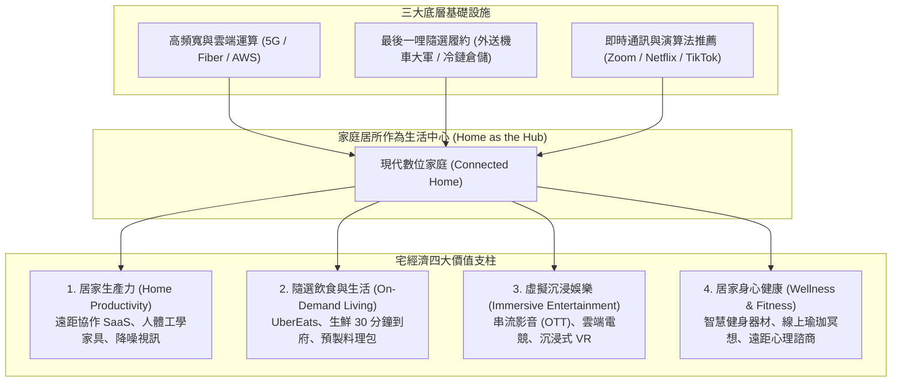

---
{"dg-publish":true,"permalink":"/98/stay-at-home-economy/","tags":["商業概念","數位轉型","平台經濟","消費者行為","PMBA"],"dg-note-properties":{"aliases":["宅經濟","Stay-at-Home Economy","居家經濟","居宅經濟","Homebody Economy"],"tags":["商業概念","數位轉型","平台經濟","消費者行為","PMBA"]}}
---


# 宅經濟 (Stay-at-Home Economy)

> [!NOTE]
> **核心概念精粹**：宅經濟（Stay-at-Home Economy / Homebody Economy）是指以「家庭與私人居所」為核心場景，依託於高速行動寬頻、雲端運算、演算法推薦與最後一哩隨選配送（On-Demand Logistics）基礎設施，將工作、娛樂、飲食、社交與健身等生活需求高度整合並遠端完成的數位化商業生態。它不僅是特殊危機下的應急避風港，更引發了人類工作與生活型態的**結構性永久典範轉移**。

---

## 一、 學理演進與居家數位生態圈

宅經濟的本質並非單純的「網購」，而是**「居所功能從純粹休息睡眠，擴展為全功能的生產與娛樂綜合體」**。



---

## 二、 宅經濟的四大商業驅動引擎與運作模式

| 商業板塊 | 核心用戶價值訴求 | 獲利模式與經濟學特徵 | 典型代表與工具 |
| :--- | :--- | :--- | :--- |
| **遠距工作與生產力<br>(Remote Work)** | 擺脫漫長通勤痛苦、隨時隨地多工協同、彈性工時。 | B2B SaaS 訂閱制（按人頭月付費）、高續約留存率。 | Zoom、Slack、Microsoft Teams、Notion。 |
| **隨選即時生活支援<br>(Quick Commerce)** | 足不出戶即可獲取生活物資，極致節省時間精力。 | 雙邊平台抽成（Take Rate）、配送費與平台廣告收益。 | 外送平台（Uber Eats、Foodpanda）、生鮮倉儲直送。 |
| **訂閱串流娛樂<br>(Streaming OTT)** | 隨選隨看無廣告、高畫質個人化演算法推薦。 | B2C 經常性訂閱收入（ARR）、內容排他性護城河。 | Netflix、Disney+、Spotify、YouTube Premium。 |
| **居宅智慧健身<br>(Connected Fitness)** | 隱私自主、免去健身房人擠人與教練推銷騷擾。 | 高單價硬體銷售 + 每月內容課程訂閱費（雙重收費模式）。 | Peloton、智慧健身鏡、Apple Fitness+。 |

---

## 三、 經典企業實戰案例：Netflix 的隨選串流帝國 vs Peloton 的後疫情退潮

```carousel

<!-- slide -->
### 1. 永久性結構勝出：Netflix 的飛輪壁壘
- **洞察**：消費者對優質影音內容的需求是無限的，而傳統有線電視的定時播放與廣告插播充斥摩擦。
- **飛輪運作**：Netflix 透過數億全球訂閱用戶的經常性現金流，支撐每年超過 150 億美元的自製內容預算（如《怪奇物語》、《魷魚遊戲》）；內容越豐富，吸納新用戶越多，用戶流失率（Churn Rate）越低。
- **跨週期韌性**：即便疫情結束、大眾回歸戶外，Netflix 的家庭娛樂黏著度依然穩固，成為不可逆的生活必需品。
<!-- slide -->
### 2. 週期性錯判警訊：Peloton 的產能過載災難
- **過度樂觀**：Peloton 在疫情期間因健身房關閉而銷量暴增數倍，管理層誤將「短期暴增的封鎖需求」視為「永久性不可逆的長期成長」；
- **盲目擴張**：大舉收購工廠、簽約數百萬平方英尺倉庫；
- **雪崩式反噬**：當實體健身房重新開放時，昂貴的飛輪車（單價破 2,000 美元）需求瞬間急凍。巨額的固定折舊與庫存跌價將公司推入數十億美元虧損泥淖，創辦人被迫辭職。
```

---

## 四、 經理人宅經濟策略檢核表（Executive Decision Checklist）

企業在評估居家數位生活場景時，必須區分「暫時性泡沫」與「永久性習慣改變」：

- [ ] **結構性習慣 vs 週期性泡沫辨識（Habit vs Bubble Test）**：
  - 我們所享受的居家需求爆發，究竟是用戶在體驗到效率提升後「再也回不去」的習慣性變遷，還是僅因外界限制解除後就會迅速消退的暫時性反彈？
- [ ] **雙向混合適應力（Hybrid Flexibility）**：
  - 產品架構是否具備「混合彈性（Hybrid Capability）」？當消費者同時穿梭於「居家（In-Home）」與「戶外/辦公室（On-the-Go）」時，我們的數位帳號、數據進度與服務體驗能否實現無縫同步？
- [ ] **訂閱單元經濟健康度（Subscription Retention Health）**：
  - 用戶在前 3 個月試用期結束後，月留存率是否維持在 90% 以上？我們的產品是否成為用戶每個月信用卡帳單上「捨不得取消」的必備項目？
- [ ] **履約最後一哩成本控制（Unit Logistics Viability）**：
  - 針對配送到府的實體商品，每單的包裝、揀貨與運費成本是否能被客單價完全覆蓋？是否會因為單量激增反而擴大虧損？

---

## 五、 關聯概念與知識網絡

* 宏觀生活形態與趨勢：
  * [[single-economy_單身經濟|單身經濟 (Single Economy)]]：單身獨居族群推升隨選外送與居家娛樂需求
  * [[silver-economy_銀髮經濟|銀髮經濟 (Silver Economy)]]：高齡長者的居家安全照護與在宅醫療
  * [[K型經濟|K型經濟 (K-Shaped Economy)]]：居家數位化高薪階層與外送體力勞動者的結構分化
* 商業模式與策略工具：
  * [[platform-envelopment_平台包夾|平台包夾 (Platform Envelopment)]]：隨選外送與串流平台跨界整合生態圈
  * [[network-effects_網絡效應|網絡效應 (Network Effects)]]：雙邊隨選履約平台之規模護城河
  * [[switching-costs_轉換成本|轉換成本 (Switching Costs)]]：居家訂閱制與數據同步之用戶鎖定
  * [[viable-business_好事業|好事業 (Viable Business)]]：避免陷入 Peloton 式產能狂躁的穩健造血機制
