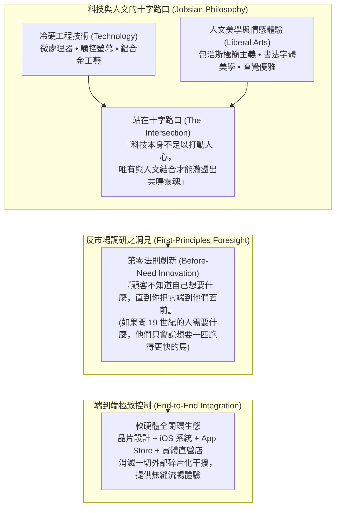

---
{"dg-publish":true,"permalink":"/98/steve-jobs/","tags":["商業概念","企業領袖","產品設計","創新管理","PMBA"],"dg-note-properties":{"aliases":["賈伯斯","Steve Jobs","史蒂夫·賈伯斯","蘋果創辦人"],"tags":["商業概念","企業領袖","產品設計","創新管理","PMBA"]}}
---


# 賈伯斯 (Steve Jobs)

> [!NOTE]
> **核心概念精粹**：史蒂夫·賈伯斯（Steve Jobs, 1955–2011），蘋果公司聯合創辦人，被公認為當代商業史上最偉大的產品願景家與創新領袖。他在個人電腦（Mac）、動畫電影（Pixar）、數位音樂（iPod/iTunes）、智慧手機（iPhone）、平板電腦（iPad）與數位零售（Apple Store）六大產業掀起了革命性的顛覆。賈伯斯的核心哲學在於**「站在科技與人文藝術的十字路口（The Intersection of Technology and Liberal Arts）」**，堅持硬體、軟體與服務的端到端極致整合，以包浩斯極簡美學與「現實扭曲力場」重塑了現代數位生活。

---

## 一、 學理定位：科技與人文交匯處的「第零法則」

賈伯斯徹底打破了傳統市場調研（Focus Groups）的教條，建立了獨特的產品哲學：



---

## 二、 賈伯斯管理哲學四大核心維度矩陣

| 核心維度 | 哲學內涵與實務運作 | 典型戰略體現 | 商業對抗範式 |
| :--- | :--- | :--- | :--- |
| **1. 極致減法與聚焦<br>(Focus & Subtraction)** | 「決定『不去做什麼』，與決定『去做什麼』同等重要。」簡約是複雜的極致昇華。 | 1997 年回歸蘋果時，一刀砍掉 70% 繁雜產品線，聚焦四象限（專業/消費；桌上型/筆記型）。 | 反對傳統消費電子巨頭（索尼、三星）狂推數十種機型進行機海戰術。 |
| **2. 現實扭曲力場<br>(Reality Distortion Field)** | 融合魅力、口才、堅定意志與追求完美的偏執，迫使團隊突破看似不可逾越的物理極限。 | 迫使康寧玻璃（Corning）在 6 個月內量產出過去從未商用過的「大猩猩防刮玻璃（Gorilla Glass）」給初代 iPhone。 | 破除工程師習慣性的「這在技術上不可能做出來」的避險藉口。 |
| **3. 軟硬體封閉一體化<br>(Closed-Loop Integration)** | 為了追求極致的使用者體驗，必須同時掌控硬體、作業系統、應用程式與周邊配件。 | 拒絕向外部 PC 廠商授權 Mac OS；打造封閉但極度安全流暢的 iOS 圍牆花園（Walled Garden）。 | 形成與[[bill-gates_比爾蓋茲|微軟比爾·蓋茲]]「開放授權、硬體碎片化」模式長達數十年的世紀對決。 |
| **4. 體驗即行銷<br>(Retail as an Experience)** | 零售店不是用來賣東西的倉庫，而是用來傳遞品牌文化、提供尊榮服務的情感殿堂。 | 創立 Apple Store 直營店，引進「天才吧（Genius Bar）」免費技術諮詢，坪效高居全球零售業之冠。 | 徹底顛覆傳統電子產品依賴 Best Buy、燦坤等第三方大賣場殺價代理的陳舊模式。 |

---

## 三、 經典企業實戰案例：初代 iPhone 發表會與「三大產品合一」

```carousel

<!-- slide -->
### 1. 2007 年舊金山 Macworld 的世紀演講
- **傳奇鋪陳**：賈伯斯走上舞台宣布：「今天，我們要推出三款革命性產品：第一款是寬螢幕觸控 iPod，第二款是革命性的行動電話，第三款是突破性的網際網路通訊裝置……這不是三件獨立的設備，而是一件產品，我們稱它為 iPhone！」；
- **顛覆本質**：初代 iPhone 徹底消滅了當時黑莓（BlackBerry）與諾基亞引以為傲的實體塑膠鍵盤，以多點觸控（Multi-Touch）與整面玻璃螢幕，重新定義了人類與數位世界交互的底層邏輯。
<!-- slide -->
### 2. 1997 年「非同凡想（Think Different）」的文化重生
- **絕境回歸**：1997 年蘋果瀕臨破產，賈伯斯以 1 美元年薪回歸；
- **靈魂廣告**：他親自配音推出了震撼全球的黑白形象廣告「致瘋狂者（Here's to the crazy ones）」——致敬愛因斯坦、甘地、約翰·藍儂、畢卡索；
- **文化奠基**：向全體員工與消費者莊嚴宣告：蘋果是一家為「敢於標新立異、試圖改變世界的人」打造工具的公司；這場文化重塑直接點燃了隨後誕生 iPod、iPhone 與三兆美元市值的黃金復興。
```

---

## 四、 經理人賈伯斯式產品領導力檢核表（Executive Decision Checklist）

在進行新產品定義、品牌溝通或跨界創新時，領導者應依序檢驗：

- [ ] **痛點直覺 vs 調研依賴檢驗（Intuitive Foresight Test）**：
  - 我們的創新專案是否過度依賴毫無想像力的調查問卷？我們是否有能力深入洞察消費者甚至「尚未意識到、但一旦看見便無法自拔」的潛在體驗渴望？
- [ ] **極致減法與捨棄勇氣（The Courage of Subtraction）**：
  - 產品介面與功能清單中，有哪些是工程師自嗨、實際上只有不到 5% 用戶使用的多餘按鈕？我們是否敢於砍掉這些雜訊，讓產品呈現極簡優雅？
- [ ] **端到端無縫體驗鏈（End-to-End Frictionless Flow）**：
  - 從包裝盒開箱的第一秒、手指接觸機身的外觀手感，到軟體首次開機引導，整個歷程是否存在任何破壞美感的停頓與割裂？
- [ ] **追求卓越的偏執標準（A-Player Talent Density）**：
  - 組織內部是否容忍平庸的妥協文化？領導者是否敢於像賈伯斯一樣，堅持只錄用熱愛產品的「A 級頂尖人才」，並果斷清除平庸的「B 級與 C 級員工」？

---

## 五、 關聯概念與知識網絡

* 領袖博弈與傳奇人物：
  * [[bill-gates_比爾蓋茲|比爾蓋茲 (Bill Gates)]]：PC 時代軟體授權與蘋果封閉生態之世紀博弈對手
  * [[elon-musk_馬斯克|馬斯克 (Elon Musk)]]：接棒賈伯斯挑戰物理極限之當代狂人
  * [[can-zhao-quan_參照權|參照權 (Referent Power)]]：現實扭曲力場與追求卓越之領袖感召力
  * [[great-company_好公司|好公司 (Great Company)]]：以極致文化造就基業長青之全球第一市值帝國
* 策略與商業模式：
  * [[disruptive-innovation_破壞式創新|破壞式創新 (Disruptive Innovation)]]：智慧手機對傳統相機、GPS、隨身聽與功能機之毀滅性收割
  * [[Nothing to Lose|無物可失 (Nothing to Lose)]]：1997 年背水一戰砍掉 70% 業務之極限決策
  * [[Functional_vs_Emotional_Value_功能價值與情緒價值|功能價值與情緒價值]]：蘋果由工具理性躍升至生活風格與身份認同之溢價
  * [[great-idea_好創意|好創意 (Great Idea)]]：從單點創意昇華為跨界百億商業機會之典範
