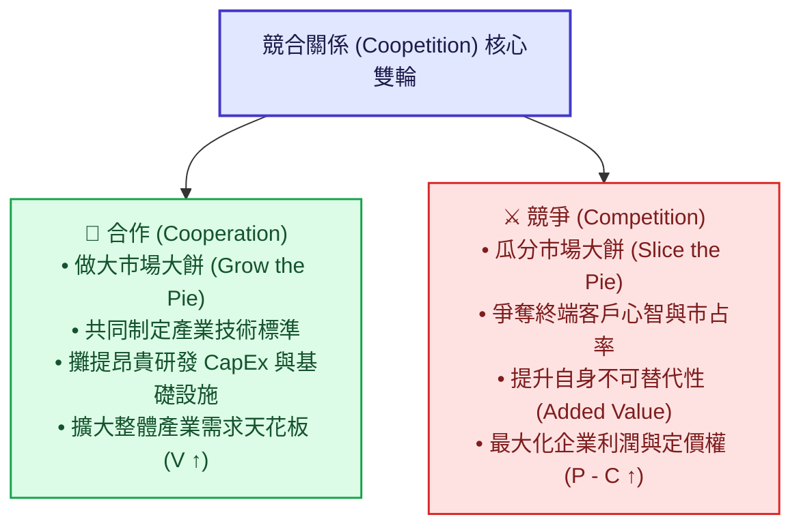
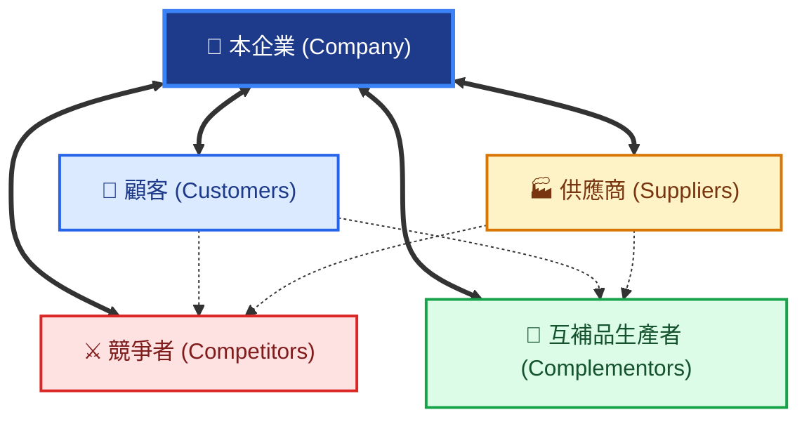
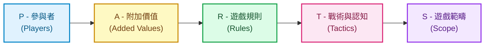
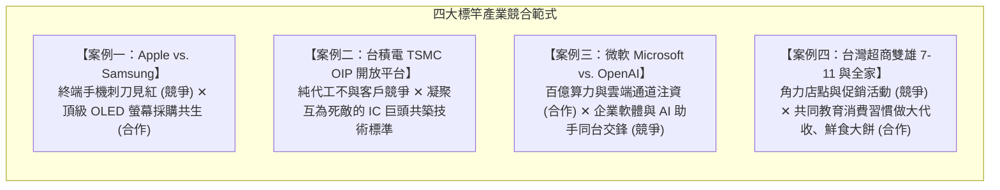
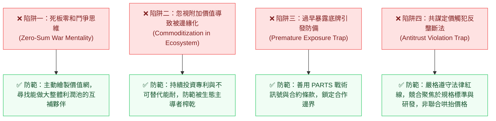

---
{"dg-publish":true,"permalink":"/98/strategy-coopetition-coopetition/","tags":["商業概念","賽局理論","策略管理","產業分析","商業模式","競爭策略","PMBA"],"dg-note-properties":{"aliases":["Coopetition 競合關係","競合關係","競合戰略","競合策略","競合理論","Coopetition","PARTS模型","PARTS架構","價值網模型","Value Net"],"tags":["商業概念","賽局理論","策略管理","產業分析","商業模式","競爭策略","PMBA"]}}
---

# 競合關係 (Coopetition / 競合戰略與價值網架構)

> **商管核心價值**：  
> 「商業並非純粹非贏即輸的戰爭。最成功的企業，懂得在『做大餅』時與夥伴深度合作，在『分大餅』時展現鋒利的競爭實力。」——亞當·布蘭登伯格（Adam M. Brandenburger）與貝利·內勒巴夫（Barry J. Nalebuff）  
> 
> 在傳統策略管理中，波特五力（Five Forces）常使經理人陷入「非敵即友、殘酷掠奪」的**零和博弈（Zero-Sum Game）偏誤**。而由哈佛與耶魯學者提出的 **競合關係（Coopetition = Cooperation 合作 + Competition 競爭）** 理論，奠基於合作賽局理論（Cooperative Game Theory），主張現代商業競爭是「正和（Positive-Sum）與動態共生」的體系。經理人的終極智慧，在於善用 **價值網（Value Net）** 與 **PARTS 戰略槓桿**，主動重塑賽局規則，化敵為友，開創全新利潤池。

---

## 一、 核心定義與理論基石

### 1.1 學術與實務定義之演進
- **競合關係（Coopetition）** 一詞最初由 Novell 創辦人 Ray Noorda 於 1990 年代初提出，後經由哈佛商學院教授 **Adam M. Brandenburger** 與耶魯管理學院教授 **Barry J. Nalebuff** 於 1996 年出版經典巨著《Co-opetition（競合策略）》，正式奠立了現代策略管理學的理論根基。
- **理論核心本質**：
  1. **做大餅（Pie-Growing / 合作正和維度）**：在市場萌芽、標準制定或面對外部共同威脅時，企業與競爭同業、互補者深度協同，擴大整體產業的「總創造價值（$V - C$）」。
  2. **分大餅（Pie-Slicing / 競爭利益維度）**：在交易實現與利益劃分時，企業憑藉自身的不可替代性（附加價值 Added Value）爭奪利潤份額（$P - C$）。

---

### 1.2 破除傳統「波特五力」的零和盲點

| 比較維度 | 波特五力分析 (Porter's Five Forces) | 競合理論與價值網 (Coopetition & Value Net) |
| :--- | :--- | :--- |
| **底層賽局假設** | **零和博弈（Zero-Sum Game）**：市場利潤池固定，買賣方互相殺價，對手非贏即輸。 | **變和 / 正和博弈（Variable/Positive-Sum）**：利潤池可被共同做大，亦敵亦友。 |
| **對手角色認定** | 將所有外部實體視為威脅者（進入者、替代品、同業掠奪）。 | 同業在特定領域可為「擴大需求的盟友」，互補品業者是至關重要的共創者。 |
| **策略核心焦點** | 構築靜態進入壁壘，防禦利潤遭侵蝕。 | 動態重塑賽局參與者、遊戲規則與互補生態系。 |
| **忽視的關鍵力量** | **完全忽略「互補品（Complementors）」**的龐大正面價值。 | **將互補者提升為核心核心角色**，建立對稱雙邊市場。 |

---

## 二、 價值網模型（Value Net Framework）

Brandenburger 與 Nalebuff 提出**價值網（Value Net）**架構，精準繪製了影響企業價值創造與捕獲的四大基本節點：

### 2.1 價值網四大節點與對稱性原理（Symmetry Principle）

1. **垂直軸（交易流動對稱）**：
   - **顧客（Customers）**：以金錢換取產品，追求顧客剩餘極大化；
   - **供應商（Suppliers）**：以資源換取貨款，追求供應商剩餘極大化。
2. **水平軸（外部影響對稱）**：
   - **[[existing-competitors_現有競爭者|競爭者 (Competitors)]]**：
     - *顧客端定義*：當顧客擁有對手的產品時，會**降低**對本公司產品的願付價格（如 Apple iOS vs. Google Android）；
     - *供給端定義*：當供應商服務對手時，向本公司供貨的意願或資源投入會降低。
   - **[[complementary-goods_互補品|互補者 (Complementors)]]**：
     - *顧客端定義*：當顧客擁有對手的產品時，會**顯著提升**對本公司產品的願付價格（如 Intel CPU ＋ Microsoft Windows；AI GPU ＋ 水冷散熱模組；電動車 ＋ 超級充電站）；
     - *供給端定義*：當供應商同時服務互補者時，能因規模效應使本公司的零組件採購成本下降。

> 📌 **商管深度洞察：角色的動態流動**  
> 企業嚴禁給對手貼上永久死標籤。在實務上，同一個企業在不同市場、不同時間點，**往往同時身兼「競爭者」與「互補者」**（如三星既是蘋果在智慧手機的死敵，又是蘋果頂級 OLED 螢幕的最核心互補供應商）。

---

## 三、 PARTS 賽局戰略操作工具箱

經理人若想跳脫被動競爭，可運用 PARTS 模型主動改變商業賽局的五大槓桿：

### 1. P（Players 參與者）：重塑賽局玩家
- **引入互補者**：主動扶植外部生態系。例如蘋果開放 iOS App Store，引入數百萬軟體開發者作為互補者，推升 iPhone 價值。
- **引入競爭者**：當客戶害怕被單一獨占供應商「敲竹槓（Hold-up）」時，主動開放第二供應商（Second Source，如早年 Intel 授權 AMD 生產 x86 晶片以贏得 IBM 採購），做大市場。
- **補貼進入（Subsidize Entry）**：買方主動補貼新進供應商以打破既有供應商的寡占聯盟。

### 2. A（Added Values 附加價值）：拉大自身不可替代性
賽局理論中，**企業所能獲取的最大利潤，絕對無法超過該企業為賽局帶來的「附加價值」**：

$$\text{企業 } X \text{ 的附加價值} = (\text{有 } X \text{ 存在時全體創造的總價值}) - (\text{沒有 } X \text{ 時全體能創造的總價值})$$

- 若企業無可替代（如台積電 2nm 先進製程），一旦失去台積電，全球 AI 算力大餅崩塌 80%，因此台積電享有極高的定價話語權。
- 若企業同質化，沒有你市場照樣運轉，附加價值即為 0，利潤必然被壓至損益平衡邊緣。

### 3. R（Rules 遊戲規則）：以契約機制改變賽局平衡
- **最惠國待遇條款（Most-Favored-Nation, MFN）**：保證給予該客戶全市場最低價格。表面上保護買方，實質上**消除了賣方針對個別客戶悄悄發動價格戰降價的動力**，維持了產業的穩定利潤。
- **匹配競爭者降價條款（Meet-the-Competition Clause, MCC）**：若其他同業降價，本企業承諾立刻跟進。這向競爭者發出強烈威懾訊號——「你降價搶不到我任何客戶，只會一起死」，從而瓦解對手的價格戰意圖。
- **產能保證或買斷條款（Take-or-Pay）**：鎖定客戶長期承諾，消除產能擴建沉沒風險。

### 4. T（Tactics 戰術與認知管理）：管理預期與策略訊號
- 賽局的關鍵在於「對手相信什麼」。
- **戰略訊號（Strategic Signaling）**：提前 2 年公開宣布巨額建廠投資或新技術發表，讓競爭對手預期到未來市場將面臨產能過剩，從而主動放棄進入或撤銷擴產計畫。

### 5. S（Scope 遊戲範疇）：連結或隔離賽局
- **擴大範疇（Multi-market Contact）**：將本國市場與海外市場連結。若對手在我的主戰場發動惡意價格戰，我就在對手的後花園（高利潤本土市場）發動反擊，形成相互威懾。
- **隔離賽局**：將高階專案市場與大眾零售市場以不同子品牌隔開，避免大眾市場的價格戰污染高階品牌的利潤池。

---

## 四、 跨產業標竿企業競合實戰深度剖析

### 4.1 案例一：蘋果（Apple）vs. 三星（Samsung）——頂級旗艦的「競合雙重奏」
- **競爭端（激烈廝殺）**：在智慧型手機、智慧手錶終端市場爭奪全球市占率第一寶座，多次在跨國法院發動百億美元專利訴訟，廣告頻繁互嘲。
- **合作端（深度共生）**：
  - 三星是全球唯一能大規模穩定供應高良率超高解析度 OLED 螢幕的巨頭；
  - 蘋果長期將 iPhone 旗艦螢幕數千萬片訂單交給三星顯示器，三星每年從蘋果賺取數十億美元淨利潤；
  - **策略雙贏**：蘋果獲得無可挑剔的頂級硬體體驗，三星獲得巨大訂單以攤平昂貴面板面板廠的 CapEx 折舊。

---

### 4.2 案例二：台積電（TSMC）——「純晶圓代工」催生的全球競合平台
- **策略定位**：張忠謀堅持「Pure-play Foundry（純晶圓代工）」，承諾絕不推出自研晶片品牌，徹底消除與客戶爭利的代理人疑慮。
- **OIP 生態系重塑競合**：
  - 全球晶片巨頭（Apple、NVIDIA、AMD、Qualcomm、MediaTek）在終端市場彼此競爭激烈；
  - 但在台積電的 OIP（開放創新平台）上，大家使用相同的 EDA 設計規則、相同的 CoWoS 先進封裝標準，**共同成為做大半導體先進製程市場的互補夥伴**；
  - 台積電將原本零和的晶片戰場，重構為全行業圍繞台積電標準運轉的巨型正和生態系。

---

### 4.3 案例三：微軟（Microsoft）與 OpenAI——巨頭與新創的競合博弈
- **合作做大餅**：
  - 微軟向 OpenAI 投資逾百億美元，並獨家提供 Azure 龐大算力基礎設施；OpenAI 則將先進 GPT 模型技術優先授權微軟整合進 Windows、Office Copilot。
- **競爭分大餅**：
  - OpenAI 推出 ChatGPT Enterprise，直接切入微軟守護的跨國企業客戶市場；
  - 微軟為了避免被 OpenAI 技術「卡脖子」，同時自研小型語言模型（Phi 系列）、挖角 DeepMind 創辦人組建 Microsoft AI，並投資 Mistral 等開源模型以維持賽局主動權。

---

### 4.4 案例四：台灣超商雙雄（統一超 7-Eleven vs. 全家 FamilyMart）
- **合作面**：共同推動台灣消費者養成「在超商解決三餐（鮮食便當）、代收水電稅單、店到店寄取包裹、現煮研磨咖啡」的生活方式，將台灣超商產業由單純雜貨店推升為年產值逾 4,000 億的生活樞紐。
- **競爭面**：在精華轉角店面搶租、App 會員點數生態圈（OPENPOINT vs. 全家點數）及自有鮮食研發上展開毫米級的精準博弈，維持健康的「雙寡占 333 獲利結構」。

---

## 五、 經理人常見四大認知陷阱與實務防範

### 1. 死板零和鬥爭思維（Zero-Sum War Mentality）
- **現象**：許多傳統經理人認為「只要對手賺錢，就等於我賠錢」，執迷於割喉價格戰或阻撓同業，最終兩敗俱傷。
- **解法**：主動引入價值網思維，在研發共通標準、教育新興市場及採購非核心原料上攜手合作，將資本集中於最關鍵的差異化戰場。

### 2. 忽視自身附加價值導致被生態「吃乾抹淨」
- **現象**：盲目加入巨頭的生態系（如依附於 Apple 或大型電商平台），自身產品高度同質化，缺乏核心護城河。
- **解法**：隨時檢視自身在賽局中的「不可替代性」。一旦發現自己的附加價值趨近於零，必須果斷轉型或開闢專屬利基，避免淪為巨頭生態系隨時可拋棄的廉價耗材。

---

## 六、 課程講義與模組網絡無縫對接

本概念卡片橫跨並貫穿 PMBA 學程之核心產業分析、商業模式與賽局戰略模組：

### 📚 官方教材與模組講義深度對接

1. **《產業分析與投資策略》官方教材對接**：
   - 📖 **Class 3 講義** ➔ [[04_主題選修/12_產業分析與投資策略/02_模組筆記/Module_1_總論與架構/M1-6_產業分析模式與九大分析工具矩陣|M1-6 產業分析模式與九大分析工具矩陣]]：
     - 深度解構模式六：**「價值網分析（Value Net Framework）」**四大角色（顧客、供應商、競爭者、互補品）與 PARTS 賽局戰略工具箱。
   - 📖 **Class 1 講義** ➔ [[04_主題選修/12_產業分析與投資策略/02_模組筆記/Module_1_總論與架構/M1-3_產業獲利結構差異與十大經典理論|M1-3 產業獲利結構差異與十大經典理論]]：
     - 十大經典理論之**「賽局理論（Game Theory）」**——分析寡占市場中的策略互賴與正和競合。
   - 📖 **Class 2 講義** ➔ [[04_主題選修/12_產業分析與投資策略/02_模組筆記/Module_1_總論與架構/M1-5_波特五力分析與量化架構|M1-5 波特五力分析與量化架構]]：
     - 批判波特五力之「靜態零和博弈偏誤」，確立互補品生產者在打破利潤天花板上的戰略樞紐地位。

2. **《創業與企業財務策略》官方教材對接**：
   - 📖 **Class 4 講義** ➔ [[04_主題選修/10_創業與企業財務策略/02_模組筆記/Module_1_創新思維與商業模式/M1-9_商業模式畫布架構與價值主張設計|M1-9 商業模式畫布架構與價值主張設計]]：
     - 商業模式畫布九大模組之**「關鍵合作夥伴（Key Partnerships）」**——透過策略聯盟、非競爭者合資與競合共生降低新創不確定性。
   - 📖 **Class 4 講義** ➔ [[04_主題選修/10_創業與企業財務策略/02_模組筆記/Module_1_創新思維與商業模式/M1-10_七大市場力量與商業戰略價值公式|M1-10 七大市場力量與商業戰略價值公式]]：
     - 七大市場力量之「網絡效益（Network Economies）」——雙邊平台網絡夥伴的競合飛輪。
   - 📖 **Class 2 講義** ➔ [[04_主題選修/10_創業與企業財務策略/02_模組筆記/Module_1_創新思維與商業模式/M1-4_創意思考工具與設計思考方法|M1-4 創意思考工具與設計思考方法]]：
     - **「兩全思維（Trade-On Thinking）」**——破除競爭與合作非黑即白的傳統對立二分法。

---

### 🔗 核心概念原子卡片雙向鏈結

- **價值創造與博弈體系**：
  - [[value-net_價值網]]（顧客、供應商、競爭者、互補品四大角色對稱網絡）
  - [[complementary-goods_互補品]]（提升顧客對主產品願付價格 WTP 的共創夥伴）
  - [[competitive-advantage_競爭優勢]]（以獨特活動配適與附加價值拉開超額經濟租金）
  - [[vpc-value-price-cost_價值價格成本分析]]（在做大 $V - C$ 的同時，精準防禦並切分 $P - C$）
- **競爭與策略分析體系**：
  - [[competitive-matrix_競爭矩陣]]（多維動態競爭定位與空白區發掘）
  - [[differentiation-strategy_差異化策略]] ｜ [[cost-leadership-strategy_成本領導策略]]
  - [[economic-moat_經濟護城河]] ｜ [[switching-costs_轉換成本]]
- **財務績效與資本評價體系**：
  - [[return-on-invested-capital_資本投入報酬率]]（透過生態圈協同降低 CapEx 投資，推升 ROIC）
  - [[cash-switching-cycle_現金轉換週期]] ｜ [[total-asset-turnover-ratio_總資產週轉率]]
